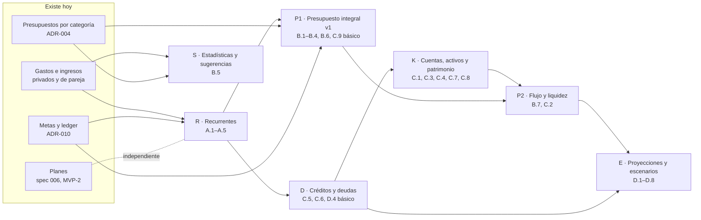

# Análisis de la propuesta de planificación financiera integral (sección 6)

**Estado:** análisis del gestor, **para decisión de los fundadores** (25 de
noviembre de 2026). **No es una decisión, no amplía el alcance y no es
autoridad.** Analiza `docs/propuestas/planificacion-financiera-integral.md` (en
adelante, «la propuesta»), sus bloques provisionales A–D y las precisiones de su
§8. No modifica el maestro, los ADR, la spec 006 ni el alcance de MVP-1. Donde
este documento recomienda algo, decide quien corresponde: los fundadores.

**Datos:** todas las cifras son **ficticias**. Las que no vienen de la propuesta
se inventaron aquí solo para ilustrar un mecanismo.

**Límites del análisis:** solo documentación, durante el gate de MVP-1 (spec 005;
decisión 25.5). Sin código, migraciones ni cambios de alcance. Las afirmaciones
sobre el modelo real salen de leer `supabase/migrations/` y `src/domain/` en
`main` (`598be13`).

---

## 0. Resumen ejecutivo

**Veredicto.** La propuesta es coherente con la visión de Juntia («lo que gastamos
y lo que apartamos», maestro §2.1) y se puede construir **por capas, cada una útil
por sí sola**. Pero no es una ampliación de MVP-2: es una línea de producto nueva.
Hoy Juntia sabe **qué pasó** (gastos, ingresos privados, repartos, metas). La
propuesta añade dos dimensiones que no existen en ninguna tabla: **el tiempo
futuro** (lo previsto, bloques A, B y D) y **la posición** (cuentas, deudas y
activos, bloque C).

**Lo que ya existe o está previsto.** De las 29 capacidades (A.1…D.8), **ninguna
existe completa**. **Tres** tienen una base real que cubre buena parte (B.2, B.3 y
C.9), apoyadas en metas con ledger, presupuestos por categoría, el uso de meta
enlazado a un gasto y `goal_type = 'emergency'`. **Cuatro** están contempladas en
el backlog o en el maestro (A.1, B.5, B.6 y, en parte, D.5). **El resto es
nuevo.** El
hallazgo más útil: **las provisiones (B.3) caben casi enteras en el motor de
metas actual.** Pagar el SOAT con una meta ya produce un solo gasto real más un
uso de meta, sin doble conteo (DEC-G04; ADR-010).

**Orden recomendado** (§8 de este documento), que ajusta el de la propuesta §8.2
en un punto:

1. **Planes** (spec 006), sin cambios.
2. **Recurrentes y calendario** (bloque A). Incluye las filas 3 y 7 del backlog.
3. **Presupuesto integral v1** (bloque B **sin liquidez**). Sube por encima de
   deudas y patrimonio: solo depende de A, de los presupuestos y de las metas.
4. **Créditos y deudas** (mitad de C). Amortización en COP, con tasa y cuota fijas.
5. **Cuentas, activos y patrimonio** (la otra mitad de C).
6. **Flujo y liquidez** (B.7 y C.2) y después **proyecciones y escenarios**
   (bloque D).

**Lo que choca con decisiones vigentes** (§3). Hay que ampliar o decidir antes de
especificar:

- la decisión 22.8: el presupuesto es solo por categoría de gasto, sin total del
  mes y nunca de ingresos;
- el contrato de §7.3: el ingreso es solo privado;
- la decisión 22.9: sin proyecciones;
- DEC-R17: no presumir liquidez;
- §2.4: sin rentabilidades;
- la navegación de §15.3: sin destinos nuevos;
- el tope de specs E2E de ADR-011, que MVP-2 mantiene (spec 006, Q20).

**Riesgos principales** (§7):

- el doble conteo en cuatro puntos: recurrente frente a gasto real, cuota frente
  a capital, provisión frente a pago, y transferencias;
- en pareja, **cualquier total compartido que mezcle algo privado lo revela por
  resta**;
- datos manuales que envejecen sin que se note;
- la deriva hacia un ERP.

**Decisiones que necesito de los fundadores** (§9): 16 preguntas. Las tres que
desbloquean todo lo demás son **Q1** (qué entra en MVP-2), **Q3** (el orden) y
**Q9** (el modelo de privacidad para ingresos, cuentas, deudas y activos).

---

## 1. Revisión contra el estado real

| Necesidad de la propuesta (§1) | Estado real en `main` | Fuente |
| --- | --- | --- |
| Ingresos de varios empleos | Ingreso como `transactions.type = 'income'`, **solo privado**, una sola categoría (`income`). Ninguna vista de resumen SQL lo suma; solo `monthSummary` del dominio | `20261105000200_controlled_tables.sql:21` (`transactions_income_private`); `src/domain/transactions/index.ts:39-51`; maestro §7.3 «Contrato por tipo» |
| Gastos personales y compartidos reales | **Existe**: privados y de pareja, repartos exactos, balance y liquidaciones | Specs 002 y 003; ADR-001, ADR-002, ADR-007 |
| Inmuebles, créditos, arriendos | **No existe** ninguna tabla de cuentas, activos, deudas ni transferencias. El único «saldo» es la deuda interna de la pareja (`couple_balance`) y el saldo de las metas | `20261106000200_shared_money_tables.sql:190-198` |
| Gastos anuales (seguros, prediales) | No hay provisiones. Las metas sirven hoy, a mano: una meta «SOAT» con aportes, y el pago como gasto con meta | `20261107221552_goals_tables.sql`; `20261107230952_goal_funding.sql:163-207` |
| Fondo de emergencia | Existe como **tipo visual** de meta (`goal_type = 'emergency'`), sin cálculo de cobertura | `20261107221552_goals_tables.sql:5` |
| Ahorro para viajes, boda | **Existe**: metas privadas y compartidas, aportes, retiros y gasto con meta; `total_destinado_neto` | Spec 004; DEC-G01..G06; §15.4 |
| Agrupar gastos de un viaje | **Decidido para MVP-2**: Planes, una etiqueta que no cambia ninguna cifra | Spec 006; ADR-015; decisión 27 |
| Evaluar decisiones a 1–5 años | **No existe.** Solo `goalPace` (cuota mensual hasta la fecha de la meta) y la comparación con el mes anterior. Las decisiones 22.9 y 22.10 prohíben extrapolar | `src/domain/goals/index.ts:36-50`; `src/domain/analysis/index.ts:2-16` |
| Presupuesto mensual | **Existe**, opcional, por categoría de gasto, con vigencia mensual e historial (`budget_versions`), privado o de pareja, sin total del mes | `20261107221547_budgets.sql`; ADR-004 y su nota 22.7; decisión 22.8 |
| Otra moneda | **No**: `currency = 'COP'` en todas las tablas; multidivisa es P2 | Maestro §3 |

**Arquitectura que toda capacidad nueva hereda** (propuesta §4, «Seguridad y
arquitectura»):

- Tablas en `juntia_data` con RLS.
- Escritura solo con funciones `security definer` de `juntia_writer`, sin
  `BYPASSRLS`.
- Idempotencia por `(actor, acción, clave)`.
- Bloqueo de la raíz del agregado y `version` para ediciones concurrentes.
- Importes `bigint` que cruzan la frontera como texto.
- Auditoría de solo inserción.

Fuentes: ADR-013 §2–§4 y decisión 15. **Cada tabla nueva que guarde importes es
una tabla controlada** (ADR-013 §2, «Ninguna tabla nueva que guarde importes o
membresía queda fuera»). Además, cada tabla nueva amplía la exportación (§15.5),
el procedimiento manual de borrado de cuenta
(`specs/005-gate-mvp-1/contracts/account-deletion.md`) y la copia con su
restauración (decisión 24.9).

Ese costo fijo por tabla es la razón principal para preferir pocos conceptos
nuevos y bien reutilizados.

---

## 2. Matriz de capacidades

Leyenda:

- **Existe**: utilizable hoy tal como la propuesta la pide.
- **Base**: hay un mecanismo reutilizable que cubre una parte.
- **Backlog**: contemplada en `docs/BACKLOG_MVP2.md` o en el maestro §11.
- **Nueva**: nada en el repositorio.

Ninguna capacidad está completa hoy.

| Cap. | Qué pide | Estado | Fuente y nota |
| --- | --- | --- | --- |
| A.1 | Configurar recurrencias | **Backlog** | Fila 3; maestro §11 «MVP-2: recurrentes»; §7.3 prevé `recurring_rules` (P1) con «instancias sin duplicados» |
| A.2 | Previsto frente a real | **Nueva** | No existe ningún estado «previsto». Es el núcleo del bloque A |
| A.3 | Ingresos variables e inciertos | **Nueva** | Necesita rangos y estados (habitual, estimado, condicional). El ingreso real ya existe, solo privado |
| A.4 | Calendario financiero | **Nueva** | La decisión 16.8 dejó el «calendario» en flechas de mes de Actividad, sin cuadrícula |
| A.5 | Compromisos de duración definida | **Nueva** | Es fecha final o número de cuotas en A.1 |
| B.1 | Presupuesto mensual integral | **Nueva**, con base | Base: `budgets`/`budget_versions`. **Choca con la 22.8** (§3) |
| B.2 | Presupuestado, comprometido, ejecutado | **Base** | `budget_months` ya da límite, consumido, restante y estado. Lo «comprometido» necesita A |
| B.3 | Provisiones | **Base fuerte** | Meta + aportes + gasto con meta = sin doble conteo (ADR-010; FR-051 a FR-055 de la 004). Falta: fecha de vencimiento, aporte mensual sugerido (`goalPace` ya lo calcula) y el vínculo con la obligación recurrente |
| B.4 | Presupuestos futuros | **Nueva** | La nota 22.7 de ADR-004: una edición rige «desde el mes en que se hace». No admite límites con fecha futura |
| B.5 | Presupuesto basado en historial | **Backlog** | Filas 5 (estadísticas) y 6 (DEC-R01-S, maestro §8.2). Base: `monthComparison` |
| B.6 | Metas integradas al presupuesto | **Backlog** | Fila 7, «aportes programados». El maestro §5.6 deja fuera de P0 las «reglas de contribuciones periódicas» |
| B.7 | Flujo mensual previsto | **Nueva** | La propuesta misma la condiciona a C |
| C.1 | Cuentas y productos financieros | **Nueva** | — |
| C.2 | Disponibilidad del dinero | **Nueva** | Choca con DEC-R17 si se presenta como «disponible» sin datos suficientes |
| C.3 | Transferencias entre cuentas | **Nueva** | `funding_mode = 'transferred_declared'` es solo una etiqueta del aporte (DEC-G03) |
| C.4 | Activos patrimoniales | **Nueva** | §2.4 excluye «rentabilidades» en MVP-1 |
| C.5 | Créditos y obligaciones | **Nueva** | — |
| C.6 | Amortización y abonos a capital | **Nueva** | La propuesta §8.4 limita: COP, tasa fija y cuota fija |
| C.7 | Inmuebles de inversión | **Nueva** | Compone C.4, C.5 y el arriendo (ingreso **compartido**, §3) |
| C.8 | Patrimonio neto | **Nueva** | El mayor riesgo de privacidad por agregados (§7.2) |
| C.9 | Fondo de emergencia | **Base** | La meta `emergency` existe; falta la cobertura en meses, que depende de B (gastos esenciales) |
| D.1 | Proyecciones por horizonte | **Nueva** | **Choca con la 22.9** («sin extrapolar») y con «Llegarán en abril» de GLOSSARY §9 |
| D.2 | Escenarios independientes | **Nueva** | — |
| D.3 | Ingresos inciertos en escenarios | **Nueva** | Depende de A.3 |
| D.4 | Simulador de reducción de deuda | **Nueva** | Sale casi gratis del motor de C.6 (§4) |
| D.5 | Simulador de decisiones | **Nueva**; el maestro §3 menciona «simulaciones avanzadas de metas» en P1 | DEC-R17: «no emitir autorización de gasto» ya está en la propuesta |
| D.6 | Varios objetivos a la vez | **Nueva** | — |
| D.7 | Visualización temporal | **Nueva** | Real y proyectado distinguibles sin depender del color (maestro §6.1.1 regla 4) |
| D.8 | Alertas descriptivas | **Nueva** | **No hay mecanismo de avisos** en Juntia (backlog, «Ideas sin decidir») |

**Recuento (29 capacidades):** 0 existen completas · 3 con base (B.2, B.3 y C.9)
· 4 en el backlog o en el maestro (A.1, B.5, B.6 y, en parte, D.5) · 22 nuevas,
dos de ellas con una base parcial (B.1 sobre `budgets`; D.1 sobre `goalPace`).

---

## 3. Contradicciones con decisiones vigentes

Tres tipos de choque:

- **Ampliar**: la decisión sigue valiendo, pero hay que extenderla con un ADR o
  una nota.
- **Decidir**: hace falta una elección de los fundadores.
- **Respetar**: la decisión vale tal cual y la spec debe cumplirla.

| # | Capacidad | Decisión vigente | Cita | Tipo y salida propuesta |
| --- | --- | --- | --- | --- |
| C-1 | B.1, B.2 | Presupuesto solo por categoría de gasto, **nunca «Ingresos»** y **sin total del mes** | Decisión 22.8; ADR-004, final de la nota 22.7 | **Ampliar.** Recomendado: una capa nueva, el «plan del mes», que asigna ingresos previstos a destinos y deja intactos los presupuestos por categoría (Q6) |
| C-2 | B.4 | Una edición rige desde el mes en curso; el pasado conserva su límite | ADR-004, nota 22.7, puntos 2 y 3 | **Ampliar** solo si el plan del mes admite meses futuros. Los presupuestos por categoría no cambian |
| C-3 | B.2, B.7, C.2, C.9, D.5 | **DEC-R17**: un presupuesto no prueba liquidez; nada de «te alcanza» sin datos suficientes y **una política de inferencia explícita** | Maestro §2.4, §5.3; US-09 | **Respetar.** Ninguna cifra de «disponible» antes de que existan cuentas con fecha de actualización (C), y aun entonces con la etiqueta «declarado» y su fecha. La política de inferencia que DEC-R17 exige va al ADR de saldos (§6) |
| C-4 | B.1, B.5 | **DEC-R01**: presupuesto opcional, `null` ≠ 0; sugerencias solo con consentimiento | Maestro §5.3, §8.2 | **Respetar.** El plan del mes también es opcional. Sin él, Juntia sigue igual (propuesta §8.6) |
| C-5 | B.6, D.* | **DEC-G04**: `total_destinado_neto` nunca es «Total gastado» ni la cifra héroe | Maestro §15.4 | **Respetar.** El «total asignado» del plan del mes es otra cifra y no puede reutilizar ni rebautizar `total_destinado_neto` |
| C-6 | A (arriendo, salario compartido), C.7 | **El ingreso es solo privado** | Maestro §7.3 «Contrato por tipo»; `transactions_income_private` | **Decidir** (Q7). Recomendado: mantenerlo privado en v1, y que cada uno registre su parte del arriendo |
| C-7 | D.1, D.5, D.8 | **Sin extrapolar**: «solo aritmética descriptiva», «sin próximo aporte planeado» | Decisión 22.9; GLOSSARY §9 («Si siguen como en los últimos tres meses…» sí; «Llegarán en abril» no) | **Ampliar.** Las proyecciones son simulaciones con supuestos visibles, nunca predicciones. La 22.9 sigue valiendo para Análisis |
| C-8 | C.4, C.7, D | §2.4 excluye «rentabilidades» y «compra de inversiones financieras»; DEC-G05: sin intereses ni valorizaciones «sin fuente independiente» | Maestro §2.4, §5.6 | **Decidir.** §2.4 es de MVP-1, pero el espíritu de DEC-G05 aplica. Recomendado: valoraciones **declaradas** con fecha, nunca calculadas; rentabilidad solo como aritmética sobre datos declarados, rotulada «estimada» |
| C-9 | A.4, C, D | **Navegación**: cinco pestañas en móvil, cinco destinos en escritorio. La propuesta §4 pide no añadir destinos sin decisión | Maestro §15.3; decisión 22.5 (Análisis, ruta hija de Plan) | **Decidir** (Q10). Recomendado: A y B dentro de **Plan** como rutas hijas, igual que Análisis. C, con comps, antes de decidir si merece destino |
| C-10 | Todas | **Tope E2E**: de 4 a 6 specs para todo P0, y como máximo 2 por spec; MVP-2 lo mantiene. Queda **una plaza libre** | ADR-011 §3; spec 006, Q20 y FR-082; `docs/TESTING.md` «Tope de specs E2E» | **Decidir** (Q13). Con cuatro o cinco specs nuevas, o se amplían las cinco existentes, o se modifica ADR-011 |
| C-11 | §8.1 «grupos de más de dos» | Grupos N en P1 / MVP-3; datos modelados para N | Maestro §11 «MVP-3», §15.5 | **Decidir** (Q2). Cambiar la prioridad no exige tocar el modelo |
| C-12 | D.8 | No hay notificaciones; avisar a la pareja exige decidir antes el mecanismo de avisos | `docs/BACKLOG_MVP2.md`, «Ideas sin decidir» | **Decidir.** Recomendado: avisos solo dentro de la app, al abrirla, sin push ni correo |
| C-13 | Privacidad (propuesta §8.5) | Privado por defecto, «tampoco por agregados» | Maestro §2.3.6, §7.4; US-05; ADR-015 §4 (F94-3) | **Respetar y ampliar** con un ADR de privacidad patrimonial (§6). Es la decisión más difícil de revertir |
| C-14 | B.3 | Las metas no tienen reglas de aporte periódico en P0 | Maestro §5.6, «Fuera de P0» | **Ampliar** ADR-010 con los aportes programados (fila 7). La regla de que un aporte nunca es un gasto no cambia |

No hay ninguna contradicción **insalvable**: todo se resuelve ampliando con ADR o
con preguntas a los fundadores. Pero **C-1, C-6, C-9, C-10 y C-13 deben
resolverse antes de escribir la primera spec**, porque deciden qué construye.

---

## 4. División propuesta de specs

Las agrupaciones no llevan número: se numeran al abrirse, de una en una (ADR-012;
propuesta §6). Cada una se pensó para que **entregue valor sin la siguiente**
(propuesta §8.6).

| Spec provisional | Capacidades | Valor por sí sola | Fuera de ella |
| --- | --- | --- | --- |
| **R · Recurrentes y calendario** | A.1, A.2, A.3 (estados y rango simples), A.4, A.5; **fila 3**; **fila 7** como recurrencia de tipo «aporte a meta» | Saber qué viene este mes y el siguiente. Confirmar en un toque lo esperado sin teclearlo (crea un gasto real o un aporte real con su idempotencia). Nunca crea movimientos reales por su cuenta (A.2) | Amortización, saldos, proyecciones |
| **P1 · Presupuesto integral v1 (sin liquidez)** | B.1, B.2, B.3 (sobre metas), B.4 (meses futuros del plan del mes), B.6; C.9 básico (cobertura con gastos esenciales declarados o históricos, rotulada «estimada») | Repartir el ingreso previsto entre destinos y ver asignado, ejecutado y pendiente. Las provisiones reutilizan metas | Cuentas, saldos y cualquier cifra de «disponible» |
| **D · Créditos y deudas** | C.5, C.6, **D.4 básico** (cuota obligatoria frente a abonos, reducción de plazo frente a reducción de cuota); vínculo con la recurrencia de la cuota | Saber cuánto se debe, cuánto es interés y cuánto capital, y qué cambia con un abono. El motor de amortización hace casi todo D.4 | Tasas variables, UVR y tarjetas de crédito (propuesta §8.4) |
| **K · Cuentas, activos y patrimonio** | C.1, C.3, C.4, C.7, C.8; ajustes de saldo sin ingresos ni gastos ficticios (propuesta §8.3) | Una foto del patrimonio con la fecha de cada dato | Liquidez prevista |
| **P2 · Flujo y liquidez** | B.7, C.2 | Flujo previsto frente a real, y disponibilidad por tipo de recurso, declarada y fechada | Escenarios |
| **E · Proyecciones y escenarios** | D.1, D.2, D.3, D.5, D.6, D.7, D.8 | Comparar decisiones con supuestos visibles | — |
| **S · Estadísticas y sugerencias** (independiente) | B.5; **filas 5 y 6** | Mejor lectura del historial. Borrador voluntario de presupuesto | Puede ir en cualquier momento, cuando haya historial suficiente |

**Por qué partir C (pedido explícito).** Deudas y cuentas tienen riesgos
distintos:

- **Deudas** es un problema de **exactitud de cálculo** (amortización, redondeo,
  capital frente a interés), que se prueba en el dominio con tablas anonimizadas.
- **Cuentas y activos** es un problema de **frescura y privacidad** (saldos
  declarados, valoraciones, agregados).

Juntos harían una spec del tamaño de la 004, que ya necesitó cinco PR.

**Por qué un presupuesto integral v1 sin patrimonio (propuesta §8.2).** El
análisis de dependencias (§5) dice que B.1 a B.4 y B.6 **solo necesitan A**,
además de los presupuestos y las metas que ya existen. La cuota de un crédito
entra en el plan del mes como **un compromiso recurrente** por su salida de caja
completa. Hasta que exista D, se rotula «cuota (sin desglosar)», sin afirmar
cuánto es capital. Registrar inmuebles o inversiones no es requisito de nada en
P1. Solo B.7 y C.2 (lo «disponible») necesitan cuentas, y por eso quedan en P2.

---

## 5. Mapa de dependencias

| Capacidad | Necesita antes | Por qué |
| --- | --- | --- |
| A.2, A.4 | A.1 | Lo previsto sale de una regla |
| B.1, B.2 | A.1, A.3 | Sin ingreso ni compromisos previstos, no hay nada que repartir |
| B.3 | Metas (existe) + A.1 (vencimiento anual) | La provisión es una meta con fecha y un aporte recurrente |
| B.6 | Fila 7 dentro de R | Un aporte planificado es una recurrencia de tipo aporte |
| C.6, D.4 | C.5 | La amortización necesita el crédito |
| C.5 ↔ A.1 | No es estricta | La cuota puede existir como recurrente antes que el crédito (P1); D la vincula después |
| C.7 | C.4 + C.5 + A (arriendo) | Compone activo, deuda y flujo |
| C.8 | C.1 + C.4 + C.5 | Activos menos pasivos |
| C.9 completo | C.1 (recursos reservados reales) | La versión básica de P1 usa el saldo de la meta, rotulado «apartado en Juntia» (DEC-G03) |
| B.7, C.2 | C.1 + A | La liquidez necesita saldos (la propuesta §B.7 ya lo dice) |
| D.1–D.3, D.5–D.8 | A + B + C.5 (+ C.1 para la liquidez) | Proyectan lo previsto sobre la posición |
| B.5 | Historial (existe) | Independiente de todo lo demás |

---

## 6. ADR candidatos

Es solo una lista de preguntas: **no se escribe ningún ADR aquí.** Cada uno va
antes de la etapa Plan de la spec que lo necesita (`AGENTS.md` 17).

| # | Candidato | Pregunta que debe cerrar | Lo necesita |
| --- | --- | --- | --- |
| ADR-a | **Recurrencias y movimientos previstos** | ¿La instancia prevista se **materializa** como fila o se **calcula** a partir de la regla? ¿Cómo se confirma y se vincula una instancia con un gasto real ya registrado, 1:1 e idempotente, sin duplicar? ¿Qué pasa con las instancias si se edita la regla? ¿Lo previsto puede estar en `transactions`? (Recomendación del análisis: no, nunca; tabla aparte, para no tocar ninguna métrica de §5.1) | R |
| ADR-b | **Previsto frente a real en las métricas** | ¿Qué cifras pueden mezclar lo previsto y lo real, y con qué rótulo? Regla mínima: ninguna de las métricas de §5.1 ni de DEC-G04 incluye nunca algo previsto | R, P1 |
| ADR-c | **Plan del mes (ampliación de ADR-004)** | ¿El presupuesto integral es una capa nueva o extiende `budgets`? ¿Admite un total, ingresos y meses futuros? ¿Cómo evita contar dos veces una obligación recurrente que además tiene categoría presupuestada (B.1)? | P1 |
| ADR-d | **Aportes programados y provisiones (ampliación de ADR-010)** | ¿Una provisión es una meta con vencimiento? ¿El aporte programado es solo una sugerencia que se confirma, nunca un asiento automático? ¿Cómo se cubre una obligación anual con la prima (B.3)? | R, P1 |
| ADR-e | **Créditos y amortización** | El sistema v1: COP, tasa fija, cuota fija, método francés. La conversión de tasa efectiva anual a mensual y su redondeo, alineados con ADR-002. Seguros y cargos como componentes aparte. Abonos: reducción de plazo o de cuota. Titularidad legal frente a responsabilidad acordada. **Cómo se registra el pago de la cuota sin que el capital cuente como consumo** (choca con `gasto_consumo`, §5.1). Cómo se verifica contra tablas anonimizadas (propuesta §8.4) | D |
| ADR-f | **Modelo de saldos de cuentas** | ¿Declarativo, derivado de movimientos o mixto con conciliación explícita (propuesta C.1)? ¿Cómo se corrige un saldo sin crear ingresos ni gastos ficticios? ¿Qué es una transferencia entre cuentas propias? **¿Cuál es la política de inferencia que exige DEC-R17** antes de mostrar algo «disponible»? | K, P2 |
| ADR-g | **Privacidad de ingresos, cuentas, deudas, activos y escenarios** | Qué se comparte, ítem por ítem o por categoría. Si los agregados compartidos se calculan **solo con ítems compartidos**. La copropiedad y el porcentaje de participación. Si los escenarios son privados por defecto. Cómo evitar las fugas por resta, por indicadores y por diferencias entre escenarios (propuesta §8.5). Exportación y borrado de cuenta | P1 (ingresos), D, K, E |
| ADR-h | **Frescura de los datos** (propuesta §8.3) | Estados «confirmado», «estimado» y «proyectado». La fecha de última actualización como dato obligatorio. Los umbrales de «desactualizado». Recordatorios solo dentro de la app. Cómo marca una proyección que usa datos viejos | K, E (y R para los estimados) |
| ADR-i | **Motor de proyecciones y escenarios** | Si es determinista y puro en el dominio. Si un escenario es una capa de supuestos sobre los datos reales, nunca una copia que se edita. El horizonte máximo. Si se guardan resultados o solo supuestos. Cómo se compara sin afirmar asequibilidad (DEC-R17). Cómo se amplía la 22.9 | E |
| ADR-j | **Ingreso compartido** (solo si Q7 elige compartirlo) | Si un ingreso de pareja tiene reparto, cómo afecta a Balance (hoy no lo afecta) y qué pasa con el contrato de §7.3 | C.7 |

**Ampliaciones probables sin ADR nuevo:**

- una nota de ADR-011 sobre el tope E2E de MVP-2 (Q13);
- una nota de ADR-013 que liste las tablas controladas nuevas;
- una nota del contrato de borrado manual de cuenta de la 005 por cada tabla nueva.

---

## 7. Riesgos

### 7.1 Integridad financiera

| Riesgo | Cómo aparece | Mitigación propuesta |
| --- | --- | --- |
| **Recurrente + gasto real = doble** | La regla prevé $1.350.000 de cuota; la persona además anota el pago a mano | La instancia confirmada **es** el gasto real, o se vincula 1:1 con uno ya anotado. Lo previsto nunca entra en `transactions` (ADR-a). Prueba en el dominio y pgTAP |
| **Cuota = consumo** | La cuota completa de $2.700.000 entra a `gasto_consumo`, aunque parte es capital, que reduce un pasivo | Hasta D: se rotula como compromiso sin desglosar y se documenta la limitación. Con D: la regla de ADR-e. **Es la decisión de modelo más delicada**, porque toca una métrica de §5.1 |
| **Provisión: aporte + pago** | Se aparta $640.000 al mes y luego el seguro de $7.680.000 cuenta otra vez | Ya resuelto por el gasto con meta: un gasto real más un uso, y `total_destinado_neto` lo neutraliza (DEC-G04, ejemplo B) |
| **Transferencias** | Pasar del ahorro al CDT aparece como gasto o como ingreso | Tipo propio, fuera de `transactions` y de toda métrica de consumo (ADR-f) |
| **Cuota inicial de un inmueble sobre planos** | Hoy solo se puede anotar como gasto (por ejemplo, en «Hogar»), y eso infla el consumo; en realidad construye un activo | Decidir antes de R cómo se registra mientras no exista K (Q8) |
| **Valorización como ingreso** | El inmueble «sube» y la cifra entra al flujo | Una valoración nunca es un movimiento: es un dato declarado con fecha (C.4) |
| **Doble atribución en pareja** | El patrimonio compartido se suma entero al de cada uno | Participación explícita por persona; los agregados individuales usan solo esa parte (C.8; como US-08) |
| **Redondeo de amortización** | La tabla de Juntia diverge del extracto en unos pesos por cuota y el saldo deriva | Algoritmo versionado como ADR-002 y prueba contra tablas anonimizadas; mostrar «estimado» y la diferencia con el extracto declarado |

### 7.2 Privacidad

Con **dos personas, cualquier agregado compartido que incluya un componente
privado es reversible por resta.** Ejemplo ficticio: si Nosotros mostrara un
«patrimonio del hogar» de $40.000.000 y A sabe que lo suyo suma $27.500.000, A
deduce que lo de B es $12.500.000. No existe anonimato por agregación con n = 2.

Consecuencias que el ADR-g debería fijar (recomendadas):

1. **Los agregados compartidos se calculan solo con ítems explícitamente
   compartidos**, con el filtro explícito en la vista y la RLS como segunda
   barrera. Es la misma regla que ADR-015 §4 (F94-3) aplicó a Planes.
2. **No existe un «total del hogar»** que combine lo privado de ambos, ni
   siquiera opcional, salvo que cada ítem esté compartido.
3. **Los indicadores también filtran:**
   - un «nivel de endeudamiento» o un «% del ingreso» de la pareja revela
     ingresos privados;
   - un «meses de cobertura» compartido revela gastos privados.

   Solo se calculan con datos compartidos.
4. **Escenarios:** privados por defecto. Un escenario compartido **solo puede
   usar datos compartidos**. Si usara el ingreso privado de A, la diferencia entre
   escenarios («+$4.300.000 al mes») lo revelaría. Comparar un escenario
   compartido con uno privado no se permite.
5. **Proyecciones de metas compartidas:** el ritmo de aporte de cada persona ya es
   visible para la pareja (DEC-G06, aportes con autor), pero el ingreso del que
   sale no lo es. Una proyección compartida no puede usar ingresos privados.
6. **Exportación:** cada exportación es solo de lo propio y lo compartido. Nunca
   los ítems privados del otro (§15.5).
7. **Funciona aunque uno no comparta nada** (propuesta §8.5): cada spec debe tener
   un escenario de aceptación con una persona que no comparte ingresos, cuentas
   ni deudas.

### 7.3 Arquitectura

| Riesgo | Mitigación |
| --- | --- |
| Costo fijo por tabla controlada (§1): RLS, `juntia_writer`, idempotencia, auditoría, exportación, borrado y copia | Pocos conceptos nuevos. Reutilizar metas para las provisiones y los aportes programados, y presupuestos para los límites |
| Cálculos pesados (amortización a 30 años, escenarios a 5 años) en cada carga | Funciones puras del dominio con entradas acotadas; sin guardar resultados (ADR-i). Medir contra los umbrales de §15.7 |
| Tope E2E agotado (C-10) | Cada invariante en la capa más baja (ADR-011 §1): amortización y proyección en el dominio, privacidad en pgTAP, vínculo previsto–real en integración. E2E solo para los recorridos que cruzan pantallas |
| Migraciones de producción más frecuentes | Copia antes de cada migración (decisión 24.9). Las aplica el gestor con el «sí» del fundador |
| Zona horaria y fechas (quincenal, «último día hábil», 31 de febrero) | Reglas de recurrencia acotadas en v1. `America/Bogota` como hoy (§5.2) |

### 7.4 Producto

| Riesgo | Cómo aparece | Mitigación |
| --- | --- | --- |
| **Carga de mantener datos a mano** (propuesta §8.3) | Saldos y valoraciones viejas, y proyecciones que se ven precisas sobre datos de hace tres meses | Fecha visible en cada dato. Rótulo «desactualizado» en lo que lo usa. Actualizar en un toque. Preferir lo que Juntia ya sabe (gastos, metas, recurrentes confirmados) a lo declarado |
| **Deriva hacia un ERP** (propuesta §8.6) | Plan de cuentas, conciliación línea a línea, categorías de activos infinitas | Cada spec con su «fuera de alcance» explícito. Sin doble partida. Sin conciliación automática. Tipos cerrados y pocos |
| **La pantalla principal se complica** | Inicio se llena de compromisos y patrimonio | Inicio no cambia hasta que los fundadores lo decidan. Lo nuevo vive en Plan (Q10) y es opcional: sin configurar nada, Juntia se ve como hoy |
| **Falsa precisión** | «Terminas el crédito el 14 de marzo de 2034» | Rangos y «estimado». Fórmulas e hipótesis documentadas (propuesta D.4) |
| **Retraso del resto de la hoja de ruta** | Grupos N, demo pública y landing se alejan | Decisión explícita en Q1 y Q2. No es un efecto colateral |

---

## 8. Orden de implementación fundamentado

### 8.1 Respuesta a la propuesta §8.2

La propuesta §8.2 ordena: 1 recurrentes · 2 créditos y deudas · 3 cuentas,
activos y patrimonio · 4 presupuesto integral · 5 proyecciones. Y pide considerar
un presupuesto integral temprano.

**El análisis confirma** que recurrentes va primero y proyecciones al final. **Y
recomienda mover el presupuesto integral v1 al segundo puesto**, por tres
razones:

1. **Dependencias:** B.1–B.4 y B.6 solo necesitan A y lo que ya existe (§5).
   Ninguna capacidad de C es requisito para repartir ingresos previstos entre
   destinos.
2. **Valor:** responde a las preguntas 1, 2, 4 y 6 del caso transversal (propuesta
   §3) sin pedir que nadie registre inmuebles ni inversiones, que es lo que §8.2
   quería evitar.
3. **Riesgo:** créditos (exactitud) y patrimonio (privacidad y frescura) son los
   bloques más arriesgados. Hacerlos después de una entrega de valor alto y bajo
   riesgo da tiempo a usar R y P1 con datos reales antes de modelar la posición.

**El costo de este orden:** durante P1 la cuota del crédito figura entera, sin
desglosar capital e interés. Es aceptable si se rotula así y si D lo reclasifica.
**El costo del orden de §8.2:** el presupuesto llega dos specs grandes más tarde,
y la persona que solo quiere organizar el mes espera por módulos que no usa.

### 8.2 Orden recomendado

| Paso | Spec | Entrega por sí sola | Depende de |
| --- | --- | --- | --- |
| 0 | **Planes** (006) | Ya decidido; no cambia | MVP-1 declarado |
| 1 | **R · Recurrentes y calendario** | Lo que viene; confirmar en un toque; menos captura manual | Existe |
| 2 | **P1 · Presupuesto integral v1** | Distribuir el ingreso previsto; provisiones; metas en el plan; cobertura estimada del fondo | R |
| 3 | **D · Créditos y deudas** | Deuda, interés, capital, abonos | R (la cuota) |
| 4 | **K · Cuentas, activos y patrimonio** | Patrimonio con fechas y sin fugas | D (los pasivos) |
| 5 | **P2 · Flujo y liquidez** | Flujo previsto y disponibilidad declarada | K, P1 |
| 6 | **E · Proyecciones y escenarios** | Comparar decisiones | P2, D |
| — | **S · Estadísticas y sugerencias** | Lectura del historial; DEC-R01-S | Independiente; según la evidencia de uso |

Nunca dos de estas specs abiertas a la vez (propuesta §6). Entre una y otra,
semanas de uso real, como pide el maestro §11 («priorización según evidencia»).

---

## 9. Preguntas para los fundadores

Cada pregunta trae sus opciones y la recomendación del gestor. Ninguna está
decidida.

**Hoja de ruta**

- **Q1 · ¿Qué entra en MVP-2?**
  - (a) Solo Planes y el backlog actual.
  - (b) Planes + R + P1.
  - (c) Planes + todos los bloques.
  - **Recomendación: (b).** Es lo que entrega valor sin la posición patrimonial.
    D y K irían a una MVP-3 de planificación; P2 y E, después.
- **Q2 · ¿Cambia la prioridad de los grupos de más de dos?**
  - (a) Se queda en MVP-3.
  - (b) Pasa detrás de la planificación financiera.
  - (c) Sin fecha.
  - **Recomendación: (b).** Las tablas nuevas se siguen modelando con dueño XOR
    grupo, como hoy, para no cerrar la puerta. La demo pública y la landing de
    MVP-3 no dependen de esta decisión.
- **Q3 · ¿Qué orden de specs?**
  - (a) El de la propuesta §8.2.
  - (b) El de este análisis (§8), con P1 antes de deudas y patrimonio.
  - **Recomendación: (b).**
- **Q4 · ¿Cómo se relaciona con las filas 3, 6 y 7 del backlog?**
  - (a) La fila 3 (recurrentes) y la fila 7 (aportes programados) se absorben en
    R; las filas 5 y 6 quedan como una spec S independiente.
  - (b) Todas siguen como filas sueltas.
  - **Recomendación: (a).**
- **Q5 · ¿Cómo encaja con Planes?**
  - (a) Planes sigue primero y sin cambios; el ahorro de un viaje sigue siendo una
    meta, y un vínculo meta↔plan se considera más adelante.
  - (b) Se rediseña Planes para incluir provisiones.
  - **Recomendación: (a).** La spec 006 no se toca (propuesta §2).

**Modelo**

- **Q6 · ¿Qué forma tiene el presupuesto integral?**
  - (a) Una capa nueva, el «plan del mes», que asigna el ingreso previsto a
    destinos y deja los presupuestos por categoría tal cual.
  - (b) Ampliar `budgets` con ingresos, un total del mes y destinos que no son
    gasto.
  - **Recomendación: (a).** No reabre ADR-004 ni la 22.8 y es opcional por
    separado.
- **Q7 · ¿Ingreso compartido (arriendo de un inmueble de los dos)?**
  - (a) Sigue privado: cada uno anota su parte.
  - (b) Ingreso de pareja con reparto, con su ADR-j.
  - **Recomendación: (a) en v1.** Se revisa con K.
- **Q8 · ¿Cómo se registran la cuota del crédito y la cuota inicial sobre planos
  antes de D y K?**
  - (a) Como hoy: un gasto, con la limitación documentada de que infla
    `gasto_consumo`.
  - (b) Como recurrencia confirmada que es un gasto real, rotulada «cuota (sin
    desglosar)».
  - (c) La cuota inicial, como aportes a una meta de tipo vivienda con
    transferencia declarada.
  - **Recomendación: (b) para la cuota del crédito y (c) para la cuota inicial**,
    hasta que D y K las reclasifiquen.
- **Q9 · ¿Qué modelo de privacidad?** Ingresos, cuentas, deudas, activos y
  escenarios privados por defecto; compartir ítem por ítem; agregados compartidos
  solo con ítems compartidos; sin «total del hogar» mixto; escenarios compartidos
  solo con datos compartidos (§7.2).
  - (a) Así.
  - (b) Permitir un total del hogar con el consentimiento de los dos.
  - **Recomendación: (a).** La (b) revela por resta lo que cada uno no comparte.

**Experiencia**

- **Q10 · ¿Dónde vive lo nuevo?**
  - (a) R y P1 como rutas hijas de **Plan**, igual que Análisis (22.5); para K se
    decide con comps.
  - (b) Un destino nuevo ya.
  - **Recomendación: (a).** Además, si «Plan» y «Planes» se confunden en el uso
    real, se reabre la idea de renombrar la pestaña, que ya está en el backlog.
- **Q11 · ¿Cómo se avisa (D.8, recordatorios de §8.3)?**
  - (a) Solo dentro de la app, al abrirla.
  - (b) Notificaciones push o correo.
  - **Recomendación: (a).** No hay mecanismo de avisos y el correo propio está
    aplazado al final del producto.
- **Q12 · ¿Las proyecciones amplían la 22.9?** Simulaciones con supuestos
  visibles, rangos y «estimado», nunca «llegarás», y Análisis sin cambios.
  - (a) Sí, con ADR-i.
  - (b) No: nada de proyecciones.
  - **Recomendación: (a), y solo en E.**

**Calidad**

- **Q13 · ¿Qué tope E2E rige para estas specs?**
  - (a) Se mantiene el de P0: amplían las cinco specs existentes y, como mucho,
    usan la sexta plaza.
  - (b) Se modifica ADR-011 con un tope propio para la planificación.
  - **Recomendación: (a) para R y P1**, y revisar antes de D y K.
- **Q14 · ¿Qué alcance tiene el crédito v1?** COP, tasa fija, cuota fija (método
  francés), seguros y cargos como componentes fijos, abonos con reducción de
  plazo o de cuota.
  - (a) Así, sin UVR, sin tasa variable y sin tarjetas de crédito.
  - (b) Incluir tarjetas de crédito.
  - **Recomendación: (a).** Las tarjetas tienen otra mecánica (cupo, pago mínimo,
    diferido).
- **Q15 · ¿Quién prepara las tablas de amortización anonimizadas?**
  - (a) Un fundador las anonimiza fuera del repositorio y entrega solo los datos
    ficticios coherentes; ningún agente ve un extracto real.
  - (b) El gestor fabrica casos sintéticos sin referencia real.
  - **Recomendación: (a) + (b).** Los sintéticos para las propiedades, y uno o
    dos anonimizados para contrastar con un banco colombiano.
- **Q16 · ¿Cuándo se desactualiza un dato y qué pasa?**
  - (a) Un umbral por tipo, que fija el ADR-h (por ejemplo, saldos a 30 días y
    valoraciones a 12 meses); lo que lo usa lo dice.
  - (b) Sin umbral: solo se muestra la fecha.
  - **Recomendación: (a).** Los umbrales concretos se calibran con el uso, como
    DEC-R01-S.

---

## 10. Cómo registrar esto en el backlog sin darlo por decidido

1. **Ahora (este PR):** la fila de la propuesta en `docs/BACKLOG_MVP2.md`
   enlaza este análisis y pasa a «análisis entregado, pendiente de decisión de los
   fundadores». **No se añaden filas** a «Funcionalidades», **no se tocan** las
   filas 3, 6 y 7 y no se asignan números de spec.
2. **Cuando los fundadores respondan:**
   - un PR documental registra sus respuestas como una decisión nueva del maestro
     §15.10 (la siguiente es la 28), igual que se hizo con Planes en la 27;
   - el mismo PR crea en el backlog filas con los nombres provisionales elegidos
     (R, P1…), cada una con su origen («decisión 28.x»);
   - las filas 3 y 7 se marcan «absorbida en R» si Q4 lo confirma, sin borrarlas.
3. **Solo al abrir cada spec**, de una en una:
   - recibe su número (`specs/007-…`);
   - sus ADR candidatos de §6 se escriben y se aceptan antes de su etapa Plan;
   - nada se implementa antes de declarar MVP-1 (decisión 25.5), ni la spec
     siguiente antes de aceptar la anterior.
4. **La propuesta original no se modifica:** queda como registro de lo que
   pidieron los fundadores. Este análisis tampoco es autoridad. Si un documento
   posterior lo contradice, manda la decisión registrada.

---

## Referencias

- `docs/propuestas/planificacion-financiera-integral.md` (la propuesta; §4, §6 y §8)
- `docs/JUNTIA_MASTER.md` §2.3, §2.4, §3, §5.1–§5.6, §7.3, §7.4, §8.2, §11, §12, §15.3–§15.5 y §15.10 (decisiones 16.8, 22, 24, 25 y 27)
- ADR-001, ADR-002, ADR-004, ADR-007, ADR-010, ADR-011 §3, ADR-012, ADR-013 §2–§4, ADR-014 y ADR-015 §4
- `docs/BACKLOG_MVP2.md`, `docs/GLOSSARY.md` §9 y §11, `docs/TESTING.md`
- Specs `004-presupuestos-y-metas`, `005-gate-mvp-1` (incluido `contracts/account-deletion.md`) y `006-planes` (Q20, FR-082)
- `supabase/migrations/20261105000200_controlled_tables.sql`, `20261106000200_shared_money_tables.sql`, `20261107221547_budgets.sql`, `20261107221552_goals_tables.sql` y `20261107230952_goal_funding.sql`
- `src/domain/goals/index.ts`, `src/domain/analysis/index.ts` y `src/domain/transactions/index.ts`
