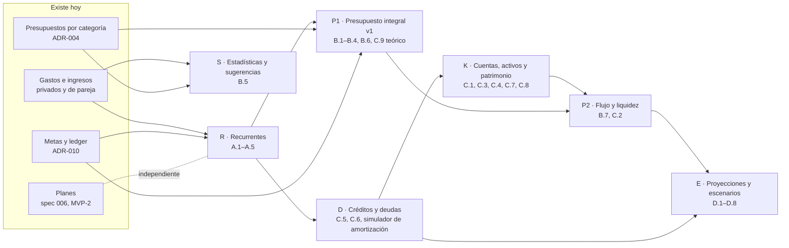

# Análisis de la propuesta de planificación financiera integral (sección 6)

**Estado:** análisis del gestor, **para decisión de los fundadores** (25 de
noviembre de 2026). Incluye las **respuestas propuestas de los fundadores (25 nov
2026)** a las preguntas de §9 y la resolución de los hallazgos F98-1 a F98-6 de
la revisión adversarial (§11). Las respuestas **todavía no son decisiones del
maestro**: lo serán cuando un PR documental las registre en §15.10 (§10). **No es
una decisión, no amplía el alcance y no es autoridad.** Analiza `docs/propuestas/planificacion-financiera-integral.md` (en
adelante, «la propuesta»), sus bloques provisionales A–D y las precisiones de su
§8. No modifica el maestro, los ADR, la spec 006 ni el alcance de MVP-1. Donde
este documento recomienda algo, decide quien corresponde: los fundadores.

**Datos:** todas las cifras son **ficticias**. Las que no vienen de la propuesta
se inventaron aquí solo para ilustrar un mecanismo.

**Límites del análisis:** solo documentación, durante el gate de MVP-1 (spec 005;
decisión 25.5). Sin código, migraciones ni cambios de alcance. Las afirmaciones
sobre el modelo real salen de leer `supabase/migrations/` y `src/domain/` en
`main` (`598be13`).

---

## 0. Resumen ejecutivo

**Veredicto.** La propuesta es coherente con la visión de Juntia («lo que gastamos
y lo que apartamos», maestro §2.1) y se puede construir **por capas, cada una útil
por sí sola**. Pero no es una ampliación de MVP-2: es una línea de producto nueva.
Hoy Juntia sabe **qué pasó** (gastos, ingresos privados, repartos, metas). La
propuesta añade dos dimensiones que no existen en ninguna tabla: **el tiempo
futuro** (lo previsto, bloques A, B y D) y **la posición** (cuentas, deudas y
activos, bloque C).

**Lo que ya existe o está previsto.** De las 29 capacidades (A.1…D.8), **ninguna
existe completa**. **Tres** tienen una base real que cubre buena parte (B.2, B.3 y
C.9), apoyadas en metas con ledger, presupuestos por categoría, el uso de meta
enlazado a un gasto y `goal_type = 'emergency'`. **Cuatro** están contempladas en
el backlog o en el maestro (A.1, B.5, B.6 y, en parte, D.5). **El resto es
nuevo.** El
hallazgo más útil: **las provisiones (B.3) caben casi enteras en el motor de
metas actual.** Pagar el SOAT con una meta ya produce un solo gasto real más un
uso de meta, sin doble conteo (DEC-G04; ADR-010).

**Orden recomendado** (§8 de este documento), que ajusta el de la propuesta §8.2
en un punto:

1. **Planes** (spec 006), sin cambios.
2. **Recurrentes y calendario** (bloque A). Incluye las filas 3 y 7 del backlog.
3. **Presupuesto integral v1** (bloque B **sin liquidez**). Sube por encima de
   deudas y patrimonio: solo depende de A, de los presupuestos y de las metas.
4. **Créditos y deudas** (mitad de C). Amortización en COP, con tasa y cuota fijas.
5. **Cuentas, activos y patrimonio** (la otra mitad de C).
6. **Flujo y liquidez** (B.7 y C.2) y después **proyecciones y escenarios**
   (bloque D).

**Lo que choca con decisiones vigentes** (§3). Hay que ampliar o decidir antes de
especificar:

- la decisión 22.8: el presupuesto es solo por categoría de gasto, sin total del
  mes y nunca de ingresos;
- el contrato de §7.3: el ingreso es solo privado;
- la decisión 22.9: sin proyecciones;
- DEC-R17: no presumir liquidez;
- §2.4: sin rentabilidades;
- la navegación de §15.3: sin destinos nuevos;
- el tope de specs E2E de ADR-011, que MVP-2 mantiene (spec 006, Q20).

**Riesgos principales** (§7):

- el doble conteo en cuatro puntos: recurrente frente a gasto real, cuota frente
  a capital, provisión frente a pago, y transferencias;
- en pareja, **cualquier total compartido que mezcle algo privado lo revela por
  resta**;
- datos manuales que envejecen sin que se note;
- la deriva hacia un ERP.

**Respuestas propuestas de los fundadores** (§9, 25 nov 2026). Respondieron las
16 preguntas, con precisiones en Q7, Q8, Q9, Q12, Q13 y Q15, y tres más que
salieron de la revisión (Q17 a Q19). Las principales:

- MVP-2 = Planes + Recurrentes + Presupuesto integral v1 (Q1);
- los grupos de más de dos van detrás de la planificación (Q2);
- el orden del análisis (Q3);
- privacidad por defecto, con agregados y escenarios compartidos solo sobre lo
  compartido (Q9).

- la cuota inicial sobre planos es un gasto real al pagar, o un gasto con meta si
  hubo una reserva previa real; nunca un aporte (Q8, F98-1);
- los presets de captura (fila 4) entran en la spec de Recurrentes como un
  concepto distinto, en PR propios (Q17);
- el trabajo documental de Recurrentes puede hacerse durante el gate, con cuatro
  condiciones previas (Q18);
- la capa de P1 se llama provisionalmente **«distribución mensual»**, sin cerrar
  el nombre (Q19).

**Al aplicar las respuestas aparecen ocho contradicciones o tensiones nuevas**
(§12). Ninguna bloquea. Las que más importan:

- MVP-2 y MVP-3 del maestro §11 cambian (N-1, N-2) y van al PR de la decisión 28.
  La parte de la fila 4 de N-1 queda resuelta por Q17;
- el objetivo orientativo de 2026 es muy ajustado frente al gate de MVP-1 (N-4);
- hacer la documentación de Recurrentes durante el gate tensiona la regla de «una
  spec a la vez» (N-8). §12 propone una lectura que la resuelve.

---

## 1. Revisión contra el estado real

| Necesidad de la propuesta (§1) | Estado real en `main` | Fuente |
| --- | --- | --- |
| Ingresos de varios empleos | Ingreso como `transactions.type = 'income'`, **solo privado**, una sola categoría (`income`). Ninguna vista de resumen SQL lo suma; solo `monthSummary` del dominio | `20261105000200_controlled_tables.sql:21` (`transactions_income_private`); `src/domain/transactions/index.ts:39-51`; maestro §7.3 «Contrato por tipo» |
| Gastos personales y compartidos reales | **Existe**: privados y de pareja, repartos exactos, balance y liquidaciones | Specs 002 y 003; ADR-001, ADR-002, ADR-007 |
| Inmuebles, créditos, arriendos | **No existe** ninguna tabla de cuentas, activos, deudas ni transferencias. El único «saldo» es la deuda interna de la pareja (`couple_balance`) y el saldo de las metas | `20261106000200_shared_money_tables.sql:190-198` |
| Gastos anuales (seguros, prediales) | No hay provisiones. Las metas sirven hoy, a mano: una meta «SOAT» con aportes, y el pago como gasto con meta | `20261107221552_goals_tables.sql`; `20261107230952_goal_funding.sql:163-207` |
| Fondo de emergencia | Existe como **tipo visual** de meta (`goal_type = 'emergency'`), sin cálculo de cobertura | `20261107221552_goals_tables.sql:5` |
| Ahorro para viajes, boda | **Existe**: metas privadas y compartidas, aportes, retiros y gasto con meta; `total_destinado_neto` | Spec 004; DEC-G01..G06; §15.4 |
| Agrupar gastos de un viaje | **Decidido para MVP-2**: Planes, una etiqueta que no cambia ninguna cifra | Spec 006; ADR-015; decisión 27 |
| Evaluar decisiones a 1–5 años | **No existe.** Solo `goalPace` (cuota mensual hasta la fecha de la meta) y la comparación con el mes anterior. Las decisiones 22.9 y 22.10 prohíben extrapolar | `src/domain/goals/index.ts:36-50`; `src/domain/analysis/index.ts:2-16` |
| Presupuesto mensual | **Existe**, opcional, por categoría de gasto, con vigencia mensual e historial (`budget_versions`), privado o de pareja, sin total del mes | `20261107221547_budgets.sql`; ADR-004 y su nota 22.7; decisión 22.8 |
| Otra moneda | **No**: `currency = 'COP'` en todas las tablas; multidivisa es P2 | Maestro §3 |

**Arquitectura que toda capacidad nueva hereda** (propuesta §4, «Seguridad y
arquitectura»):

- Tablas en `juntia_data` con RLS.
- Escritura solo con funciones `security definer` de `juntia_writer`, sin
  `BYPASSRLS`.
- Idempotencia por `(actor, acción, clave)`.
- Bloqueo de la raíz del agregado y `version` para ediciones concurrentes.
- Importes `bigint` que cruzan la frontera como texto.
- Auditoría de solo inserción.

Fuentes: ADR-013 §2–§4 y decisión 15. **Cada tabla nueva que guarde importes es
una tabla controlada** (ADR-013 §2, «Ninguna tabla nueva que guarde importes o
membresía queda fuera»). Además, cada tabla nueva amplía la exportación (§15.5),
el procedimiento manual de borrado de cuenta
(`specs/005-gate-mvp-1/contracts/account-deletion.md`) y la copia con su
restauración (decisión 24.9).

Ese costo fijo por tabla es la razón principal para preferir pocos conceptos
nuevos y bien reutilizados.

---

## 2. Matriz de capacidades

Leyenda:

- **Existe**: utilizable hoy tal como la propuesta la pide.
- **Base**: hay un mecanismo reutilizable que cubre una parte.
- **Backlog**: contemplada en `docs/BACKLOG_MVP2.md` o en el maestro §11.
- **Nueva**: nada en el repositorio.

Ninguna capacidad está completa hoy.

| Cap. | Qué pide | Estado | Fuente y nota |
| --- | --- | --- | --- |
| A.1 | Configurar recurrencias | **Backlog** | Fila 3; maestro §11 «MVP-2: recurrentes»; §7.3 prevé `recurring_rules` (P1) con «instancias sin duplicados» |
| A.2 | Previsto frente a real | **Nueva** | No existe ningún estado «previsto». Es el núcleo del bloque A |
| A.3 | Ingresos variables e inciertos | **Nueva** | Necesita rangos y estados (habitual, estimado, condicional). El ingreso real ya existe, solo privado |
| A.4 | Calendario financiero | **Nueva** | La decisión 16.8 dejó el «calendario» en flechas de mes de Actividad, sin cuadrícula |
| A.5 | Compromisos de duración definida | **Nueva** | Es fecha final o número de cuotas en A.1 |
| B.1 | Presupuesto mensual integral | **Nueva**, con base | Base: `budgets`/`budget_versions`. **Choca con la 22.8** (§3) |
| B.2 | Presupuestado, comprometido, ejecutado | **Base** | `budget_months` ya da límite, consumido, restante y estado. Lo «comprometido» necesita A |
| B.3 | Provisiones | **Base fuerte** | Meta + aportes + gasto con meta = sin doble conteo (ADR-010; FR-051 a FR-055 de la 004). Falta: fecha de vencimiento, aporte mensual sugerido (`goalPace` ya lo calcula) y el vínculo con la obligación recurrente |
| B.4 | Presupuestos futuros | **Nueva** | La nota 22.7 de ADR-004: una edición rige «desde el mes en que se hace». No admite límites con fecha futura |
| B.5 | Presupuesto basado en historial | **Backlog** | Filas 5 (estadísticas) y 6 (DEC-R01-S, maestro §8.2). Base: `monthComparison` |
| B.6 | Metas integradas al presupuesto | **Backlog** | Fila 7, «aportes programados». El maestro §5.6 deja fuera de P0 las «reglas de contribuciones periódicas» |
| B.7 | Flujo mensual previsto | **Nueva** | La propuesta misma la condiciona a C |
| C.1 | Cuentas y productos financieros | **Nueva** | — |
| C.2 | Disponibilidad del dinero | **Nueva** | Choca con DEC-R17 si se presenta como «disponible» sin datos suficientes |
| C.3 | Transferencias entre cuentas | **Nueva** | `funding_mode = 'transferred_declared'` es solo una etiqueta del aporte (DEC-G03) |
| C.4 | Activos patrimoniales | **Nueva** | §2.4 excluye «rentabilidades» en MVP-1 |
| C.5 | Créditos y obligaciones | **Nueva** | — |
| C.6 | Amortización y abonos a capital | **Nueva** | La propuesta §8.4 limita: COP, tasa fija y cuota fija |
| C.7 | Inmuebles de inversión | **Nueva** | Compone C.4, C.5 y el arriendo (ingreso **compartido**, §3) |
| C.8 | Patrimonio neto | **Nueva** | El mayor riesgo de privacidad por agregados (§7.2) |
| C.9 | Fondo de emergencia | **Base** | La meta `emergency` existe; falta la cobertura en meses. **Una meta no acredita que el dinero exista ni que sea líquido** (DEC-G03; F98-4): en P1 solo cabe una cobertura **teórica**; la real espera a K y P2 |
| D.1 | Proyecciones por horizonte | **Nueva** | **Choca con la 22.9** («sin extrapolar») y con «Llegarán en abril» de GLOSSARY §9 |
| D.2 | Escenarios independientes | **Nueva** | — |
| D.3 | Ingresos inciertos en escenarios | **Nueva** | Depende de A.3 |
| D.4 | Simulador de reducción de deuda | **Nueva** | Sale casi gratis del motor de C.6. Va **dentro de D** cuando su ADR esté aceptado, sin esperar a E (Q12; F98-3) |
| D.5 | Simulador de decisiones | **Nueva**; el maestro §3 menciona «simulaciones avanzadas de metas» en P1 | DEC-R17: «no emitir autorización de gasto» ya está en la propuesta |
| D.6 | Varios objetivos a la vez | **Nueva** | — |
| D.7 | Visualización temporal | **Nueva** | Real y proyectado distinguibles sin depender del color (maestro §6.1.1 regla 4) |
| D.8 | Alertas descriptivas | **Nueva** | **No hay mecanismo de avisos** en Juntia (backlog, «Ideas sin decidir») |

**Recuento (29 capacidades):** 0 existen completas · 3 con base (B.2, B.3 y C.9)
· 4 en el backlog o en el maestro (A.1, B.5, B.6 y, en parte, D.5) · 22 nuevas,
dos de ellas con una base parcial (B.1 sobre `budgets`; D.1 sobre `goalPace`).

---

## 3. Contradicciones con decisiones vigentes

Tres tipos de choque:

- **Ampliar**: la decisión sigue valiendo, pero hay que extenderla con un ADR o
  una nota.
- **Decidir**: hace falta una elección de los fundadores.
- **Respetar**: la decisión vale tal cual y la spec debe cumplirla.

| # | Capacidad | Decisión vigente | Cita | Tipo y salida propuesta |
| --- | --- | --- | --- | --- |
| C-1 | B.1, B.2 | Presupuesto solo por categoría de gasto, **nunca «Ingresos»** y **sin total del mes** | Decisión 22.8; ADR-004, final de la nota 22.7 | **Ampliar.** Recomendado: una capa nueva, la «distribución mensual», que asigna ingresos previstos a destinos y deja intactos los presupuestos por categoría (Q6) |
| C-2 | B.4 | Una edición rige desde el mes en curso; el pasado conserva su límite | ADR-004, nota 22.7, puntos 2 y 3 | **Ampliar** solo si la distribución mensual admite meses futuros. Los presupuestos por categoría no cambian |
| C-3 | B.2, B.7, C.2, C.9, D.5 | **DEC-R17**: un presupuesto no prueba liquidez; nada de «te alcanza» sin datos suficientes y **una política de inferencia explícita** | Maestro §2.4, §5.3; US-09 | **Respetar.** Ninguna cifra de «disponible» antes de que existan cuentas con fecha de actualización (C), y aun entonces con la etiqueta «declarado» y su fecha. La política de inferencia que DEC-R17 exige va al ADR de saldos (§6) |
| C-4 | B.1, B.5 | **DEC-R01**: presupuesto opcional, `null` ≠ 0; sugerencias solo con consentimiento | Maestro §5.3, §8.2 | **Respetar.** La distribución mensual también es opcional. Sin él, Juntia sigue igual (propuesta §8.6) |
| C-5 | B.6, D.* | **DEC-G04**: `total_destinado_neto` nunca es «Total gastado» ni la cifra héroe | Maestro §15.4 | **Respetar.** El «total asignado» de la distribución mensual es otra cifra y no puede reutilizar ni rebautizar `total_destinado_neto` |
| C-6 | A (arriendo, salario compartido), C.7 | **El ingreso es solo privado** | Maestro §7.3 «Contrato por tipo»; `transactions_income_private` | **Decidir** (Q7). Recomendado: mantenerlo privado en v1, y que cada uno registre su parte del arriendo |
| C-7 | D.1, D.5, D.8 | **Sin extrapolar**: «solo aritmética descriptiva», «sin próximo aporte planeado» | Decisión 22.9; GLOSSARY §9 («Si siguen como en los últimos tres meses…» sí; «Llegarán en abril» no) | **Ampliar.** Las proyecciones son simulaciones con supuestos visibles, nunca predicciones. La 22.9 sigue valiendo para Análisis |
| C-8 | C.4, C.7, D | §2.4 excluye «rentabilidades» y «compra de inversiones financieras»; DEC-G05: sin intereses ni valorizaciones «sin fuente independiente» | Maestro §2.4, §5.6 | **Decidir.** §2.4 es de MVP-1, pero el espíritu de DEC-G05 aplica. Recomendado: valoraciones **declaradas** con fecha, nunca calculadas; rentabilidad solo como aritmética sobre datos declarados, rotulada «estimada» |
| C-9 | A.4, C, D | **Navegación**: cinco pestañas en móvil, cinco destinos en escritorio. La propuesta §4 pide no añadir destinos sin decisión | Maestro §15.3; decisión 22.5 (Análisis, ruta hija de Plan) | **Decidir** (Q10). Recomendado: A y B dentro de **Plan** como rutas hijas, igual que Análisis. C, con comps, antes de decidir si merece destino |
| C-10 | Todas | **Tope E2E**: de 4 a 6 specs para todo P0, y como máximo 2 por spec; MVP-2 lo mantiene. Queda **una plaza libre** | ADR-011 §3; spec 006, Q20 y FR-082; `docs/TESTING.md` «Tope de specs E2E» | **Decidir** (Q13). Con cuatro o cinco specs nuevas, o se amplían las cinco existentes, o se modifica ADR-011 |
| C-11 | §8.1 «grupos de más de dos» | Grupos N en P1 / MVP-3; datos modelados para N | Maestro §11 «MVP-3», §15.5 | **Decidir** (Q2). Cambiar la prioridad no exige tocar el modelo |
| C-12 | D.8 | No hay notificaciones; avisar a la pareja exige decidir antes el mecanismo de avisos | `docs/BACKLOG_MVP2.md`, «Ideas sin decidir» | **Decidir.** Recomendado: avisos solo dentro de la app, al abrirla, sin push ni correo |
| C-13 | Privacidad (propuesta §8.5) | Privado por defecto, «tampoco por agregados» | Maestro §2.3.6, §7.4; US-05; ADR-015 §4 (F94-3) | **Respetar y ampliar** con un ADR de privacidad patrimonial (§6). Es la decisión más difícil de revertir |
| C-14 | B.3 | Las metas no tienen reglas de aporte periódico en P0 | Maestro §5.6, «Fuera de P0» | **Ampliar** ADR-010 con los aportes programados (fila 7). La regla de que un aporte nunca es un gasto no cambia |

No hay ninguna contradicción **insalvable**: todo se resuelve ampliando con ADR o
con preguntas a los fundadores. Pero **C-1, C-6, C-9, C-10 y C-13 deben
resolverse antes de escribir la primera spec**, porque deciden qué construye.

---

## 4. División propuesta de specs

Las agrupaciones no llevan número: se numeran al abrirse, de una en una (ADR-012;
propuesta §6). Cada una se pensó para que **entregue valor sin la siguiente**
(propuesta §8.6).

| Spec provisional | Capacidades | Valor por sí sola | Fuera de ella |
| --- | --- | --- | --- |
| **R · Recurrentes y calendario** | A.1, A.2, A.3 (estados y rango simples), A.4, A.5; **fila 3**; **fila 7** como recurrencia de tipo «aporte a meta»; **fila 4, presets de captura**, como concepto distinto y en PR propios (Q17) | Saber qué viene este mes y el siguiente. Confirmar en un toque lo esperado sin teclearlo (crea un gasto real o un aporte real con su idempotencia). Nunca crea movimientos reales por su cuenta (A.2). Los presets aceleran la captura sin prever nada | Amortización, saldos, proyecciones |

**Recurrencias y presets dentro de R (Q17).**

- **Son conceptos distintos.** Una recurrencia es un movimiento esperado con
  frecuencia o fecha; genera instancias previstas y entra en la distribución
  mensual como compromiso. Un preset es una plantilla para anotar rápido; no
  genera obligaciones, movimientos previstos ni compromisos de presupuesto.
- **Pueden compartir mecanismos**, sin compartir entidad en la base de datos. Por
  ejemplo, el borrador de movimiento que rellena Anotar, la validación del dominio
  y los componentes de selección. Si comparten tabla o no se decide en el plan de
  R; ADR-a solo fija qué es una recurrencia.
- **Orden de PR propuesto:** primero el núcleo de recurrencias (base de datos,
  confirmación y vínculo con lo real), después el calendario, y los presets en un
  PR independiente. Los presets pueden ir antes o después del calendario, pero
  nunca bloquean el núcleo.
| **P1 · Presupuesto integral v1 (sin liquidez)** | B.1, B.2, B.3 (sobre metas), B.4 (meses futuros de la distribución mensual), B.6; C.9 **teórico** (F98-4, abajo) | Repartir el ingreso previsto entre destinos y ver asignado, ejecutado y pendiente. Las provisiones reutilizan metas | Cuentas, saldos y cualquier cifra de «disponible»; la cobertura con recursos líquidos reales |
| **D · Créditos y deudas** | C.5, C.6, **simulador de amortización** (D.4 del crédito: cuota obligatoria frente a abonos, reducción de plazo frente a reducción de cuota); vínculo con la recurrencia de la cuota; reclasificación auditada de las cuotas «sin desglosar» (F98-1) | Saber cuánto se debe, cuánto es interés y cuánto capital, y qué cambia con un abono. El motor de amortización hace casi todo D.4 | Tasas variables, UVR y tarjetas de crédito (Q14); el simulador integral entre bloques (E) |

**Fondo de emergencia en P1 (F98-4).** Una meta registra lo que alguien apartó en
Juntia («apartado en Juntia» o «transferencia declarada», DEC-G03). No acredita que
el dinero exista ni que sea líquido. En P1 solo se muestra una **cobertura
teórica**:

- se calcula como el saldo de la meta de emergencia dividido entre los gastos
  esenciales **declarados** por la persona;
- se rotula «teórica», con sus dos supuestos a la vista: que lo apartado existe y
  que los gastos esenciales declarados son correctos;
- nunca se usa para afirmar solvencia, para autorizar un gasto ni para decir «te
  alcanza» (DEC-R17).

La cobertura con recursos líquidos reales espera a K (cuentas) y a P2 (liquidez).

**Simulación de deuda antes de E (F98-3).** No hay contradicción con Q12 si se
separan dos cosas:

- **el simulador de amortización de un crédito** (D.4 aplicado a una deuda): es
  aritmética determinista sobre un crédito declarado. Entra en D en cuanto su ADR
  (ADR-e) esté aceptado;
- **el simulador integral** (D.4 cruzado con liquidez, fondo de emergencia o
  varios objetivos; D.5 y D.6): necesita P2 y va en E.

Lo que D **no** muestra es el «efecto sobre el fondo de emergencia» de la
propuesta D.4: necesita liquidez, y por eso es de E.
| **K · Cuentas, activos y patrimonio** | C.1, C.3, C.4, C.7, C.8; ajustes de saldo sin ingresos ni gastos ficticios (propuesta §8.3) | Una foto del patrimonio con la fecha de cada dato | Liquidez prevista |
| **P2 · Flujo y liquidez** | B.7, C.2 | Flujo previsto frente a real, y disponibilidad por tipo de recurso, declarada y fechada | Escenarios |
| **E · Proyecciones y escenarios** | D.1, D.2, D.3, D.5, D.6, D.7, D.8 | Comparar decisiones con supuestos visibles | — |
| **S · Estadísticas y sugerencias** (independiente) | B.5; **filas 5 y 6** | Mejor lectura del historial. Borrador voluntario de presupuesto | Puede ir en cualquier momento, cuando haya historial suficiente |

**Por qué partir C (pedido explícito).** Deudas y cuentas tienen riesgos
distintos:

- **Deudas** es un problema de **exactitud de cálculo** (amortización, redondeo,
  capital frente a interés), que se prueba en el dominio con tablas anonimizadas.
- **Cuentas y activos** es un problema de **frescura y privacidad** (saldos
  declarados, valoraciones, agregados).

Juntos harían una spec del tamaño de la 004, que ya necesitó cinco PR.

**Por qué un presupuesto integral v1 sin patrimonio (propuesta §8.2).** El
análisis de dependencias (§5) dice que B.1 a B.4 y B.6 **solo necesitan A**,
además de los presupuestos y las metas que ya existen. La cuota de un crédito
entra en la distribución mensual como **un compromiso recurrente** por su salida de caja
completa. Hasta que exista D, se rotula «cuota (sin desglosar)», con las cuatro
condiciones de F98-1 (§9, Q8). Registrar inmuebles o inversiones no es requisito de nada en
P1. Solo B.7 y C.2 (lo «disponible») necesitan cuentas, y por eso quedan en P2.

---

## 5. Mapa de dependencias

| Capacidad | Necesita antes | Por qué |
| --- | --- | --- |
| A.2, A.4 | A.1 | Lo previsto sale de una regla |
| B.1, B.2 | A.1, A.3 | Sin ingreso ni compromisos previstos, no hay nada que repartir |
| B.3 | Metas (existe) + A.1 (vencimiento anual) | La provisión es una meta con fecha y un aporte recurrente |
| B.6 | Fila 7 dentro de R | Un aporte planificado es una recurrencia de tipo aporte |
| C.6, D.4 | C.5 | La amortización necesita el crédito |
| C.5 ↔ A.1 | No es estricta | La cuota puede existir como recurrente antes que el crédito (P1); D la vincula después |
| C.7 | C.4 + C.5 + A (arriendo) | Compone activo, deuda y flujo |
| C.8 | C.1 + C.4 + C.5 | Activos menos pasivos |
| C.9 completo | C.1 + P2 (recursos líquidos reales) | La versión de P1 es solo teórica: saldo de la meta entre gastos esenciales declarados (F98-4) |
| B.7, C.2 | C.1 + A | La liquidez necesita saldos (la propuesta §B.7 ya lo dice) |
| D.1–D.3, D.5–D.8 | A + B + C.5 (+ C.1 para la liquidez) | Proyectan lo previsto sobre la posición |
| B.5 | Historial (existe) | Independiente de todo lo demás |

---

## 6. ADR candidatos

Es solo una lista de preguntas: **no se escribe ningún ADR aquí.** Cada uno va
antes de la etapa Plan de la spec que lo necesita (`AGENTS.md` 17).

| # | Candidato | Pregunta que debe cerrar | Lo necesita |
| --- | --- | --- | --- |
| ADR-a | **Recurrencias y movimientos previstos** | ¿La instancia prevista se **materializa** como fila o se **calcula** a partir de la regla? ¿Cómo se confirma y se vincula una instancia con un gasto real ya registrado, 1:1 e idempotente, sin duplicar? ¿Qué pasa con las instancias si se edita la regla? ¿Lo previsto puede estar en `transactions`? (Recomendación del análisis: no, nunca; tabla aparte, para no tocar ninguna métrica de §5.1) | R |
| ADR-b | **Previsto frente a real en las métricas** | ¿Qué cifras pueden mezclar lo previsto y lo real, y con qué rótulo? Regla mínima: ninguna de las métricas de §5.1 ni de DEC-G04 incluye nunca algo previsto | R, P1 |
| ADR-c | **Distribución mensual (ampliación de ADR-004)** | ¿El presupuesto integral es una capa nueva o extiende `budgets`? ¿Admite un total, ingresos y meses futuros? ¿Cómo evita contar dos veces una obligación recurrente que además tiene categoría presupuestada (B.1)? | P1 |
| ADR-d | **Aportes programados y provisiones (ampliación de ADR-010)** | ¿Una provisión es una meta con vencimiento? ¿El aporte programado es solo una sugerencia que se confirma, nunca un asiento automático? ¿Cómo se cubre una obligación anual con la prima (B.3)? | R, P1 |
| ADR-e | **Créditos y amortización** | El sistema v1: COP, tasa fija, cuota fija, método francés. La conversión de tasa efectiva anual a mensual y su redondeo, alineados con ADR-002. Seguros y cargos como componentes aparte. Abonos: reducción de plazo o de cuota. Titularidad legal frente a responsabilidad acordada. **Cómo se registra el pago de la cuota sin que el capital cuente como consumo** (choca con `gasto_consumo`, §5.1), y cómo se reclasifican de forma auditada y sin duplicar las cuotas históricas «sin desglosar» (F98-1). Que el simulador de amortización es aritmética determinista y no una proyección de la 22.9 (Q12; F98-3). El procedimiento de evidencia de §9, Q15 (F98-6) | D |
| ADR-f | **Modelo de saldos de cuentas** | ¿Declarativo, derivado de movimientos o mixto con conciliación explícita (propuesta C.1)? ¿Cómo se corrige un saldo sin crear ingresos ni gastos ficticios? ¿Qué es una transferencia entre cuentas propias? **¿Cuál es la política de inferencia que exige DEC-R17** antes de mostrar algo «disponible»? | K, P2 |
| ADR-g | **Privacidad de ingresos, cuentas, deudas, activos y escenarios** | Qué se comparte, ítem por ítem o por categoría. Si los agregados compartidos se calculan **solo con ítems compartidos**. La copropiedad y el porcentaje de participación. Si los escenarios son privados por defecto. Cómo evitar las fugas por resta, por indicadores y por diferencias entre escenarios (propuesta §8.5). Exportación y borrado de cuenta | P1 (ingresos), D, K, E |
| ADR-h | **Frescura de los datos** (propuesta §8.3) | Estados «confirmado», «estimado» y «proyectado». La fecha de última actualización como dato obligatorio. Los umbrales de «desactualizado». Recordatorios solo dentro de la app. Cómo marca una proyección que usa datos viejos | K, E (y R para los estimados) |
| ADR-i | **Motor de proyecciones y escenarios** | Si es determinista y puro en el dominio. Si un escenario es una capa de supuestos sobre los datos reales, nunca una copia que se edita. El horizonte máximo. Si se guardan resultados o solo supuestos. Cómo se compara sin afirmar asequibilidad (DEC-R17). Cómo se amplía la 22.9 | E |
| ADR-j | **Ingreso compartido** (la respuesta propuesta de Q7 lo aplaza; se revisa antes de K) | Cómo se distinguen la recepción efectiva, el derecho económico de cada uno y la transferencia posterior entre la pareja (F98-2). Si un ingreso de pareja tiene reparto, cómo afecta a Balance (hoy no lo afecta). Qué pasa con el contrato de §7.3 | K (C.7) |

**Ampliaciones probables sin ADR nuevo:**

- una nota de ADR-011 sobre el tope E2E de MVP-2 (Q13);
- una nota de ADR-013 que liste las tablas controladas nuevas;
- una nota del contrato de borrado manual de cuenta de la 005 por cada tabla nueva.

---

## 7. Riesgos

### 7.1 Integridad financiera

| Riesgo | Cómo aparece | Mitigación propuesta |
| --- | --- | --- |
| **Recurrente + gasto real = doble** | La regla prevé $1.350.000 de cuota; la persona además anota el pago a mano | La instancia confirmada **es** el gasto real, o se vincula 1:1 con uno ya anotado. Lo previsto nunca entra en `transactions` (ADR-a). Prueba en el dominio y pgTAP |
| **Cuota = consumo** | La cuota completa de $2.700.000 entra a `gasto_consumo`, aunque parte es capital, que reduce un pasivo | Hasta D: se rotula como compromiso sin desglosar y se documenta la limitación. Con D: la regla de ADR-e. **Es la decisión de modelo más delicada**, porque toca una métrica de §5.1 |
| **Provisión: aporte + pago** | Se aparta $640.000 al mes y luego el seguro de $7.680.000 cuenta otra vez | Ya resuelto por el gasto con meta: un gasto real más un uso, y `total_destinado_neto` lo neutraliza (DEC-G04, ejemplo B) |
| **Transferencias** | Pasar del ahorro al CDT aparece como gasto o como ingreso | Tipo propio, fuera de `transactions` y de toda métrica de consumo (ADR-f) |
| **Cuota inicial de un inmueble sobre planos** | Hoy solo se puede anotar como gasto (por ejemplo, en «Hogar»), y eso infla el consumo; en realidad construye un activo. **Anotarla como aporte a una meta es peor** (F98-1): el saldo seguiría disponible para financiar otro gasto aunque el dinero ya esté en la constructora | Q8 revisada (§9). Nunca se presenta como ahorro disponible algo ya entregado a un tercero |
| **Arriendo compartido** (F98-2) | El arriendo de un inmueble de los dos llega completo a la cuenta de A. Si se anotara un 50 % de ingreso para cada uno, B tendría un ingreso de caja que no recibió | Q7: en v1, el ingreso lo anota quien lo recibe, por lo recibido. Se distinguen tres cosas que v1 no mezcla: **recepción efectiva** (lo que llegó a la cuenta de A, un ingreso real de A), **derecho económico** (la participación del 50 % de B, que v1 no registra como dinero) y **transferencia posterior** (si A le pasa su parte a B, eso es un ingreso real de B y una salida de A, que v1 no puede modelar sin ADR-j y queda como limitación documentada). Nunca se crea un ingreso ficticio para un reparto no ejecutado |
| **Valorización como ingreso** | El inmueble «sube» y la cifra entra al flujo | Una valoración nunca es un movimiento: es un dato declarado con fecha (C.4) |
| **Doble atribución en pareja** | El patrimonio compartido se suma entero al de cada uno | Participación explícita por persona; los agregados individuales usan solo esa parte (C.8; como US-08) |
| **Redondeo de amortización** | La tabla de Juntia diverge del extracto en unos pesos por cuota y el saldo deriva | Algoritmo versionado como ADR-002 y prueba contra tablas anonimizadas; mostrar «estimado» y la diferencia con el extracto declarado |

### 7.2 Privacidad

Con **dos personas, cualquier agregado compartido que incluya un componente
privado es reversible por resta.** Ejemplo ficticio: si Nosotros mostrara un
«patrimonio del hogar» de $40.000.000 y A sabe que lo suyo suma $27.500.000, A
deduce que lo de B es $12.500.000. No existe anonimato por agregación con n = 2.

Consecuencias que el ADR-g debería fijar (recomendadas):

1. **Los agregados compartidos se calculan solo con ítems explícitamente
   compartidos**, con el filtro explícito en la vista y la RLS como segunda
   barrera. Es la misma regla que ADR-015 §4 (F94-3) aplicó a Planes.
2. **No existe un «total del hogar»** que combine lo privado de ambos, ni
   siquiera opcional, salvo que cada ítem esté compartido.
3. **Los indicadores también filtran:**
   - un «nivel de endeudamiento» o un «% del ingreso» de la pareja revela
     ingresos privados;
   - un «meses de cobertura» compartido revela gastos privados.

   Solo se calculan con datos compartidos.
4. **Escenarios** (respuesta propuesta de Q9): privados por defecto. Un escenario
   compartido **solo puede usar datos compartidos**: si usara el ingreso privado de
   A, la diferencia entre escenarios («+$4.300.000 al mes») lo revelaría. Un
   escenario privado puede usar los datos propios y los compartidos a los que su
   dueño tiene acceso, y sus resultados nunca se muestran a la pareja ni entran
   en una cifra compartida.
5. **Proyecciones de metas compartidas:** el ritmo de aporte de cada persona ya es
   visible para la pareja (DEC-G06, aportes con autor), pero el ingreso del que
   sale no lo es. Una proyección compartida no puede usar ingresos privados.
6. **Exportación:** cada exportación es solo de lo propio y lo compartido. Nunca
   los ítems privados del otro (§15.5).
7. **Funciona aunque uno no comparta nada** (propuesta §8.5): cada spec debe tener
   un escenario de aceptación con una persona que no comparte ingresos, cuentas
   ni deudas.

### 7.3 Arquitectura

| Riesgo | Mitigación |
| --- | --- |
| Costo fijo por tabla controlada (§1): RLS, `juntia_writer`, idempotencia, auditoría, exportación, borrado y copia | Pocos conceptos nuevos. Reutilizar metas para las provisiones y los aportes programados, y presupuestos para los límites |
| Cálculos pesados (amortización a 30 años, escenarios a 5 años) en cada carga | Funciones puras del dominio con entradas acotadas; sin guardar resultados (ADR-i). Medir contra los umbrales de §15.7 |
| Tope E2E agotado (C-10) | Cada invariante en la capa más baja (ADR-011 §1): amortización y proyección en el dominio, privacidad en pgTAP, vínculo previsto–real en integración. E2E solo para los recorridos que cruzan pantallas |
| Migraciones de producción más frecuentes | Copia antes de cada migración (decisión 24.9). Las aplica el gestor con el «sí» del fundador |
| Zona horaria y fechas (quincenal, «último día hábil», 31 de febrero) | Reglas de recurrencia acotadas en v1. `America/Bogota` como hoy (§5.2) |

### 7.4 Producto

| Riesgo | Cómo aparece | Mitigación |
| --- | --- | --- |
| **Carga de mantener datos a mano** (propuesta §8.3) | Saldos y valoraciones viejas, y proyecciones que se ven precisas sobre datos de hace tres meses | Fecha visible en cada dato. Rótulo «desactualizado» en lo que lo usa. Actualizar en un toque. Preferir lo que Juntia ya sabe (gastos, metas, recurrentes confirmados) a lo declarado |
| **Deriva hacia un ERP** (propuesta §8.6) | Plan de cuentas, conciliación línea a línea, categorías de activos infinitas | Cada spec con su «fuera de alcance» explícito. Sin doble partida. Sin conciliación automática. Tipos cerrados y pocos |
| **La pantalla principal se complica** | Inicio se llena de compromisos y patrimonio | Inicio no cambia hasta que los fundadores lo decidan. Lo nuevo vive en Plan (Q10) y es opcional: sin configurar nada, Juntia se ve como hoy |
| **Falsa precisión** | «Terminas el crédito el 14 de marzo de 2034» | Rangos y «estimado». Fórmulas e hipótesis documentadas (propuesta D.4) |
| **Retraso del resto de la hoja de ruta** | Grupos N, demo pública y landing se alejan | Decisión explícita en Q1 y Q2. No es un efecto colateral |

---

## 8. Orden de implementación fundamentado

### 8.1 Respuesta a la propuesta §8.2

La propuesta §8.2 ordena: 1 recurrentes · 2 créditos y deudas · 3 cuentas,
activos y patrimonio · 4 presupuesto integral · 5 proyecciones. Y pide considerar
un presupuesto integral temprano.

**El análisis confirma** que recurrentes va primero y proyecciones al final. **Y
recomienda mover el presupuesto integral v1 al segundo puesto**, por tres
razones:

1. **Dependencias:** B.1–B.4 y B.6 solo necesitan A y lo que ya existe (§5).
   Ninguna capacidad de C es requisito para repartir ingresos previstos entre
   destinos.
2. **Valor:** responde a las preguntas 1, 2, 4 y 6 del caso transversal (propuesta
   §3) sin pedir que nadie registre inmuebles ni inversiones, que es lo que §8.2
   quería evitar.
3. **Riesgo:** créditos (exactitud) y patrimonio (privacidad y frescura) son los
   bloques más arriesgados. Hacerlos después de una entrega de valor alto y bajo
   riesgo da tiempo a usar R y P1 con datos reales antes de modelar la posición.

**El costo de este orden:** durante P1 la cuota del crédito figura entera, sin
desglosar capital e interés. Es aceptable si se rotula así y si D lo reclasifica.
**El costo del orden de §8.2:** el presupuesto llega dos specs grandes más tarde,
y la persona que solo quiere organizar el mes espera por módulos que no usa.

### 8.2 Orden recomendado

| Paso | Spec | Entrega por sí sola | Depende de |
| --- | --- | --- | --- |
| 0 | **Planes** (006) | Ya decidido; no cambia | MVP-1 declarado |
| 1 | **R · Recurrentes y calendario** | Lo que viene; confirmar en un toque; menos captura manual | Existe |
| 2 | **P1 · Presupuesto integral v1** | Distribuir el ingreso previsto; provisiones; metas en el plan; cobertura estimada del fondo | R |
| 3 | **D · Créditos y deudas** | Deuda, interés, capital, abonos | R (la cuota) |
| 4 | **K · Cuentas, activos y patrimonio** | Patrimonio con fechas y sin fugas | D (los pasivos) |
| 5 | **P2 · Flujo y liquidez** | Flujo previsto y disponibilidad declarada | K, P1 |
| 6 | **E · Proyecciones y escenarios** | Comparar decisiones | P2, D |
| — | **S · Estadísticas y sugerencias** | Lectura del historial; DEC-R01-S | Independiente; según la evidencia de uso |

### 8.3 Cadencia entre specs (F98-5)

Se conservan:

- la entrega incremental;
- una spec a la vez en implementación (propuesta §6; lectura propuesta en §12, N-8);
- la aceptación de cada spec antes de implementar la siguiente;
- la priorización según evidencia (maestro §11).

**No hay una espera fija de varias semanas entre todas las specs.** Una spec
siguiente empieza cuando sus dependencias están aceptadas. El periodo de
observación con datos reales depende del riesgo de cada spec:

| Spec | Observación antes de avanzar | Por qué |
| --- | --- | --- |
| R | Ninguna fija: la siguiente puede empezar al aceptarla | P1 se valida con los recurrentes ya configurados, no con meses de historia |
| P1 | Al menos un ciclo mensual completo con la distribución mensual, **para validarla**, no para bloquear D | Asignado, ejecutado y pendiente solo se pueden comprobar al cerrar un mes |
| D | Contraste con las referencias externas de Q15 antes de aceptarla | El riesgo es la exactitud del cálculo, que no se ve con el uso |
| K | Al menos un ciclo de actualización de saldos (umbrales de Q16) antes de P2 | P2 depende de saldos frescos; hay que ver si la carga de mantenerlos es razonable (§7.4) |
| P2, E | Según la evidencia de K | — |
| S | Varios meses de historial real | DEC-R01-S lo exige (maestro §8.2) |

Nada de esto cambia el gate de MVP-1 (spec 005; decisión 25.5) ni permite
saltarse las verificaciones humanas, las revisiones adversariales o los criterios
de aceptación.

**Objetivo orientativo de los fundadores:** terminar 2026 con Planes y
Recurrentes funcionando y, si el avance y la calidad lo permiten, también el
Presupuesto integral v1. **No es un compromiso de fecha y no autoriza a recortar
alcance ni calidad.** Es muy ajustado; la tensión está en §12, N-4.

---

## 9. Preguntas para los fundadores y respuestas propuestas

Los fundadores respondieron el 25 de noviembre de 2026 (Alejandro lo comunicó al
gestor). Son **respuestas propuestas**: no son decisiones del maestro hasta que
un PR documental las registre (§10). La tabla conserva la recomendación del
análisis para que se vea dónde coincide y dónde la respuesta añade una precisión.

| # | Pregunta | Recomendación del análisis | Respuesta propuesta (25 nov 2026) |
| --- | --- | --- | --- |
| Q1 | ¿Qué entra en MVP-2? (a) Planes y backlog actual · (b) Planes + R + P1 · (c) todo | (b) | **(b).** Lo demás se desarrolla de forma progresiva, sin límites artificiales que impidan avanzar si las entregas terminan antes |
| Q2 | ¿Grupos de más de dos? (a) siguen en MVP-3 · (b) detrás de la planificación · (c) sin fecha | (b), con las tablas nuevas modeladas para N | **(b).** Se mantiene la compatibilidad de arquitectura con N miembros, sin construir ahora su experiencia |
| Q3 | ¿Orden? (a) el de §8.2 · (b) el del análisis | (b) | **(b):** Planes → R → P1 → D → K → P2 → E |
| Q4 | ¿Filas 3, 6 y 7? (a) 3 y 7 en R, y 5 y 6 como spec S · (b) sueltas | (a) | **(a).** S, priorizada según evidencia |
| Q5 | ¿Planes? (a) primero y sin cambios · (b) rediseñar | (a) | **(a)** |
| Q6 | ¿Forma del presupuesto integral? (a) capa nueva · (b) ampliar `budgets` | (a) | **(a).** Los presupuestos por categoría y sus métricas quedan intactos |
| Q7 | ¿Ingreso compartido? (a) privado · (b) de pareja con ADR-j | (a) en v1 | **(a), con precisión:** se distingue la participación económica del dinero efectivamente recibido, sin ingresos ficticios por repartos no ejecutados. Limitación documentada; el ingreso compartido se revisa después (F98-2, §7.1) |
| Q8 | Cuota del crédito y cuota inicial antes de D y K | Primero (b) y (c); tras F98-1, la Q8 revisada: (a) por defecto y (b) con reserva previa | **(a) por defecto y (b) cuando haya una reserva previa real.** Detalle abajo, en «Q8 revisada» |
| Q9 | ¿Modelo de privacidad? (a) privado por defecto, sin total del hogar · (b) total del hogar con consentimiento | (a) | **(a), con precisión.** Se comparte explícitamente cada elemento cuando su spec lo soporte. Los agregados y escenarios compartidos usan solo lo compartido. Los escenarios privados pueden usar lo propio y lo compartido a lo que su dueño tenga acceso, sin exponer resultados privados (§7.2) |
| Q10 | ¿Dónde vive lo nuevo? (a) rutas hijas de Plan · (b) destino nuevo | (a) | **(a).** R y P1 como rutas hijas de Plan; la navegación de patrimonio se evalúa con comps en su spec |
| Q11 | ¿Avisos? (a) dentro de la app · (b) push o correo | (a) | **(a)**, inicialmente |
| Q12 | ¿Proyecciones? (a) sí, con ADR-i · (b) no | (a), solo en E | **(a), con precisión:** simulaciones deterministas con supuestos visibles. Las proyecciones integrales van en E, pero el simulador de amortización puede autorizarse dentro de D con su ADR. El análisis histórico conserva sus restricciones (22.9) (F98-3, §4) |
| Q13 | ¿Tope E2E? (a) se mantiene · (b) tope propio | (a) para R y P1 | **(a)** para R y P1; se revisa antes de D y K. El tope no impide probar los invariantes importantes en su capa |
| Q14 | ¿Crédito v1? (a) COP, tasa fija, cuota fija, sin UVR ni tarjetas · (b) con tarjetas | (a) | **(a):** método francés, componentes separados, abonos con reducción de plazo o de cuota. Fuera por ahora: UVR, tasa variable y tarjetas |
| Q15 | ¿Tablas de amortización? (a) anonimizadas por un fundador · (b) sintéticas | (a) + (b) | **(a) + (b), con precisión:** contraste con referencias bancarias reales tratadas fuera del repositorio, y casos sintéticos reproducibles para las pruebas, diferenciando las dos clases de evidencia. Procedimiento abajo (F98-6) |
| Q16 | ¿Desactualización? (a) umbrales por tipo · (b) solo la fecha | (a) | **(a):** umbrales por tipo de dato, visibles y calibrables con evidencia de uso |
| Q17 | ¿Dónde van los presets de captura (fila 4)? Salió de N-1 | — | **En la spec R, como concepto distinto.** Un preset es una plantilla reutilizable para capturar rápido; una recurrencia es un movimiento esperado con frecuencia o fecha. Un preset no genera obligaciones, movimientos previstos ni compromisos de presupuesto. Se evalúa reutilizar componentes y lógica sin imponer una entidad común en la base de datos. Los presets no retrasan el núcleo de R: se evalúa separarlos en PR independientes dentro de la misma spec (§4) |
| Q18 | ¿Se puede hacer la documentación de R durante el gate de MVP-1? Salió de N-4 | Sí, como se hizo con Planes | **Sí, solo documentación**: sin implementación, migraciones ni despliegues. Antes de empezar: (1) cerrar las decisiones de este PR; (2) registrar formalmente las respuestas en el maestro; (3) completar el trabajo documental pendiente de Planes; (4) resolver la tensión con «una spec a la vez» (§12, N-8) |
| Q19 | ¿Cómo se llama la capa de P1? Salió de N-5 | Un nombre sin «plan» | **Se evita «plan del mes».** Candidatos: «Mi presupuesto», «Presupuesto mensual», «Distribución mensual» y «Organización mensual». Preferencia inicial: **«Distribución mensual»**. El nombre **no se cierra todavía**: se evalúa en la spec y los comps, en Yo y en Nosotros. Este documento usa «distribución mensual» como nombre provisional |

### Q8 revisada · Cómo registrar la cuota inicial sobre planos y la cuota del crédito antes de D y K (F98-1)

**Qué cambió.** La recomendación anterior para la cuota inicial era la opción (c):
aportes a una meta de tipo vivienda con transferencia declarada. **Se retira.** Un
aporte deja saldo en la meta (DEC-G05), y ese saldo puede financiar otro gasto
(`goal_usage`, ADR-010). Si la cuota ya se pagó a la constructora, Juntia mostraría
como apartado un dinero que ya no está en poder de la persona. Corregirlo exigiría
otra dimensión financiera o tocar el ledger, y ninguna de las dos se propone aquí.

**Distinción que se mantiene.** Dinero **reservado para** pagar una cuota (ahorro,
todavía de la persona) no es dinero **entregado a** la constructora (salida
real). Una meta solo puede representar lo primero.

**Opciones para la cuota inicial**, todas compatibles con ADR-010 y DEC-G04, sin
dimensión nueva y sin tocar el ledger:

- **(a) Gasto real al pagar.** Cada cuota pagada se confirma desde su recurrencia
  (R) como un gasto real, rotulado «Cuota inicial · {inmueble}».
  - Lo bueno: la salida de caja aparece una vez, y nada queda como ahorro
    disponible.
  - Lo malo: infla `gasto_consumo`, igual que la cuota del crédito. Aplican las
    cuatro condiciones de abajo.
- **(b) Meta para reservar y gasto con meta al pagar.** Si la persona aparta el
  dinero antes de pagarlo, lo aporta a una meta, y al pagar registra un gasto con
  esa meta.
  - Lo bueno: el pago consume el saldo (es un `goal_usage`), así que nada pagado
    queda disponible, y `total_destinado_neto` no lo cuenta dos veces (DEC-G04,
    ejemplo B).
  - Lo malo: son dos pasos al mes y el mismo efecto en `gasto_consumo` que (a).
    Solo tiene sentido si de verdad se reserva antes de pagar.
- **(c) Solo la obligación prevista.** La recurrencia aparece en el calendario y en
  la distribución mensual como compromiso. Al confirmarla, se marca «pagada fuera de
  Juntia», un **estado de la instancia prevista**, sin gasto ni aporte.
  - Lo bueno: no toca ninguna métrica.
  - Lo malo: la salida real desaparece de todas las cifras de Juntia (gasto y
    flujo neto). La limitación tiene que verse en la distribución mensual.
- **(d) Aporte a meta con transferencia declarada**, la recomendación anterior.
  **Se descarta**, por lo dicho arriba.

**Respuesta propuesta de los fundadores (25 nov 2026): (a) por defecto y (b) cuando
haya una reserva previa real.**

- Si se paga directo a la constructora, se registra **un solo gasto real**,
  vinculado a su recurrencia (R).
- Si antes se reservó dinero en una meta, se usa el **gasto financiado con meta**
  que ya existe (ADR-010).
- **No se exige crear una meta** para registrar una cuota inmobiliaria.
- Lo ya entregado a terceros **nunca** queda como ahorro disponible.
- **Limitación documentada:** por ahora, estos pagos entran en las métricas de
  gasto (`gasto_consumo` y, por tanto, `total_destinado_neto`), aunque
  económicamente sean adquisición de patrimonio.
- Cuando exista K, se evalúa su reclasificación histórica de forma auditada, sin
  duplicar movimientos ni inventar información.

La recomendación del análisis, que la respuesta acepta, era esta: **(a) por defecto, con (b) como camino opcional** para quien reserva
antes de pagar. (c) queda como alternativa si los fundadores prefieren no inflar el
consumo a costa de no ver la salida. **Nunca (d).** Cuando exista K, la
reclasificación de estas cuotas a un activo («derechos adquiridos», C.4) sigue las
mismas cuatro condiciones.

**Cuota del crédito «sin desglosar».** La respuesta anterior se mantiene: un gasto
real confirmado desde su recurrencia, rotulado «cuota (sin desglosar)». La revisión
la acepta si cumple **cuatro condiciones**:

1. se identifica su limitación en las métricas de consumo: la cuota completa entra
   en `gasto_consumo`, y eso se dice donde aparece;
2. Juntia no afirma qué parte es capital ni qué parte es interés;
3. D define cómo vincular o reclasificar los movimientos históricos de forma
   auditada y sin duplicarlos (ADR-e);
4. la migración futura no inventa intereses ni capital: lo que no se puede
   reconstruir con datos declarados queda «sin desglosar».

### Procedimiento de evidencia de amortización (Q15; F98-6)

Una tabla sintética no equivale a una tabla bancaria anonimizada, y quitar nombres
y números de cuenta no basta: los importes, la tasa, el plazo y las fechas pueden
identificar a una persona. Por eso hay **dos clases de evidencia, que no se
mezclan**:

1. **Casos sintéticos reproducibles, en el repositorio.**
   - Créditos inventados (capital, tasa efectiva anual, plazo, seguros fijos y
     abonos), con su tabla esperada calculada por el gestor.
   - Pruebas de propiedad: el capital amortizado suma el capital inicial, y la
     cuota es fija salvo abono.
   - Son la evidencia de las pruebas, y no derivan de ningún crédito real.
2. **Contraste con referencias reales, fuera del repositorio.**
   - Un fundador compara, en su equipo, la salida de Juntia para un caso
     sintético que reproduce las condiciones de su crédito con la tabla o el
     extracto del banco.
   - En el repositorio queda **solo el resultado, sin datos**: fecha, tipo de
     crédito, número de cuotas comparadas, diferencia máxima por cuota en pesos y
     su causa si la hay (redondeo, seguro), y quién lo hizo.
   - Ningún agente ve el extracto. Ningún importe, tasa, plazo ni fecha real entra
     al repositorio, ni siquiera alterado.

El ADR-e fija la tolerancia aceptada (por ejemplo, unos pocos pesos por cuota por
redondeo) y qué pasa si se supera. Esta evidencia externa es un criterio de
aceptación de D, no una prueba de CI.

---

## 10. Cómo registrar esto en el backlog sin darlo por decidido

1. **Ahora (este PR):** la fila de la propuesta en `docs/BACKLOG_MVP2.md`
   enlaza este análisis y pasa a «análisis entregado, pendiente de decisión de los
   fundadores». **No se añaden filas** a «Funcionalidades», **no se tocan** las
   filas 3, 6 y 7 y no se asignan números de spec.
2. **Cuando los fundadores confirmen sus respuestas propuestas (§9) y respondan la
   Q8 revisada:**
   - un PR documental registra sus respuestas como una decisión nueva del maestro
     §15.10 (la siguiente es la 28), igual que se hizo con Planes en la 27. El
     mismo PR resuelve en el maestro las contradicciones N-1 y N-2 de §12 (§11
     «MVP-2» y «MVP-3»);
   - el mismo PR crea en el backlog filas con los nombres provisionales elegidos
     (R, P1…), cada una con su origen («decisión 28.x»);
   - las filas 3, 4 y 7 se marcan «absorbida en R» (Q4 y Q17), sin borrarlas.
3. **Solo al abrir cada spec**, de una en una:
   - recibe su número (`specs/007-…`);
   - sus ADR candidatos de §6 se escriben y se aceptan antes de su etapa Plan;
   - nada se implementa antes de declarar MVP-1 (decisión 25.5), ni la spec
     siguiente antes de aceptar la anterior. La documentación de la siguiente
     puede adelantarse, según la lectura de «una spec a la vez» de §12, N-8.
4. **La propuesta original no se modifica:** queda como registro de lo que
   pidieron los fundadores. Este análisis tampoco es autoridad. Si un documento
   posterior lo contradice, manda la decisión registrada.

---

## 11. Hallazgos de la revisión adversarial (F98-1 a F98-6)

Revisión pasada por el gestor el 25 de noviembre de 2026. Cada hallazgo se
resolvió en el texto, sin introducir dimensiones financieras nuevas ni tocar el
ledger de metas.

| # | Hallazgo | Resolución | Dónde |
| --- | --- | --- | --- |
| F98-1 | Una cuota inicial ya pagada, anotada como aporte a una meta, seguiría disponible para financiar otro gasto. La «cuota sin desglosar» necesita condiciones | Se retira la recomendación de registrarla como aporte. Q8 revisada con opciones (a)–(d) y recomendación (a) + (b). Cuatro condiciones para la cuota del crédito | §9, Q8 revisada; §7.1; ADR-e |
| F98-2 | Un 50 % de participación en el arriendo no es un ingreso recibido | Se distinguen recepción efectiva, derecho económico y transferencia posterior. v1 solo registra la recepción efectiva, y nunca un ingreso ficticio | §7.1; Q7; ADR-j |
| F98-3 | D.4 dentro de D contradecía «proyecciones solo en E» | Se separa el simulador de amortización de un crédito (D, con su ADR) del simulador integral (E) | §4; §2 (D.4); ADR-e |
| F98-4 | Una meta no acredita recursos existentes ni líquidos | En P1, solo cobertura **teórica**, rotulada, con sus supuestos y sin usarla para afirmar solvencia; la real espera a K y P2 | §4; §2 (C.9); §5 |
| F98-5 | La espera fija de semanas entre specs no tenía base de riesgo | Periodos de observación por spec y por riesgo; objetivo orientativo de 2026 sin compromiso de fecha | §8.3 |
| F98-6 | Una tabla sintética no es una bancaria anonimizada, y anonimizar importes no basta | Dos clases de evidencia separadas: sintética en el repositorio y contraste externo documentado sin datos | §9, procedimiento de evidencia |

---

## 12. Contradicciones y tensiones nuevas al aplicar las respuestas

Ninguna bloquea el análisis. Las que tocan al maestro se resuelven en el PR de la
decisión 28, no aquí.

| # | Qué choca | Con qué | Propuesta |
| --- | --- | --- | --- |
| N-1 | Q1: MVP-2 = Planes + R + P1 | El maestro §11 define MVP-2 como «recurrentes, presets de captura, estadísticas mejores, sugerencia voluntaria de presupuestos y aportes programados». P1 no está; **la fila 4 (presets de captura) no la ubica ninguna respuesta**, y la fila 5 (estadísticas) va a la spec S, priorizada por evidencia | La decisión 28 redefine MVP-2. **La parte de la fila 4 queda resuelta** por la respuesta propuesta de Q17: los presets van en R, así que entran en MVP-2. Queda pendiente que la decisión 28 registre el nuevo MVP-2 en el maestro |
| N-2 | Q2: grupos de más de dos detrás de la planificación | El maestro §11 pone «ampliación a grupos N si la pareja lo necesita» en MVP-3, junto con la demo pública, la landing y la PWA más completa | La decisión 28 mueve solo los grupos N. El resto de MVP-3 no se toca sin otra pregunta |
| N-3 | Q12: simulador de amortización en D | La decisión 22.9 («sin extrapolar») y GLOSSARY §9 («Llegarán en abril» no se dice) | La 22.9 rige para Análisis y no cambia. ADR-e declara que el simulador es aritmética sobre un crédito declarado, y su copy es condicional («con estos supuestos, terminarías en…»), nunca una fecha afirmada |
| N-4 | F98-5: objetivo orientativo para 2026 (Planes + R y, si se puede, P1) | El gate de MVP-1: 7 días de uso con despliegues congelados (24.10, 25.5). Planes no puede implementarse antes de declarar MVP-1 (decisión 27). R y P1 necesitan antes sus ADR (a, b, c, d), comps aprobados y revisiones | **No es una contradicción formal, porque el objetivo no es un compromiso**, pero es muy ajustado: quedan unas cinco semanas. La forma de acercarse sin recortar calidad es preparar la documentación de R (spec y ADR-a/b/d) mientras corre el gate, como se hizo con Planes. **Autorizado** por la respuesta propuesta de Q18, con sus cuatro condiciones previas |
| N-5 | Q10: R y P1 como rutas hijas de Plan | «Plan» es el destino de presupuestos; «Planes» (006) vive en Actividad (spec 006, Q2 y Q3). El «plan del mes» que usaba la primera versión de este análisis era un tercer uso de la palabra | **Encaminada** por la respuesta propuesta de Q19: se evita «plan del mes» y la preferencia inicial es «Distribución mensual», **sin cerrar**. El nombre se evalúa en la spec de P1 y en sus comps, en Yo y en Nosotros, y entra en el glosario cuando se apruebe. Dos cuidados para esa evaluación: «Mi presupuesto» y «Presupuesto mensual» pueden confundirse con los presupuestos por categoría de ADR-004, y «Mi…» no se lee bien en Nosotros. La idea del backlog de renombrar la pestaña «Plan» se sigue reconsiderando con evidencia |
| N-8 | Q18: la documentación de R durante el gate | La regla de «una spec a la vez» (propuesta §6; §8.3 y §10 de este análisis). Hoy la spec 006 (Planes) está abierta: Specify y Clarify hechos y comps aprobados, pero no puede pasar a Plan hasta declarar MVP-1. Abrir la spec de R crearía dos specs abiertas a la vez | **Propuesta de lectura, para que los fundadores la confirmen en la decisión 28:** «una spec a la vez» se aplica a la **implementación**. Como mucho, una spec en implementación y una en documentación, y nunca dos specs nuevas en documentación al mismo tiempo. Con esa lectura, R puede documentarse mientras 006 espera a MVP-1, porque 006 no tiene trabajo documental abierto una vez cumplida la condición (3) de Q18. Al declarar MVP-1 se implementa 006, y la implementación de R espera a que 006 esté aceptada. La alternativa estricta, sin documentar R hasta aceptar 006, contradice Q18 y deja el gate sin aprovechar |
| N-6 | Q10: el calendario financiero (A.4) en Plan | La decisión 16.8 dejó el «calendario» de lo real en Actividad, con flechas de mes | No es una contradicción: Actividad sigue siendo lo real, y el calendario de R muestra solo lo previsto y su estado. La spec R debe decir cómo enlaza una instancia confirmada con su movimiento en Actividad |
| N-7 | Q7 (ingreso privado en v1) frente a C.7 (flujo de un inmueble compartido) | El flujo de caja de un inmueble de los dos no se puede calcular sin un ingreso compartido | C.7 de un inmueble compartido depende de ADR-j, que debe escribirse antes de K. Hasta entonces, K solo puede mostrar el flujo de inmuebles privados o la parte declarada por cada uno |

---

## Referencias

- `docs/propuestas/planificacion-financiera-integral.md` (la propuesta; §4, §6 y §8)
- `docs/JUNTIA_MASTER.md` §2.3, §2.4, §3, §5.1–§5.6, §7.3, §7.4, §8.2, §11, §12, §15.3–§15.5 y §15.10 (decisiones 16.8, 22, 24, 25 y 27)
- ADR-001, ADR-002, ADR-004, ADR-007, ADR-010, ADR-011 §3, ADR-012, ADR-013 §2–§4, ADR-014 y ADR-015 §4
- `docs/BACKLOG_MVP2.md`, `docs/GLOSSARY.md` §9 y §11, `docs/TESTING.md`
- Specs `004-presupuestos-y-metas`, `005-gate-mvp-1` (incluido `contracts/account-deletion.md`) y `006-planes` (Q20, FR-082)
- `supabase/migrations/20261105000200_controlled_tables.sql`, `20261106000200_shared_money_tables.sql`, `20261107221547_budgets.sql`, `20261107221552_goals_tables.sql` y `20261107230952_goal_funding.sql`
- `src/domain/goals/index.ts`, `src/domain/analysis/index.ts` y `src/domain/transactions/index.ts`
