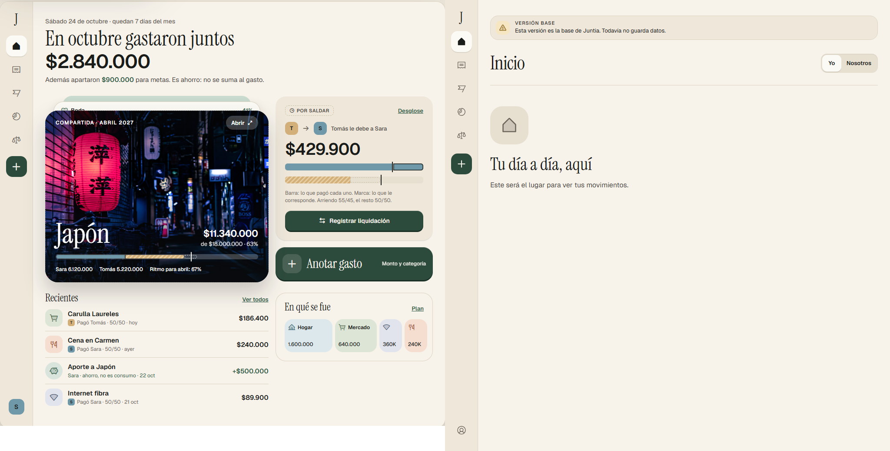
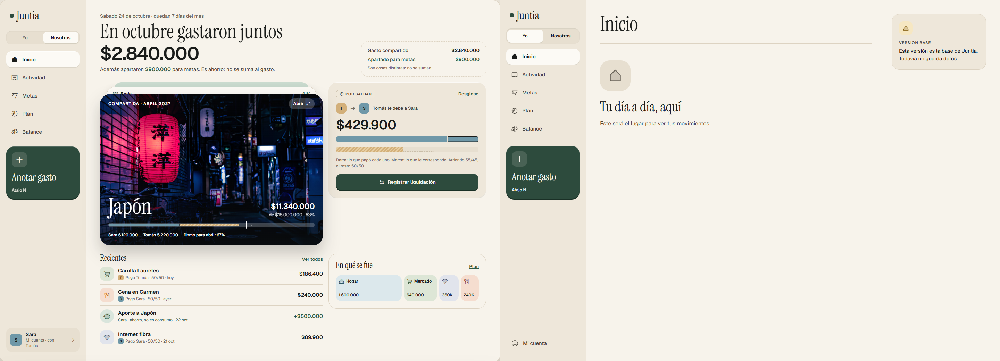
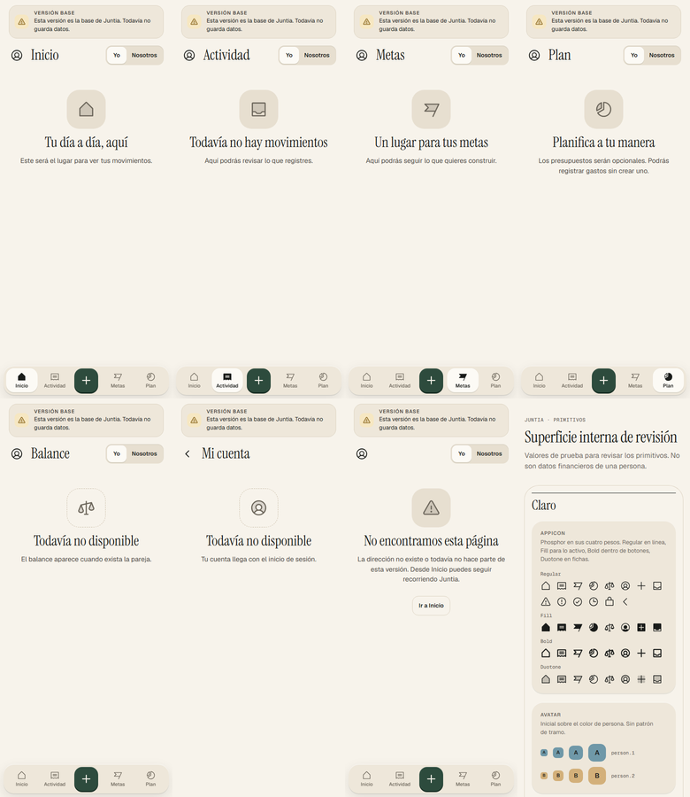
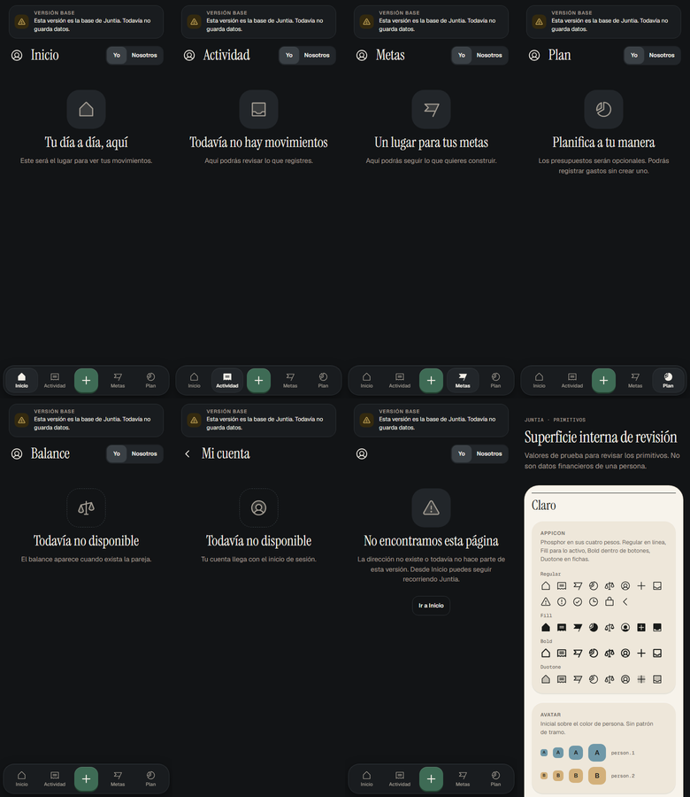
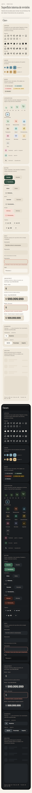

# 001 · PR D · Evidencia de verificación y cierre

Base: `a3216c0e343ca7cd02cb22d04659d0f90174a581`. Fecha: 2026-11-03 (America/Bogota).

Las salidas previas A/B/C son antecedentes; las de D se ejecutan de nuevo. Cero specs E2E añadidas. La aceptación visual y de dispositivos corresponde a los fundadores.

<a id="t061"></a>

## T061 · Registro de evidencia

Fecha: 2026-11-03 · Commit: `a3216c0`.

Registro creado con las 18 secciones T061–T078.

<a id="t062"></a>

## T062 · Instalación limpia y verify

Fecha: 2026-11-03 · Commit de aplicación: `a3216c0`.

Instalación limpia en el worktree D, inicialmente sin `node_modules`. Comandos: `npm ci` y `npm run verify`. Ambos exit 0. La auditoría de npm informa 16 vulnerabilidades moderadas; no se cambian versiones ni se ejecuta audit fix en este PR.

```text
npm warn deprecated eslint@9.39.5: This version is no longer supported. Please see https://eslint.org/version-support for other options.

added 472 packages, and audited 479 packages in 1m

162 packages are looking for funding
  run `npm fund` for details

16 moderate severity vulnerabilities

To address issues that do not require attention, run:
  npm audit fix

To address all issues (including breaking changes), run:
  npm audit fix --force

Run `npm audit` for details.
```

```text
> juntia@0.1.0 verify
> node scripts/verify.mjs


> juntia@0.1.0 lint
> eslint .


> juntia@0.1.0 typecheck
> tsc --noEmit


> juntia@0.1.0 test:unit
> vitest run --project domain --passWithNoTests


 RUN  v5.1.0 C:/Users/aleja/.codex/worktrees/001-d-verification/Juntia

No test files found, exiting with code 0

projects: domain

|domain|

include: src/domain/**/*.test.ts
exclude:  **/node_modules/**, **/.git/**


> juntia@0.1.0 test:components
> vitest run --project components


 RUN  v5.1.0 C:/Users/aleja/.codex/worktrees/001-d-verification/Juntia


 Test Files  9 passed (9)
      Tests  85 passed (85)
   Start at  20:21:22
   Duration  12.02s (tests 29%, import 28%, environment 28%, setup 11%, transform 4%)

verify · 001
┌─────────┬──────────────────┬──────────────────────────────────────────────────┬───────────┬─────────────┬───────┐
│ (index) │ control          │ resultado                                        │ duración  │ presupuesto │ aviso │
├─────────┼──────────────────┼──────────────────────────────────────────────────┼───────────┼─────────────┼───────┤
│ 0       │ 'lint'           │ 'pasó'                                           │ '19.11 s' │ '—'         │ ''    │
│ 1       │ 'typecheck'      │ 'pasó'                                           │ '6.17 s'  │ '—'         │ ''    │
│ 2       │ 'unit (domain)'  │ '0 pruebas — la 001 no tiene dominio financiero' │ '1.43 s'  │ '< 15 s'    │ ''    │
│ 3       │ 'components'     │ 'pasó'                                           │ '13.33 s' │ '—'         │ ''    │
│ 4       │ 'SQL/RLS'        │ 'NO APLICABLE — lo incorpora P0-1'               │ '—'       │ '< 60 s'    │ ''    │
│ 5       │ 'verify (total)' │ 'pasó'                                           │ '40.05 s' │ '< 90 s'    │ ''    │
└─────────┴──────────────────┴──────────────────────────────────────────────────┴───────────┴─────────────┴───────┘
```

Presupuestos: verify 40,05 s < 90 s; domain 1,43 s < 15 s, con 0 pruebas. SQL/RLS no aplicable. Instalación fuera del presupuesto local.

<a id="t063"></a>

## T063 · Build, axe y comprobaciones HTTP

Fecha: 2026-11-03 · Commit de aplicación: `a3216c0`.

Comando: `npm run build`, exit 0.

```text
> juntia@0.1.0 build
> next build

▲ Next.js 16.4.4 (Turbopack)
✓ Running next.config.ts took 173ms

  Creating an optimized production build ...
✓ Compiled successfully in 7.7s
  Running TypeScript ...
  Finished TypeScript in 11.3s ...
  Collecting page data using 10 workers ...
  Generating static pages using 10 workers (0/9) ...
  Generating static pages using 10 workers (2/9)
  Generating static pages using 10 workers (4/9)
  Generating static pages using 10 workers (6/9)
✓ Generating static pages using 10 workers (9/9) in 1267ms
  Finalizing page optimization ...

Route (app)
┌ ○ /
├ ○ /_not-found
├ ○ /actividad
├ ○ /balance
├ ○ /cuenta
├ ƒ /interno/primitivos
├ ○ /metas
└ ○ /plan


○  (Static)   prerendered as static content
ƒ  (Dynamic)  server-rendered on demand
```

Comando: `npm run test:a11y`, exit 0.

```text
> juntia@0.1.0 test:a11y
> playwright test --project a11y

[WebServer] (node:820) Warning: The 'NO_COLOR' env is ignored due to the 'FORCE_COLOR' env being set.
[WebServer] (Use `node --trace-warnings ...` to show where the warning was created)

Running 36 tests using 1 worker

(node:22904) Warning: The 'NO_COLOR' env is ignored due to the 'FORCE_COLOR' env being set.
(Use `node --trace-warnings ...` to show where the warning was created)
light / 390px: 0 violaciones, 0 serias o críticas
light / 390px: perilla 285.84 en 10 cuadros, 1 posición(es)
light / 390px: aviso en hoja, 1 rectángulo(s) en 10 cuadros
  ok  1 [a11y] › tests\a11y\routes.a11y.ts:111:11 › / · light · 390px (2.5s)
light /actividad 390px: 0 violaciones, 0 serias o críticas
light /actividad 390px: perilla 285.84 en 10 cuadros, 1 posición(es)
light /actividad 390px: aviso en hoja, 1 rectángulo(s) en 10 cuadros
  ok  2 [a11y] › tests\a11y\routes.a11y.ts:111:11 › /actividad · light · 390px (2.1s)
light /metas 390px: 0 violaciones, 0 serias o críticas
light /metas 390px: perilla 285.84 en 10 cuadros, 1 posición(es)
light /metas 390px: aviso en hoja, 1 rectángulo(s) en 10 cuadros
  ok  3 [a11y] › tests\a11y\routes.a11y.ts:111:11 › /metas · light · 390px (2.1s)
light /plan 390px: 0 violaciones, 0 serias o críticas
light /plan 390px: perilla 285.84 en 10 cuadros, 1 posición(es)
light /plan 390px: aviso en hoja, 1 rectángulo(s) en 10 cuadros
  ok  4 [a11y] › tests\a11y\routes.a11y.ts:111:11 › /plan · light · 390px (2.1s)
light /balance 390px: 0 violaciones, 0 serias o críticas
light /balance 390px: perilla 285.84 en 10 cuadros, 1 posición(es)
light /balance 390px: aviso en hoja, 1 rectángulo(s) en 10 cuadros
  ok  5 [a11y] › tests\a11y\routes.a11y.ts:111:11 › /balance · light · 390px (1.9s)
light /cuenta 390px: 0 violaciones, 0 serias o críticas
light /cuenta 390px: sin selector en este ancho
light /cuenta 390px: sin disparador visible de Anotar
  ok  6 [a11y] › tests\a11y\routes.a11y.ts:111:11 › /cuenta · light · 390px (1.4s)
light /interno/primitivos 390px: 0 violaciones, 0 serias o críticas
light /interno/primitivos 390px: área táctil Segmented «Yo» [section[data-theme="light"]] 44×44, esquinas de 44 dentro
light /interno/primitivos 390px: área táctil Button sm solo ícono [section[data-theme="light"]] 44×44, esquinas de 44 dentro
light /interno/primitivos 390px: skeleton 0 animaciones, opacidad 1; button 428.36/44.00 en 10 cuadros
  ok  7 [a11y] › tests\a11y\routes.a11y.ts:111:11 › /interno/primitivos · light · 390px (4.4s)
light /ruta-que-no-existe 390px: 0 violaciones, 0 serias o críticas
  ok  8 [a11y] › tests\a11y\routes.a11y.ts:111:11 › /ruta-que-no-existe · light · 390px (1.4s)
light / 1440px: 0 violaciones, 0 serias o críticas
light / 1440px: perilla 123.5 en 10 cuadros, 1 posición(es)
light / 1440px: aviso en diálogo, 1 rectángulo(s) en 10 cuadros
  ok  9 [a11y] › tests\a11y\routes.a11y.ts:111:11 › / · light · 1440px (2.2s)
light /actividad 1440px: 0 violaciones, 0 serias o críticas
light /actividad 1440px: perilla 123.5 en 10 cuadros, 1 posición(es)
light /actividad 1440px: aviso en diálogo, 1 rectángulo(s) en 10 cuadros
  ok 10 [a11y] › tests\a11y\routes.a11y.ts:111:11 › /actividad · light · 1440px (1.9s)
light /metas 1440px: 0 violaciones, 0 serias o críticas
light /metas 1440px: perilla 123.5 en 10 cuadros, 1 posición(es)
light /metas 1440px: aviso en diálogo, 1 rectángulo(s) en 10 cuadros
  ok 11 [a11y] › tests\a11y\routes.a11y.ts:111:11 › /metas · light · 1440px (2.0s)
light /plan 1440px: 0 violaciones, 0 serias o críticas
light /plan 1440px: perilla 123.5 en 10 cuadros, 1 posición(es)
light /plan 1440px: aviso en diálogo, 1 rectángulo(s) en 10 cuadros
  ok 12 [a11y] › tests\a11y\routes.a11y.ts:111:11 › /plan · light · 1440px (1.9s)
light /balance 1440px: 0 violaciones, 0 serias o críticas
light /balance 1440px: perilla 123.5 en 10 cuadros, 1 posición(es)
light /balance 1440px: aviso en diálogo, 1 rectángulo(s) en 10 cuadros
  ok 13 [a11y] › tests\a11y\routes.a11y.ts:111:11 › /balance · light · 1440px (2.0s)
light /cuenta 1440px: 0 violaciones, 0 serias o críticas
light /cuenta 1440px: perilla 123.5 en 10 cuadros, 1 posición(es)
light /cuenta 1440px: aviso en diálogo, 1 rectángulo(s) en 10 cuadros
  ok 14 [a11y] › tests\a11y\routes.a11y.ts:111:11 › /cuenta · light · 1440px (2.0s)
light /interno/primitivos 1440px: 0 violaciones, 0 serias o críticas
light /interno/primitivos 1440px: área táctil Segmented «Yo» [section[data-theme="light"]] 44×44, esquinas de 44 dentro
light /interno/primitivos 1440px: área táctil Button sm solo ícono [section[data-theme="light"]] 44×44, esquinas de 44 dentro
light /interno/primitivos 1440px: skeleton 0 animaciones, opacidad 1; button 428.16/44.00 en 10 cuadros
  ok 15 [a11y] › tests\a11y\routes.a11y.ts:111:11 › /interno/primitivos · light · 1440px (4.5s)
light /ruta-que-no-existe 1440px: 0 violaciones, 0 serias o críticas
  ok 16 [a11y] › tests\a11y\routes.a11y.ts:111:11 › /ruta-que-no-existe · light · 1440px (1.7s)
dark / 390px: 0 violaciones, 0 serias o críticas
dark / 390px: perilla 285.84 en 10 cuadros, 1 posición(es)
dark / 390px: aviso en hoja, 1 rectángulo(s) en 10 cuadros
  ok 17 [a11y] › tests\a11y\routes.a11y.ts:111:11 › / · dark · 390px (2.1s)
dark /actividad 390px: 0 violaciones, 0 serias o críticas
dark /actividad 390px: perilla 285.84 en 10 cuadros, 1 posición(es)
dark /actividad 390px: aviso en hoja, 1 rectángulo(s) en 10 cuadros
  ok 18 [a11y] › tests\a11y\routes.a11y.ts:111:11 › /actividad · dark · 390px (2.3s)
dark /metas 390px: 0 violaciones, 0 serias o críticas
dark /metas 390px: perilla 285.84 en 10 cuadros, 1 posición(es)
dark /metas 390px: aviso en hoja, 1 rectángulo(s) en 10 cuadros
  ok 19 [a11y] › tests\a11y\routes.a11y.ts:111:11 › /metas · dark · 390px (2.0s)
dark /plan 390px: 0 violaciones, 0 serias o críticas
dark /plan 390px: perilla 285.84 en 10 cuadros, 1 posición(es)
dark /plan 390px: aviso en hoja, 1 rectángulo(s) en 10 cuadros
  ok 20 [a11y] › tests\a11y\routes.a11y.ts:111:11 › /plan · dark · 390px (2.2s)
dark /balance 390px: 0 violaciones, 0 serias o críticas
dark /balance 390px: perilla 285.84 en 10 cuadros, 1 posición(es)
dark /balance 390px: aviso en hoja, 1 rectángulo(s) en 10 cuadros
  ok 21 [a11y] › tests\a11y\routes.a11y.ts:111:11 › /balance · dark · 390px (2.2s)
dark /cuenta 390px: 0 violaciones, 0 serias o críticas
dark /cuenta 390px: sin selector en este ancho
dark /cuenta 390px: sin disparador visible de Anotar
  ok 22 [a11y] › tests\a11y\routes.a11y.ts:111:11 › /cuenta · dark · 390px (1.4s)
dark /interno/primitivos 390px: 0 violaciones, 0 serias o críticas
dark /interno/primitivos 390px: área táctil Segmented «Yo» [section[data-theme="dark"]] 44×44, esquinas de 44 dentro
dark /interno/primitivos 390px: área táctil Button sm solo ícono [section[data-theme="dark"]] 44×44, esquinas de 44 dentro
dark /interno/primitivos 390px: skeleton 0 animaciones, opacidad 1; button 427.72/44.00 en 10 cuadros
  ok 23 [a11y] › tests\a11y\routes.a11y.ts:111:11 › /interno/primitivos · dark · 390px (3.8s)
dark /ruta-que-no-existe 390px: 0 violaciones, 0 serias o críticas
  ok 24 [a11y] › tests\a11y\routes.a11y.ts:111:11 › /ruta-que-no-existe · dark · 390px (1.3s)
dark / 1440px: 0 violaciones, 0 serias o críticas
dark / 1440px: perilla 123.5 en 10 cuadros, 1 posición(es)
dark / 1440px: aviso en diálogo, 1 rectángulo(s) en 10 cuadros
  ok 25 [a11y] › tests\a11y\routes.a11y.ts:111:11 › / · dark · 1440px (1.9s)
dark /actividad 1440px: 0 violaciones, 0 serias o críticas
dark /actividad 1440px: perilla 123.5 en 10 cuadros, 1 posición(es)
dark /actividad 1440px: aviso en diálogo, 1 rectángulo(s) en 10 cuadros
  ok 26 [a11y] › tests\a11y\routes.a11y.ts:111:11 › /actividad · dark · 1440px (1.9s)
dark /metas 1440px: 0 violaciones, 0 serias o críticas
dark /metas 1440px: perilla 123.5 en 10 cuadros, 1 posición(es)
dark /metas 1440px: aviso en diálogo, 1 rectángulo(s) en 10 cuadros
  ok 27 [a11y] › tests\a11y\routes.a11y.ts:111:11 › /metas · dark · 1440px (1.9s)
dark /plan 1440px: 0 violaciones, 0 serias o críticas
dark /plan 1440px: perilla 123.5 en 10 cuadros, 1 posición(es)
dark /plan 1440px: aviso en diálogo, 1 rectángulo(s) en 10 cuadros
  ok 28 [a11y] › tests\a11y\routes.a11y.ts:111:11 › /plan · dark · 1440px (1.8s)
dark /balance 1440px: 0 violaciones, 0 serias o críticas
dark /balance 1440px: perilla 123.5 en 10 cuadros, 1 posición(es)
dark /balance 1440px: aviso en diálogo, 1 rectángulo(s) en 10 cuadros
  ok 29 [a11y] › tests\a11y\routes.a11y.ts:111:11 › /balance · dark · 1440px (2.3s)
dark /cuenta 1440px: 0 violaciones, 0 serias o críticas
dark /cuenta 1440px: perilla 123.5 en 10 cuadros, 1 posición(es)
dark /cuenta 1440px: aviso en diálogo, 1 rectángulo(s) en 10 cuadros
  ok 30 [a11y] › tests\a11y\routes.a11y.ts:111:11 › /cuenta · dark · 1440px (1.9s)
dark /interno/primitivos 1440px: 0 violaciones, 0 serias o críticas
dark /interno/primitivos 1440px: área táctil Segmented «Yo» [section[data-theme="dark"]] 44×44, esquinas de 44 dentro
dark /interno/primitivos 1440px: área táctil Button sm solo ícono [section[data-theme="dark"]] 44×44, esquinas de 44 dentro
dark /interno/primitivos 1440px: skeleton 0 animaciones, opacidad 1; button 428.16/44.00 en 10 cuadros
  ok 31 [a11y] › tests\a11y\routes.a11y.ts:111:11 › /interno/primitivos · dark · 1440px (3.8s)
dark /ruta-que-no-existe 1440px: 0 violaciones, 0 serias o críticas
  ok 32 [a11y] › tests\a11y\routes.a11y.ts:111:11 › /ruta-que-no-existe · dark · 1440px (1.3s)
light /cuenta 390px: disparadores de Anotar visibles 0
  ok 33 [a11y] › tests\a11y\routes.a11y.ts:195:9 › /cuenta · light · 390px: barra oculta (pantalla apilada) (425ms)
light /cuenta 768px: disparadores de Anotar visibles 1
  ok 34 [a11y] › tests\a11y\routes.a11y.ts:195:9 › /cuenta · light · 768px: barra visible con Anotar (789ms)
dark /cuenta 390px: disparadores de Anotar visibles 0
  ok 35 [a11y] › tests\a11y\routes.a11y.ts:195:9 › /cuenta · dark · 390px: barra oculta (pantalla apilada) (423ms)
dark /cuenta 768px: disparadores de Anotar visibles 1
  ok 36 [a11y] › tests\a11y\routes.a11y.ts:195:9 › /cuenta · dark · 768px: barra visible con Anotar (762ms)

  36 passed (1.3m)
```

Comando: `npm run check:internal-surface`, exit 0.

```text
> juntia@0.1.0 check:internal-surface
> node scripts/check-internal-surface.mjs

check:internal-surface · /interno/primitivos
┌─────────┬───────────────────────────────────────────────────┬─────────────────────────────────────────────────────────────┬──────────┬──────────┬───────────┐
│ (index) │ destino                                           │ host                                                        │ obtenido │ esperado │ resultado │
├─────────┼───────────────────────────────────────────────────┼─────────────────────────────────────────────────────────────┼──────────┼──────────┼───────────┤
│ 0       │ 'VERCEL=1 VERCEL_ENV=production + URLs de prueba' │ 'dominio de producción (juntia-produccion.example)'         │ 404      │ 404      │ 'OK'      │
│ 1       │ 'VERCEL=1 VERCEL_ENV=production + URLs de prueba' │ 'URL de despliegue (juntia-prueba123-equipo.vercel.app)'    │ 404      │ 404      │ 'OK'      │
│ 2       │ 'VERCEL=1 VERCEL_ENV=preview + URLs de prueba'    │ 'URL de despliegue (juntia-prueba123-equipo.vercel.app)'    │ 200      │ 200      │ 'OK'      │
│ 3       │ 'VERCEL=1 VERCEL_ENV=preview + URLs de prueba'    │ 'URL de rama (juntia-git-rama-prueba-equipo.vercel.app)'    │ 200      │ 200      │ 'OK'      │
│ 4       │ 'VERCEL=1 VERCEL_ENV=preview + URLs de prueba'    │ 'dominio de producción (alias) (juntia-produccion.example)' │ 404      │ 404      │ 'OK'      │
│ 5       │ 'ninguna variable'                                │ 'localhost (localhost)'                                     │ 404      │ 404      │ 'OK'      │
└─────────┴───────────────────────────────────────────────────┴─────────────────────────────────────────────────────────────┴──────────┴──────────┴───────────┘
```

Comando: `npm run check:theme-script`, exit 0.

```text
> juntia@0.1.0 check:theme-script
> node scripts/check-theme-script.mjs

OK · / responde 200
OK · head precede a body
OK · script de tema inline dentro de head
OK · script sin src, async ni defer
OK · html sin data-theme fijado por el servidor
```

Seis rutas de producto `○`, interna `ƒ`; no se crean subrutas de cuenta. Axe: 36 casos, cero violaciones; movimiento reducido incluido.

<a id="t064"></a>

## T064 · Vitest --changed

Fecha: 2026-11-03 · Commit de aplicación: `a3216c0`.

Procedimiento: añadir un comentario temporal a `src/components/ui/amount-input.tsx`, ejecutar `npx vitest run --changed --reporter=verbose` y restaurar los bytes originales con `finally`. `git diff --exit-code -- src/components/ui/amount-input.tsx` termina sin salida y exit 0.

```text
RUN  v5.1.0 C:/Users/aleja/.codex/worktrees/001-d-verification/Juntia

 ✓ |components| src/components/ui/amount-input.test.tsx > AmountInput (T024) > abre el teclado numérico nativo 456ms
 ✓ |components| src/components/ui/amount-input.test.tsx > AmountInput (T024) > formatea con puntos de miles de es-CO y sin decimales 189ms
 ✓ |components| src/components/ui/amount-input.test.tsx > AmountInput (T024) > no acepta un décimo dígito: el tope es 999.999.999 190ms
 ✓ |components| src/components/ui/amount-input.test.tsx > AmountInput (T024) > al pegar conserva solo los dígitos 61ms
 ✓ |components| src/components/ui/amount-input.test.tsx > AmountInput (T024) > al pegar sin dígitos el valor no cambia 97ms
 ✓ |components| src/components/ui/amount-input.test.tsx > AmountInput (T024) > vacío entrega null y 0 entrega 0: vacío no es cero 89ms
 ✓ |components| src/components/ui/amount-input.test.tsx > AmountInput (T024) > entrega pesos enteros, nunca unidades menores ni decimales 95ms
 ✓ |components| src/components/ui/amount-input.test.tsx > AmountInput (T024) > con error: aria-invalid, aria-errormessage hacia un mensaje en región polite e ícono oculto 30ms
 ✓ |components| src/components/ui/amount-input.test.tsx > AmountInput (T024) > enlaza la ayuda con aria-describedby 23ms
 ✓ |components| src/components/ui/amount-input.test.tsx > AmountInput (T024) > valor externo fuera de rango (mil millones) > por value: vacío, inválido y con aviso de desarrollo 18ms
 ✓ |components| src/components/ui/amount-input.test.tsx > AmountInput (T024) > valor externo fuera de rango (mil millones) > por defaultValue: vacío, inválido y con aviso de desarrollo 13ms
 ✓ |components| src/components/ui/amount-input.test.tsx > AmountInput (T024) > valor externo fuera de rango (negativo) > por value: vacío, inválido y con aviso de desarrollo 20ms
 ✓ |components| src/components/ui/amount-input.test.tsx > AmountInput (T024) > valor externo fuera de rango (negativo) > por defaultValue: vacío, inválido y con aviso de desarrollo 23ms
 ✓ |components| src/components/ui/amount-input.test.tsx > AmountInput (T024) > valor externo fuera de rango (con decimales) > por value: vacío, inválido y con aviso de desarrollo 21ms
 ✓ |components| src/components/ui/amount-input.test.tsx > AmountInput (T024) > valor externo fuera de rango (con decimales) > por defaultValue: vacío, inválido y con aviso de desarrollo 16ms
 ✓ |components| src/components/ui/amount-input.test.tsx > AmountInput (T024) > con error vacío, un valor fuera de rango sigue inválido con el mensaje del catálogo 15ms

 Test Files  1 passed (1)
   Affected  1 of 9 test files (related to 9 changed files)
      Tests  16 passed (16)
   Start at  20:24:22
   Duration  4.48s (environment 45%, tests 32%, setup 11%, import 10%, transform 1%)
```

<a id="t065"></a>

## T065 · Umbrales de rendimiento

Fecha: 2026-11-03 · Commit de aplicación: `a3216c0`.

Procedimiento: build de T063 servido por `JUNTIA_INTERNAL_SURFACE=1 npm run start`. Arnés desechable en `%TEMP%/juntia-001-d/measure-v2.cjs`, ejecutado con `node`; no se añade a `tests/`. Chromium, contextos nuevos, caché deshabilitada, CPU 6×, 400 kbit/s, latencia 400 ms. `Page.startScreencast` PNG y `PerformanceObserver(layout-shift)` desde initScript.

**Hallazgo D-01: no cumple CLS = 0.** Las 12 cargas tienen CLS positivo: 0.00008378615461070229–0.0002777967355077034. Las fuentes registradas son los textos centrados al cambiar la fuente; se remite a Claude Code por composición del shell (T077). No se redondea a cero ni se cambia el umbral.

La primera pasada muestreó la esquina inferior izquierda de R2: la sombra de la barra altera el RGB claro a 243,239,231. La segunda añade esquina superior izquierda de lienzo para evitar confundir sombra con otro tema. No se detectó un cuadro del tema contrario en las 12 cargas. El control negativo transforma solo la respuesta del navegador para poner tema claro y diferir el oscuro hasta después de load/dos RAF: detectó 247,243,235 con sistema oscuro; no modifica el producto.

Scroll: 70 combinaciones, 0 fallos. INP de laboratorio: 112 ms a 390 y 48 ms a 1440; < 200 ms. No representa p75 de usuarios reales.

**Hallazgo D-02:** Input/AmountInput en la superficie interna tienen cajas interactivas de 22,5 y 19 px, aunque el marco visual mide 48/64. Falta confirmar el hit testing en T067. Los botones, enlaces visibles y segmentados cumplen 44×44; barra: 54 px (rango requerido 46–56). El enlace «Ir al contenido» está recortado hasta recibir foco: se excluye del inventario táctil visible y se mide con teclado en T067. Los disabled no representan una acción disponible.

Salida real compactada a campos de resultado; originales con cada área y fuente en [T065-measurements-v2.txt](evidence/T065-measurements-v2.txt):

```jsonl
{"kind":"FIRST_FRAME","route":"/","theme":"light","timeOrigin":1793755563721.1,"firstPaint":2260,"cls":0.0001068768271412108,"atBody":"light","shifts":[{"value":0.0001068768271412108,"time":3096.6999999284744,"sources":[{"node":"<p class=\"text-[length:var(--body-m-size)] leading-[1.5] text-pretty text-[var(--comp-shell-muted-fg)] lg:text-[length:var(--body-l-size)]\">Este será el lugar para ver tus movimientos.</p>","previous":{"x":41.75,"y":352.46875,"width":306.484375,"height":22.5,"top":352.46875,"right":348.234375,"bottom":374.96875,"left":41.75},"current":{"x":45.96875,"y":352.46875,"width":298.046875,"height":22.5,"top":352.46875,"right":344.015625,"bottom":374.96875,"left":45.96875}}]}],"frames":5,"first":[247,243,235],"opposite":0,"pixels":["247,243,235"]}
{"kind":"FIRST_FRAME","route":"/actividad","theme":"light","timeOrigin":1793755572574.3,"firstPaint":2352,"cls":0.00008378615461070229,"atBody":"light","shifts":[{"value":0.00008378615461070229,"time":3197.100000023842,"sources":[{"node":"<p class=\"text-[length:var(--body-m-size)] leading-[1.5] text-pretty text-[var(--comp-shell-muted-fg)] lg:text-[length:var(--body-l-size)]\">Aquí podrás revisar lo que registres.</p>","previous":{"x":67.8125,"y":352.46875,"width":254,"height":22.5,"top":352.46875,"right":321.8125,"bottom":374.96875,"left":67.8125},"current":{"x":72.796875,"y":352.46875,"width":244.40625,"height":22.5,"top":352.46875,"right":317.203125,"bottom":374.96875,"left":72.796875}}]}],"frames":5,"first":[247,243,235],"opposite":0,"pixels":["247,243,235"]}
{"kind":"FIRST_FRAME","route":"/metas","theme":"light","timeOrigin":1793755582889.6,"firstPaint":2344,"cls":0.00009587480081785087,"atBody":"light","shifts":[{"value":0.00009587480081785087,"time":2922.399999976158,"sources":[{"node":"<p class=\"text-[length:var(--body-m-size)] leading-[1.5] text-pretty text-[var(--comp-shell-muted-fg)] lg:text-[length:var(--body-l-size)]\">Aquí podrás seguir lo que quieres construir.</p>","previous":{"x":42.484375,"y":352.46875,"width":305,"height":22.5,"top":352.46875,"right":347.484375,"bottom":374.96875,"left":42.484375},"current":{"x":47.28125,"y":352.46875,"width":295.4375,"height":22.5,"top":352.46875,"right":342.71875,"bottom":374.96875,"left":47.28125}}]}],"frames":5,"first":[247,243,235],"opposite":0,"pixels":["247,243,235"]}
{"kind":"FIRST_FRAME","route":"/plan","theme":"light","timeOrigin":1793755592810.5,"firstPaint":2236,"cls":0.0002777967355077034,"atBody":"light","shifts":[],"frames":5,"first":[247,243,235],"opposite":0,"pixels":["247,243,235"]}
{"kind":"FIRST_FRAME","route":"/balance","theme":"light","timeOrigin":1793755601068.7,"firstPaint":2560,"cls":0.00014927682499586768,"atBody":"light","shifts":[{"value":0.000019896617499434148,"time":2621.9000000953674,"sources":[{"node":"<svg xmlns=\"http://www.w3.org/2000/svg\" width=\"22\" height=\"22\" fill=\"currentColor\" viewBox=\"0 0 256 256\" aria-hidden=\"true\" focusable=\"false\"><path d=\"M72,104a8,8,0,0,1,8-8h96a8,8,0,0,1,0,16H80A8,8,0,0,1,72,104Zm8,40h96a8,8,0,0,0,0-16H80a8,8,0,0,0,0,16ZM232,56V208a8,8,0,0,1-11.58,7.15L192,200.94l-28","previous":{"x":112.75,"y":792,"width":22,"height":22,"top":792,"right":134.75,"bottom":814,"left":112.75},"current":{"x":112.75,"y":783.625,"width":22,"height":22,"top":783.625,"right":134.75,"bottom":805.625,"left":112.75}}]},{"value":0.00012938020749643354,"time":3278.8000000715256,"sources":[{"node":"<p class=\"text-[length:var(--body-m-size)] leading-[1.5] text-pretty text-[var(--comp-shell-muted-fg)] lg:text-[length:var(--body-l-size)]\">El balance aparece cuando exista la pareja.</p>","previous":{"x":42.59375,"y":352.46875,"width":304.8125,"height":22.5,"top":352.46875,"right":347.40625,"bottom":374.96875,"left":42.59375},"current":{"x":47.734375,"y":352.46875,"width":294.515625,"height":22.5,"top":352.46875,"right":342.25,"bottom":374.96875,"left":47.734375}}]}],"frames":4,"first":[247,243,235],"opposite":0,"pixels":["247,243,235"]}
{"kind":"FIRST_FRAME","route":"/cuenta","theme":"light","timeOrigin":1793755609432.7,"firstPaint":2348,"cls":0.00010093922563336577,"atBody":"light","shifts":[{"value":0.00010093922563336577,"time":3167.0999999046326,"sources":[{"node":"<p class=\"text-[length:var(--body-m-size)] leading-[1.5] text-pretty text-[var(--comp-shell-muted-fg)] lg:text-[length:var(--body-l-size)]\">Tu cuenta llega con el inicio de sesión.</p>","previous":{"x":60.359375,"y":352.46875,"width":269.28125,"height":22.5,"top":352.46875,"right":329.640625,"bottom":374.96875,"left":60.359375},"current":{"x":63.875,"y":352.46875,"width":262,"height":22.5,"top":352.46875,"right":325.875,"bottom":374.96875,"left":63.875}}]}],"frames":3,"first":[247,243,235],"opposite":0,"pixels":["247,243,235"]}
{"kind":"FIRST_FRAME","route":"/","theme":"dark","timeOrigin":1793755619361.7,"firstPaint":2380,"cls":0.0001068768271412108,"atBody":"dark","shifts":[{"value":0.0001068768271412108,"time":3415.2000000476837,"sources":[{"node":"<p class=\"text-[length:var(--body-m-size)] leading-[1.5] text-pretty text-[var(--comp-shell-muted-fg)] lg:text-[length:var(--body-l-size)]\">Este será el lugar para ver tus movimientos.</p>","previous":{"x":41.75,"y":352.46875,"width":306.484375,"height":22.5,"top":352.46875,"right":348.234375,"bottom":374.96875,"left":41.75},"current":{"x":45.96875,"y":352.46875,"width":298.046875,"height":22.5,"top":352.46875,"right":344.015625,"bottom":374.96875,"left":45.96875}}]}],"frames":5,"first":[18,20,22],"opposite":0,"pixels":["18,20,22"]}
{"kind":"FIRST_FRAME","route":"/actividad","theme":"dark","timeOrigin":1793755628146.7,"firstPaint":2248,"cls":0.00008378615461070229,"atBody":"dark","shifts":[{"value":0.00008378615461070229,"time":3214.7000000476837,"sources":[{"node":"<p class=\"text-[length:var(--body-m-size)] leading-[1.5] text-pretty text-[var(--comp-shell-muted-fg)] lg:text-[length:var(--body-l-size)]\">Aquí podrás revisar lo que registres.</p>","previous":{"x":67.8125,"y":352.46875,"width":254,"height":22.5,"top":352.46875,"right":321.8125,"bottom":374.96875,"left":67.8125},"current":{"x":72.796875,"y":352.46875,"width":244.40625,"height":22.5,"top":352.46875,"right":317.203125,"bottom":374.96875,"left":72.796875}}]}],"frames":5,"first":[18,20,22],"opposite":0,"pixels":["18,20,22"]}
{"kind":"FIRST_FRAME","route":"/metas","theme":"dark","timeOrigin":1793755637691.1,"firstPaint":2364,"cls":0.00009587480081785087,"atBody":"dark","shifts":[{"value":0.00009587480081785087,"time":3037.5,"sources":[{"node":"<p class=\"text-[length:var(--body-m-size)] leading-[1.5] text-pretty text-[var(--comp-shell-muted-fg)] lg:text-[length:var(--body-l-size)]\">Aquí podrás seguir lo que quieres construir.</p>","previous":{"x":42.484375,"y":352.46875,"width":305,"height":22.5,"top":352.46875,"right":347.484375,"bottom":374.96875,"left":42.484375},"current":{"x":47.28125,"y":352.46875,"width":295.4375,"height":22.5,"top":352.46875,"right":342.71875,"bottom":374.96875,"left":47.28125}}]}],"frames":3,"first":[18,20,22],"opposite":0,"pixels":["18,20,22"]}
{"kind":"FIRST_FRAME","route":"/plan","theme":"dark","timeOrigin":1793755647562.3,"firstPaint":2436,"cls":0.0002777967355077034,"atBody":"dark","shifts":[],"frames":3,"first":[18,20,22],"opposite":0,"pixels":["18,20,22"]}
{"kind":"FIRST_FRAME","route":"/balance","theme":"dark","timeOrigin":1793755656154.5,"firstPaint":2244,"cls":0.00012938020749643354,"atBody":"dark","shifts":[{"value":0.00012938020749643354,"time":3175.5,"sources":[{"node":"<p class=\"text-[length:var(--body-m-size)] leading-[1.5] text-pretty text-[var(--comp-shell-muted-fg)] lg:text-[length:var(--body-l-size)]\">El balance aparece cuando exista la pareja.</p>","previous":{"x":42.59375,"y":352.46875,"width":304.8125,"height":22.5,"top":352.46875,"right":347.40625,"bottom":374.96875,"left":42.59375},"current":{"x":47.734375,"y":352.46875,"width":294.515625,"height":22.5,"top":352.46875,"right":342.25,"bottom":374.96875,"left":47.734375}}]}],"frames":3,"first":[18,20,22],"opposite":0,"pixels":["18,20,22"]}
{"kind":"FIRST_FRAME","route":"/cuenta","theme":"dark","timeOrigin":1793755665156,"firstPaint":2604,"cls":0.00010093922563336577,"atBody":"dark","shifts":[{"value":0.00010093922563336577,"time":3103.2000000476837,"sources":[{"node":"<p class=\"text-[length:var(--body-m-size)] leading-[1.5] text-pretty text-[var(--comp-shell-muted-fg)] lg:text-[length:var(--body-l-size)]\">Tu cuenta llega con el inicio de sesión.</p>","previous":{"x":60.359375,"y":352.46875,"width":269.28125,"height":22.5,"top":352.46875,"right":329.640625,"bottom":374.96875,"left":60.359375},"current":{"x":63.875,"y":352.46875,"width":262,"height":22.5,"top":352.46875,"right":325.875,"bottom":374.96875,"left":63.875}}]}],"frames":3,"first":[18,20,22],"opposite":0,"pixels":["18,20,22"]}
{"kind":"NEGATIVE_CONTROL","first":[18,18,18],"pixels":["18,18,18","247,243,235","52,53,53"],"flashDetected":true}
{"kind":"SCROLL","route":"/","theme":"light","width":360,"scrollWidth":360,"clientWidth":360,"pass":true}
{"kind":"SCROLL","route":"/actividad","theme":"light","width":360,"scrollWidth":360,"clientWidth":360,"pass":true}
{"kind":"SCROLL","route":"/metas","theme":"light","width":360,"scrollWidth":360,"clientWidth":360,"pass":true}
{"kind":"SCROLL","route":"/plan","theme":"light","width":360,"scrollWidth":360,"clientWidth":360,"pass":true}
{"kind":"SCROLL","route":"/balance","theme":"light","width":360,"scrollWidth":360,"clientWidth":360,"pass":true}
{"kind":"SCROLL","route":"/cuenta","theme":"light","width":360,"scrollWidth":360,"clientWidth":360,"pass":true}
{"kind":"SCROLL","route":"/interno/primitivos","theme":"light","width":360,"scrollWidth":360,"clientWidth":360,"pass":true}
{"kind":"SCROLL","route":"/","theme":"light","width":390,"scrollWidth":390,"clientWidth":390,"pass":true}
{"kind":"SCROLL","route":"/actividad","theme":"light","width":390,"scrollWidth":390,"clientWidth":390,"pass":true}
{"kind":"SCROLL","route":"/metas","theme":"light","width":390,"scrollWidth":390,"clientWidth":390,"pass":true}
{"kind":"SCROLL","route":"/plan","theme":"light","width":390,"scrollWidth":390,"clientWidth":390,"pass":true}
{"kind":"SCROLL","route":"/balance","theme":"light","width":390,"scrollWidth":390,"clientWidth":390,"pass":true}
{"kind":"SCROLL","route":"/cuenta","theme":"light","width":390,"scrollWidth":390,"clientWidth":390,"pass":true}
{"kind":"SCROLL","route":"/interno/primitivos","theme":"light","width":390,"scrollWidth":390,"clientWidth":390,"pass":true}
{"kind":"SCROLL","route":"/","theme":"light","width":430,"scrollWidth":430,"clientWidth":430,"pass":true}
{"kind":"SCROLL","route":"/actividad","theme":"light","width":430,"scrollWidth":430,"clientWidth":430,"pass":true}
{"kind":"SCROLL","route":"/metas","theme":"light","width":430,"scrollWidth":430,"clientWidth":430,"pass":true}
{"kind":"SCROLL","route":"/plan","theme":"light","width":430,"scrollWidth":430,"clientWidth":430,"pass":true}
{"kind":"SCROLL","route":"/balance","theme":"light","width":430,"scrollWidth":430,"clientWidth":430,"pass":true}
{"kind":"SCROLL","route":"/cuenta","theme":"light","width":430,"scrollWidth":430,"clientWidth":430,"pass":true}
{"kind":"SCROLL","route":"/interno/primitivos","theme":"light","width":430,"scrollWidth":430,"clientWidth":430,"pass":true}
{"kind":"SCROLL","route":"/","theme":"light","width":1024,"scrollWidth":1024,"clientWidth":1024,"pass":true}
{"kind":"SCROLL","route":"/actividad","theme":"light","width":1024,"scrollWidth":1024,"clientWidth":1024,"pass":true}
{"kind":"SCROLL","route":"/metas","theme":"light","width":1024,"scrollWidth":1024,"clientWidth":1024,"pass":true}
{"kind":"SCROLL","route":"/plan","theme":"light","width":1024,"scrollWidth":1024,"clientWidth":1024,"pass":true}
{"kind":"SCROLL","route":"/balance","theme":"light","width":1024,"scrollWidth":1024,"clientWidth":1024,"pass":true}
{"kind":"SCROLL","route":"/cuenta","theme":"light","width":1024,"scrollWidth":1024,"clientWidth":1024,"pass":true}
{"kind":"SCROLL","route":"/interno/primitivos","theme":"light","width":1024,"scrollWidth":1024,"clientWidth":1024,"pass":true}
{"kind":"SCROLL","route":"/","theme":"light","width":1440,"scrollWidth":1440,"clientWidth":1440,"pass":true}
{"kind":"SCROLL","route":"/actividad","theme":"light","width":1440,"scrollWidth":1440,"clientWidth":1440,"pass":true}
{"kind":"SCROLL","route":"/metas","theme":"light","width":1440,"scrollWidth":1440,"clientWidth":1440,"pass":true}
{"kind":"SCROLL","route":"/plan","theme":"light","width":1440,"scrollWidth":1440,"clientWidth":1440,"pass":true}
{"kind":"SCROLL","route":"/balance","theme":"light","width":1440,"scrollWidth":1440,"clientWidth":1440,"pass":true}
{"kind":"SCROLL","route":"/cuenta","theme":"light","width":1440,"scrollWidth":1440,"clientWidth":1440,"pass":true}
{"kind":"SCROLL","route":"/interno/primitivos","theme":"light","width":1440,"scrollWidth":1440,"clientWidth":1440,"pass":true}
{"kind":"SCROLL","route":"/","theme":"dark","width":360,"scrollWidth":360,"clientWidth":360,"pass":true}
{"kind":"SCROLL","route":"/actividad","theme":"dark","width":360,"scrollWidth":360,"clientWidth":360,"pass":true}
{"kind":"SCROLL","route":"/metas","theme":"dark","width":360,"scrollWidth":360,"clientWidth":360,"pass":true}
{"kind":"SCROLL","route":"/plan","theme":"dark","width":360,"scrollWidth":360,"clientWidth":360,"pass":true}
{"kind":"SCROLL","route":"/balance","theme":"dark","width":360,"scrollWidth":360,"clientWidth":360,"pass":true}
{"kind":"SCROLL","route":"/cuenta","theme":"dark","width":360,"scrollWidth":360,"clientWidth":360,"pass":true}
{"kind":"SCROLL","route":"/interno/primitivos","theme":"dark","width":360,"scrollWidth":360,"clientWidth":360,"pass":true}
{"kind":"SCROLL","route":"/","theme":"dark","width":390,"scrollWidth":390,"clientWidth":390,"pass":true}
{"kind":"SCROLL","route":"/actividad","theme":"dark","width":390,"scrollWidth":390,"clientWidth":390,"pass":true}
{"kind":"SCROLL","route":"/metas","theme":"dark","width":390,"scrollWidth":390,"clientWidth":390,"pass":true}
{"kind":"SCROLL","route":"/plan","theme":"dark","width":390,"scrollWidth":390,"clientWidth":390,"pass":true}
{"kind":"SCROLL","route":"/balance","theme":"dark","width":390,"scrollWidth":390,"clientWidth":390,"pass":true}
{"kind":"SCROLL","route":"/cuenta","theme":"dark","width":390,"scrollWidth":390,"clientWidth":390,"pass":true}
{"kind":"SCROLL","route":"/interno/primitivos","theme":"dark","width":390,"scrollWidth":390,"clientWidth":390,"pass":true}
{"kind":"SCROLL","route":"/","theme":"dark","width":430,"scrollWidth":430,"clientWidth":430,"pass":true}
{"kind":"SCROLL","route":"/actividad","theme":"dark","width":430,"scrollWidth":430,"clientWidth":430,"pass":true}
{"kind":"SCROLL","route":"/metas","theme":"dark","width":430,"scrollWidth":430,"clientWidth":430,"pass":true}
{"kind":"SCROLL","route":"/plan","theme":"dark","width":430,"scrollWidth":430,"clientWidth":430,"pass":true}
{"kind":"SCROLL","route":"/balance","theme":"dark","width":430,"scrollWidth":430,"clientWidth":430,"pass":true}
{"kind":"SCROLL","route":"/cuenta","theme":"dark","width":430,"scrollWidth":430,"clientWidth":430,"pass":true}
{"kind":"SCROLL","route":"/interno/primitivos","theme":"dark","width":430,"scrollWidth":430,"clientWidth":430,"pass":true}
{"kind":"SCROLL","route":"/","theme":"dark","width":1024,"scrollWidth":1024,"clientWidth":1024,"pass":true}
{"kind":"SCROLL","route":"/actividad","theme":"dark","width":1024,"scrollWidth":1024,"clientWidth":1024,"pass":true}
{"kind":"SCROLL","route":"/metas","theme":"dark","width":1024,"scrollWidth":1024,"clientWidth":1024,"pass":true}
{"kind":"SCROLL","route":"/plan","theme":"dark","width":1024,"scrollWidth":1024,"clientWidth":1024,"pass":true}
{"kind":"SCROLL","route":"/balance","theme":"dark","width":1024,"scrollWidth":1024,"clientWidth":1024,"pass":true}
{"kind":"SCROLL","route":"/cuenta","theme":"dark","width":1024,"scrollWidth":1024,"clientWidth":1024,"pass":true}
{"kind":"SCROLL","route":"/interno/primitivos","theme":"dark","width":1024,"scrollWidth":1024,"clientWidth":1024,"pass":true}
{"kind":"SCROLL","route":"/","theme":"dark","width":1440,"scrollWidth":1440,"clientWidth":1440,"pass":true}
{"kind":"SCROLL","route":"/actividad","theme":"dark","width":1440,"scrollWidth":1440,"clientWidth":1440,"pass":true}
{"kind":"SCROLL","route":"/metas","theme":"dark","width":1440,"scrollWidth":1440,"clientWidth":1440,"pass":true}
{"kind":"SCROLL","route":"/plan","theme":"dark","width":1440,"scrollWidth":1440,"clientWidth":1440,"pass":true}
{"kind":"SCROLL","route":"/balance","theme":"dark","width":1440,"scrollWidth":1440,"clientWidth":1440,"pass":true}
{"kind":"SCROLL","route":"/cuenta","theme":"dark","width":1440,"scrollWidth":1440,"clientWidth":1440,"pass":true}
{"kind":"SCROLL","route":"/interno/primitivos","theme":"dark","width":1440,"scrollWidth":1440,"clientWidth":1440,"pass":true}
{"kind":"TOUCH","route":"/","theme":"light","width":390,"count":9,"minWidth":32,"minHeight":24,"failures":[]}
{"kind":"TOUCH","route":"/actividad","theme":"light","width":390,"count":9,"minWidth":32,"minHeight":24,"failures":[]}
{"kind":"TOUCH","route":"/metas","theme":"light","width":390,"count":9,"minWidth":32,"minHeight":24,"failures":[]}
{"kind":"TOUCH","route":"/plan","theme":"light","width":390,"count":9,"minWidth":32,"minHeight":24,"failures":[]}
{"kind":"TOUCH","route":"/balance","theme":"light","width":390,"count":9,"minWidth":32,"minHeight":24,"failures":[]}
{"kind":"TOUCH","route":"/cuenta","theme":"light","width":390,"count":2,"minWidth":32,"minHeight":24,"failures":[]}
{"kind":"TOUCH","route":"/interno/primitivos","theme":"light","width":390,"count":58,"minWidth":44,"minHeight":19,"failures":[{"name":"INPUT","width":258,"height":22.5,"corners":false,"bar":false},{"name":"INPUT","width":258,"height":22.5,"corners":false,"bar":false},{"name":"INPUT","width":258,"height":22.5,"corners":false,"bar":false},{"name":"INPUT","width":256,"height":22.5,"corners":false,"bar":false},{"name":"INPUT","width":232.94,"height":19,"corners":false,"bar":false},{"name":"INPUT","width":232.94,"height":19,"corners":false,"bar":false},{"name":"INPUT","width":232.94,"height":19,"corners":false,"bar":false},{"name":"INPUT","width":186.94,"height":19,"corners":false,"bar":false},{"name":"INPUT","width":258,"height":22.5,"corners":false,"bar":false},{"name":"INPUT","width":258,"height":22.5,"corners":false,"bar":false},{"name":"INPUT","width":258,"height":22.5,"corners":false,"bar":false},{"name":"INPUT","width":256,"height":22.5,"corners":false,"bar":false},{"name":"INPUT","width":232.94,"height":19,"corners":false,"bar":false},{"name":"INPUT","width":232.94,"height":19,"corners":false,"bar":false},{"name":"INPUT","width":232.94,"height":19,"corners":false,"bar":false},{"name":"INPUT","width":186.94,"height":19,"corners":false,"bar":false}]}
{"kind":"TOUCH","route":"/","theme":"light","width":1440,"count":10,"minWidth":32,"minHeight":24,"failures":[]}
{"kind":"TOUCH","route":"/actividad","theme":"light","width":1440,"count":10,"minWidth":32,"minHeight":24,"failures":[]}
{"kind":"TOUCH","route":"/metas","theme":"light","width":1440,"count":10,"minWidth":32,"minHeight":24,"failures":[]}
{"kind":"TOUCH","route":"/plan","theme":"light","width":1440,"count":10,"minWidth":32,"minHeight":24,"failures":[]}
{"kind":"TOUCH","route":"/balance","theme":"light","width":1440,"count":10,"minWidth":32,"minHeight":24,"failures":[]}
{"kind":"TOUCH","route":"/cuenta","theme":"light","width":1440,"count":10,"minWidth":32,"minHeight":24,"failures":[]}
{"kind":"TOUCH","route":"/interno/primitivos","theme":"light","width":1440,"count":58,"minWidth":44,"minHeight":19,"failures":[{"name":"INPUT","width":224,"height":22.5,"corners":false,"bar":false},{"name":"INPUT","width":224,"height":22.5,"corners":false,"bar":false},{"name":"INPUT","width":224,"height":22.5,"corners":false,"bar":false},{"name":"INPUT","width":222,"height":22.5,"corners":false,"bar":false},{"name":"INPUT","width":198.94,"height":19,"corners":false,"bar":false},{"name":"INPUT","width":198.94,"height":19,"corners":false,"bar":false},{"name":"INPUT","width":198.94,"height":19,"corners":false,"bar":false},{"name":"INPUT","width":186.94,"height":19,"corners":false,"bar":false},{"name":"INPUT","width":224,"height":22.5,"corners":false,"bar":false},{"name":"INPUT","width":224,"height":22.5,"corners":false,"bar":false},{"name":"INPUT","width":224,"height":22.5,"corners":false,"bar":false},{"name":"INPUT","width":222,"height":22.5,"corners":false,"bar":false},{"name":"INPUT","width":198.94,"height":19,"corners":false,"bar":false},{"name":"INPUT","width":198.94,"height":19,"corners":false,"bar":false},{"name":"INPUT","width":198.94,"height":19,"corners":false,"bar":false},{"name":"INPUT","width":186.94,"height":19,"corners":false,"bar":false}]}
{"kind":"TOUCH","route":"/","theme":"dark","width":390,"count":9,"minWidth":32,"minHeight":24,"failures":[]}
{"kind":"TOUCH","route":"/actividad","theme":"dark","width":390,"count":9,"minWidth":32,"minHeight":24,"failures":[]}
{"kind":"TOUCH","route":"/metas","theme":"dark","width":390,"count":9,"minWidth":32,"minHeight":24,"failures":[]}
{"kind":"TOUCH","route":"/plan","theme":"dark","width":390,"count":9,"minWidth":32,"minHeight":24,"failures":[]}
{"kind":"TOUCH","route":"/balance","theme":"dark","width":390,"count":9,"minWidth":32,"minHeight":24,"failures":[]}
{"kind":"TOUCH","route":"/cuenta","theme":"dark","width":390,"count":2,"minWidth":32,"minHeight":24,"failures":[]}
{"kind":"TOUCH","route":"/interno/primitivos","theme":"dark","width":390,"count":58,"minWidth":44,"minHeight":19,"failures":[{"name":"INPUT","width":258,"height":22.5,"corners":false,"bar":false},{"name":"INPUT","width":258,"height":22.5,"corners":false,"bar":false},{"name":"INPUT","width":258,"height":22.5,"corners":false,"bar":false},{"name":"INPUT","width":256,"height":22.5,"corners":false,"bar":false},{"name":"INPUT","width":232.94,"height":19,"corners":false,"bar":false},{"name":"INPUT","width":232.94,"height":19,"corners":false,"bar":false},{"name":"INPUT","width":232.94,"height":19,"corners":false,"bar":false},{"name":"INPUT","width":186.94,"height":19,"corners":false,"bar":false},{"name":"INPUT","width":258,"height":22.5,"corners":false,"bar":false},{"name":"INPUT","width":258,"height":22.5,"corners":false,"bar":false},{"name":"INPUT","width":258,"height":22.5,"corners":false,"bar":false},{"name":"INPUT","width":256,"height":22.5,"corners":false,"bar":false},{"name":"INPUT","width":232.94,"height":19,"corners":false,"bar":false},{"name":"INPUT","width":232.94,"height":19,"corners":false,"bar":false},{"name":"INPUT","width":232.94,"height":19,"corners":false,"bar":false},{"name":"INPUT","width":186.94,"height":19,"corners":false,"bar":false}]}
{"kind":"TOUCH","route":"/","theme":"dark","width":1440,"count":10,"minWidth":32,"minHeight":24,"failures":[]}
{"kind":"TOUCH","route":"/actividad","theme":"dark","width":1440,"count":10,"minWidth":32,"minHeight":24,"failures":[]}
{"kind":"TOUCH","route":"/metas","theme":"dark","width":1440,"count":10,"minWidth":32,"minHeight":24,"failures":[]}
{"kind":"TOUCH","route":"/plan","theme":"dark","width":1440,"count":10,"minWidth":32,"minHeight":24,"failures":[]}
{"kind":"TOUCH","route":"/balance","theme":"dark","width":1440,"count":10,"minWidth":32,"minHeight":24,"failures":[]}
{"kind":"TOUCH","route":"/cuenta","theme":"dark","width":1440,"count":10,"minWidth":32,"minHeight":24,"failures":[]}
{"kind":"TOUCH","route":"/interno/primitivos","theme":"dark","width":1440,"count":58,"minWidth":44,"minHeight":19,"failures":[{"name":"INPUT","width":224,"height":22.5,"corners":false,"bar":false},{"name":"INPUT","width":224,"height":22.5,"corners":false,"bar":false},{"name":"INPUT","width":224,"height":22.5,"corners":false,"bar":false},{"name":"INPUT","width":222,"height":22.5,"corners":false,"bar":false},{"name":"INPUT","width":198.94,"height":19,"corners":false,"bar":false},{"name":"INPUT","width":198.94,"height":19,"corners":false,"bar":false},{"name":"INPUT","width":198.94,"height":19,"corners":false,"bar":false},{"name":"INPUT","width":186.94,"height":19,"corners":false,"bar":false},{"name":"INPUT","width":224,"height":22.5,"corners":false,"bar":false},{"name":"INPUT","width":224,"height":22.5,"corners":false,"bar":false},{"name":"INPUT","width":224,"height":22.5,"corners":false,"bar":false},{"name":"INPUT","width":222,"height":22.5,"corners":false,"bar":false},{"name":"INPUT","width":198.94,"height":19,"corners":false,"bar":false},{"name":"INPUT","width":198.94,"height":19,"corners":false,"bar":false},{"name":"INPUT","width":198.94,"height":19,"corners":false,"bar":false},{"name":"INPUT","width":186.94,"height":19,"corners":false,"bar":false}]}
{"kind":"INP_LAB","width":390,"events":[{"name":"pointerdown","duration":112,"interactionId":1444},{"name":"pointerup","duration":112,"interactionId":1444},{"name":"click","duration":112,"interactionId":1444}],"note":"Event Timing laboratory only; entries below 16ms are omitted; never field p75"}
{"kind":"INP_LAB","width":1440,"events":[{"name":"pointerdown","duration":48,"interactionId":9779},{"name":"pointerup","duration":48,"interactionId":9779},{"name":"click","duration":48,"interactionId":9779}],"note":"Event Timing laboratory only; entries below 16ms are omitted; never field p75"}
```

Arnés ejecutado:

```javascript
const fs=require('node:fs');
const root=process.cwd();const req=require('node:module').createRequire(root+'/package.json');const {chromium}=req('playwright');const sharp=req('sharp');
const out=root+'/specs/001-frontend-foundation/evidence/';const product=['/','/actividad','/metas','/plan','/balance','/cuenta'];const routes=[...product,'/interno/primitivos'];const base='http://localhost:3000';
const log=(kind,data)=>console.log(kind+' '+JSON.stringify(data));
async function ready(p){await p.evaluate(()=>document.fonts.ready);await p.locator('[data-context-selector][data-hydrated]').first().waitFor({state:'attached'}).catch(()=>{});}
(async()=>{const browser=await chromium.launch();
// CPU/network cold load, fresh context for every route/theme. All screencast frames after first-paint.
for(const theme of ['light','dark'])for(const route of product){
 const ctx=await browser.newContext({viewport:{width:390,height:844},colorScheme:theme,reducedMotion:'reduce'});const p=await ctx.newPage();
 await p.addInitScript(()=>{window.__cls=0;window.__shifts=[];new PerformanceObserver(l=>{for(const e of l.getEntries())if(!e.hadRecentInput){window.__cls+=e.value;window.__shifts.push({value:e.value,time:e.startTime,sources:e.sources.map(s=>({node:s.node?.outerHTML.slice(0,300),previous:s.previousRect,current:s.currentRect}))})}}).observe({type:'layout-shift',buffered:true});new MutationObserver(()=>{if(document.body&&window.__atBody===undefined)window.__atBody=document.documentElement.dataset.theme}).observe(document,{childList:true,subtree:true});});
 const cdp=await ctx.newCDPSession(p);await cdp.send('Network.enable');await cdp.send('Network.setCacheDisabled',{cacheDisabled:true});await cdp.send('Emulation.setCPUThrottlingRate',{rate:6});await cdp.send('Network.emulateNetworkConditions',{offline:false,latency:400,downloadThroughput:400000/8,uploadThroughput:400000/8});
 const frames=[];cdp.on('Page.screencastFrame',e=>{frames.push(e);void cdp.send('Page.screencastFrameAck',{sessionId:e.sessionId});});await cdp.send('Page.startScreencast',{format:'png',everyNthFrame:1});await p.goto(base+route);await ready(p);await p.evaluate(()=>new Promise(r=>{let n=0;function f(){if(++n===20)r();else requestAnimationFrame(f)}requestAnimationFrame(f)}));
 const data=await p.evaluate(()=>({timeOrigin:performance.timeOrigin,firstPaint:performance.getEntriesByName('first-paint')[0]?.startTime,cls:window.__cls,atBody:window.__atBody,shifts:window.__shifts}));await cdp.send('Page.stopScreencast');const painted=frames.filter(e=>e.metadata.timestamp*1000>=data.timeOrigin+data.firstPaint);const pixels=[];
 for(const f of painted){const {data:d,info}=await sharp(Buffer.from(f.data,'base64')).raw().toBuffer({resolveWithObject:true});const i=(3*info.width+3)*info.channels;pixels.push([...d.subarray(i,i+3)]);}
 const expected=theme==='dark'?[18,20,22]:[247,243,235];log('FIRST_FRAME',{route,theme,...data,frames:pixels.length,first:pixels[0],opposite:pixels.filter(rgb=>(theme==="dark"?rgb[0]>150:rgb[0]<100)).length,pixels:[...new Set(pixels.map(a=>a.join(',')))]});await ctx.close();
}
// Negative control: response transformation only in this disposable browser: defer theme application; remove fallback to reproduce R2 useEffect failure.
{const ctx=await browser.newContext({viewport:{width:390,height:844},colorScheme:'dark'});const p=await ctx.newPage();await p.route('**/*',async route=>{const res=await route.fetch();const type=res.headers()['content-type']||'';if(type.includes('text/html')){let body=await res.text();body=body.replace(/<script>\(function\(\)\{var d=document.documentElement;[\s\S]*?<\/script>/,'<script>document.documentElement.dataset.theme="light";addEventListener("load",()=>{requestAnimationFrame(()=>requestAnimationFrame(()=>{document.documentElement.dataset.theme="dark"}))})</script>');await route.fulfill({response:res,body});}else await route.fulfill({response:res});});const c=await ctx.newCDPSession(p);await c.send('Emulation.setCPUThrottlingRate',{rate:6});await c.send('Network.enable');await c.send('Network.emulateNetworkConditions',{offline:false,latency:400,downloadThroughput:50000,uploadThroughput:50000});const frames=[];c.on('Page.screencastFrame',e=>{frames.push(e);void c.send('Page.screencastFrameAck',{sessionId:e.sessionId})});await c.send('Page.startScreencast',{format:'png',everyNthFrame:1});await p.goto(base);await p.waitForFunction(()=>document.documentElement.dataset.theme==='dark');await c.send('Page.stopScreencast');const pixels=[];for(const f of frames){const {data:d,info}=await sharp(Buffer.from(f.data,'base64')).raw().toBuffer({resolveWithObject:true});const i=(3*info.width+3)*info.channels;pixels.push([...d.subarray(i,i+3)]);}log('NEGATIVE_CONTROL',{first:pixels[0],pixels:[...new Set(pixels.map(a=>a.join(',')))],flashDetected:pixels.some(a=>a.join()==='247,243,235')});await ctx.close();}
for(const theme of ['light','dark'])for(const width of [360,390,430,1024,1440])for(const route of routes){const ctx=await browser.newContext({viewport:{width,height:900},colorScheme:theme,reducedMotion:'reduce'});const p=await ctx.newPage();await p.goto(base+route);await p.evaluate(()=>document.fonts.ready);const size=await p.evaluate(()=>({scrollWidth:document.documentElement.scrollWidth,clientWidth:document.documentElement.clientWidth}));log('SCROLL',{route,theme,width,...size,pass:size.scrollWidth<=size.clientWidth});
 if([390,1440].includes(width)){const controls=p.locator('a[href],button,input,select,textarea,[tabindex="0"]');const areas=[];for(let i=0;i<await controls.count();i++){const el=controls.nth(i);if(!await el.isVisible())continue;if(await el.evaluate(e=>getComputedStyle(e).position==='absolute'&&e.getBoundingClientRect().width<=1))continue;await el.scrollIntoViewIfNeeded();areas.push(await el.evaluate(e=>{const b=e.getBoundingClientRect(),a=getComputedStyle(e,'::after'),ext=a.content!=='none'&&a.position==='absolute',px=v=>ext&&v.endsWith('px')?parseFloat(v):0;const w=Math.max(b.width,b.width-px(a.left)-px(a.right)),h=Math.max(b.height,b.height-px(a.top)-px(a.bottom));const corners=[[-21,-21],[21,-21],[-21,21],[21,21]].every(([dx,dy])=>{const hit=document.elementFromPoint(b.x+b.width/2+dx,b.y+b.height/2+dy);return hit&&(hit===e||e.contains(hit))});return {name:e.getAttribute('aria-label')||e.textContent?.trim()||e.tagName,width:+w.toFixed(2),height:+h.toFixed(2),corners,bar:!!e.closest('nav.lg\\:hidden')};}));}log('TOUCH',{route,theme,width,count:areas.length,minWidth:Math.min(...areas.map(a=>a.width)),minHeight:Math.min(...areas.map(a=>a.height)),failures:areas.filter(a=>a.width<44||a.height<44||!a.corners),areas});}
 await ctx.close();}
for(const width of [390,1440]){const ctx=await browser.newContext({viewport:{width,height:900}});const p=await ctx.newPage();await p.addInitScript(()=>{window.__events=[];new PerformanceObserver(l=>{window.__events.push(...l.getEntries().filter(e=>e.interactionId).map(e=>({name:e.name,duration:e.duration,interactionId:e.interactionId})))}).observe({type:'event',buffered:true,durationThreshold:16});});await p.goto(base);await ready(p);await p.locator('[data-annotate-trigger]:visible').click();await p.getByRole('dialog').waitFor();await p.evaluate(()=>new Promise(r=>{let n=0;function f(){if(++n===30)r();else requestAnimationFrame(f)}requestAnimationFrame(f)}));log('INP_LAB',{width,events:await p.evaluate(()=>window.__events),note:'Event Timing laboratory only; entries below 16ms are omitted; never field p75'});await ctx.close();}
await browser.close();})().catch(e=>{console.error(e);process.exitCode=1});

```

Repetición final del arnés R2: se conservan píxel inferior izquierdo y píxel de lienzo sin sombra en las 12 cargas. La sombra cambia ligeramente el RGB inferior, pero ningún cuadro cruza al tema contrario. El control negativo vuelve a detectar claro con sistema oscuro. Resultados (fuentes de CLS en el log original):

```jsonl
FIRST_FRAME {"route":"/","theme":"light","timeOrigin":1793756163092.6,"firstPaint":2292,"cls":0.0001068768271412108,"atBody":"light","bottomLeft":["247,243,235","243,239,231"],"frames":4,"first":[247,243,235],"opposite":0,"pixels":["247,243,235"]}
FIRST_FRAME {"route":"/actividad","theme":"light","timeOrigin":1793756171817.7,"firstPaint":2384,"cls":0.00008378615461070229,"atBody":"light","bottomLeft":["247,243,235","243,239,231"],"frames":5,"first":[247,243,235],"opposite":0,"pixels":["247,243,235"]}
FIRST_FRAME {"route":"/metas","theme":"light","timeOrigin":1793756180877,"firstPaint":2224,"cls":0.00009587480081785087,"atBody":"light","bottomLeft":["247,243,235","243,239,231"],"frames":5,"first":[247,243,235],"opposite":0,"pixels":["247,243,235"]}
FIRST_FRAME {"route":"/plan","theme":"light","timeOrigin":1793756189720,"firstPaint":2480,"cls":0,"atBody":"light","bottomLeft":["247,243,235","243,239,231"],"frames":4,"first":[247,243,235],"opposite":0,"pixels":["247,243,235"]}
FIRST_FRAME {"route":"/balance","theme":"light","timeOrigin":1793756200004.7,"firstPaint":2460,"cls":0.00012938020749643354,"atBody":"light","bottomLeft":["247,243,235","243,239,231"],"frames":5,"first":[247,243,235],"opposite":0,"pixels":["247,243,235"]}
FIRST_FRAME {"route":"/cuenta","theme":"light","timeOrigin":1793756209222.1,"firstPaint":2248,"cls":0.00010093922563336577,"atBody":"light","bottomLeft":["247,243,235"],"frames":4,"first":[247,243,235],"opposite":0,"pixels":["247,243,235"]}
FIRST_FRAME {"route":"/","theme":"dark","timeOrigin":1793756217771.3,"firstPaint":2144,"cls":0.0001068768271412108,"atBody":"dark","bottomLeft":["18,20,22","16,18,20"],"frames":5,"first":[18,20,22],"opposite":0,"pixels":["18,20,22"]}
FIRST_FRAME {"route":"/actividad","theme":"dark","timeOrigin":1793756226400.1,"firstPaint":2412,"cls":0.00008378615461070229,"atBody":"dark","bottomLeft":["16,18,20"],"frames":4,"first":[18,20,22],"opposite":0,"pixels":["18,20,22"]}
FIRST_FRAME {"route":"/metas","theme":"dark","timeOrigin":1793756235028.1,"firstPaint":2220,"cls":0.00009587480081785087,"atBody":"dark","bottomLeft":["18,20,22","16,18,20"],"frames":5,"first":[18,20,22],"opposite":0,"pixels":["18,20,22"]}
FIRST_FRAME {"route":"/plan","theme":"dark","timeOrigin":1793756243750.6,"firstPaint":2212,"cls":0.0002777967355077034,"atBody":"dark","bottomLeft":["18,20,22","16,18,20"],"frames":5,"first":[18,20,22],"opposite":0,"pixels":["18,20,22"]}
FIRST_FRAME {"route":"/balance","theme":"dark","timeOrigin":1793756252433.2,"firstPaint":2212,"cls":0.00012938020749643354,"atBody":"dark","bottomLeft":["16,18,20"],"frames":4,"first":[18,20,22],"opposite":0,"pixels":["18,20,22"]}
FIRST_FRAME {"route":"/cuenta","theme":"dark","timeOrigin":1793756261533.5,"firstPaint":2228,"cls":0.00010093922563336577,"atBody":"dark","bottomLeft":["18,20,22"],"frames":4,"first":[18,20,22],"opposite":0,"pixels":["18,20,22"]}
NEGATIVE_CONTROL {"first":[18,18,18],"pixels":["18,18,18","247,243,235"],"flashDetected":true}
```

Índice inferior muestreado: `((info.height-4)*info.width+3)*info.channels`; el otro píxel usa `(3*info.width+3)*info.channels`. Comando: `node %TEMP%/juntia-001-d/first-final.cjs`.

### Repetición tras T077 (D-01 y D-02)

Fecha: 2026-11-03 · Commit de aplicación: `d2d5ef8` (D-01 en `57731b4`). Mismo build servido por `JUNTIA_INTERNAL_SURFACE=1 next start`, mismo arnés: `node %TEMP%/juntia-001-d/first-final.cjs`, exit 0. Salida completa en [T077-cls-r2.txt](evidence/T077-cls-r2.txt).

**D-01: CLS = 0 en las 12 cargas del arnés R2** (seis rutas × dos temas, CPU 6×, 400 kbit/s, 400 ms). Ningún cuadro con el tema contrario y el control negativo sigue detectando el destello:

```jsonl
FIRST_FRAME {"route":"/","theme":"light","cls":0,"shifts":[],"frames":4,"first":[247,243,235],"opposite":0}
FIRST_FRAME {"route":"/actividad","theme":"light","cls":0,"shifts":[],"frames":4,"first":[247,243,235],"opposite":0}
FIRST_FRAME {"route":"/metas","theme":"light","cls":0,"shifts":[],"frames":4,"first":[247,243,235],"opposite":0}
FIRST_FRAME {"route":"/plan","theme":"light","cls":0,"shifts":[],"frames":4,"first":[247,243,235],"opposite":0}
FIRST_FRAME {"route":"/balance","theme":"light","cls":0,"shifts":[],"frames":4,"first":[247,243,235],"opposite":0}
FIRST_FRAME {"route":"/cuenta","theme":"light","cls":0,"shifts":[],"frames":3,"first":[247,243,235],"opposite":0}
FIRST_FRAME {"route":"/","theme":"dark","cls":0,"shifts":[],"frames":4,"first":[18,20,22],"opposite":0}
FIRST_FRAME {"route":"/actividad","theme":"dark","cls":0,"shifts":[],"frames":4,"first":[18,20,22],"opposite":0}
FIRST_FRAME {"route":"/metas","theme":"dark","cls":0,"shifts":[],"frames":5,"first":[18,20,22],"opposite":0}
FIRST_FRAME {"route":"/plan","theme":"dark","cls":0,"shifts":[],"frames":5,"first":[18,20,22],"opposite":0}
FIRST_FRAME {"route":"/balance","theme":"dark","cls":0,"shifts":[],"frames":4,"first":[18,20,22],"opposite":0}
FIRST_FRAME {"route":"/cuenta","theme":"dark","cls":0,"shifts":[],"frames":3,"first":[18,20,22],"opposite":0}
NEGATIVE_CONTROL {"first":[18,18,18],"pixels":["18,18,18","247,243,235"],"flashDetected":true}
```

(Campos compactados; las líneas originales, con `timeOrigin`, `firstPaint` y los píxeles inferiores, están en el archivo enlazado.)

Una segunda pasada con un arnés de diagnóstico que además registra las fuentes cargadas ([T077-cls-sources.txt](evidence/T077-cls-sources.txt)) da 0 en 11 de 12 cargas y **0,00168 en `/` oscuro**. Esa carga no viene de las fuentes: su fuente es el selector de contexto. Por eso se repitió la medición; véase «Segunda fuente de CLS» más abajo.

**Causa de D-01 y margen.** La fuente del desplazamiento no era la caja del `<p>`, sino **dónde empieza la línea de texto centrada**. Con `items-center` y `text-center`, el inicio de la línea depende de su ancho, y `/plan` lo demostraba: su `<p>` ocupa todo el ancho, el rectángulo no cambia (`[20,353.47,350,41.5]` antes y después) y Chrome igual registró el desplazamiento del nodo de texto. Ensanchar la caja no lo habría corregido. El respaldo automático de `next/font` es Arial al 104,76 % para todos los pesos; en el copy de la 001 resultaba ~3 % más ancho que Geist, y el inicio de la línea se movía entre 3,5 y 5,1 px al llegar Geist. Chrome ignora movimientos de menos de 3 px. La corrección define «Geist Fallback» con un `size-adjust` por peso, medido como relación de anchos Geist/Arial sobre las 137 cadenas de `src/lib/copy/es.ts` (400 → 1,0070; 500 → 1,0269; 600 → 0,9712), y conserva las métricas verticales de Geist. `font-display` sigue siendo `swap`. Movimiento residual del inicio de la primera línea, medido con cada familia a 390 px:

| Ruta | Inicio con Geist | Inicio con el respaldo | Diferencia |
| --- | --- | --- | --- |
| / | 45,97 | 47,70 | 1,73 px |
| /actividad | 72,80 | 73,72 | 0,92 px |
| /metas | 47,28 | 49,36 | 2,08 px |
| /plan | 47,41 | 48,09 | 0,68 px |
| /balance | 47,73 | 48,52 | 0,79 px |
| /cuenta | 64,88 | 65,58 | 0,70 px |

Límite conocido: el respaldo sale de `local("Arial")`. En un sistema sin Arial (Android suele no tenerla), el navegador usa la fuente genérica y el ajuste no aplica, igual que con el respaldo automático de `next/font`. Las capturas de las rutas de producto, rehechas después de la corrección, son idénticas byte a byte a las de `a3216c0` (T068): tras cargar Geist no cambia nada de lo que se ve.

**Segunda fuente de CLS: pintura con el DOM a medio parsear. Existía antes de D-01 y sigue abierta.** Al repetir las cargas aparece de forma intermitente un desplazamiento con otra fuente: la barra inferior (52 → 106 px de alto), el selector de contexto (50 → 129 px de ancho) o un ícono de la barra. Muestra en [T077-cls-repeat.txt](evidence/T077-cls-repeat.txt): **9 de 40 cargas con CLS > 0, entre 0,00002 y 0,00804**; en las otras 31, CLS = 0. Causa: el HTML termina de llegar a ~545 ms, pero el script de tema, inline y bloqueante (R2), va en `<head>` detrás de la hoja de estilos. El navegador no puede ejecutarlo hasta que llega el CSS (~2,3 s), así que el `<body>` empieza a parsearse tarde. Con la CPU a 6×, el parser cede antes de terminar y el primer pintado (~2,4 s) llega antes de DOMContentLoaded (~2,45–2,95 s): se pinta un shell incompleto que crece cuando se parsea el resto. Ningún archivo de D-01, D-02 o D-05 toca esos nodos. La primera pasada de Codex ya registró un caso de esta clase en `a3216c0` (el `<svg>` de la barra en `/balance` claro, 792 → 783,6). **No se corrige en este PR:** las salidas tocan la posición del script de tema, que decidió R2 y comprueba `check:theme-script`, o la composición del shell. Va a revisión (T077).

**D-02.** El hit testing ahora forma parte de `tests/a11y/routes.a11y.ts` (T077): 28 de 28 marcos enfocan su `<input>` en las cuatro esquinas, en los dos temas, a 390 y 1440. Antes: 0 de 4 en todos. Véase T077.

<a id="t066"></a>

## T066 · Ícono scales

Fecha: 2026-11-03 · Commit de aplicación: `a3216c0`.

Procedimiento: capturas reales de Inicio en claro a 1024 y 1440 tras `document.fonts.ready`, build T063; composición con sharp de referencia a la izquierda e implementación a la derecha, sin medir dimensiones del diseño sobre PNG.

```text
T066 {"width":1024,"reference":"docs/design/screenshots/appshell-1024-rail-light.png","capture":"inicio-1024-light-T066.png","comparison":"scales-1024-reference-left-implementation-right.png"}
T066 {"width":1440,"reference":"docs/design/screenshots/appshell-1440-sidebar-light.png","capture":"inicio-1440-light-T066.png","comparison":"scales-1440-reference-left-implementation-right.png"}
```





Observación visual: coincide el símbolo de balanza de dos platillos (`scales`, regular para Balance inactivo) en rail y sidebar. Se aprecian diferencias de contenido y de acceso a Cuenta previstas en el alcance 001, que no implementa finanzas ni AccountButton. La aprobación visual corresponde al revisor.

<a id="t067"></a>

## T067 · Recorrido de interacción

Fecha: 2026-11-03 · Commit de aplicación: `a3216c0`.

Procedimiento: `npm run dev -- --port 3001` y dos scripts desechables (`interactions.cjs`, `interaction-extra.cjs`) con Playwright Chromium. Se trata de un recorrido de navegador automatizado fuera de la suite; no equivale a una aprobación humana del diseño ni a un dispositivo real. Ambos scripts exit 0.

La primera tentativa se detuvo porque el badge de Next interceptaba el click de Mi cuenta a 1024; se ocultó únicamente `[data-next-badge-root]` en el shadow DOM del navegador desechable, conservando los listeners de errores. No se cambia next.config ni el producto. Salida de la tentativa en [T067-interactions.txt](evidence/T067-interactions.txt).

| Punto | Resultado observado |
| --- | --- |
| Anchos / temas / movimiento | 360,390,430,768,1024,1280,1440 × ambos temas × reduce/no-preference: Anotar a un toque; acceso a Mi cuenta; Balance por URL. |
| Teclado | Ir al contenido primero. Tab recorre enlaces y controles con outline sólido 2 px/offset 2 px; `aria-current` e SVG Fill en Inicio. En Balance móvil no hay destino visible porque no forma parte de la barra. |
| Anotar | Toque, Enter, N, Escape y Cerrar; retorno del foco. Hoja <768; diálogo desde768 con ancho CSS520 (la medición de la caja sin reducción captura el scale durante la entrada). 700→900→700 conserva abierto y Escape retorna a barra. |
| Selector | Nosotros persiste tras recargar/navegar; anuncio Ahora ves: Nosotros. Reduce: una posición; sin reducción: posiciones intermedias del spring, mismo destino final. |
| Tema | Cambio del sistema en vivo: 0s con reduce y 0.18s sin reducción. Primer cuadro lento en T065. |
| Copy / base | Seis rutas sin cifras/porcentajes, aviso de versión base visible. Revisión semántica del catálogo en T070; aprobación humana en T078. |
| Texto200% | 390px: scrollWidth=clientWidth=390 en ambos temas/modos; se ocultan las cuatro etiquetas de barra y conservan sus nombres accesibles. |
| iPhone | Emulación iPhone13 en Chromium: 390×664, sin overflow, barra termina en664. env(safe-area-inset-bottom)=0 en esta emulación; no valida una muesca física ni Safari, pendiente de revisión iOS. |
| Segmented tablist | Flecha derecha mueve foco/selección al segundo tab, tabindex itinerante. |
| Skeleton | Callbacks300 medidos303–318ms; los temporizadores anulados por StrictMode se muestran como null. Cero animaciones con reduce, una sin reducir. |
| Button carga | Intercambio de visibilidad de las dos caras existentes con las mismas etiquetas: delta0 en96 botones medidos. Esto valida la geometría de la galería; no ejecuta un cambio de prop React. |
| Área Input | **D-02 confirmado:** cajas22,5/19px y marcos48/64px; clicks a21px por encima del centro no enfocan (se midió el extremo superior), en ambos temas/modos. Requiere Claude Code y comp. |
| Hidratación | **D-03:** en /interno/primitivos, reduce emite mismatch de tabindex de motion.button; sin reducir, cero errores. Corrección no visual en T077. |

Salida real del recorrido:

```jsonl
COMPOSITION {"motion":"reduce","theme":"light","width":360,"first":{"name":"Ir al contenido","outline":"rgb(46, 88, 102) solid 2px","boxShadow":"rgba(0, 0, 0, 0) 0px 0px 0px 0px, rgba(0, 0, 0, 0) 0px 0px 0px 0px, rgba(0, 0, 0, 0) 0px 0px 0px 0px, rgba(0, 0, 0, 0) 0px 0px 0px 0px, rgba(26, 28, 26, 0.22) 0px 18px 40px 0px"},"dialog":{"width":360,"modal":false,"sheet":true},"account":true,"balanceByURL":true,"active":0}
COMPOSITION {"motion":"reduce","theme":"light","width":390,"first":{"name":"Ir al contenido","outline":"rgb(46, 88, 102) solid 2px","boxShadow":"rgba(0, 0, 0, 0) 0px 0px 0px 0px, rgba(0, 0, 0, 0) 0px 0px 0px 0px, rgba(0, 0, 0, 0) 0px 0px 0px 0px, rgba(0, 0, 0, 0) 0px 0px 0px 0px, rgba(26, 28, 26, 0.22) 0px 18px 40px 0px"},"dialog":{"width":390,"modal":false,"sheet":true},"account":true,"balanceByURL":true,"active":0}
COMPOSITION {"motion":"reduce","theme":"light","width":430,"first":{"name":"Ir al contenido","outline":"rgb(46, 88, 102) solid 2px","boxShadow":"rgba(0, 0, 0, 0) 0px 0px 0px 0px, rgba(0, 0, 0, 0) 0px 0px 0px 0px, rgba(0, 0, 0, 0) 0px 0px 0px 0px, rgba(0, 0, 0, 0) 0px 0px 0px 0px, rgba(26, 28, 26, 0.22) 0px 18px 40px 0px"},"dialog":{"width":430,"modal":false,"sheet":true},"account":true,"balanceByURL":true,"active":0}
COMPOSITION {"motion":"reduce","theme":"light","width":768,"first":{"name":"Ir al contenido","outline":"rgb(46, 88, 102) solid 2px","boxShadow":"rgba(0, 0, 0, 0) 0px 0px 0px 0px, rgba(0, 0, 0, 0) 0px 0px 0px 0px, rgba(0, 0, 0, 0) 0px 0px 0px 0px, rgba(0, 0, 0, 0) 0px 0px 0px 0px, rgba(26, 28, 26, 0.22) 0px 18px 40px 0px"},"dialog":{"width":520,"modal":true,"sheet":false},"account":true,"balanceByURL":true,"active":0}
COMPOSITION {"motion":"reduce","theme":"light","width":1024,"first":{"name":"Ir al contenido","outline":"rgb(46, 88, 102) solid 2px","boxShadow":"rgba(0, 0, 0, 0) 0px 0px 0px 0px, rgba(0, 0, 0, 0) 0px 0px 0px 0px, rgba(0, 0, 0, 0) 0px 0px 0px 0px, rgba(0, 0, 0, 0) 0px 0px 0px 0px, rgba(26, 28, 26, 0.22) 0px 18px 40px 0px"},"dialog":{"width":520,"modal":true,"sheet":false},"account":true,"balanceByURL":true,"active":1}
COMPOSITION {"motion":"reduce","theme":"light","width":1280,"first":{"name":"Ir al contenido","outline":"rgb(46, 88, 102) solid 2px","boxShadow":"rgba(0, 0, 0, 0) 0px 0px 0px 0px, rgba(0, 0, 0, 0) 0px 0px 0px 0px, rgba(0, 0, 0, 0) 0px 0px 0px 0px, rgba(0, 0, 0, 0) 0px 0px 0px 0px, rgba(26, 28, 26, 0.22) 0px 18px 40px 0px"},"dialog":{"width":520,"modal":true,"sheet":false},"account":true,"balanceByURL":true,"active":1}
COMPOSITION {"motion":"reduce","theme":"light","width":1440,"first":{"name":"Ir al contenido","outline":"rgb(46, 88, 102) solid 2px","boxShadow":"rgba(0, 0, 0, 0) 0px 0px 0px 0px, rgba(0, 0, 0, 0) 0px 0px 0px 0px, rgba(0, 0, 0, 0) 0px 0px 0px 0px, rgba(0, 0, 0, 0) 0px 0px 0px 0px, rgba(26, 28, 26, 0.22) 0px 18px 40px 0px"},"dialog":{"width":520,"modal":true,"sheet":false},"account":true,"balanceByURL":true,"active":1}
CROSS_768 {"motion":"reduce","theme":"light","openMaintained":true,"focus":"bar"}
CONTEXT {"motion":"reduce","theme":"light","persistsReloadNavigation":true,"positions":[285.84],"announcer":["Ahora ves: Nosotros",""]}
THEME {"motion":"reduce","theme":"light","to":"dark","transition":"0s"}
PRODUCT {"motion":"reduce","theme":"light","route":"/","notice":true,"forbidden":false}
PRODUCT {"motion":"reduce","theme":"light","route":"/actividad","notice":true,"forbidden":false}
PRODUCT {"motion":"reduce","theme":"light","route":"/metas","notice":true,"forbidden":false}
PRODUCT {"motion":"reduce","theme":"light","route":"/plan","notice":true,"forbidden":false}
PRODUCT {"motion":"reduce","theme":"light","route":"/balance","notice":true,"forbidden":false}
PRODUCT {"motion":"reduce","theme":"light","route":"/cuenta","notice":true,"forbidden":false}
TEXT_200 {"motion":"reduce","theme":"light","scroll":390,"client":390,"labels":[]}
INTERNAL {"motion":"reduce","theme":"light","tabs":[{"name":"50/50","selected":"false","tabIndex":-1},{"name":"Porcentaje","selected":"true","tabIndex":0},{"name":"Importe","selected":"false","tabIndex":-1}],"timers":[{"requested":300,"elapsed":null},{"requested":300,"elapsed":null},{"requested":300,"elapsed":307.60000002384186},{"requested":300,"elapsed":307.10000002384186}],"buttonWidths":[{"name":"GuardarGuardar","busy":null,"width":103.296875},{"name":"GuardarGuardar","busy":null,"width":103.296875},{"name":"GuardarGuardando…","busy":"true","width":129.921875}],"skeletonAnimations":0}
N_IN_INPUT {"motion":"reduce","theme":"light","opens":false}
DEV_ERRORS {"motion":"reduce","theme":"light","errors":["A tree hydrated but some attributes of the server rendered HTML didn't match the client properties. This won't be patched up. This can happen if a SSR-ed Client Component used:\n\n- A server/client branch `if (typeof window !== 'undefined')`.\n- Variable input such as `Date.now()` or `Math.random()` which changes each time it's called.\n- Date formatting in a user's locale which doesn't match the server.\n- External changing data without sending a snapshot of it along with the HTML.\n- Invalid HTML tag nesting.\n\nIt can also happen if the client has a browser extension installed which messes with the HTML before React loaded.\n\n%s%s https://react.dev/link/hydration-mismatch \n\n  ...\n    <InnerLayoutRouter url=\"/interno/p...\" tree={[...]} params={{}} renderTree={{...}} segmentPath={[...]} ...>\n      <SegmentViewNode type=\"page\" pagePath=\"(internal)...\">\n        <SegmentTrieNode>\n        <InternalPrimitivesPage>\n          <main id=\"contenido\" className=\"mx-auto fl...\">\n            <header>\n            <div className=\"grid gap-6...\">\n              <PrimitivesGallery>\n                <section data-theme=\"light\" aria-labelledby=\"tema-light\" className=\"flex min-w...\">\n                  <h2>\n                  <div className=\"grid gap-5...\">\n                    <section>\n                    <section>\n                    <section>\n                    <section>\n                    <Card>\n                      <section className=\"flex min-w...\">\n                        <div>\n                        <div className=\"flex flex-...\">\n                          <div>\n                          ...\n                            <Button variant=\"primary\">\n                              <motion.button type=\"button\" data-variant=\"primary\" aria-label={undefined} ...>\n                                <button\n                                  type=\"button\"\n                                  data-variant=\"primary\"\n                                  aria-label={undefined}\n                                  aria-disabled={undefined}\n                                  aria-busy={undefined}\n                                  onClick={function handleClick}\n                                  className={\"relative inline-flex shrink-0 items-center justify-center font-semibold...\"}\n                                  style={{}}\n                                  ref={function useMotionRef.useCallback}\n-                                 tabindex=\"0\"\n                                >\n                          ...\n                            <Button variant=\"secondary\">\n                              <motion.button type=\"button\" data-variant=\"secondary\" aria-label={undefined} ...>\n                                <button\n                                  type=\"button\"\n                                  data-variant=\"secondary\"\n                                  aria-label={undefined}\n                                  aria-disabled={undefined}\n                                  aria-busy={undefined}\n                                  onClick={function handleClick}\n                                  className={\"relative inline-flex shrink-0 items-center justify-center font-semibold...\"}\n                                  style={{}}\n                                  ref={function useMotionRef.useCallback}\n-                                 tabindex=\"0\"\n                                >\n                          ...\n                            <Button variant=\"ghost\">\n                              <motion.button type=\"button\" data-variant=\"ghost\" aria-label={undefined} ...>\n                                <button\n                                  type=\"button\"\n                                  data-variant=\"ghost\"\n                                  aria-label={undefined}\n                                  aria-disabled={undefined}\n                                  aria-busy={undefined}\n                                  onClick={function handleClick}\n                                  className={\"relative inline-flex shrink-0 items-center justify-center font-semibold...\"}\n                                  style={{}}\n                                  ref={function useMotionRef.useCallback}\n-                                 tabindex=\"0\"\n                                >\n                          ...\n                            <Button variant=\"danger\">\n                              <motion.button type=\"button\" data-variant=\"danger\" aria-label={undefined} ...>\n                                <button\n                                  type=\"button\"\n                                  data-variant=\"danger\"\n                                  aria-label={undefined}\n                                  aria-disabled={undefined}\n                                  aria-busy={undefined}\n                                  onClick={function handleClick}\n                                  className={\"relative inline-flex shrink-0 items-center justify-center font-semibold...\"}\n                                  style={{}}\n                                  ref={function useMotionRef.useCallback}\n-                                 tabindex=\"0\"\n                                >\n                          <div className=\"flex flex-...\">\n                            <span>\n                            <div className=\"flex flex-...\">\n                              <Button size=\"sm\" variant=\"secondary\" icon=\"plus\">\n                                <motion.button type=\"button\" data-variant=\"secondary\" aria-label={undefined} ...>\n                                  <button\n                                    type=\"button\"\n                                    data-variant=\"secondary\"\n                                    aria-label={undefined}\n                                    aria-disabled={undefined}\n                                    aria-busy={undefined}\n                                    onClick={function handleClick}\n                                    className={\"relative inline-flex shrink-0 items-center justify-center font-semibo...\"}\n                                    style={{}}\n                                    ref={function useMotionRef.useCallback}\n-                                   tabindex=\"0\"\n                                  >\n                              <Button size=\"md\" variant=\"secondary\" icon=\"plus\">\n                                <motion.button type=\"button\" data-variant=\"secondary\" aria-label={undefined} ...>\n                                  <button\n                                    type=\"button\"\n                                    data-variant=\"secondary\"\n                                    aria-label={undefined}\n                                    aria-disabled={undefined}\n                                    aria-busy={undefined}\n                                    onClick={function handleClick}\n                                    className={\"relative inline-flex shrink-0 items-center justify-center font-semibo...\"}\n                                    style={{}}\n                                    ref={function useMotionRef.useCallback}\n-                                   tabindex=\"0\"\n                                  >\n                              <Button size=\"lg\" variant=\"secondary\" icon=\"plus\">\n                                <motion.button type=\"button\" data-variant=\"secondary\" aria-label={undefined} ...>\n                                  <button\n                                    type=\"button\"\n                                    data-variant=\"secondary\"\n                                    aria-label={undefined}\n                                    aria-disabled={undefined}\n                                    aria-busy={undefined}\n                                    onClick={function handleClick}\n                                    className={\"relative inline-flex shrink-0 items-center justify-center font-semibo...\"}\n                                    style={{}}\n                                    ref={function useMotionRef.useCallback}\n-                                   tabindex=\"0\"\n                                  >\n                              <Button size=\"sm\" variant=\"secondary\" icon=\"plus\" label=\"Agregar\" data-touch-probe=\"\">\n                                <motion.button data-touch-probe=\"\" type=\"button\" data-variant=\"secondary\" ...>\n                                  <button\n                                    data-touch-probe=\"\"\n                                    type=\"button\"\n                                    data-variant=\"secondary\"\n                                    aria-label=\"Agregar\"\n                                    aria-disabled={undefined}\n                                    aria-busy={undefined}\n                                    onClick={function handleClick}\n                                    className={\"relative inline-flex shrink-0 items-center justify-center font-semibo...\"}\n                                    style={{}}\n                                    ref={function useMotionRef.useCallback}\n-                                   tabindex=\"0\"\n                                  >\n                    ...\n              <PrimitivesGallery>\n                <section data-theme=\"dark\" aria-labelledby=\"tema-dark\" className=\"flex min-w...\">\n                  <h2>\n                  <div className=\"grid gap-5...\">\n                    <section>\n                    <section>\n                    <section>\n                    <section>\n                    <Card>\n                      <section className=\"flex min-w...\">\n                        <div>\n                        <div className=\"flex flex-...\">\n                          <div>\n                          ...\n                            <Button variant=\"primary\">\n                              <motion.button type=\"button\" data-variant=\"primary\" aria-label={undefined} ...>\n                                <button\n                                  type=\"button\"\n                                  data-variant=\"primary\"\n                                  aria-label={undefined}\n                                  aria-disabled={undefined}\n                                  aria-busy={undefined}\n                                  onClick={function handleClick}\n                                  className={\"relative inline-flex shrink-0 items-center justify-center font-semibold...\"}\n                                  style={{}}\n                                  ref={function useMotionRef.useCallback}\n-                                 tabindex=\"0\"\n                                >\n                          ...\n                            <Button variant=\"secondary\">\n                              <motion.button type=\"button\" data-variant=\"secondary\" aria-label={undefined} ...>\n                                <button\n                                  type=\"button\"\n                                  data-variant=\"secondary\"\n                                  aria-label={undefined}\n                                  aria-disabled={undefined}\n                                  aria-busy={undefined}\n                                  onClick={function handleClick}\n                                  className={\"relative inline-flex shrink-0 items-center justify-center font-semibold...\"}\n                                  style={{}}\n                                  ref={function useMotionRef.useCallback}\n-                                 tabindex=\"0\"\n                                >\n                          ...\n                            <Button variant=\"ghost\">\n                              <motion.button type=\"button\" data-variant=\"ghost\" aria-label={undefined} ...>\n                                <button\n                                  type=\"button\"\n                                  data-variant=\"ghost\"\n                                  aria-label={undefined}\n                                  aria-disabled={undefined}\n                                  aria-busy={undefined}\n                                  onClick={function handleClick}\n                                  className={\"relative inline-flex shrink-0 items-center justify-center font-semibold...\"}\n                                  style={{}}\n                                  ref={function useMotionRef.useCallback}\n-                                 tabindex=\"0\"\n                                >\n                          ...\n                            <Button variant=\"danger\">\n                              <motion.button type=\"button\" data-variant=\"danger\" aria-label={undefined} ...>\n                                <button\n                                  type=\"button\"\n                                  data-variant=\"danger\"\n                                  aria-label={undefined}\n                                  aria-disabled={undefined}\n                                  aria-busy={undefined}\n                                  onClick={function handleClick}\n                                  className={\"relative inline-flex shrink-0 items-center justify-center font-semibold...\"}\n                                  style={{}}\n                                  ref={function useMotionRef.useCallback}\n-                                 tabindex=\"0\"\n                                >\n                          <div className=\"flex flex-...\">\n                            <span>\n                            <div className=\"flex flex-...\">\n                              <Button size=\"sm\" variant=\"secondary\" icon=\"plus\">\n                                <motion.button type=\"button\" data-variant=\"secondary\" aria-label={undefined} ...>\n                                  <button\n                                    type=\"button\"\n                                    data-variant=\"secondary\"\n                                    aria-label={undefined}\n                                    aria-disabled={undefined}\n                                    aria-busy={undefined}\n                                    onClick={function handleClick}\n                                    className={\"relative inline-flex shrink-0 items-center justify-center font-semibo...\"}\n                                    style={{}}\n                                    ref={function useMotionRef.useCallback}\n-                                   tabindex=\"0\"\n                                  >\n                              <Button size=\"md\" variant=\"secondary\" icon=\"plus\">\n                                <motion.button type=\"button\" data-variant=\"secondary\" aria-label={undefined} ...>\n                                  <button\n                                    type=\"button\"\n                                    data-variant=\"secondary\"\n                                    aria-label={undefined}\n                                    aria-disabled={undefined}\n                                    aria-busy={undefined}\n                                    onClick={function handleClick}\n                                    className={\"relative inline-flex shrink-0 items-center justify-center font-semibo...\"}\n                                    style={{}}\n                                    ref={function useMotionRef.useCallback}\n-                                   tabindex=\"0\"\n                                  >\n                              <Button size=\"lg\" variant=\"secondary\" icon=\"plus\">\n                                <motion.button type=\"button\" data-variant=\"secondary\" aria-label={undefined} ...>\n                                  <button\n                                    type=\"button\"\n                                    data-variant=\"secondary\"\n                                    aria-label={undefined}\n                                    aria-disabled={undefined}\n                                    aria-busy={undefined}\n                                    onClick={function handleClick}\n                                    className={\"relative inline-flex shrink-0 items-center justify-center font-semibo...\"}\n                                    style={{}}\n                                    ref={function useMotionRef.useCallback}\n-                                   tabindex=\"0\"\n                                  >\n                              <Button size=\"sm\" variant=\"secondary\" icon=\"plus\" label=\"Agregar\" data-touch-probe=\"\">\n                                <motion.button data-touch-probe=\"\" type=\"button\" data-variant=\"secondary\" ...>\n                                  <button\n                                    data-touch-probe=\"\"\n                                    type=\"button\"\n                                    data-variant=\"secondary\"\n                                    aria-label=\"Agregar\"\n                                    aria-disabled={undefined}\n                                    aria-busy={undefined}\n                                    onClick={function handleClick}\n                                    className={\"relative inline-flex shrink-0 items-center justify-center font-semibo...\"}\n                                    style={{}}\n                                    ref={function useMotionRef.useCallback}\n-                                   tabindex=\"0\"\n                                  >\n                    ...\n      ...\n"]}
COMPOSITION {"motion":"reduce","theme":"dark","width":360,"first":{"name":"Ir al contenido","outline":"rgb(143, 179, 193) solid 2px","boxShadow":"rgba(0, 0, 0, 0) 0px 0px 0px 0px, rgba(0, 0, 0, 0) 0px 0px 0px 0px, rgba(0, 0, 0, 0) 0px 0px 0px 0px, rgba(0, 0, 0, 0) 0px 0px 0px 0px, rgba(0, 0, 0, 0.6) 0px 24px 56px 0px, rgb(58, 64, 69) 0px 0px 0px 1px"},"dialog":{"width":360,"modal":false,"sheet":true},"account":true,"balanceByURL":true,"active":0}
COMPOSITION {"motion":"reduce","theme":"dark","width":390,"first":{"name":"Ir al contenido","outline":"rgb(143, 179, 193) solid 2px","boxShadow":"rgba(0, 0, 0, 0) 0px 0px 0px 0px, rgba(0, 0, 0, 0) 0px 0px 0px 0px, rgba(0, 0, 0, 0) 0px 0px 0px 0px, rgba(0, 0, 0, 0) 0px 0px 0px 0px, rgba(0, 0, 0, 0.6) 0px 24px 56px 0px, rgb(58, 64, 69) 0px 0px 0px 1px"},"dialog":{"width":390,"modal":false,"sheet":true},"account":true,"balanceByURL":true,"active":0}
COMPOSITION {"motion":"reduce","theme":"dark","width":430,"first":{"name":"Ir al contenido","outline":"rgb(143, 179, 193) solid 2px","boxShadow":"rgba(0, 0, 0, 0) 0px 0px 0px 0px, rgba(0, 0, 0, 0) 0px 0px 0px 0px, rgba(0, 0, 0, 0) 0px 0px 0px 0px, rgba(0, 0, 0, 0) 0px 0px 0px 0px, rgba(0, 0, 0, 0.6) 0px 24px 56px 0px, rgb(58, 64, 69) 0px 0px 0px 1px"},"dialog":{"width":430,"modal":false,"sheet":true},"account":true,"balanceByURL":true,"active":0}
COMPOSITION {"motion":"reduce","theme":"dark","width":768,"first":{"name":"Ir al contenido","outline":"rgb(143, 179, 193) solid 2px","boxShadow":"rgba(0, 0, 0, 0) 0px 0px 0px 0px, rgba(0, 0, 0, 0) 0px 0px 0px 0px, rgba(0, 0, 0, 0) 0px 0px 0px 0px, rgba(0, 0, 0, 0) 0px 0px 0px 0px, rgba(0, 0, 0, 0.6) 0px 24px 56px 0px, rgb(58, 64, 69) 0px 0px 0px 1px"},"dialog":{"width":520,"modal":true,"sheet":false},"account":true,"balanceByURL":true,"active":0}
COMPOSITION {"motion":"reduce","theme":"dark","width":1024,"first":{"name":"Ir al contenido","outline":"rgb(143, 179, 193) solid 2px","boxShadow":"rgba(0, 0, 0, 0) 0px 0px 0px 0px, rgba(0, 0, 0, 0) 0px 0px 0px 0px, rgba(0, 0, 0, 0) 0px 0px 0px 0px, rgba(0, 0, 0, 0) 0px 0px 0px 0px, rgba(0, 0, 0, 0.6) 0px 24px 56px 0px, rgb(58, 64, 69) 0px 0px 0px 1px"},"dialog":{"width":520,"modal":true,"sheet":false},"account":true,"balanceByURL":true,"active":1}
COMPOSITION {"motion":"reduce","theme":"dark","width":1280,"first":{"name":"Ir al contenido","outline":"rgb(143, 179, 193) solid 2px","boxShadow":"rgba(0, 0, 0, 0) 0px 0px 0px 0px, rgba(0, 0, 0, 0) 0px 0px 0px 0px, rgba(0, 0, 0, 0) 0px 0px 0px 0px, rgba(0, 0, 0, 0) 0px 0px 0px 0px, rgba(0, 0, 0, 0.6) 0px 24px 56px 0px, rgb(58, 64, 69) 0px 0px 0px 1px"},"dialog":{"width":520,"modal":true,"sheet":false},"account":true,"balanceByURL":true,"active":1}
COMPOSITION {"motion":"reduce","theme":"dark","width":1440,"first":{"name":"Ir al contenido","outline":"rgb(143, 179, 193) solid 2px","boxShadow":"rgba(0, 0, 0, 0) 0px 0px 0px 0px, rgba(0, 0, 0, 0) 0px 0px 0px 0px, rgba(0, 0, 0, 0) 0px 0px 0px 0px, rgba(0, 0, 0, 0) 0px 0px 0px 0px, rgba(0, 0, 0, 0.6) 0px 24px 56px 0px, rgb(58, 64, 69) 0px 0px 0px 1px"},"dialog":{"width":520,"modal":true,"sheet":false},"account":true,"balanceByURL":true,"active":1}
CROSS_768 {"motion":"reduce","theme":"dark","openMaintained":true,"focus":"bar"}
CONTEXT {"motion":"reduce","theme":"dark","persistsReloadNavigation":true,"positions":[285.84],"announcer":["Ahora ves: Nosotros","Metas"]}
THEME {"motion":"reduce","theme":"dark","to":"light","transition":"0s"}
PRODUCT {"motion":"reduce","theme":"dark","route":"/","notice":true,"forbidden":false}
PRODUCT {"motion":"reduce","theme":"dark","route":"/actividad","notice":true,"forbidden":false}
PRODUCT {"motion":"reduce","theme":"dark","route":"/metas","notice":true,"forbidden":false}
PRODUCT {"motion":"reduce","theme":"dark","route":"/plan","notice":true,"forbidden":false}
PRODUCT {"motion":"reduce","theme":"dark","route":"/balance","notice":true,"forbidden":false}
PRODUCT {"motion":"reduce","theme":"dark","route":"/cuenta","notice":true,"forbidden":false}
TEXT_200 {"motion":"reduce","theme":"dark","scroll":390,"client":390,"labels":[]}
INTERNAL {"motion":"reduce","theme":"dark","tabs":[{"name":"50/50","selected":"false","tabIndex":-1},{"name":"Porcentaje","selected":"true","tabIndex":0},{"name":"Importe","selected":"false","tabIndex":-1}],"timers":[{"requested":300,"elapsed":null},{"requested":300,"elapsed":null},{"requested":300,"elapsed":317.10000002384186},{"requested":300,"elapsed":317}],"buttonWidths":[{"name":"GuardarGuardar","busy":null,"width":103.296875},{"name":"GuardarGuardar","busy":null,"width":103.296875},{"name":"GuardarGuardando…","busy":"true","width":129.921875}],"skeletonAnimations":0}
N_IN_INPUT {"motion":"reduce","theme":"dark","opens":false}
DEV_ERRORS {"motion":"reduce","theme":"dark","errors":["A tree hydrated but some attributes of the server rendered HTML didn't match the client properties. This won't be patched up. This can happen if a SSR-ed Client Component used:\n\n- A server/client branch `if (typeof window !== 'undefined')`.\n- Variable input such as `Date.now()` or `Math.random()` which changes each time it's called.\n- Date formatting in a user's locale which doesn't match the server.\n- External changing data without sending a snapshot of it along with the HTML.\n- Invalid HTML tag nesting.\n\nIt can also happen if the client has a browser extension installed which messes with the HTML before React loaded.\n\n%s%s https://react.dev/link/hydration-mismatch \n\n  ...\n    <InnerLayoutRouter url=\"/interno/p...\" tree={[...]} params={{}} renderTree={{...}} segmentPath={[...]} ...>\n      <SegmentViewNode type=\"page\" pagePath=\"(internal)...\">\n        <SegmentTrieNode>\n        <InternalPrimitivesPage>\n          <main id=\"contenido\" className=\"mx-auto fl...\">\n            <header>\n            <div className=\"grid gap-6...\">\n              <PrimitivesGallery>\n                <section data-theme=\"light\" aria-labelledby=\"tema-light\" className=\"flex min-w...\">\n                  <h2>\n                  <div className=\"grid gap-5...\">\n                    <section>\n                    <section>\n                    <section>\n                    <section>\n                    <Card>\n                      <section className=\"flex min-w...\">\n                        <div>\n                        <div className=\"flex flex-...\">\n                          <div>\n                          ...\n                            <Button variant=\"primary\">\n                              <motion.button type=\"button\" data-variant=\"primary\" aria-label={undefined} ...>\n                                <button\n                                  type=\"button\"\n                                  data-variant=\"primary\"\n                                  aria-label={undefined}\n                                  aria-disabled={undefined}\n                                  aria-busy={undefined}\n                                  onClick={function handleClick}\n                                  className={\"relative inline-flex shrink-0 items-center justify-center font-semibold...\"}\n                                  style={{}}\n                                  ref={function useMotionRef.useCallback}\n-                                 tabindex=\"0\"\n                                >\n                          ...\n                            <Button variant=\"secondary\">\n                              <motion.button type=\"button\" data-variant=\"secondary\" aria-label={undefined} ...>\n                                <button\n                                  type=\"button\"\n                                  data-variant=\"secondary\"\n                                  aria-label={undefined}\n                                  aria-disabled={undefined}\n                                  aria-busy={undefined}\n                                  onClick={function handleClick}\n                                  className={\"relative inline-flex shrink-0 items-center justify-center font-semibold...\"}\n                                  style={{}}\n                                  ref={function useMotionRef.useCallback}\n-                                 tabindex=\"0\"\n                                >\n                          ...\n                            <Button variant=\"ghost\">\n                              <motion.button type=\"button\" data-variant=\"ghost\" aria-label={undefined} ...>\n                                <button\n                                  type=\"button\"\n                                  data-variant=\"ghost\"\n                                  aria-label={undefined}\n                                  aria-disabled={undefined}\n                                  aria-busy={undefined}\n                                  onClick={function handleClick}\n                                  className={\"relative inline-flex shrink-0 items-center justify-center font-semibold...\"}\n                                  style={{}}\n                                  ref={function useMotionRef.useCallback}\n-                                 tabindex=\"0\"\n                                >\n                          ...\n                            <Button variant=\"danger\">\n                              <motion.button type=\"button\" data-variant=\"danger\" aria-label={undefined} ...>\n                                <button\n                                  type=\"button\"\n                                  data-variant=\"danger\"\n                                  aria-label={undefined}\n                                  aria-disabled={undefined}\n                                  aria-busy={undefined}\n                                  onClick={function handleClick}\n                                  className={\"relative inline-flex shrink-0 items-center justify-center font-semibold...\"}\n                                  style={{}}\n                                  ref={function useMotionRef.useCallback}\n-                                 tabindex=\"0\"\n                                >\n                          <div className=\"flex flex-...\">\n                            <span>\n                            <div className=\"flex flex-...\">\n                              <Button size=\"sm\" variant=\"secondary\" icon=\"plus\">\n                                <motion.button type=\"button\" data-variant=\"secondary\" aria-label={undefined} ...>\n                                  <button\n                                    type=\"button\"\n                                    data-variant=\"secondary\"\n                                    aria-label={undefined}\n                                    aria-disabled={undefined}\n                                    aria-busy={undefined}\n                                    onClick={function handleClick}\n                                    className={\"relative inline-flex shrink-0 items-center justify-center font-semibo...\"}\n                                    style={{}}\n                                    ref={function useMotionRef.useCallback}\n-                                   tabindex=\"0\"\n                                  >\n                              <Button size=\"md\" variant=\"secondary\" icon=\"plus\">\n                                <motion.button type=\"button\" data-variant=\"secondary\" aria-label={undefined} ...>\n                                  <button\n                                    type=\"button\"\n                                    data-variant=\"secondary\"\n                                    aria-label={undefined}\n                                    aria-disabled={undefined}\n                                    aria-busy={undefined}\n                                    onClick={function handleClick}\n                                    className={\"relative inline-flex shrink-0 items-center justify-center font-semibo...\"}\n                                    style={{}}\n                                    ref={function useMotionRef.useCallback}\n-                                   tabindex=\"0\"\n                                  >\n                              <Button size=\"lg\" variant=\"secondary\" icon=\"plus\">\n                                <motion.button type=\"button\" data-variant=\"secondary\" aria-label={undefined} ...>\n                                  <button\n                                    type=\"button\"\n                                    data-variant=\"secondary\"\n                                    aria-label={undefined}\n                                    aria-disabled={undefined}\n                                    aria-busy={undefined}\n                                    onClick={function handleClick}\n                                    className={\"relative inline-flex shrink-0 items-center justify-center font-semibo...\"}\n                                    style={{}}\n                                    ref={function useMotionRef.useCallback}\n-                                   tabindex=\"0\"\n                                  >\n                              <Button size=\"sm\" variant=\"secondary\" icon=\"plus\" label=\"Agregar\" data-touch-probe=\"\">\n                                <motion.button data-touch-probe=\"\" type=\"button\" data-variant=\"secondary\" ...>\n                                  <button\n                                    data-touch-probe=\"\"\n                                    type=\"button\"\n                                    data-variant=\"secondary\"\n                                    aria-label=\"Agregar\"\n                                    aria-disabled={undefined}\n                                    aria-busy={undefined}\n                                    onClick={function handleClick}\n                                    className={\"relative inline-flex shrink-0 items-center justify-center font-semibo...\"}\n                                    style={{}}\n                                    ref={function useMotionRef.useCallback}\n-                                   tabindex=\"0\"\n                                  >\n                    ...\n              <PrimitivesGallery>\n                <section data-theme=\"dark\" aria-labelledby=\"tema-dark\" className=\"flex min-w...\">\n                  <h2>\n                  <div className=\"grid gap-5...\">\n                    <section>\n                    <section>\n                    <section>\n                    <section>\n                    <Card>\n                      <section className=\"flex min-w...\">\n                        <div>\n                        <div className=\"flex flex-...\">\n                          <div>\n                          ...\n                            <Button variant=\"primary\">\n                              <motion.button type=\"button\" data-variant=\"primary\" aria-label={undefined} ...>\n                                <button\n                                  type=\"button\"\n                                  data-variant=\"primary\"\n                                  aria-label={undefined}\n                                  aria-disabled={undefined}\n                                  aria-busy={undefined}\n                                  onClick={function handleClick}\n                                  className={\"relative inline-flex shrink-0 items-center justify-center font-semibold...\"}\n                                  style={{}}\n                                  ref={function useMotionRef.useCallback}\n-                                 tabindex=\"0\"\n                                >\n                          ...\n                            <Button variant=\"secondary\">\n                              <motion.button type=\"button\" data-variant=\"secondary\" aria-label={undefined} ...>\n                                <button\n                                  type=\"button\"\n                                  data-variant=\"secondary\"\n                                  aria-label={undefined}\n                                  aria-disabled={undefined}\n                                  aria-busy={undefined}\n                                  onClick={function handleClick}\n                                  className={\"relative inline-flex shrink-0 items-center justify-center font-semibold...\"}\n                                  style={{}}\n                                  ref={function useMotionRef.useCallback}\n-                                 tabindex=\"0\"\n                                >\n                          ...\n                            <Button variant=\"ghost\">\n                              <motion.button type=\"button\" data-variant=\"ghost\" aria-label={undefined} ...>\n                                <button\n                                  type=\"button\"\n                                  data-variant=\"ghost\"\n                                  aria-label={undefined}\n                                  aria-disabled={undefined}\n                                  aria-busy={undefined}\n                                  onClick={function handleClick}\n                                  className={\"relative inline-flex shrink-0 items-center justify-center font-semibold...\"}\n                                  style={{}}\n                                  ref={function useMotionRef.useCallback}\n-                                 tabindex=\"0\"\n                                >\n                          ...\n                            <Button variant=\"danger\">\n                              <motion.button type=\"button\" data-variant=\"danger\" aria-label={undefined} ...>\n                                <button\n                                  type=\"button\"\n                                  data-variant=\"danger\"\n                                  aria-label={undefined}\n                                  aria-disabled={undefined}\n                                  aria-busy={undefined}\n                                  onClick={function handleClick}\n                                  className={\"relative inline-flex shrink-0 items-center justify-center font-semibold...\"}\n                                  style={{}}\n                                  ref={function useMotionRef.useCallback}\n-                                 tabindex=\"0\"\n                                >\n                          <div className=\"flex flex-...\">\n                            <span>\n                            <div className=\"flex flex-...\">\n                              <Button size=\"sm\" variant=\"secondary\" icon=\"plus\">\n                                <motion.button type=\"button\" data-variant=\"secondary\" aria-label={undefined} ...>\n                                  <button\n                                    type=\"button\"\n                                    data-variant=\"secondary\"\n                                    aria-label={undefined}\n                                    aria-disabled={undefined}\n                                    aria-busy={undefined}\n                                    onClick={function handleClick}\n                                    className={\"relative inline-flex shrink-0 items-center justify-center font-semibo...\"}\n                                    style={{}}\n                                    ref={function useMotionRef.useCallback}\n-                                   tabindex=\"0\"\n                                  >\n                              <Button size=\"md\" variant=\"secondary\" icon=\"plus\">\n                                <motion.button type=\"button\" data-variant=\"secondary\" aria-label={undefined} ...>\n                                  <button\n                                    type=\"button\"\n                                    data-variant=\"secondary\"\n                                    aria-label={undefined}\n                                    aria-disabled={undefined}\n                                    aria-busy={undefined}\n                                    onClick={function handleClick}\n                                    className={\"relative inline-flex shrink-0 items-center justify-center font-semibo...\"}\n                                    style={{}}\n                                    ref={function useMotionRef.useCallback}\n-                                   tabindex=\"0\"\n                                  >\n                              <Button size=\"lg\" variant=\"secondary\" icon=\"plus\">\n                                <motion.button type=\"button\" data-variant=\"secondary\" aria-label={undefined} ...>\n                                  <button\n                                    type=\"button\"\n                                    data-variant=\"secondary\"\n                                    aria-label={undefined}\n                                    aria-disabled={undefined}\n                                    aria-busy={undefined}\n                                    onClick={function handleClick}\n                                    className={\"relative inline-flex shrink-0 items-center justify-center font-semibo...\"}\n                                    style={{}}\n                                    ref={function useMotionRef.useCallback}\n-                                   tabindex=\"0\"\n                                  >\n                              <Button size=\"sm\" variant=\"secondary\" icon=\"plus\" label=\"Agregar\" data-touch-probe=\"\">\n                                <motion.button data-touch-probe=\"\" type=\"button\" data-variant=\"secondary\" ...>\n                                  <button\n                                    data-touch-probe=\"\"\n                                    type=\"button\"\n                                    data-variant=\"secondary\"\n                                    aria-label=\"Agregar\"\n                                    aria-disabled={undefined}\n                                    aria-busy={undefined}\n                                    onClick={function handleClick}\n                                    className={\"relative inline-flex shrink-0 items-center justify-center font-semibo...\"}\n                                    style={{}}\n                                    ref={function useMotionRef.useCallback}\n-                                   tabindex=\"0\"\n                                  >\n                    ...\n      ...\n"]}
COMPOSITION {"motion":"no-preference","theme":"light","width":360,"first":{"name":"Ir al contenido","outline":"rgb(46, 88, 102) solid 2px","boxShadow":"rgba(0, 0, 0, 0) 0px 0px 0px 0px, rgba(0, 0, 0, 0) 0px 0px 0px 0px, rgba(0, 0, 0, 0) 0px 0px 0px 0px, rgba(0, 0, 0, 0) 0px 0px 0px 0px, rgba(26, 28, 26, 0.22) 0px 18px 40px 0px"},"dialog":{"width":360,"modal":false,"sheet":true},"account":true,"balanceByURL":true,"active":0}
COMPOSITION {"motion":"no-preference","theme":"light","width":390,"first":{"name":"Ir al contenido","outline":"rgb(46, 88, 102) solid 2px","boxShadow":"rgba(0, 0, 0, 0) 0px 0px 0px 0px, rgba(0, 0, 0, 0) 0px 0px 0px 0px, rgba(0, 0, 0, 0) 0px 0px 0px 0px, rgba(0, 0, 0, 0) 0px 0px 0px 0px, rgba(26, 28, 26, 0.22) 0px 18px 40px 0px"},"dialog":{"width":390,"modal":false,"sheet":true},"account":true,"balanceByURL":true,"active":0}
COMPOSITION {"motion":"no-preference","theme":"light","width":430,"first":{"name":"Ir al contenido","outline":"rgb(46, 88, 102) solid 2px","boxShadow":"rgba(0, 0, 0, 0) 0px 0px 0px 0px, rgba(0, 0, 0, 0) 0px 0px 0px 0px, rgba(0, 0, 0, 0) 0px 0px 0px 0px, rgba(0, 0, 0, 0) 0px 0px 0px 0px, rgba(26, 28, 26, 0.22) 0px 18px 40px 0px"},"dialog":{"width":430,"modal":false,"sheet":true},"account":true,"balanceByURL":true,"active":0}
COMPOSITION {"motion":"no-preference","theme":"light","width":768,"first":{"name":"Ir al contenido","outline":"rgb(46, 88, 102) solid 2px","boxShadow":"rgba(0, 0, 0, 0) 0px 0px 0px 0px, rgba(0, 0, 0, 0) 0px 0px 0px 0px, rgba(0, 0, 0, 0) 0px 0px 0px 0px, rgba(0, 0, 0, 0) 0px 0px 0px 0px, rgba(26, 28, 26, 0.22) 0px 18px 40px 0px"},"dialog":{"width":516.87451171875,"modal":true,"sheet":false},"account":true,"balanceByURL":true,"active":0}
COMPOSITION {"motion":"no-preference","theme":"light","width":1024,"first":{"name":"Ir al contenido","outline":"rgb(46, 88, 102) solid 2px","boxShadow":"rgba(0, 0, 0, 0) 0px 0px 0px 0px, rgba(0, 0, 0, 0) 0px 0px 0px 0px, rgba(0, 0, 0, 0) 0px 0px 0px 0px, rgba(0, 0, 0, 0) 0px 0px 0px 0px, rgba(26, 28, 26, 0.22) 0px 18px 40px 0px"},"dialog":{"width":517.218505859375,"modal":true,"sheet":false},"account":true,"balanceByURL":true,"active":1}
COMPOSITION {"motion":"no-preference","theme":"light","width":1280,"first":{"name":"Ir al contenido","outline":"rgb(46, 88, 102) solid 2px","boxShadow":"rgba(0, 0, 0, 0) 0px 0px 0px 0px, rgba(0, 0, 0, 0) 0px 0px 0px 0px, rgba(0, 0, 0, 0) 0px 0px 0px 0px, rgba(0, 0, 0, 0) 0px 0px 0px 0px, rgba(26, 28, 26, 0.22) 0px 18px 40px 0px"},"dialog":{"width":518.682373046875,"modal":true,"sheet":false},"account":true,"balanceByURL":true,"active":1}
COMPOSITION {"motion":"no-preference","theme":"light","width":1440,"first":{"name":"Ir al contenido","outline":"rgb(46, 88, 102) solid 2px","boxShadow":"rgba(0, 0, 0, 0) 0px 0px 0px 0px, rgba(0, 0, 0, 0) 0px 0px 0px 0px, rgba(0, 0, 0, 0) 0px 0px 0px 0px, rgba(0, 0, 0, 0) 0px 0px 0px 0px, rgba(26, 28, 26, 0.22) 0px 18px 40px 0px"},"dialog":{"width":515.061767578125,"modal":true,"sheet":false},"account":true,"balanceByURL":true,"active":1}
CROSS_768 {"motion":"no-preference","theme":"light","openMaintained":true,"focus":"bar"}
CONTEXT {"motion":"no-preference","theme":"light","persistsReloadNavigation":true,"positions":[242.36,246.03,252.03,258.63,265.28,271.01,275.4,279,281.63,283.48,284.7,285.43,285.89,286.13,286.22,286.23,286.19,286.14,286.08,286.02,285.97,285.93,285.9,285.88,285.86,285.85,285.84],"announcer":["Ahora ves: Nosotros","Metas"]}
THEME {"motion":"no-preference","theme":"light","to":"dark","transition":"0.18s, 0.18s"}
PRODUCT {"motion":"no-preference","theme":"light","route":"/","notice":true,"forbidden":false}
PRODUCT {"motion":"no-preference","theme":"light","route":"/actividad","notice":true,"forbidden":false}
PRODUCT {"motion":"no-preference","theme":"light","route":"/metas","notice":true,"forbidden":false}
PRODUCT {"motion":"no-preference","theme":"light","route":"/plan","notice":true,"forbidden":false}
PRODUCT {"motion":"no-preference","theme":"light","route":"/balance","notice":true,"forbidden":false}
PRODUCT {"motion":"no-preference","theme":"light","route":"/cuenta","notice":true,"forbidden":false}
TEXT_200 {"motion":"no-preference","theme":"light","scroll":390,"client":390,"labels":[]}
INTERNAL {"motion":"no-preference","theme":"light","tabs":[{"name":"50/50","selected":"false","tabIndex":-1},{"name":"Porcentaje","selected":"true","tabIndex":0},{"name":"Importe","selected":"false","tabIndex":-1}],"timers":[{"requested":300,"elapsed":null},{"requested":300,"elapsed":null},{"requested":300,"elapsed":303.2999999523163},{"requested":300,"elapsed":302.7000000476837}],"buttonWidths":[{"name":"GuardarGuardar","busy":null,"width":103.296875},{"name":"GuardarGuardar","busy":null,"width":103.296875},{"name":"GuardarGuardando…","busy":"true","width":129.921875}],"skeletonAnimations":1}
N_IN_INPUT {"motion":"no-preference","theme":"light","opens":false}
DEV_ERRORS {"motion":"no-preference","theme":"light","errors":[]}
COMPOSITION {"motion":"no-preference","theme":"dark","width":360,"first":{"name":"Ir al contenido","outline":"rgb(143, 179, 193) solid 2px","boxShadow":"rgba(0, 0, 0, 0) 0px 0px 0px 0px, rgba(0, 0, 0, 0) 0px 0px 0px 0px, rgba(0, 0, 0, 0) 0px 0px 0px 0px, rgba(0, 0, 0, 0) 0px 0px 0px 0px, rgba(0, 0, 0, 0.6) 0px 24px 56px 0px, rgb(58, 64, 69) 0px 0px 0px 1px"},"dialog":{"width":360,"modal":false,"sheet":true},"account":true,"balanceByURL":true,"active":0}
COMPOSITION {"motion":"no-preference","theme":"dark","width":390,"first":{"name":"Ir al contenido","outline":"rgb(143, 179, 193) solid 2px","boxShadow":"rgba(0, 0, 0, 0) 0px 0px 0px 0px, rgba(0, 0, 0, 0) 0px 0px 0px 0px, rgba(0, 0, 0, 0) 0px 0px 0px 0px, rgba(0, 0, 0, 0) 0px 0px 0px 0px, rgba(0, 0, 0, 0.6) 0px 24px 56px 0px, rgb(58, 64, 69) 0px 0px 0px 1px"},"dialog":{"width":390,"modal":false,"sheet":true},"account":true,"balanceByURL":true,"active":0}
COMPOSITION {"motion":"no-preference","theme":"dark","width":430,"first":{"name":"Ir al contenido","outline":"rgb(143, 179, 193) solid 2px","boxShadow":"rgba(0, 0, 0, 0) 0px 0px 0px 0px, rgba(0, 0, 0, 0) 0px 0px 0px 0px, rgba(0, 0, 0, 0) 0px 0px 0px 0px, rgba(0, 0, 0, 0) 0px 0px 0px 0px, rgba(0, 0, 0, 0.6) 0px 24px 56px 0px, rgb(58, 64, 69) 0px 0px 0px 1px"},"dialog":{"width":430,"modal":false,"sheet":true},"account":true,"balanceByURL":true,"active":0}
COMPOSITION {"motion":"no-preference","theme":"dark","width":768,"first":{"name":"Ir al contenido","outline":"rgb(143, 179, 193) solid 2px","boxShadow":"rgba(0, 0, 0, 0) 0px 0px 0px 0px, rgba(0, 0, 0, 0) 0px 0px 0px 0px, rgba(0, 0, 0, 0) 0px 0px 0px 0px, rgba(0, 0, 0, 0) 0px 0px 0px 0px, rgba(0, 0, 0, 0.6) 0px 24px 56px 0px, rgb(58, 64, 69) 0px 0px 0px 1px"},"dialog":{"width":516.476806640625,"modal":true,"sheet":false},"account":true,"balanceByURL":true,"active":0}
COMPOSITION {"motion":"no-preference","theme":"dark","width":1024,"first":{"name":"Ir al contenido","outline":"rgb(143, 179, 193) solid 2px","boxShadow":"rgba(0, 0, 0, 0) 0px 0px 0px 0px, rgba(0, 0, 0, 0) 0px 0px 0px 0px, rgba(0, 0, 0, 0) 0px 0px 0px 0px, rgba(0, 0, 0, 0) 0px 0px 0px 0px, rgba(0, 0, 0, 0.6) 0px 24px 56px 0px, rgb(58, 64, 69) 0px 0px 0px 1px"},"dialog":{"width":511.24127197265625,"modal":true,"sheet":false},"account":true,"balanceByURL":true,"active":1}
COMPOSITION {"motion":"no-preference","theme":"dark","width":1280,"first":{"name":"Ir al contenido","outline":"rgb(143, 179, 193) solid 2px","boxShadow":"rgba(0, 0, 0, 0) 0px 0px 0px 0px, rgba(0, 0, 0, 0) 0px 0px 0px 0px, rgba(0, 0, 0, 0) 0px 0px 0px 0px, rgba(0, 0, 0, 0) 0px 0px 0px 0px, rgba(0, 0, 0, 0.6) 0px 24px 56px 0px, rgb(58, 64, 69) 0px 0px 0px 1px"},"dialog":{"width":514.959228515625,"modal":true,"sheet":false},"account":true,"balanceByURL":true,"active":1}
COMPOSITION {"motion":"no-preference","theme":"dark","width":1440,"first":{"name":"Ir al contenido","outline":"rgb(143, 179, 193) solid 2px","boxShadow":"rgba(0, 0, 0, 0) 0px 0px 0px 0px, rgba(0, 0, 0, 0) 0px 0px 0px 0px, rgba(0, 0, 0, 0) 0px 0px 0px 0px, rgba(0, 0, 0, 0) 0px 0px 0px 0px, rgba(0, 0, 0, 0.6) 0px 24px 56px 0px, rgb(58, 64, 69) 0px 0px 0px 1px"},"dialog":{"width":515.03125,"modal":true,"sheet":false},"account":true,"balanceByURL":true,"active":1}
CROSS_768 {"motion":"no-preference","theme":"dark","openMaintained":true,"focus":"bar"}
CONTEXT {"motion":"no-preference","theme":"dark","persistsReloadNavigation":true,"positions":[242.67,246.7,252.84,260.25,266.37,272.2,276.11,279.36,282.01,283.65,284.86,285.5,285.93,286.15,286.23,286.22,286.18,286.13,286.07,286.01,285.96,285.9,285.88,285.86,285.84],"announcer":["Ahora ves: Nosotros","Metas"]}
THEME {"motion":"no-preference","theme":"dark","to":"light","transition":"0.18s, 0.18s"}
PRODUCT {"motion":"no-preference","theme":"dark","route":"/","notice":true,"forbidden":false}
PRODUCT {"motion":"no-preference","theme":"dark","route":"/actividad","notice":true,"forbidden":false}
PRODUCT {"motion":"no-preference","theme":"dark","route":"/metas","notice":true,"forbidden":false}
PRODUCT {"motion":"no-preference","theme":"dark","route":"/plan","notice":true,"forbidden":false}
PRODUCT {"motion":"no-preference","theme":"dark","route":"/balance","notice":true,"forbidden":false}
PRODUCT {"motion":"no-preference","theme":"dark","route":"/cuenta","notice":true,"forbidden":false}
TEXT_200 {"motion":"no-preference","theme":"dark","scroll":390,"client":390,"labels":[]}
INTERNAL {"motion":"no-preference","theme":"dark","tabs":[{"name":"50/50","selected":"false","tabIndex":-1},{"name":"Porcentaje","selected":"true","tabIndex":0},{"name":"Importe","selected":"false","tabIndex":-1}],"timers":[{"requested":300,"elapsed":null},{"requested":300,"elapsed":null},{"requested":300,"elapsed":305.6999999284744},{"requested":300,"elapsed":305.7000000476837}],"buttonWidths":[{"name":"GuardarGuardar","busy":null,"width":103.296875},{"name":"GuardarGuardar","busy":null,"width":103.296875},{"name":"GuardarGuardando…","busy":"true","width":129.921875}],"skeletonAnimations":1}
N_IN_INPUT {"motion":"no-preference","theme":"dark","opens":false}
DEV_ERRORS {"motion":"no-preference","theme":"dark","errors":[]}
IPHONE_EMULATION {"device":"iPhone 13 emulation in Chromium, not physical device","viewport":{"width":390,"height":664,"scroll":390},"bar":{"bottom":664,"paddingBottom":"8px"},"safeAreaNote":"Chromium emulation reports env(safe-area-inset-bottom)=0; physical inset and clipping still need iOS review"}
```

Salida adicional (al llegar a BODY se omite únicamente el texto de scripts inline; se conservan tag y estilos):

```jsonl
KEYBOARD {"width":390,"theme":"light","motion":"reduce","focus":[{"name":"Ir al contenido","tag":"A","outline":"rgb(46, 88, 102) solid 2px","offset":"2px","href":"#contenido"},{"name":"Mi cuenta","tag":"A","outline":"rgb(46, 88, 102) solid 2px","offset":"2px","href":"/cuenta"},{"name":"Yo","tag":"BUTTON","outline":"rgb(46, 88, 102) solid 2px","offset":"2px","href":null},{"name":"Inicio","tag":"A","outline":"rgb(46, 88, 102) solid 2px","offset":"2px","href":"/"},{"name":"Actividad","tag":"A","outline":"rgb(46, 88, 102) solid 2px","offset":"2px","href":"/actividad"},{"name":"Anotar gasto","tag":"BUTTON","outline":"rgb(46, 88, 102) solid 2px","offset":"2px","href":null},{"name":"Metas","tag":"A","outline":"rgb(46, 88, 102) solid 2px","offset":"2px","href":"/metas"},{"name":"Plan","tag":"A","outline":"rgb(46, 88, 102) solid 2px","offset":"2px","href":"/plan"},{"name":"BODY (cycle boundary; inline scripts omitted)","tag":"BODY","outline":"rgb(26, 28, 26) none 3px","offset":"0px","href":null},{"name":"Ir al contenido","tag":"A","outline":"rgb(46, 88, 102) solid 2px","offset":"2px","href":"#contenido"},{"name":"Mi cuenta","tag":"A","outline":"rgb(46, 88, 102) solid 2px","offset":"2px","href":"/cuenta"},{"name":"Yo","tag":"BUTTON","outline":"rgb(46, 88, 102) solid 2px","offset":"2px","href":null},{"name":"Inicio","tag":"A","outline":"rgb(46, 88, 102) solid 2px","offset":"2px","href":"/"},{"name":"Actividad","tag":"A","outline":"rgb(46, 88, 102) solid 2px","offset":"2px","href":"/actividad"}],"active":[{"name":"Inicio","svg":"<path d=\"M224,120v96a8,8,0,0,1-8,8H40a8,8,0,0,1-8-8V120a15.87,15.87,0,0,1,4.69-11.32l80-80a16,16,0,0,1,22.62,0l80,80A15.87,15.87,0,0,1,224,120Z\"></path>"}]}
BUTTON_FACE_SWAP {"width":390,"theme":"light","motion":"reduce","method":"DOM visibility swap of existing faces with same labels; presentation-only, not React prop transition","widths":[{"loading":129.921875,"idleSameFaces":129.921875,"delta":0},{"loading":116.609375,"idleSameFaces":116.609375,"delta":0},{"loading":137.8125,"idleSameFaces":137.8125,"delta":0},{"loading":130.53125,"idleSameFaces":130.53125,"delta":0},{"loading":129.921875,"idleSameFaces":129.921875,"delta":0},{"loading":116.609375,"idleSameFaces":116.609375,"delta":0},{"loading":137.8125,"idleSameFaces":137.8125,"delta":0},{"loading":130.53125,"idleSameFaces":130.53125,"delta":0}]}
INPUT_HIT {"width":390,"theme":"light","motion":"reduce","hits":[{"id":"_S_1_-input","inputHeight":22.5,"frameHeight":48,"x":195,"y":429.328125,"focused":false},{"id":"_S_2_-input","inputHeight":22.5,"frameHeight":48,"x":195,"y":514.921875,"focused":false},{"id":"_S_3_-input","inputHeight":22.5,"frameHeight":48,"x":195,"y":622.109375,"focused":false},{"id":"_R_1jpklritpesnelb_-input","inputHeight":19,"frameHeight":64,"x":207.53125,"y":429.078125,"focused":false},{"id":"_R_2jpklritpesnelb_-input","inputHeight":19,"frameHeight":64,"x":207.53125,"y":552.265625,"focused":false},{"id":"_R_3jpklritpesnelb_-input","inputHeight":19,"frameHeight":64,"x":207.53125,"y":653.859375,"focused":false},{"id":"_R_4jpklritpesnelb_-input","inputHeight":19,"frameHeight":64,"x":184.53125,"y":777.046875,"focused":false},{"id":"_S_5_-input","inputHeight":22.5,"frameHeight":48,"x":195,"y":428.6875,"focused":false},{"id":"_S_6_-input","inputHeight":22.5,"frameHeight":48,"x":195,"y":514.28125,"focused":false},{"id":"_S_7_-input","inputHeight":22.5,"frameHeight":48,"x":195,"y":621.46875,"focused":false},{"id":"_R_1jqklritpesnelb_-input","inputHeight":19,"frameHeight":64,"x":207.53125,"y":429.4375,"focused":false},{"id":"_R_2jqklritpesnelb_-input","inputHeight":19,"frameHeight":64,"x":207.53125,"y":552.625,"focused":false},{"id":"_R_3jqklritpesnelb_-input","inputHeight":19,"frameHeight":64,"x":207.53125,"y":654.21875,"focused":false},{"id":"_R_4jqklritpesnelb_-input","inputHeight":19,"frameHeight":64,"x":184.53125,"y":777.40625,"focused":false}]}
KEYBOARD {"width":1024,"theme":"light","motion":"reduce","focus":[{"name":"Ir al contenido","tag":"A","outline":"rgb(46, 88, 102) solid 2px","offset":"2px","href":"#contenido"},{"name":"Inicio","tag":"A","outline":"rgb(46, 88, 102) solid 2px","offset":"2px","href":"/"},{"name":"Actividad","tag":"A","outline":"rgb(46, 88, 102) solid 2px","offset":"2px","href":"/actividad"},{"name":"Metas","tag":"A","outline":"rgb(46, 88, 102) solid 2px","offset":"2px","href":"/metas"},{"name":"Plan","tag":"A","outline":"rgb(46, 88, 102) solid 2px","offset":"2px","href":"/plan"},{"name":"Balance","tag":"A","outline":"rgb(46, 88, 102) solid 2px","offset":"2px","href":"/balance"},{"name":"Anotar gastoAtajo N","tag":"BUTTON","outline":"rgb(46, 88, 102) solid 2px","offset":"2px","href":null},{"name":"Mi cuenta","tag":"A","outline":"rgb(46, 88, 102) solid 2px","offset":"2px","href":"/cuenta"},{"name":"Yo","tag":"BUTTON","outline":"rgb(46, 88, 102) solid 2px","offset":"2px","href":null},{"name":"BODY (cycle boundary; inline scripts omitted)","tag":"BODY","outline":"rgb(26, 28, 26) none 3px","offset":"0px","href":null},{"name":"Ir al contenido","tag":"A","outline":"rgb(46, 88, 102) solid 2px","offset":"2px","href":"#contenido"},{"name":"Inicio","tag":"A","outline":"rgb(46, 88, 102) solid 2px","offset":"2px","href":"/"},{"name":"Actividad","tag":"A","outline":"rgb(46, 88, 102) solid 2px","offset":"2px","href":"/actividad"},{"name":"Metas","tag":"A","outline":"rgb(46, 88, 102) solid 2px","offset":"2px","href":"/metas"}],"active":[{"name":"Inicio","svg":"<path d=\"M224,120v96a8,8,0,0,1-8,8H40a8,8,0,0,1-8-8V120a15.87,15.87,0,0,1,4.69-11.32l80-80a16,16,0,0,1,22.62,0l80,80A15.87,15.87,0,0,1,224,120Z\"></path>"}]}
BUTTON_FACE_SWAP {"width":1024,"theme":"light","motion":"reduce","method":"DOM visibility swap of existing faces with same labels; presentation-only, not React prop transition","widths":[{"loading":129.921875,"idleSameFaces":129.921875,"delta":0},{"loading":116.609375,"idleSameFaces":116.609375,"delta":0},{"loading":137.8125,"idleSameFaces":137.8125,"delta":0},{"loading":130.53125,"idleSameFaces":130.53125,"delta":0},{"loading":129.921875,"idleSameFaces":129.921875,"delta":0},{"loading":116.609375,"idleSameFaces":116.609375,"delta":0},{"loading":137.8125,"idleSameFaces":137.8125,"delta":0},{"loading":130.53125,"idleSameFaces":130.53125,"delta":0}]}
INPUT_HIT {"width":1024,"theme":"light","motion":"reduce","hits":[{"id":"_S_1_-input","inputHeight":22.5,"frameHeight":48,"x":277,"y":429.40625,"focused":false},{"id":"_S_2_-input","inputHeight":22.5,"frameHeight":48,"x":277,"y":515,"focused":false},{"id":"_S_3_-input","inputHeight":22.5,"frameHeight":48,"x":277,"y":622.1875,"focused":false},{"id":"_R_1jpklritpesnelb_-input","inputHeight":19,"frameHeight":64,"x":759.53125,"y":456.25,"focused":false},{"id":"_R_2jpklritpesnelb_-input","inputHeight":19,"frameHeight":64,"x":759.53125,"y":579.4375,"focused":false},{"id":"_R_3jpklritpesnelb_-input","inputHeight":19,"frameHeight":64,"x":759.53125,"y":681.03125,"focused":false},{"id":"_R_4jpklritpesnelb_-input","inputHeight":19,"frameHeight":64,"x":678.53125,"y":804.21875,"focused":false},{"id":"_S_5_-input","inputHeight":22.5,"frameHeight":48,"x":277,"y":428.609375,"focused":false},{"id":"_S_6_-input","inputHeight":22.5,"frameHeight":48,"x":277,"y":514.203125,"focused":false},{"id":"_S_7_-input","inputHeight":22.5,"frameHeight":48,"x":277,"y":621.390625,"focused":false},{"id":"_R_1jqklritpesnelb_-input","inputHeight":19,"frameHeight":64,"x":759.53125,"y":455.453125,"focused":false},{"id":"_R_2jqklritpesnelb_-input","inputHeight":19,"frameHeight":64,"x":759.53125,"y":578.640625,"focused":false},{"id":"_R_3jqklritpesnelb_-input","inputHeight":19,"frameHeight":64,"x":759.53125,"y":680.234375,"focused":false},{"id":"_R_4jqklritpesnelb_-input","inputHeight":19,"frameHeight":64,"x":678.53125,"y":803.421875,"focused":false}]}
KEYBOARD {"width":1440,"theme":"light","motion":"reduce","focus":[{"name":"Ir al contenido","tag":"A","outline":"rgb(46, 88, 102) solid 2px","offset":"2px","href":"#contenido"},{"name":"Yo","tag":"BUTTON","outline":"rgb(46, 88, 102) solid 2px","offset":"2px","href":null},{"name":"Inicio","tag":"A","outline":"rgb(46, 88, 102) solid 2px","offset":"2px","href":"/"},{"name":"Actividad","tag":"A","outline":"rgb(46, 88, 102) solid 2px","offset":"2px","href":"/actividad"},{"name":"Metas","tag":"A","outline":"rgb(46, 88, 102) solid 2px","offset":"2px","href":"/metas"},{"name":"Plan","tag":"A","outline":"rgb(46, 88, 102) solid 2px","offset":"2px","href":"/plan"},{"name":"Balance","tag":"A","outline":"rgb(46, 88, 102) solid 2px","offset":"2px","href":"/balance"},{"name":"Anotar gastoAtajo N","tag":"BUTTON","outline":"rgb(46, 88, 102) solid 2px","offset":"2px","href":null},{"name":"Mi cuenta","tag":"A","outline":"rgb(46, 88, 102) solid 2px","offset":"2px","href":"/cuenta"},{"name":"BODY (cycle boundary; inline scripts omitted)","tag":"BODY","outline":"rgb(26, 28, 26) none 3px","offset":"0px","href":null},{"name":"Ir al contenido","tag":"A","outline":"rgb(46, 88, 102) solid 2px","offset":"2px","href":"#contenido"},{"name":"Yo","tag":"BUTTON","outline":"rgb(46, 88, 102) solid 2px","offset":"2px","href":null},{"name":"Inicio","tag":"A","outline":"rgb(46, 88, 102) solid 2px","offset":"2px","href":"/"},{"name":"Actividad","tag":"A","outline":"rgb(46, 88, 102) solid 2px","offset":"2px","href":"/actividad"}],"active":[{"name":"Inicio","svg":"<path d=\"M224,120v96a8,8,0,0,1-8,8H40a8,8,0,0,1-8-8V120a15.87,15.87,0,0,1,4.69-11.32l80-80a16,16,0,0,1,22.62,0l80,80A15.87,15.87,0,0,1,224,120Z\"></path>"}]}
BUTTON_FACE_SWAP {"width":1440,"theme":"light","motion":"reduce","method":"DOM visibility swap of existing faces with same labels; presentation-only, not React prop transition","widths":[{"loading":129.921875,"idleSameFaces":129.921875,"delta":0},{"loading":116.609375,"idleSameFaces":116.609375,"delta":0},{"loading":137.8125,"idleSameFaces":137.8125,"delta":0},{"loading":130.53125,"idleSameFaces":130.53125,"delta":0},{"loading":129.921875,"idleSameFaces":129.921875,"delta":0},{"loading":116.609375,"idleSameFaces":116.609375,"delta":0},{"loading":137.8125,"idleSameFaces":137.8125,"delta":0},{"loading":130.53125,"idleSameFaces":130.53125,"delta":0}]}
INPUT_HIT {"width":1440,"theme":"light","motion":"reduce","hits":[{"id":"_S_1_-input","inputHeight":22.5,"frameHeight":48,"x":214,"y":428.9375,"focused":false},{"id":"_S_2_-input","inputHeight":22.5,"frameHeight":48,"x":214,"y":514.53125,"focused":false},{"id":"_S_3_-input","inputHeight":22.5,"frameHeight":48,"x":214,"y":621.71875,"focused":false},{"id":"_R_1jpklritpesnelb_-input","inputHeight":19,"frameHeight":64,"x":546.53125,"y":436.9375,"focused":false},{"id":"_R_2jpklritpesnelb_-input","inputHeight":19,"frameHeight":64,"x":546.53125,"y":560.125,"focused":false},{"id":"_R_3jpklritpesnelb_-input","inputHeight":19,"frameHeight":64,"x":546.53125,"y":661.71875,"focused":false},{"id":"_R_4jpklritpesnelb_-input","inputHeight":19,"frameHeight":64,"x":540.53125,"y":784.90625,"focused":false},{"id":"_S_5_-input","inputHeight":22.5,"frameHeight":48,"x":906,"y":428.9375,"focused":false},{"id":"_S_6_-input","inputHeight":22.5,"frameHeight":48,"x":906,"y":514.53125,"focused":false},{"id":"_S_7_-input","inputHeight":22.5,"frameHeight":48,"x":906,"y":621.71875,"focused":false},{"id":"_R_1jqklritpesnelb_-input","inputHeight":19,"frameHeight":64,"x":1238.53125,"y":436.9375,"focused":false},{"id":"_R_2jqklritpesnelb_-input","inputHeight":19,"frameHeight":64,"x":1238.53125,"y":560.125,"focused":false},{"id":"_R_3jqklritpesnelb_-input","inputHeight":19,"frameHeight":64,"x":1238.53125,"y":661.71875,"focused":false},{"id":"_R_4jqklritpesnelb_-input","inputHeight":19,"frameHeight":64,"x":1232.53125,"y":784.90625,"focused":false}]}
KEYBOARD {"width":390,"theme":"dark","motion":"reduce","focus":[{"name":"Ir al contenido","tag":"A","outline":"rgb(143, 179, 193) solid 2px","offset":"2px","href":"#contenido"},{"name":"Mi cuenta","tag":"A","outline":"rgb(143, 179, 193) solid 2px","offset":"2px","href":"/cuenta"},{"name":"Yo","tag":"BUTTON","outline":"rgb(143, 179, 193) solid 2px","offset":"2px","href":null},{"name":"Inicio","tag":"A","outline":"rgb(143, 179, 193) solid 2px","offset":"2px","href":"/"},{"name":"Actividad","tag":"A","outline":"rgb(143, 179, 193) solid 2px","offset":"2px","href":"/actividad"},{"name":"Anotar gasto","tag":"BUTTON","outline":"rgb(143, 179, 193) solid 2px","offset":"2px","href":null},{"name":"Metas","tag":"A","outline":"rgb(143, 179, 193) solid 2px","offset":"2px","href":"/metas"},{"name":"Plan","tag":"A","outline":"rgb(143, 179, 193) solid 2px","offset":"2px","href":"/plan"},{"name":"BODY (cycle boundary; inline scripts omitted)","tag":"BODY","outline":"rgb(243, 239, 231) none 3px","offset":"0px","href":null},{"name":"Ir al contenido","tag":"A","outline":"rgb(143, 179, 193) solid 2px","offset":"2px","href":"#contenido"},{"name":"Mi cuenta","tag":"A","outline":"rgb(143, 179, 193) solid 2px","offset":"2px","href":"/cuenta"},{"name":"Yo","tag":"BUTTON","outline":"rgb(143, 179, 193) solid 2px","offset":"2px","href":null},{"name":"Inicio","tag":"A","outline":"rgb(143, 179, 193) solid 2px","offset":"2px","href":"/"},{"name":"Actividad","tag":"A","outline":"rgb(143, 179, 193) solid 2px","offset":"2px","href":"/actividad"}],"active":[{"name":"Inicio","svg":"<path d=\"M224,120v96a8,8,0,0,1-8,8H40a8,8,0,0,1-8-8V120a15.87,15.87,0,0,1,4.69-11.32l80-80a16,16,0,0,1,22.62,0l80,80A15.87,15.87,0,0,1,224,120Z\"></path>"}]}
BUTTON_FACE_SWAP {"width":390,"theme":"dark","motion":"reduce","method":"DOM visibility swap of existing faces with same labels; presentation-only, not React prop transition","widths":[{"loading":129.921875,"idleSameFaces":129.921875,"delta":0},{"loading":116.609375,"idleSameFaces":116.609375,"delta":0},{"loading":137.8125,"idleSameFaces":137.8125,"delta":0},{"loading":130.53125,"idleSameFaces":130.53125,"delta":0},{"loading":129.921875,"idleSameFaces":129.921875,"delta":0},{"loading":116.609375,"idleSameFaces":116.609375,"delta":0},{"loading":137.8125,"idleSameFaces":137.8125,"delta":0},{"loading":130.53125,"idleSameFaces":130.53125,"delta":0}]}
INPUT_HIT {"width":390,"theme":"dark","motion":"reduce","hits":[{"id":"_S_1_-input","inputHeight":22.5,"frameHeight":48,"x":195,"y":429.328125,"focused":false},{"id":"_S_2_-input","inputHeight":22.5,"frameHeight":48,"x":195,"y":514.921875,"focused":false},{"id":"_S_3_-input","inputHeight":22.5,"frameHeight":48,"x":195,"y":622.109375,"focused":false},{"id":"_R_1jpklritpesnelb_-input","inputHeight":19,"frameHeight":64,"x":207.53125,"y":429.078125,"focused":false},{"id":"_R_2jpklritpesnelb_-input","inputHeight":19,"frameHeight":64,"x":207.53125,"y":552.265625,"focused":false},{"id":"_R_3jpklritpesnelb_-input","inputHeight":19,"frameHeight":64,"x":207.53125,"y":653.859375,"focused":false},{"id":"_R_4jpklritpesnelb_-input","inputHeight":19,"frameHeight":64,"x":184.53125,"y":777.046875,"focused":false},{"id":"_S_5_-input","inputHeight":22.5,"frameHeight":48,"x":195,"y":428.6875,"focused":false},{"id":"_S_6_-input","inputHeight":22.5,"frameHeight":48,"x":195,"y":514.28125,"focused":false},{"id":"_S_7_-input","inputHeight":22.5,"frameHeight":48,"x":195,"y":621.46875,"focused":false},{"id":"_R_1jqklritpesnelb_-input","inputHeight":19,"frameHeight":64,"x":207.53125,"y":429.4375,"focused":false},{"id":"_R_2jqklritpesnelb_-input","inputHeight":19,"frameHeight":64,"x":207.53125,"y":552.625,"focused":false},{"id":"_R_3jqklritpesnelb_-input","inputHeight":19,"frameHeight":64,"x":207.53125,"y":654.21875,"focused":false},{"id":"_R_4jqklritpesnelb_-input","inputHeight":19,"frameHeight":64,"x":184.53125,"y":777.40625,"focused":false}]}
KEYBOARD {"width":1024,"theme":"dark","motion":"reduce","focus":[{"name":"Ir al contenido","tag":"A","outline":"rgb(143, 179, 193) solid 2px","offset":"2px","href":"#contenido"},{"name":"Inicio","tag":"A","outline":"rgb(143, 179, 193) solid 2px","offset":"2px","href":"/"},{"name":"Actividad","tag":"A","outline":"rgb(143, 179, 193) solid 2px","offset":"2px","href":"/actividad"},{"name":"Metas","tag":"A","outline":"rgb(143, 179, 193) solid 2px","offset":"2px","href":"/metas"},{"name":"Plan","tag":"A","outline":"rgb(143, 179, 193) solid 2px","offset":"2px","href":"/plan"},{"name":"Balance","tag":"A","outline":"rgb(143, 179, 193) solid 2px","offset":"2px","href":"/balance"},{"name":"Anotar gastoAtajo N","tag":"BUTTON","outline":"rgb(143, 179, 193) solid 2px","offset":"2px","href":null},{"name":"Mi cuenta","tag":"A","outline":"rgb(143, 179, 193) solid 2px","offset":"2px","href":"/cuenta"},{"name":"Yo","tag":"BUTTON","outline":"rgb(143, 179, 193) solid 2px","offset":"2px","href":null},{"name":"BODY (cycle boundary; inline scripts omitted)","tag":"BODY","outline":"rgb(243, 239, 231) none 3px","offset":"0px","href":null},{"name":"Ir al contenido","tag":"A","outline":"rgb(143, 179, 193) solid 2px","offset":"2px","href":"#contenido"},{"name":"Inicio","tag":"A","outline":"rgb(143, 179, 193) solid 2px","offset":"2px","href":"/"},{"name":"Actividad","tag":"A","outline":"rgb(143, 179, 193) solid 2px","offset":"2px","href":"/actividad"},{"name":"Metas","tag":"A","outline":"rgb(143, 179, 193) solid 2px","offset":"2px","href":"/metas"}],"active":[{"name":"Inicio","svg":"<path d=\"M224,120v96a8,8,0,0,1-8,8H40a8,8,0,0,1-8-8V120a15.87,15.87,0,0,1,4.69-11.32l80-80a16,16,0,0,1,22.62,0l80,80A15.87,15.87,0,0,1,224,120Z\"></path>"}]}
BUTTON_FACE_SWAP {"width":1024,"theme":"dark","motion":"reduce","method":"DOM visibility swap of existing faces with same labels; presentation-only, not React prop transition","widths":[{"loading":129.921875,"idleSameFaces":129.921875,"delta":0},{"loading":116.609375,"idleSameFaces":116.609375,"delta":0},{"loading":137.8125,"idleSameFaces":137.8125,"delta":0},{"loading":130.53125,"idleSameFaces":130.53125,"delta":0},{"loading":129.921875,"idleSameFaces":129.921875,"delta":0},{"loading":116.609375,"idleSameFaces":116.609375,"delta":0},{"loading":137.8125,"idleSameFaces":137.8125,"delta":0},{"loading":130.53125,"idleSameFaces":130.53125,"delta":0}]}
INPUT_HIT {"width":1024,"theme":"dark","motion":"reduce","hits":[{"id":"_S_1_-input","inputHeight":22.5,"frameHeight":48,"x":277,"y":429.40625,"focused":false},{"id":"_S_2_-input","inputHeight":22.5,"frameHeight":48,"x":277,"y":515,"focused":false},{"id":"_S_3_-input","inputHeight":22.5,"frameHeight":48,"x":277,"y":622.1875,"focused":false},{"id":"_R_1jpklritpesnelb_-input","inputHeight":19,"frameHeight":64,"x":759.53125,"y":456.25,"focused":false},{"id":"_R_2jpklritpesnelb_-input","inputHeight":19,"frameHeight":64,"x":759.53125,"y":579.4375,"focused":false},{"id":"_R_3jpklritpesnelb_-input","inputHeight":19,"frameHeight":64,"x":759.53125,"y":681.03125,"focused":false},{"id":"_R_4jpklritpesnelb_-input","inputHeight":19,"frameHeight":64,"x":678.53125,"y":804.21875,"focused":false},{"id":"_S_5_-input","inputHeight":22.5,"frameHeight":48,"x":277,"y":428.609375,"focused":false},{"id":"_S_6_-input","inputHeight":22.5,"frameHeight":48,"x":277,"y":514.203125,"focused":false},{"id":"_S_7_-input","inputHeight":22.5,"frameHeight":48,"x":277,"y":621.390625,"focused":false},{"id":"_R_1jqklritpesnelb_-input","inputHeight":19,"frameHeight":64,"x":759.53125,"y":455.453125,"focused":false},{"id":"_R_2jqklritpesnelb_-input","inputHeight":19,"frameHeight":64,"x":759.53125,"y":578.640625,"focused":false},{"id":"_R_3jqklritpesnelb_-input","inputHeight":19,"frameHeight":64,"x":759.53125,"y":680.234375,"focused":false},{"id":"_R_4jqklritpesnelb_-input","inputHeight":19,"frameHeight":64,"x":678.53125,"y":803.421875,"focused":false}]}
KEYBOARD {"width":1440,"theme":"dark","motion":"reduce","focus":[{"name":"Ir al contenido","tag":"A","outline":"rgb(143, 179, 193) solid 2px","offset":"2px","href":"#contenido"},{"name":"Yo","tag":"BUTTON","outline":"rgb(143, 179, 193) solid 2px","offset":"2px","href":null},{"name":"Inicio","tag":"A","outline":"rgb(143, 179, 193) solid 2px","offset":"2px","href":"/"},{"name":"Actividad","tag":"A","outline":"rgb(143, 179, 193) solid 2px","offset":"2px","href":"/actividad"},{"name":"Metas","tag":"A","outline":"rgb(143, 179, 193) solid 2px","offset":"2px","href":"/metas"},{"name":"Plan","tag":"A","outline":"rgb(143, 179, 193) solid 2px","offset":"2px","href":"/plan"},{"name":"Balance","tag":"A","outline":"rgb(143, 179, 193) solid 2px","offset":"2px","href":"/balance"},{"name":"Anotar gastoAtajo N","tag":"BUTTON","outline":"rgb(143, 179, 193) solid 2px","offset":"2px","href":null},{"name":"Mi cuenta","tag":"A","outline":"rgb(143, 179, 193) solid 2px","offset":"2px","href":"/cuenta"},{"name":"BODY (cycle boundary; inline scripts omitted)","tag":"BODY","outline":"rgb(243, 239, 231) none 3px","offset":"0px","href":null},{"name":"Ir al contenido","tag":"A","outline":"rgb(143, 179, 193) solid 2px","offset":"2px","href":"#contenido"},{"name":"Yo","tag":"BUTTON","outline":"rgb(143, 179, 193) solid 2px","offset":"2px","href":null},{"name":"Inicio","tag":"A","outline":"rgb(143, 179, 193) solid 2px","offset":"2px","href":"/"},{"name":"Actividad","tag":"A","outline":"rgb(143, 179, 193) solid 2px","offset":"2px","href":"/actividad"}],"active":[{"name":"Inicio","svg":"<path d=\"M224,120v96a8,8,0,0,1-8,8H40a8,8,0,0,1-8-8V120a15.87,15.87,0,0,1,4.69-11.32l80-80a16,16,0,0,1,22.62,0l80,80A15.87,15.87,0,0,1,224,120Z\"></path>"}]}
BUTTON_FACE_SWAP {"width":1440,"theme":"dark","motion":"reduce","method":"DOM visibility swap of existing faces with same labels; presentation-only, not React prop transition","widths":[{"loading":129.921875,"idleSameFaces":129.921875,"delta":0},{"loading":116.609375,"idleSameFaces":116.609375,"delta":0},{"loading":137.8125,"idleSameFaces":137.8125,"delta":0},{"loading":130.53125,"idleSameFaces":130.53125,"delta":0},{"loading":129.921875,"idleSameFaces":129.921875,"delta":0},{"loading":116.609375,"idleSameFaces":116.609375,"delta":0},{"loading":137.8125,"idleSameFaces":137.8125,"delta":0},{"loading":130.53125,"idleSameFaces":130.53125,"delta":0}]}
INPUT_HIT {"width":1440,"theme":"dark","motion":"reduce","hits":[{"id":"_S_1_-input","inputHeight":22.5,"frameHeight":48,"x":214,"y":428.9375,"focused":false},{"id":"_S_2_-input","inputHeight":22.5,"frameHeight":48,"x":214,"y":514.53125,"focused":false},{"id":"_S_3_-input","inputHeight":22.5,"frameHeight":48,"x":214,"y":621.71875,"focused":false},{"id":"_R_1jpklritpesnelb_-input","inputHeight":19,"frameHeight":64,"x":546.53125,"y":436.9375,"focused":false},{"id":"_R_2jpklritpesnelb_-input","inputHeight":19,"frameHeight":64,"x":546.53125,"y":560.125,"focused":false},{"id":"_R_3jpklritpesnelb_-input","inputHeight":19,"frameHeight":64,"x":546.53125,"y":661.71875,"focused":false},{"id":"_R_4jpklritpesnelb_-input","inputHeight":19,"frameHeight":64,"x":540.53125,"y":784.90625,"focused":false},{"id":"_S_5_-input","inputHeight":22.5,"frameHeight":48,"x":906,"y":428.9375,"focused":false},{"id":"_S_6_-input","inputHeight":22.5,"frameHeight":48,"x":906,"y":514.53125,"focused":false},{"id":"_S_7_-input","inputHeight":22.5,"frameHeight":48,"x":906,"y":621.71875,"focused":false},{"id":"_R_1jqklritpesnelb_-input","inputHeight":19,"frameHeight":64,"x":1238.53125,"y":436.9375,"focused":false},{"id":"_R_2jqklritpesnelb_-input","inputHeight":19,"frameHeight":64,"x":1238.53125,"y":560.125,"focused":false},{"id":"_R_3jqklritpesnelb_-input","inputHeight":19,"frameHeight":64,"x":1238.53125,"y":661.71875,"focused":false},{"id":"_R_4jqklritpesnelb_-input","inputHeight":19,"frameHeight":64,"x":1232.53125,"y":784.90625,"focused":false}]}
KEYBOARD {"width":390,"theme":"light","motion":"no-preference","focus":[{"name":"Ir al contenido","tag":"A","outline":"rgb(46, 88, 102) solid 2px","offset":"2px","href":"#contenido"},{"name":"Mi cuenta","tag":"A","outline":"rgb(46, 88, 102) solid 2px","offset":"2px","href":"/cuenta"},{"name":"Yo","tag":"BUTTON","outline":"rgb(46, 88, 102) solid 2px","offset":"2px","href":null},{"name":"Inicio","tag":"A","outline":"rgb(46, 88, 102) solid 2px","offset":"2px","href":"/"},{"name":"Actividad","tag":"A","outline":"rgb(46, 88, 102) solid 2px","offset":"2px","href":"/actividad"},{"name":"Anotar gasto","tag":"BUTTON","outline":"rgb(46, 88, 102) solid 2px","offset":"2px","href":null},{"name":"Metas","tag":"A","outline":"rgb(46, 88, 102) solid 2px","offset":"2px","href":"/metas"},{"name":"Plan","tag":"A","outline":"rgb(46, 88, 102) solid 2px","offset":"2px","href":"/plan"},{"name":"BODY (cycle boundary; inline scripts omitted)","tag":"BODY","outline":"rgb(26, 28, 26) none 3px","offset":"0px","href":null},{"name":"Ir al contenido","tag":"A","outline":"rgb(46, 88, 102) solid 2px","offset":"2px","href":"#contenido"},{"name":"Mi cuenta","tag":"A","outline":"rgb(46, 88, 102) solid 2px","offset":"2px","href":"/cuenta"},{"name":"Yo","tag":"BUTTON","outline":"rgb(46, 88, 102) solid 2px","offset":"2px","href":null},{"name":"Inicio","tag":"A","outline":"rgb(46, 88, 102) solid 2px","offset":"2px","href":"/"},{"name":"Actividad","tag":"A","outline":"rgb(46, 88, 102) solid 2px","offset":"2px","href":"/actividad"}],"active":[{"name":"Inicio","svg":"<path d=\"M224,120v96a8,8,0,0,1-8,8H40a8,8,0,0,1-8-8V120a15.87,15.87,0,0,1,4.69-11.32l80-80a16,16,0,0,1,22.62,0l80,80A15.87,15.87,0,0,1,224,120Z\"></path>"}]}
BUTTON_FACE_SWAP {"width":390,"theme":"light","motion":"no-preference","method":"DOM visibility swap of existing faces with same labels; presentation-only, not React prop transition","widths":[{"loading":129.921875,"idleSameFaces":129.921875,"delta":0},{"loading":116.609375,"idleSameFaces":116.609375,"delta":0},{"loading":137.8125,"idleSameFaces":137.8125,"delta":0},{"loading":130.53125,"idleSameFaces":130.53125,"delta":0},{"loading":129.921875,"idleSameFaces":129.921875,"delta":0},{"loading":116.609375,"idleSameFaces":116.609375,"delta":0},{"loading":137.8125,"idleSameFaces":137.8125,"delta":0},{"loading":130.53125,"idleSameFaces":130.53125,"delta":0}]}
INPUT_HIT {"width":390,"theme":"light","motion":"no-preference","hits":[{"id":"_S_1_-input","inputHeight":22.5,"frameHeight":48,"x":195,"y":429.328125,"focused":false},{"id":"_S_2_-input","inputHeight":22.5,"frameHeight":48,"x":195,"y":514.921875,"focused":false},{"id":"_S_3_-input","inputHeight":22.5,"frameHeight":48,"x":195,"y":622.109375,"focused":false},{"id":"_R_1jpklritpesnelb_-input","inputHeight":19,"frameHeight":64,"x":207.53125,"y":429.078125,"focused":false},{"id":"_R_2jpklritpesnelb_-input","inputHeight":19,"frameHeight":64,"x":207.53125,"y":552.265625,"focused":false},{"id":"_R_3jpklritpesnelb_-input","inputHeight":19,"frameHeight":64,"x":207.53125,"y":653.859375,"focused":false},{"id":"_R_4jpklritpesnelb_-input","inputHeight":19,"frameHeight":64,"x":184.53125,"y":777.046875,"focused":false},{"id":"_S_5_-input","inputHeight":22.5,"frameHeight":48,"x":195,"y":428.6875,"focused":false},{"id":"_S_6_-input","inputHeight":22.5,"frameHeight":48,"x":195,"y":514.28125,"focused":false},{"id":"_S_7_-input","inputHeight":22.5,"frameHeight":48,"x":195,"y":621.46875,"focused":false},{"id":"_R_1jqklritpesnelb_-input","inputHeight":19,"frameHeight":64,"x":207.53125,"y":429.4375,"focused":false},{"id":"_R_2jqklritpesnelb_-input","inputHeight":19,"frameHeight":64,"x":207.53125,"y":552.625,"focused":false},{"id":"_R_3jqklritpesnelb_-input","inputHeight":19,"frameHeight":64,"x":207.53125,"y":654.21875,"focused":false},{"id":"_R_4jqklritpesnelb_-input","inputHeight":19,"frameHeight":64,"x":184.53125,"y":777.40625,"focused":false}]}
KEYBOARD {"width":1024,"theme":"light","motion":"no-preference","focus":[{"name":"Ir al contenido","tag":"A","outline":"rgb(46, 88, 102) solid 2px","offset":"2px","href":"#contenido"},{"name":"Inicio","tag":"A","outline":"rgb(26, 28, 26) solid 2px","offset":"2px","href":"/"},{"name":"Actividad","tag":"A","outline":"rgb(108, 102, 91) solid 2px","offset":"2px","href":"/actividad"},{"name":"Metas","tag":"A","outline":"rgb(108, 102, 91) solid 2px","offset":"2px","href":"/metas"},{"name":"Plan","tag":"A","outline":"rgb(108, 102, 91) solid 2px","offset":"2px","href":"/plan"},{"name":"Balance","tag":"A","outline":"rgb(108, 102, 91) solid 2px","offset":"2px","href":"/balance"},{"name":"Anotar gastoAtajo N","tag":"BUTTON","outline":"rgb(247, 243, 235) solid 2px","offset":"2px","href":null},{"name":"Mi cuenta","tag":"A","outline":"rgb(108, 102, 91) solid 2px","offset":"2px","href":"/cuenta"},{"name":"Yo","tag":"BUTTON","outline":"rgb(46, 88, 102) solid 2px","offset":"2px","href":null},{"name":"BODY (cycle boundary; inline scripts omitted)","tag":"BODY","outline":"rgb(26, 28, 26) none 3px","offset":"0px","href":null},{"name":"Ir al contenido","tag":"A","outline":"rgb(46, 88, 102) solid 2px","offset":"2px","href":"#contenido"},{"name":"Inicio","tag":"A","outline":"rgb(26, 28, 26) solid 2px","offset":"2px","href":"/"},{"name":"Actividad","tag":"A","outline":"rgb(108, 102, 91) solid 2px","offset":"2px","href":"/actividad"},{"name":"Metas","tag":"A","outline":"rgb(108, 102, 91) solid 2px","offset":"2px","href":"/metas"}],"active":[{"name":"Inicio","svg":"<path d=\"M224,120v96a8,8,0,0,1-8,8H40a8,8,0,0,1-8-8V120a15.87,15.87,0,0,1,4.69-11.32l80-80a16,16,0,0,1,22.62,0l80,80A15.87,15.87,0,0,1,224,120Z\"></path>"}]}
BUTTON_FACE_SWAP {"width":1024,"theme":"light","motion":"no-preference","method":"DOM visibility swap of existing faces with same labels; presentation-only, not React prop transition","widths":[{"loading":129.921875,"idleSameFaces":129.921875,"delta":0},{"loading":116.609375,"idleSameFaces":116.609375,"delta":0},{"loading":137.8125,"idleSameFaces":137.8125,"delta":0},{"loading":130.53125,"idleSameFaces":130.53125,"delta":0},{"loading":129.921875,"idleSameFaces":129.921875,"delta":0},{"loading":116.609375,"idleSameFaces":116.609375,"delta":0},{"loading":137.8125,"idleSameFaces":137.8125,"delta":0},{"loading":130.53125,"idleSameFaces":130.53125,"delta":0}]}
INPUT_HIT {"width":1024,"theme":"light","motion":"no-preference","hits":[{"id":"_S_1_-input","inputHeight":22.5,"frameHeight":48,"x":277,"y":429.40625,"focused":false},{"id":"_S_2_-input","inputHeight":22.5,"frameHeight":48,"x":277,"y":515,"focused":false},{"id":"_S_3_-input","inputHeight":22.5,"frameHeight":48,"x":277,"y":622.1875,"focused":false},{"id":"_R_1jpklritpesnelb_-input","inputHeight":19,"frameHeight":64,"x":759.53125,"y":456.25,"focused":false},{"id":"_R_2jpklritpesnelb_-input","inputHeight":19,"frameHeight":64,"x":759.53125,"y":579.4375,"focused":false},{"id":"_R_3jpklritpesnelb_-input","inputHeight":19,"frameHeight":64,"x":759.53125,"y":681.03125,"focused":false},{"id":"_R_4jpklritpesnelb_-input","inputHeight":19,"frameHeight":64,"x":678.53125,"y":804.21875,"focused":false},{"id":"_S_5_-input","inputHeight":22.5,"frameHeight":48,"x":277,"y":428.609375,"focused":false},{"id":"_S_6_-input","inputHeight":22.5,"frameHeight":48,"x":277,"y":514.203125,"focused":false},{"id":"_S_7_-input","inputHeight":22.5,"frameHeight":48,"x":277,"y":621.390625,"focused":false},{"id":"_R_1jqklritpesnelb_-input","inputHeight":19,"frameHeight":64,"x":759.53125,"y":455.453125,"focused":false},{"id":"_R_2jqklritpesnelb_-input","inputHeight":19,"frameHeight":64,"x":759.53125,"y":578.640625,"focused":false},{"id":"_R_3jqklritpesnelb_-input","inputHeight":19,"frameHeight":64,"x":759.53125,"y":680.234375,"focused":false},{"id":"_R_4jqklritpesnelb_-input","inputHeight":19,"frameHeight":64,"x":678.53125,"y":803.421875,"focused":false}]}
KEYBOARD {"width":1440,"theme":"light","motion":"no-preference","focus":[{"name":"Ir al contenido","tag":"A","outline":"rgb(46, 88, 102) solid 2px","offset":"2px","href":"#contenido"},{"name":"Yo","tag":"BUTTON","outline":"rgb(46, 88, 102) solid 2px","offset":"2px","href":null},{"name":"Inicio","tag":"A","outline":"rgb(26, 28, 26) solid 2px","offset":"2px","href":"/"},{"name":"Actividad","tag":"A","outline":"rgb(72, 68, 60) solid 2px","offset":"2px","href":"/actividad"},{"name":"Metas","tag":"A","outline":"rgb(72, 68, 60) solid 2px","offset":"2px","href":"/metas"},{"name":"Plan","tag":"A","outline":"rgb(72, 68, 60) solid 2px","offset":"2px","href":"/plan"},{"name":"Balance","tag":"A","outline":"rgb(72, 68, 60) solid 2px","offset":"2px","href":"/balance"},{"name":"Anotar gastoAtajo N","tag":"BUTTON","outline":"rgb(247, 243, 235) solid 2px","offset":"2px","href":null},{"name":"Mi cuenta","tag":"A","outline":"rgb(72, 68, 60) solid 2px","offset":"2px","href":"/cuenta"},{"name":"BODY (cycle boundary; inline scripts omitted)","tag":"BODY","outline":"rgb(26, 28, 26) none 3px","offset":"0px","href":null},{"name":"Ir al contenido","tag":"A","outline":"rgb(46, 88, 102) solid 2px","offset":"2px","href":"#contenido"},{"name":"Yo","tag":"BUTTON","outline":"rgb(46, 88, 102) solid 2px","offset":"2px","href":null},{"name":"Inicio","tag":"A","outline":"rgb(26, 28, 26) solid 2px","offset":"2px","href":"/"},{"name":"Actividad","tag":"A","outline":"rgb(72, 68, 60) solid 2px","offset":"2px","href":"/actividad"}],"active":[{"name":"Inicio","svg":"<path d=\"M224,120v96a8,8,0,0,1-8,8H40a8,8,0,0,1-8-8V120a15.87,15.87,0,0,1,4.69-11.32l80-80a16,16,0,0,1,22.62,0l80,80A15.87,15.87,0,0,1,224,120Z\"></path>"}]}
BUTTON_FACE_SWAP {"width":1440,"theme":"light","motion":"no-preference","method":"DOM visibility swap of existing faces with same labels; presentation-only, not React prop transition","widths":[{"loading":129.921875,"idleSameFaces":129.921875,"delta":0},{"loading":116.609375,"idleSameFaces":116.609375,"delta":0},{"loading":137.8125,"idleSameFaces":137.8125,"delta":0},{"loading":130.53125,"idleSameFaces":130.53125,"delta":0},{"loading":129.921875,"idleSameFaces":129.921875,"delta":0},{"loading":116.609375,"idleSameFaces":116.609375,"delta":0},{"loading":137.8125,"idleSameFaces":137.8125,"delta":0},{"loading":130.53125,"idleSameFaces":130.53125,"delta":0}]}
INPUT_HIT {"width":1440,"theme":"light","motion":"no-preference","hits":[{"id":"_S_1_-input","inputHeight":22.5,"frameHeight":48,"x":214,"y":428.9375,"focused":false},{"id":"_S_2_-input","inputHeight":22.5,"frameHeight":48,"x":214,"y":514.53125,"focused":false},{"id":"_S_3_-input","inputHeight":22.5,"frameHeight":48,"x":214,"y":621.71875,"focused":false},{"id":"_R_1jpklritpesnelb_-input","inputHeight":19,"frameHeight":64,"x":546.53125,"y":436.9375,"focused":false},{"id":"_R_2jpklritpesnelb_-input","inputHeight":19,"frameHeight":64,"x":546.53125,"y":560.125,"focused":false},{"id":"_R_3jpklritpesnelb_-input","inputHeight":19,"frameHeight":64,"x":546.53125,"y":661.71875,"focused":false},{"id":"_R_4jpklritpesnelb_-input","inputHeight":19,"frameHeight":64,"x":540.53125,"y":784.90625,"focused":false},{"id":"_S_5_-input","inputHeight":22.5,"frameHeight":48,"x":906,"y":428.9375,"focused":false},{"id":"_S_6_-input","inputHeight":22.5,"frameHeight":48,"x":906,"y":514.53125,"focused":false},{"id":"_S_7_-input","inputHeight":22.5,"frameHeight":48,"x":906,"y":621.71875,"focused":false},{"id":"_R_1jqklritpesnelb_-input","inputHeight":19,"frameHeight":64,"x":1238.53125,"y":436.9375,"focused":false},{"id":"_R_2jqklritpesnelb_-input","inputHeight":19,"frameHeight":64,"x":1238.53125,"y":560.125,"focused":false},{"id":"_R_3jqklritpesnelb_-input","inputHeight":19,"frameHeight":64,"x":1238.53125,"y":661.71875,"focused":false},{"id":"_R_4jqklritpesnelb_-input","inputHeight":19,"frameHeight":64,"x":1232.53125,"y":784.90625,"focused":false}]}
KEYBOARD {"width":390,"theme":"dark","motion":"no-preference","focus":[{"name":"Ir al contenido","tag":"A","outline":"rgb(143, 179, 193) solid 2px","offset":"2px","href":"#contenido"},{"name":"Mi cuenta","tag":"A","outline":"rgb(143, 179, 193) solid 2px","offset":"2px","href":"/cuenta"},{"name":"Yo","tag":"BUTTON","outline":"rgb(143, 179, 193) solid 2px","offset":"2px","href":null},{"name":"Inicio","tag":"A","outline":"rgb(143, 179, 193) solid 2px","offset":"2px","href":"/"},{"name":"Actividad","tag":"A","outline":"rgb(143, 179, 193) solid 2px","offset":"2px","href":"/actividad"},{"name":"Anotar gasto","tag":"BUTTON","outline":"rgb(143, 179, 193) solid 2px","offset":"2px","href":null},{"name":"Metas","tag":"A","outline":"rgb(143, 179, 193) solid 2px","offset":"2px","href":"/metas"},{"name":"Plan","tag":"A","outline":"rgb(143, 179, 193) solid 2px","offset":"2px","href":"/plan"},{"name":"BODY (cycle boundary; inline scripts omitted)","tag":"BODY","outline":"rgb(243, 239, 231) none 3px","offset":"0px","href":null},{"name":"Ir al contenido","tag":"A","outline":"rgb(143, 179, 193) solid 2px","offset":"2px","href":"#contenido"},{"name":"Mi cuenta","tag":"A","outline":"rgb(143, 179, 193) solid 2px","offset":"2px","href":"/cuenta"},{"name":"Yo","tag":"BUTTON","outline":"rgb(143, 179, 193) solid 2px","offset":"2px","href":null},{"name":"Inicio","tag":"A","outline":"rgb(143, 179, 193) solid 2px","offset":"2px","href":"/"},{"name":"Actividad","tag":"A","outline":"rgb(143, 179, 193) solid 2px","offset":"2px","href":"/actividad"}],"active":[{"name":"Inicio","svg":"<path d=\"M224,120v96a8,8,0,0,1-8,8H40a8,8,0,0,1-8-8V120a15.87,15.87,0,0,1,4.69-11.32l80-80a16,16,0,0,1,22.62,0l80,80A15.87,15.87,0,0,1,224,120Z\"></path>"}]}
BUTTON_FACE_SWAP {"width":390,"theme":"dark","motion":"no-preference","method":"DOM visibility swap of existing faces with same labels; presentation-only, not React prop transition","widths":[{"loading":129.921875,"idleSameFaces":129.921875,"delta":0},{"loading":116.609375,"idleSameFaces":116.609375,"delta":0},{"loading":137.8125,"idleSameFaces":137.8125,"delta":0},{"loading":130.53125,"idleSameFaces":130.53125,"delta":0},{"loading":129.921875,"idleSameFaces":129.921875,"delta":0},{"loading":116.609375,"idleSameFaces":116.609375,"delta":0},{"loading":137.8125,"idleSameFaces":137.8125,"delta":0},{"loading":130.53125,"idleSameFaces":130.53125,"delta":0}]}
INPUT_HIT {"width":390,"theme":"dark","motion":"no-preference","hits":[{"id":"_S_1_-input","inputHeight":22.5,"frameHeight":48,"x":195,"y":429.328125,"focused":false},{"id":"_S_2_-input","inputHeight":22.5,"frameHeight":48,"x":195,"y":514.921875,"focused":false},{"id":"_S_3_-input","inputHeight":22.5,"frameHeight":48,"x":195,"y":622.109375,"focused":false},{"id":"_R_1jpklritpesnelb_-input","inputHeight":19,"frameHeight":64,"x":207.53125,"y":429.078125,"focused":false},{"id":"_R_2jpklritpesnelb_-input","inputHeight":19,"frameHeight":64,"x":207.53125,"y":552.265625,"focused":false},{"id":"_R_3jpklritpesnelb_-input","inputHeight":19,"frameHeight":64,"x":207.53125,"y":653.859375,"focused":false},{"id":"_R_4jpklritpesnelb_-input","inputHeight":19,"frameHeight":64,"x":184.53125,"y":777.046875,"focused":false},{"id":"_S_5_-input","inputHeight":22.5,"frameHeight":48,"x":195,"y":428.6875,"focused":false},{"id":"_S_6_-input","inputHeight":22.5,"frameHeight":48,"x":195,"y":514.28125,"focused":false},{"id":"_S_7_-input","inputHeight":22.5,"frameHeight":48,"x":195,"y":621.46875,"focused":false},{"id":"_R_1jqklritpesnelb_-input","inputHeight":19,"frameHeight":64,"x":207.53125,"y":429.4375,"focused":false},{"id":"_R_2jqklritpesnelb_-input","inputHeight":19,"frameHeight":64,"x":207.53125,"y":552.625,"focused":false},{"id":"_R_3jqklritpesnelb_-input","inputHeight":19,"frameHeight":64,"x":207.53125,"y":654.21875,"focused":false},{"id":"_R_4jqklritpesnelb_-input","inputHeight":19,"frameHeight":64,"x":184.53125,"y":777.40625,"focused":false}]}
KEYBOARD {"width":1024,"theme":"dark","motion":"no-preference","focus":[{"name":"Ir al contenido","tag":"A","outline":"rgb(143, 179, 193) solid 2px","offset":"2px","href":"#contenido"},{"name":"Inicio","tag":"A","outline":"rgb(243, 239, 231) solid 2px","offset":"2px","href":"/"},{"name":"Actividad","tag":"A","outline":"rgb(162, 156, 146) solid 2px","offset":"2px","href":"/actividad"},{"name":"Metas","tag":"A","outline":"rgb(162, 156, 146) solid 2px","offset":"2px","href":"/metas"},{"name":"Plan","tag":"A","outline":"rgb(162, 156, 146) solid 2px","offset":"2px","href":"/plan"},{"name":"Balance","tag":"A","outline":"rgb(162, 156, 146) solid 2px","offset":"2px","href":"/balance"},{"name":"Anotar gastoAtajo N","tag":"BUTTON","outline":"rgb(243, 239, 231) solid 2px","offset":"2px","href":null},{"name":"Mi cuenta","tag":"A","outline":"rgb(162, 156, 146) solid 2px","offset":"2px","href":"/cuenta"},{"name":"Yo","tag":"BUTTON","outline":"rgb(143, 179, 193) solid 2px","offset":"2px","href":null},{"name":"BODY (cycle boundary; inline scripts omitted)","tag":"BODY","outline":"rgb(243, 239, 231) none 3px","offset":"0px","href":null},{"name":"Ir al contenido","tag":"A","outline":"rgb(143, 179, 193) solid 2px","offset":"2px","href":"#contenido"},{"name":"Inicio","tag":"A","outline":"rgb(243, 239, 231) solid 2px","offset":"2px","href":"/"},{"name":"Actividad","tag":"A","outline":"rgb(162, 156, 146) solid 2px","offset":"2px","href":"/actividad"},{"name":"Metas","tag":"A","outline":"rgb(162, 156, 146) solid 2px","offset":"2px","href":"/metas"}],"active":[{"name":"Inicio","svg":"<path d=\"M224,120v96a8,8,0,0,1-8,8H40a8,8,0,0,1-8-8V120a15.87,15.87,0,0,1,4.69-11.32l80-80a16,16,0,0,1,22.62,0l80,80A15.87,15.87,0,0,1,224,120Z\"></path>"}]}
BUTTON_FACE_SWAP {"width":1024,"theme":"dark","motion":"no-preference","method":"DOM visibility swap of existing faces with same labels; presentation-only, not React prop transition","widths":[{"loading":129.921875,"idleSameFaces":129.921875,"delta":0},{"loading":116.609375,"idleSameFaces":116.609375,"delta":0},{"loading":137.8125,"idleSameFaces":137.8125,"delta":0},{"loading":130.53125,"idleSameFaces":130.53125,"delta":0},{"loading":129.921875,"idleSameFaces":129.921875,"delta":0},{"loading":116.609375,"idleSameFaces":116.609375,"delta":0},{"loading":137.8125,"idleSameFaces":137.8125,"delta":0},{"loading":130.53125,"idleSameFaces":130.53125,"delta":0}]}
INPUT_HIT {"width":1024,"theme":"dark","motion":"no-preference","hits":[{"id":"_S_1_-input","inputHeight":22.5,"frameHeight":48,"x":277,"y":429.40625,"focused":false},{"id":"_S_2_-input","inputHeight":22.5,"frameHeight":48,"x":277,"y":515,"focused":false},{"id":"_S_3_-input","inputHeight":22.5,"frameHeight":48,"x":277,"y":622.1875,"focused":false},{"id":"_R_1jpklritpesnelb_-input","inputHeight":19,"frameHeight":64,"x":759.53125,"y":456.25,"focused":false},{"id":"_R_2jpklritpesnelb_-input","inputHeight":19,"frameHeight":64,"x":759.53125,"y":579.4375,"focused":false},{"id":"_R_3jpklritpesnelb_-input","inputHeight":19,"frameHeight":64,"x":759.53125,"y":681.03125,"focused":false},{"id":"_R_4jpklritpesnelb_-input","inputHeight":19,"frameHeight":64,"x":678.53125,"y":804.21875,"focused":false},{"id":"_S_5_-input","inputHeight":22.5,"frameHeight":48,"x":277,"y":428.609375,"focused":false},{"id":"_S_6_-input","inputHeight":22.5,"frameHeight":48,"x":277,"y":514.203125,"focused":false},{"id":"_S_7_-input","inputHeight":22.5,"frameHeight":48,"x":277,"y":621.390625,"focused":false},{"id":"_R_1jqklritpesnelb_-input","inputHeight":19,"frameHeight":64,"x":759.53125,"y":455.453125,"focused":false},{"id":"_R_2jqklritpesnelb_-input","inputHeight":19,"frameHeight":64,"x":759.53125,"y":578.640625,"focused":false},{"id":"_R_3jqklritpesnelb_-input","inputHeight":19,"frameHeight":64,"x":759.53125,"y":680.234375,"focused":false},{"id":"_R_4jqklritpesnelb_-input","inputHeight":19,"frameHeight":64,"x":678.53125,"y":803.421875,"focused":false}]}
KEYBOARD {"width":1440,"theme":"dark","motion":"no-preference","focus":[{"name":"Ir al contenido","tag":"A","outline":"rgb(143, 179, 193) solid 2px","offset":"2px","href":"#contenido"},{"name":"Yo","tag":"BUTTON","outline":"rgb(143, 179, 193) solid 2px","offset":"2px","href":null},{"name":"Inicio","tag":"A","outline":"rgb(243, 239, 231) solid 2px","offset":"2px","href":"/"},{"name":"Actividad","tag":"A","outline":"rgb(208, 202, 192) solid 2px","offset":"2px","href":"/actividad"},{"name":"Metas","tag":"A","outline":"rgb(208, 202, 192) solid 2px","offset":"2px","href":"/metas"},{"name":"Plan","tag":"A","outline":"rgb(208, 202, 192) solid 2px","offset":"2px","href":"/plan"},{"name":"Balance","tag":"A","outline":"rgb(208, 202, 192) solid 2px","offset":"2px","href":"/balance"},{"name":"Anotar gastoAtajo N","tag":"BUTTON","outline":"rgb(243, 239, 231) solid 2px","offset":"2px","href":null},{"name":"Mi cuenta","tag":"A","outline":"rgb(208, 202, 192) solid 2px","offset":"2px","href":"/cuenta"},{"name":"BODY (cycle boundary; inline scripts omitted)","tag":"BODY","outline":"rgb(243, 239, 231) none 3px","offset":"0px","href":null},{"name":"Ir al contenido","tag":"A","outline":"rgb(143, 179, 193) solid 2px","offset":"2px","href":"#contenido"},{"name":"Yo","tag":"BUTTON","outline":"rgb(143, 179, 193) solid 2px","offset":"2px","href":null},{"name":"Inicio","tag":"A","outline":"rgb(243, 239, 231) solid 2px","offset":"2px","href":"/"},{"name":"Actividad","tag":"A","outline":"rgb(208, 202, 192) solid 2px","offset":"2px","href":"/actividad"}],"active":[{"name":"Inicio","svg":"<path d=\"M224,120v96a8,8,0,0,1-8,8H40a8,8,0,0,1-8-8V120a15.87,15.87,0,0,1,4.69-11.32l80-80a16,16,0,0,1,22.62,0l80,80A15.87,15.87,0,0,1,224,120Z\"></path>"}]}
BUTTON_FACE_SWAP {"width":1440,"theme":"dark","motion":"no-preference","method":"DOM visibility swap of existing faces with same labels; presentation-only, not React prop transition","widths":[{"loading":129.921875,"idleSameFaces":129.921875,"delta":0},{"loading":116.609375,"idleSameFaces":116.609375,"delta":0},{"loading":137.8125,"idleSameFaces":137.8125,"delta":0},{"loading":130.53125,"idleSameFaces":130.53125,"delta":0},{"loading":129.921875,"idleSameFaces":129.921875,"delta":0},{"loading":116.609375,"idleSameFaces":116.609375,"delta":0},{"loading":137.8125,"idleSameFaces":137.8125,"delta":0},{"loading":130.53125,"idleSameFaces":130.53125,"delta":0}]}
INPUT_HIT {"width":1440,"theme":"dark","motion":"no-preference","hits":[{"id":"_S_1_-input","inputHeight":22.5,"frameHeight":48,"x":214,"y":428.9375,"focused":false},{"id":"_S_2_-input","inputHeight":22.5,"frameHeight":48,"x":214,"y":514.53125,"focused":false},{"id":"_S_3_-input","inputHeight":22.5,"frameHeight":48,"x":214,"y":621.71875,"focused":false},{"id":"_R_1jpklritpesnelb_-input","inputHeight":19,"frameHeight":64,"x":546.53125,"y":436.9375,"focused":false},{"id":"_R_2jpklritpesnelb_-input","inputHeight":19,"frameHeight":64,"x":546.53125,"y":560.125,"focused":false},{"id":"_R_3jpklritpesnelb_-input","inputHeight":19,"frameHeight":64,"x":546.53125,"y":661.71875,"focused":false},{"id":"_R_4jpklritpesnelb_-input","inputHeight":19,"frameHeight":64,"x":540.53125,"y":784.90625,"focused":false},{"id":"_S_5_-input","inputHeight":22.5,"frameHeight":48,"x":906,"y":428.9375,"focused":false},{"id":"_S_6_-input","inputHeight":22.5,"frameHeight":48,"x":906,"y":514.53125,"focused":false},{"id":"_S_7_-input","inputHeight":22.5,"frameHeight":48,"x":906,"y":621.71875,"focused":false},{"id":"_R_1jqklritpesnelb_-input","inputHeight":19,"frameHeight":64,"x":1238.53125,"y":436.9375,"focused":false},{"id":"_R_2jqklritpesnelb_-input","inputHeight":19,"frameHeight":64,"x":1238.53125,"y":560.125,"focused":false},{"id":"_R_3jqklritpesnelb_-input","inputHeight":19,"frameHeight":64,"x":1238.53125,"y":661.71875,"focused":false},{"id":"_R_4jqklritpesnelb_-input","inputHeight":19,"frameHeight":64,"x":1232.53125,"y":784.90625,"focused":false}]}
```

Arneses ejecutados fuera de tests:

```javascript
const req=require('node:module').createRequire(process.cwd()+'/package.json');const{chromium,devices}=req('playwright');const {expect}=req('@playwright/test');const base='http://localhost:3001';const log=(name,data)=>console.log(name+' '+JSON.stringify(data));const routes=['/','/actividad','/metas','/plan','/balance','/cuenta'];async function hydrated(p){await p.locator('[data-context-selector][data-hydrated]').first().waitFor({state:'attached'});await p.evaluate(()=>document.fonts.ready);await p.locator('nextjs-portal [data-next-badge-root]').evaluateAll(es=>es.forEach(e=>e.style.display='none'))}async function frames(p,selector,prop='x'){return p.evaluate(([selector,prop])=>new Promise(r=>{const vals=[];function f(){const e=document.querySelector(selector);if(e)vals.push(+e.getBoundingClientRect()[prop].toFixed(2));if(vals.length===30)r(vals);else requestAnimationFrame(f)}requestAnimationFrame(f)}),[selector,prop])}
(async()=>{const b=await chromium.launch();for(const motion of['reduce','no-preference'])for(const theme of['light','dark']){const ctx=await b.newContext({viewport:{width:390,height:900},colorScheme:theme,reducedMotion:motion,hasTouch:true});const p=await ctx.newPage();const errors=[];p.on('pageerror',e=>errors.push(e.message));p.on('console',m=>{if(m.type()==='error')errors.push(m.text())});
for(const width of[360,390,430,768,1024,1280,1440]){await p.setViewportSize({width,height:900});await p.goto(base);await hydrated(p);await p.keyboard.press('Tab');const first=await p.evaluate(()=>({name:document.activeElement.textContent,outline:getComputedStyle(document.activeElement).outline,boxShadow:getComputedStyle(document.activeElement).boxShadow}));await expect(p.getByRole('link',{name:'Ir al contenido'})).toBeFocused();const trigger=p.locator('[data-annotate-trigger]:visible');await expect(trigger).toHaveCount(1);await trigger.tap();await expect(p.getByRole('dialog')).toBeVisible();const dialog=await p.getByRole('dialog').evaluate(e=>({width:e.getBoundingClientRect().width,modal:e.hasAttribute('data-modal'),sheet:e.hasAttribute('data-bottom-sheet')}));await p.keyboard.press('Escape');await expect(trigger).toBeFocused();await trigger.press('Enter');await p.getByRole('button',{name:'Cerrar',exact:true}).click();await expect(trigger).toBeFocused();await p.keyboard.press('n');await expect(p.getByRole('dialog')).toBeVisible();await p.keyboard.press('Escape');const acc=p.getByRole('link',{name:'Mi cuenta',exact:true}).filter({visible:true});await expect(acc).toHaveCount(1);await acc.click();await expect(p).toHaveURL(/\/cuenta$/);await expect(p.locator('[data-base-version-notice]')).toBeVisible();await p.goto(base+'/balance');await hydrated(p);await expect(p.getByRole('heading',{name:'Todavía no disponible'})).toBeVisible();const active=await p.locator('a[aria-current="page"]:visible').count();log('COMPOSITION',{motion,theme,width,first,dialog,account:true,balanceByURL:true,active});}
await p.setViewportSize({width:700,height:900});await p.goto(base);await hydrated(p);await p.locator('[data-annotate-trigger]:visible').click();await p.setViewportSize({width:900,height:900});await expect(p.locator('[role="dialog"][data-modal]')).toBeVisible();await p.setViewportSize({width:700,height:900});await expect(p.getByRole('dialog')).toBeVisible();await p.keyboard.press('Escape');log('CROSS_768',{motion,theme,openMaintained:true,focus:await p.evaluate(()=>document.activeElement.getAttribute('data-annotate-trigger'))});
await p.setViewportSize({width:390,height:900});await p.goto(base);await hydrated(p);const group=p.locator('[data-context-selector]:visible');await group.getByRole('radio',{name:'Nosotros',exact:true}).click();await p.reload();await hydrated(p);await expect(group.getByRole('radio',{name:'Nosotros',exact:true})).toHaveAttribute('aria-checked','true');await p.getByRole('link',{name:'Metas',exact:true}).filter({visible:true}).click();await hydrated(p);await expect(group.getByRole('radio',{name:'Nosotros',exact:true})).toHaveAttribute('aria-checked','true');await group.getByRole('radio',{name:'Yo',exact:true}).click();await frames(p,'[data-context-selector] [data-segmented-knob]');const xs=await p.evaluate(()=>new Promise(r=>{const g=[...document.querySelectorAll('[data-context-selector]')].find(e=>e.getClientRects().length);g.querySelector('[data-value="us"]').click();const a=[];function f(){a.push(+g.querySelector('[data-segmented-knob]').getBoundingClientRect().x.toFixed(2));if(a.length===30)r(a);else requestAnimationFrame(f)}requestAnimationFrame(f)}));log('CONTEXT',{motion,theme,persistsReloadNavigation:true,positions:[...new Set(xs)],announcer:await p.locator('[aria-live]').allTextContents()});
const other=theme==='light'?'dark':'light';await p.emulateMedia({colorScheme:other});await p.waitForFunction(t=>document.documentElement.dataset.theme===t,other);log('THEME',{motion,theme,to:other,transition:await p.evaluate(()=>getComputedStyle(document.body).transitionDuration)});await p.emulateMedia({colorScheme:theme});
for(const route of routes){await p.goto(base+route);await hydrated(p);const text=await p.locator('main').innerText();log('PRODUCT',{motion,theme,route,notice:await p.locator('[data-base-version-notice]').isVisible(),forbidden:/\$|\d+\s*%|Al día|le debe/.test(text)});}
await p.goto(base);await hydrated(p);await p.addStyleTag({content:'html {font-size:200% !important}'});log('TEXT_200',{motion,theme,...await p.evaluate(()=>({scroll:document.documentElement.scrollWidth,client:document.documentElement.clientWidth,labels:[...document.querySelectorAll('nav a span')].filter(e=>e.getBoundingClientRect().width>1).map(e=>e.textContent)}))});
// Browser timer instrumentation: measure the actual 300ms callback and skeleton attribute, without sleeping.
await p.addInitScript(()=>{window.__timers=[];const original=window.setTimeout;window.setTimeout=function(fn,ms,...args){if(ms===300){const t={delay:ms,start:performance.now()};window.__timers.push(t);return original(()=>{t.fire=performance.now();fn(...args)},ms)}return original(fn,ms,...args)};});await p.goto(base+'/interno/primitivos');await p.locator('[data-skeleton-visible]').first().waitFor({state:'attached'});const tabs=p.locator('section[data-theme="'+theme+'"] [role="tablist"]');await tabs.getByRole('tab').first().focus();await p.keyboard.press('ArrowRight');await expect(tabs.getByRole('tab').nth(1)).toBeFocused();log('INTERNAL',{motion,theme,tabs:await tabs.getByRole('tab').evaluateAll(es=>es.map(e=>({name:e.textContent,selected:e.getAttribute('aria-selected'),tabIndex:e.tabIndex}))),timers:await p.evaluate(()=>window.__timers.map(t=>({requested:t.delay,elapsed:t.fire-t.start}))),buttonWidths:await p.locator('section[data-theme="'+theme+'"] button[data-variant="primary"]').evaluateAll(es=>es.slice(0,3).map(e=>({name:e.textContent,busy:e.getAttribute('aria-busy'),width:e.getBoundingClientRect().width}))),skeletonAnimations:await p.locator('section[data-theme="'+theme+'"] [data-skeleton]').first().evaluate(e=>e.getAnimations().length)});const input=p.locator('input').first();await input.fill('n');await expect(p.getByRole('dialog')).toHaveCount(0);log('N_IN_INPUT',{motion,theme,opens:false});log('DEV_ERRORS',{motion,theme,errors});await ctx.close();}
const ctx=await b.newContext({...devices['iPhone 13'],defaultBrowserType:undefined});const p=await ctx.newPage();await p.goto(base);await hydrated(p);log('IPHONE_EMULATION',{device:'iPhone 13 emulation in Chromium, not physical device',viewport:await p.evaluate(()=>({width:innerWidth,height:innerHeight,scroll:document.documentElement.scrollWidth})),bar:await p.locator('nav.lg\\:hidden').evaluate(e=>({bottom:e.getBoundingClientRect().bottom,paddingBottom:getComputedStyle(e).paddingBottom})),safeAreaNote:'Chromium emulation reports env(safe-area-inset-bottom)=0; physical inset and clipping still need iOS review'});await ctx.close();await b.close()})().catch(e=>{console.error(e);process.exitCode=1});

const req=require('node:module').createRequire(process.cwd()+'/package.json');const{chromium}=req('playwright');(async()=>{const b=await chromium.launch();for(const motion of['reduce','no-preference'])for(const theme of['light','dark'])for(const width of[390,1024,1440]){const p=await b.newPage({viewport:{width,height:900},colorScheme:theme,reducedMotion:motion});await p.goto('http://localhost:3001');await p.locator('[data-context-selector][data-hydrated]').first().waitFor({state:'attached'});await p.evaluate(()=>document.fonts.ready);await p.locator('nextjs-portal [data-next-badge-root]').evaluateAll(es=>es.forEach(e=>e.style.display='none'));const focus=[];for(let i=0;i<14;i++){await p.keyboard.press('Tab');focus.push(await p.evaluate(()=>{const e=document.activeElement,s=getComputedStyle(e);return {name:e.getAttribute('aria-label')||(e.tagName==='BODY'?'BODY (cycle boundary)':e.textContent.trim().slice(0,100)),tag:e.tagName,outline:s.outline,offset:s.outlineOffset,href:e.getAttribute('href')}}))}const active=await p.locator('a[aria-current="page"]:visible').evaluateAll(es=>es.map(e=>({name:e.textContent,svg:e.querySelector('svg')?.innerHTML.slice(0,160)})));console.log('KEYBOARD '+JSON.stringify({width,theme,motion,focus,active}));await p.goto('http://localhost:3001/interno/primitivos');await p.locator('[data-skeleton-visible]').first().waitFor({state:'attached'});const widths=await p.locator('button[aria-busy="true"]').evaluateAll(es=>es.map(e=>{const before=e.getBoundingClientRect().width;const faces=e.querySelector('span.grid').children;faces[0].classList.remove('invisible');faces[1].classList.add('invisible');const idle=e.getBoundingClientRect().width;faces[0].classList.add('invisible');faces[1].classList.remove('invisible');return {loading:before,idleSameFaces:idle,delta:idle-before}}));console.log('BUTTON_FACE_SWAP '+JSON.stringify({width,theme,motion,method:'DOM visibility swap of existing faces with same labels; presentation-only, not React prop transition',widths}));const inputs=p.locator('input:not([disabled])');const hits=[];for(let i=0;i<await inputs.count();i++){const e=inputs.nth(i);await e.scrollIntoViewIfNeeded();const data=await e.evaluate(e=>{const b=e.getBoundingClientRect(),frame=e.parentElement.getBoundingClientRect();return {id:e.id,inputHeight:b.height,frameHeight:frame.height,x:b.x+b.width/2,y:b.y+b.height/2-21}});await p.mouse.click(data.x,data.y);hits.push({...data,focused:await e.evaluate(e=>document.activeElement===e)});}console.log('INPUT_HIT '+JSON.stringify({width,theme,motion,hits}));await p.close()}await b.close()})().catch(e=>{console.error(e);process.exitCode=1});

```

<a id="t068"></a>

## T068 · Capturas del gate visual

Fecha: 2026-11-03 · Commit de aplicación: `a3216c0`.

Procedimiento: Playwright Chromium sobre build T063, viewport altura900, sistema light/dark y reducedMotion=reduce; espera de fuentes y Skeleton. 112 visitas (8 rutas ×7 anchos ×2 temas), 62 capturas: las32 obligatorias y30 de composiciones adicionales (Inicio, Cuenta e interna). El resto de rutas se visita en los cinco anchos adicionales y conserva la composición documentada.

Capturas reales nombradas por ruta/ancho/tema; el rail1024 oscuro está incluido. Las capturas de la galería larga se repitieron tras inspeccionar un tile en blanco: scroll por cada viewport y dos RAF antes de fullPage. Es una corrección del procedimiento de captura; la visita de navegador mostraba el DOM visible y el screenshot de viewport correcto. No se modifica el producto.

| Ruta | Ancho | Tema | Captura |
| --- | ---: | --- | --- |
| / | 390 | light | [PNG](evidence/inicio-390-light.png) |
| /actividad | 390 | light | [PNG](evidence/actividad-390-light.png) |
| /metas | 390 | light | [PNG](evidence/metas-390-light.png) |
| /plan | 390 | light | [PNG](evidence/plan-390-light.png) |
| /balance | 390 | light | [PNG](evidence/balance-390-light.png) |
| /cuenta | 390 | light | [PNG](evidence/cuenta-390-light.png) |
| /ruta-que-no-existe | 390 | light | [PNG](evidence/ruta-que-no-existe-390-light.png) |
| /interno/primitivos | 390 | light | [PNG](evidence/interno-primitivos-390-light.png) |
| / | 1440 | light | [PNG](evidence/inicio-1440-light.png) |
| /actividad | 1440 | light | [PNG](evidence/actividad-1440-light.png) |
| /metas | 1440 | light | [PNG](evidence/metas-1440-light.png) |
| /plan | 1440 | light | [PNG](evidence/plan-1440-light.png) |
| /balance | 1440 | light | [PNG](evidence/balance-1440-light.png) |
| /cuenta | 1440 | light | [PNG](evidence/cuenta-1440-light.png) |
| /ruta-que-no-existe | 1440 | light | [PNG](evidence/ruta-que-no-existe-1440-light.png) |
| /interno/primitivos | 1440 | light | [PNG](evidence/interno-primitivos-1440-light.png) |
| / | 360 | light | [PNG](evidence/inicio-360-light.png) |
| /cuenta | 360 | light | [PNG](evidence/cuenta-360-light.png) |
| /interno/primitivos | 360 | light | [PNG](evidence/interno-primitivos-360-light.png) |
| / | 430 | light | [PNG](evidence/inicio-430-light.png) |
| /cuenta | 430 | light | [PNG](evidence/cuenta-430-light.png) |
| /interno/primitivos | 430 | light | [PNG](evidence/interno-primitivos-430-light.png) |
| / | 768 | light | [PNG](evidence/inicio-768-light.png) |
| /cuenta | 768 | light | [PNG](evidence/cuenta-768-light.png) |
| /interno/primitivos | 768 | light | [PNG](evidence/interno-primitivos-768-light.png) |
| / | 1024 | light | [PNG](evidence/inicio-1024-light.png) |
| /cuenta | 1024 | light | [PNG](evidence/cuenta-1024-light.png) |
| /interno/primitivos | 1024 | light | [PNG](evidence/interno-primitivos-1024-light.png) |
| / | 1280 | light | [PNG](evidence/inicio-1280-light.png) |
| /cuenta | 1280 | light | [PNG](evidence/cuenta-1280-light.png) |
| /interno/primitivos | 1280 | light | [PNG](evidence/interno-primitivos-1280-light.png) |
| / | 390 | dark | [PNG](evidence/inicio-390-dark.png) |
| /actividad | 390 | dark | [PNG](evidence/actividad-390-dark.png) |
| /metas | 390 | dark | [PNG](evidence/metas-390-dark.png) |
| /plan | 390 | dark | [PNG](evidence/plan-390-dark.png) |
| /balance | 390 | dark | [PNG](evidence/balance-390-dark.png) |
| /cuenta | 390 | dark | [PNG](evidence/cuenta-390-dark.png) |
| /ruta-que-no-existe | 390 | dark | [PNG](evidence/ruta-que-no-existe-390-dark.png) |
| /interno/primitivos | 390 | dark | [PNG](evidence/interno-primitivos-390-dark.png) |
| / | 1440 | dark | [PNG](evidence/inicio-1440-dark.png) |
| /actividad | 1440 | dark | [PNG](evidence/actividad-1440-dark.png) |
| /metas | 1440 | dark | [PNG](evidence/metas-1440-dark.png) |
| /plan | 1440 | dark | [PNG](evidence/plan-1440-dark.png) |
| /balance | 1440 | dark | [PNG](evidence/balance-1440-dark.png) |
| /cuenta | 1440 | dark | [PNG](evidence/cuenta-1440-dark.png) |
| /ruta-que-no-existe | 1440 | dark | [PNG](evidence/ruta-que-no-existe-1440-dark.png) |
| /interno/primitivos | 1440 | dark | [PNG](evidence/interno-primitivos-1440-dark.png) |
| / | 360 | dark | [PNG](evidence/inicio-360-dark.png) |
| /cuenta | 360 | dark | [PNG](evidence/cuenta-360-dark.png) |
| /interno/primitivos | 360 | dark | [PNG](evidence/interno-primitivos-360-dark.png) |
| / | 430 | dark | [PNG](evidence/inicio-430-dark.png) |
| /cuenta | 430 | dark | [PNG](evidence/cuenta-430-dark.png) |
| /interno/primitivos | 430 | dark | [PNG](evidence/interno-primitivos-430-dark.png) |
| / | 768 | dark | [PNG](evidence/inicio-768-dark.png) |
| /cuenta | 768 | dark | [PNG](evidence/cuenta-768-dark.png) |
| /interno/primitivos | 768 | dark | [PNG](evidence/interno-primitivos-768-dark.png) |
| / | 1024 | dark | [PNG](evidence/inicio-1024-dark.png) |
| /cuenta | 1024 | dark | [PNG](evidence/cuenta-1024-dark.png) |
| /interno/primitivos | 1024 | dark | [PNG](evidence/interno-primitivos-1024-dark.png) |
| / | 1280 | dark | [PNG](evidence/inicio-1280-dark.png) |
| /cuenta | 1280 | dark | [PNG](evidence/cuenta-1280-dark.png) |
| /interno/primitivos | 1280 | dark | [PNG](evidence/interno-primitivos-1280-dark.png) |

Salida de todas las visitas:

```text
{"route":"/","width":390,"theme":"light","status":200,"capture":"inicio-390-light.png"}
{"route":"/actividad","width":390,"theme":"light","status":200,"capture":"actividad-390-light.png"}
{"route":"/metas","width":390,"theme":"light","status":200,"capture":"metas-390-light.png"}
{"route":"/plan","width":390,"theme":"light","status":200,"capture":"plan-390-light.png"}
{"route":"/balance","width":390,"theme":"light","status":200,"capture":"balance-390-light.png"}
{"route":"/cuenta","width":390,"theme":"light","status":200,"capture":"cuenta-390-light.png"}
{"route":"/ruta-que-no-existe","width":390,"theme":"light","status":404,"capture":"ruta-que-no-existe-390-light.png"}
{"route":"/interno/primitivos","width":390,"theme":"light","status":200,"capture":"interno-primitivos-390-light.png"}
{"route":"/","width":1440,"theme":"light","status":200,"capture":"inicio-1440-light.png"}
{"route":"/actividad","width":1440,"theme":"light","status":200,"capture":"actividad-1440-light.png"}
{"route":"/metas","width":1440,"theme":"light","status":200,"capture":"metas-1440-light.png"}
{"route":"/plan","width":1440,"theme":"light","status":200,"capture":"plan-1440-light.png"}
{"route":"/balance","width":1440,"theme":"light","status":200,"capture":"balance-1440-light.png"}
{"route":"/cuenta","width":1440,"theme":"light","status":200,"capture":"cuenta-1440-light.png"}
{"route":"/ruta-que-no-existe","width":1440,"theme":"light","status":404,"capture":"ruta-que-no-existe-1440-light.png"}
{"route":"/interno/primitivos","width":1440,"theme":"light","status":200,"capture":"interno-primitivos-1440-light.png"}
{"route":"/","width":360,"theme":"light","status":200,"capture":"inicio-360-light.png"}
{"route":"/actividad","width":360,"theme":"light","status":200,"capture":null}
{"route":"/metas","width":360,"theme":"light","status":200,"capture":null}
{"route":"/plan","width":360,"theme":"light","status":200,"capture":null}
{"route":"/balance","width":360,"theme":"light","status":200,"capture":null}
{"route":"/cuenta","width":360,"theme":"light","status":200,"capture":"cuenta-360-light.png"}
{"route":"/ruta-que-no-existe","width":360,"theme":"light","status":404,"capture":null}
{"route":"/interno/primitivos","width":360,"theme":"light","status":200,"capture":"interno-primitivos-360-light.png"}
{"route":"/","width":430,"theme":"light","status":200,"capture":"inicio-430-light.png"}
{"route":"/actividad","width":430,"theme":"light","status":200,"capture":null}
{"route":"/metas","width":430,"theme":"light","status":200,"capture":null}
{"route":"/plan","width":430,"theme":"light","status":200,"capture":null}
{"route":"/balance","width":430,"theme":"light","status":200,"capture":null}
{"route":"/cuenta","width":430,"theme":"light","status":200,"capture":"cuenta-430-light.png"}
{"route":"/ruta-que-no-existe","width":430,"theme":"light","status":404,"capture":null}
{"route":"/interno/primitivos","width":430,"theme":"light","status":200,"capture":"interno-primitivos-430-light.png"}
{"route":"/","width":768,"theme":"light","status":200,"capture":"inicio-768-light.png"}
{"route":"/actividad","width":768,"theme":"light","status":200,"capture":null}
{"route":"/metas","width":768,"theme":"light","status":200,"capture":null}
{"route":"/plan","width":768,"theme":"light","status":200,"capture":null}
{"route":"/balance","width":768,"theme":"light","status":200,"capture":null}
{"route":"/cuenta","width":768,"theme":"light","status":200,"capture":"cuenta-768-light.png"}
{"route":"/ruta-que-no-existe","width":768,"theme":"light","status":404,"capture":null}
{"route":"/interno/primitivos","width":768,"theme":"light","status":200,"capture":"interno-primitivos-768-light.png"}
{"route":"/","width":1024,"theme":"light","status":200,"capture":"inicio-1024-light.png"}
{"route":"/actividad","width":1024,"theme":"light","status":200,"capture":null}
{"route":"/metas","width":1024,"theme":"light","status":200,"capture":null}
{"route":"/plan","width":1024,"theme":"light","status":200,"capture":null}
{"route":"/balance","width":1024,"theme":"light","status":200,"capture":null}
{"route":"/cuenta","width":1024,"theme":"light","status":200,"capture":"cuenta-1024-light.png"}
{"route":"/ruta-que-no-existe","width":1024,"theme":"light","status":404,"capture":null}
{"route":"/interno/primitivos","width":1024,"theme":"light","status":200,"capture":"interno-primitivos-1024-light.png"}
{"route":"/","width":1280,"theme":"light","status":200,"capture":"inicio-1280-light.png"}
{"route":"/actividad","width":1280,"theme":"light","status":200,"capture":null}
{"route":"/metas","width":1280,"theme":"light","status":200,"capture":null}
{"route":"/plan","width":1280,"theme":"light","status":200,"capture":null}
{"route":"/balance","width":1280,"theme":"light","status":200,"capture":null}
{"route":"/cuenta","width":1280,"theme":"light","status":200,"capture":"cuenta-1280-light.png"}
{"route":"/ruta-que-no-existe","width":1280,"theme":"light","status":404,"capture":null}
{"route":"/interno/primitivos","width":1280,"theme":"light","status":200,"capture":"interno-primitivos-1280-light.png"}
{"route":"/","width":390,"theme":"dark","status":200,"capture":"inicio-390-dark.png"}
{"route":"/actividad","width":390,"theme":"dark","status":200,"capture":"actividad-390-dark.png"}
{"route":"/metas","width":390,"theme":"dark","status":200,"capture":"metas-390-dark.png"}
{"route":"/plan","width":390,"theme":"dark","status":200,"capture":"plan-390-dark.png"}
{"route":"/balance","width":390,"theme":"dark","status":200,"capture":"balance-390-dark.png"}
{"route":"/cuenta","width":390,"theme":"dark","status":200,"capture":"cuenta-390-dark.png"}
{"route":"/ruta-que-no-existe","width":390,"theme":"dark","status":404,"capture":"ruta-que-no-existe-390-dark.png"}
{"route":"/interno/primitivos","width":390,"theme":"dark","status":200,"capture":"interno-primitivos-390-dark.png"}
{"route":"/","width":1440,"theme":"dark","status":200,"capture":"inicio-1440-dark.png"}
{"route":"/actividad","width":1440,"theme":"dark","status":200,"capture":"actividad-1440-dark.png"}
{"route":"/metas","width":1440,"theme":"dark","status":200,"capture":"metas-1440-dark.png"}
{"route":"/plan","width":1440,"theme":"dark","status":200,"capture":"plan-1440-dark.png"}
{"route":"/balance","width":1440,"theme":"dark","status":200,"capture":"balance-1440-dark.png"}
{"route":"/cuenta","width":1440,"theme":"dark","status":200,"capture":"cuenta-1440-dark.png"}
{"route":"/ruta-que-no-existe","width":1440,"theme":"dark","status":404,"capture":"ruta-que-no-existe-1440-dark.png"}
{"route":"/interno/primitivos","width":1440,"theme":"dark","status":200,"capture":"interno-primitivos-1440-dark.png"}
{"route":"/","width":360,"theme":"dark","status":200,"capture":"inicio-360-dark.png"}
{"route":"/actividad","width":360,"theme":"dark","status":200,"capture":null}
{"route":"/metas","width":360,"theme":"dark","status":200,"capture":null}
{"route":"/plan","width":360,"theme":"dark","status":200,"capture":null}
{"route":"/balance","width":360,"theme":"dark","status":200,"capture":null}
{"route":"/cuenta","width":360,"theme":"dark","status":200,"capture":"cuenta-360-dark.png"}
{"route":"/ruta-que-no-existe","width":360,"theme":"dark","status":404,"capture":null}
{"route":"/interno/primitivos","width":360,"theme":"dark","status":200,"capture":"interno-primitivos-360-dark.png"}
{"route":"/","width":430,"theme":"dark","status":200,"capture":"inicio-430-dark.png"}
{"route":"/actividad","width":430,"theme":"dark","status":200,"capture":null}
{"route":"/metas","width":430,"theme":"dark","status":200,"capture":null}
{"route":"/plan","width":430,"theme":"dark","status":200,"capture":null}
{"route":"/balance","width":430,"theme":"dark","status":200,"capture":null}
{"route":"/cuenta","width":430,"theme":"dark","status":200,"capture":"cuenta-430-dark.png"}
{"route":"/ruta-que-no-existe","width":430,"theme":"dark","status":404,"capture":null}
{"route":"/interno/primitivos","width":430,"theme":"dark","status":200,"capture":"interno-primitivos-430-dark.png"}
{"route":"/","width":768,"theme":"dark","status":200,"capture":"inicio-768-dark.png"}
{"route":"/actividad","width":768,"theme":"dark","status":200,"capture":null}
{"route":"/metas","width":768,"theme":"dark","status":200,"capture":null}
{"route":"/plan","width":768,"theme":"dark","status":200,"capture":null}
{"route":"/balance","width":768,"theme":"dark","status":200,"capture":null}
{"route":"/cuenta","width":768,"theme":"dark","status":200,"capture":"cuenta-768-dark.png"}
{"route":"/ruta-que-no-existe","width":768,"theme":"dark","status":404,"capture":null}
{"route":"/interno/primitivos","width":768,"theme":"dark","status":200,"capture":"interno-primitivos-768-dark.png"}
{"route":"/","width":1024,"theme":"dark","status":200,"capture":"inicio-1024-dark.png"}
{"route":"/actividad","width":1024,"theme":"dark","status":200,"capture":null}
{"route":"/metas","width":1024,"theme":"dark","status":200,"capture":null}
{"route":"/plan","width":1024,"theme":"dark","status":200,"capture":null}
{"route":"/balance","width":1024,"theme":"dark","status":200,"capture":null}
{"route":"/cuenta","width":1024,"theme":"dark","status":200,"capture":"cuenta-1024-dark.png"}
{"route":"/ruta-que-no-existe","width":1024,"theme":"dark","status":404,"capture":null}
{"route":"/interno/primitivos","width":1024,"theme":"dark","status":200,"capture":"interno-primitivos-1024-dark.png"}
{"route":"/","width":1280,"theme":"dark","status":200,"capture":"inicio-1280-dark.png"}
{"route":"/actividad","width":1280,"theme":"dark","status":200,"capture":null}
{"route":"/metas","width":1280,"theme":"dark","status":200,"capture":null}
{"route":"/plan","width":1280,"theme":"dark","status":200,"capture":null}
{"route":"/balance","width":1280,"theme":"dark","status":200,"capture":null}
{"route":"/cuenta","width":1280,"theme":"dark","status":200,"capture":"cuenta-1280-dark.png"}
{"route":"/ruta-que-no-existe","width":1280,"theme":"dark","status":404,"capture":null}
{"route":"/interno/primitivos","width":1280,"theme":"dark","status":200,"capture":"interno-primitivos-1280-dark.png"}
```





Inspección visual: páginas provisionales, barra/rail/sidebar y cuenta apilada corresponden a las composiciones del alcance; no se introducen cifras en producto. Se entrega a los fundadores para aprobación de paleta (Sara petróleo, Hogar azul tenue, superficie oscura) y SC-001. Gasto/ingreso/liquidación en tinta pasa a P0-1; no se aprueba aquí.


**Hallazgo D-05 (T068):** en las capturas de AmountInput los dígitos son menores que el signo de pesos. La comprobación de estilo calculado a1440 devuelve fontSize15px en los8 campos (ambos paneles), por debajo del mínimo28px del contrato. Véase [salida de estilo calculado](evidence/T068-amount-type.txt). Se remite a Claude Code por anatomía/tipografía de AmountInput; no se corrige aquí.

```json
[
  {
    "value": "",
    "fontSize": "15px",
    "lineHeight": "15px",
    "className": "min-w-0 flex-1 bg-transparent text-[length:var(--body-m-size)] font-medium placeholder:text-[var(--comp-field-muted-fg)] focus-visible:outline-none disabled:cursor-not-allowed text-[length:clamp(28px,calc(100cqi/(var(--amount-chars)*0.62+0.75)),40px)] leading-none font-semibold tracking-[-0.03em] "
  },
  {
    "value": "999.999.999",
    "fontSize": "15px",
    "lineHeight": "15px",
    "className": "min-w-0 flex-1 bg-transparent text-[length:var(--body-m-size)] font-medium placeholder:text-[var(--comp-field-muted-fg)] focus-visible:outline-none disabled:cursor-not-allowed text-[length:clamp(28px,calc(100cqi/(var(--amount-chars)*0.62+0.75)),40px)] leading-none font-semibold tracking-[-0.03em] "
  },
  {
    "value": "",
    "fontSize": "15px",
    "lineHeight": "15px",
    "className": "min-w-0 flex-1 bg-transparent text-[length:var(--body-m-size)] font-medium placeholder:text-[var(--comp-field-muted-fg)] focus-visible:outline-none disabled:cursor-not-allowed text-[length:clamp(28px,calc(100cqi/(var(--amount-chars)*0.62+0.75)),40px)] leading-none font-semibold tracking-[-0.03em] "
  },
  {
    "value": "999.999.999",
    "fontSize": "15px",
    "lineHeight": "15px",
    "className": "min-w-0 flex-1 bg-transparent text-[length:var(--body-m-size)] font-medium placeholder:text-[var(--comp-field-muted-fg)] focus-visible:outline-none disabled:cursor-not-allowed text-[length:clamp(28px,calc(100cqi/(var(--amount-chars)*0.62+0.75)),40px)] leading-none font-semibold tracking-[-0.03em] "
  },
  {
    "value": "",
    "fontSize": "15px",
    "lineHeight": "15px",
    "className": "min-w-0 flex-1 bg-transparent text-[length:var(--body-m-size)] font-medium placeholder:text-[var(--comp-field-muted-fg)] focus-visible:outline-none disabled:cursor-not-allowed text-[length:clamp(28px,calc(100cqi/(var(--amount-chars)*0.62+0.75)),40px)] leading-none font-semibold tracking-[-0.03em] "
  },
  {
    "value": "999.999.999",
    "fontSize": "15px",
    "lineHeight": "15px",
    "className": "min-w-0 flex-1 bg-transparent text-[length:var(--body-m-size)] font-medium placeholder:text-[var(--comp-field-muted-fg)] focus-visible:outline-none disabled:cursor-not-allowed text-[length:clamp(28px,calc(100cqi/(var(--amount-chars)*0.62+0.75)),40px)] leading-none font-semibold tracking-[-0.03em] "
  },
  {
    "value": "",
    "fontSize": "15px",
    "lineHeight": "15px",
    "className": "min-w-0 flex-1 bg-transparent text-[length:var(--body-m-size)] font-medium placeholder:text-[var(--comp-field-muted-fg)] focus-visible:outline-none disabled:cursor-not-allowed text-[length:clamp(28px,calc(100cqi/(var(--amount-chars)*0.62+0.75)),40px)] leading-none font-semibold tracking-[-0.03em] "
  },
  {
    "value": "999.999.999",
    "fontSize": "15px",
    "lineHeight": "15px",
    "className": "min-w-0 flex-1 bg-transparent text-[length:var(--body-m-size)] font-medium placeholder:text-[var(--comp-field-muted-fg)] focus-visible:outline-none disabled:cursor-not-allowed text-[length:clamp(28px,calc(100cqi/(var(--amount-chars)*0.62+0.75)),40px)] leading-none font-semibold tracking-[-0.03em] "
  }
]
```


Repetición de capturas internas: comando `node %TEMP%/juntia-001-d/recapture-internal.cjs`, exit0.

```text
RECAPTURE {"route":"/interno/primitivos","width":390,"theme":"light","capture":"interno-primitivos-390-light.png","method":"scroll through long page + 2 RAF per viewport before fullPage to paint raster tiles"}
RECAPTURE {"route":"/interno/primitivos","width":1440,"theme":"light","capture":"interno-primitivos-1440-light.png","method":"scroll through long page + 2 RAF per viewport before fullPage to paint raster tiles"}
RECAPTURE {"route":"/interno/primitivos","width":360,"theme":"light","capture":"interno-primitivos-360-light.png","method":"scroll through long page + 2 RAF per viewport before fullPage to paint raster tiles"}
RECAPTURE {"route":"/interno/primitivos","width":430,"theme":"light","capture":"interno-primitivos-430-light.png","method":"scroll through long page + 2 RAF per viewport before fullPage to paint raster tiles"}
RECAPTURE {"route":"/interno/primitivos","width":768,"theme":"light","capture":"interno-primitivos-768-light.png","method":"scroll through long page + 2 RAF per viewport before fullPage to paint raster tiles"}
RECAPTURE {"route":"/interno/primitivos","width":1024,"theme":"light","capture":"interno-primitivos-1024-light.png","method":"scroll through long page + 2 RAF per viewport before fullPage to paint raster tiles"}
RECAPTURE {"route":"/interno/primitivos","width":1280,"theme":"light","capture":"interno-primitivos-1280-light.png","method":"scroll through long page + 2 RAF per viewport before fullPage to paint raster tiles"}
RECAPTURE {"route":"/interno/primitivos","width":390,"theme":"dark","capture":"interno-primitivos-390-dark.png","method":"scroll through long page + 2 RAF per viewport before fullPage to paint raster tiles"}
RECAPTURE {"route":"/interno/primitivos","width":1440,"theme":"dark","capture":"interno-primitivos-1440-dark.png","method":"scroll through long page + 2 RAF per viewport before fullPage to paint raster tiles"}
RECAPTURE {"route":"/interno/primitivos","width":360,"theme":"dark","capture":"interno-primitivos-360-dark.png","method":"scroll through long page + 2 RAF per viewport before fullPage to paint raster tiles"}
RECAPTURE {"route":"/interno/primitivos","width":430,"theme":"dark","capture":"interno-primitivos-430-dark.png","method":"scroll through long page + 2 RAF per viewport before fullPage to paint raster tiles"}
RECAPTURE {"route":"/interno/primitivos","width":768,"theme":"dark","capture":"interno-primitivos-768-dark.png","method":"scroll through long page + 2 RAF per viewport before fullPage to paint raster tiles"}
RECAPTURE {"route":"/interno/primitivos","width":1024,"theme":"dark","capture":"interno-primitivos-1024-dark.png","method":"scroll through long page + 2 RAF per viewport before fullPage to paint raster tiles"}
RECAPTURE {"route":"/interno/primitivos","width":1280,"theme":"dark","capture":"interno-primitivos-1280-dark.png","method":"scroll through long page + 2 RAF per viewport before fullPage to paint raster tiles"}
```

### Repetición tras T077 (D-01, D-02 y D-05)

Fecha: 2026-11-03 · Commit de aplicación: `d2d5ef8`. Mismos arneses: `node %TEMP%/juntia-001-d/captures.cjs` (112 visitas, 62 capturas, exit 0; [T077-captures.txt](evidence/T077-captures.txt)) y luego `node %TEMP%/juntia-001-d/recapture-internal.cjs` (14 capturas de la superficie interna, exit 0; [T077-internal-recapture.txt](evidence/T077-internal-recapture.txt)).

- **Rutas de producto (con sus estados provisionales) y «no encontrado»: las 48 capturas restantes son idénticas byte a byte a las de `a3216c0`.** `git status` no marca ninguna como modificada. La corrección de D-01 solo actúa mientras Geist no ha cargado y no cambia la composición visible.
- **Superficie interna: cambian las 14 capturas** (7 anchos × 2 temas), por D-05. Los dígitos de AmountInput pasan de 15 px a 40 px cuando el campo está vacío y a 28–34 px con 999.999.999; ahora son más grandes que el «$» (26 px), como pide el contrato. Los marcos conservan sus 64 px (48 en Input). D-02 no se ve en una captura: solo cambia dónde responde el clic.



**Comparación con el comp `Juntia DS v1 - 02 Componentes`, sección Input y monto.** El comp dibuja el monto como un campo normal: 48 px de alto, «$0» a 15 px y peso 500, en el ejemplo de error («Escribe un monto mayor que 0»). La entrada grande del importe está en otra sección, «Anotar gasto · Flujo», a 52 px: es la pantalla de P0-1, no el primitivo. La 001 sigue la autoridad escrita: `contracts/primitives.md` («reduce el tamaño hasta 28 px sin cortar») y COMPONENT_SPECIFICATIONS.md §Input (Monto) («los importes largos reducen el tamaño con `clamp`»), con el marco de 64 px que construyó el PR B. **Queda para el revisor la diferencia entre ese ejemplo del comp y el contrato.** No se resuelve aquí porque cambiaría la anatomía aprobada en B.

<a id="t069"></a>

## T069 · Inventario de pruebas

Fecha: 2026-11-03 · Commit de aplicación: `a3216c0`.

Comandos de solo lectura: `npx vitest list` y `npx playwright test --list --project a11y`, exit0. Vitest lista plantillas parametrizadas; verify ejecutó85 casos en9 archivos. Playwright lista36 en1 archivo. **E2E specs added: 0**; D no añade ni retira ninguna prueba.

```text
[components] tests/lint-rules.test.ts > reglas de lint propias (T012) > marca las líneas exactas de %s y permite las anclas
[components] tests/lint-rules.test.ts > reglas de lint propias (T012) > permite los colores en tokens.css
[components] tests/lint-rules.test.ts > reglas de lint propias (T012) > impide importar la interfaz desde domain
[components] tests/lint-rules.test.ts > reglas de lint propias (T012) > resuelve la frontera de %s y permite imports internos y de Node
[components] tests/lint-rules.test.ts > vigila todas las formas de importación y rechaza especificadores dinámicos
[components] src/styles/tokens.test.ts > mantiene el respaldo sin JavaScript idéntico al tema oscuro
[components] src/lib/internal-surface.test.ts > isInternalSurfaceEnabled (primera barrera: destino) > %s
[components] src/lib/internal-surface.test.ts > isAllowedInternalHost (segunda barrera: host) > %s
[components] src/lib/theme-script.test.ts > script bloqueante de tema (T015) > resuelve matches=%s como %s
[components] src/lib/theme-script.test.ts > script bloqueante de tema (T015) > sigue los cambios del sistema
[components] src/lib/theme-script.test.ts > script bloqueante de tema (T015) > recupera el contexto válido %s
[components] src/lib/theme-script.test.ts > script bloqueante de tema (T015) > ignora el contexto ausente o ilegible %s
[components] src/lib/theme-script.test.ts > script bloqueante de tema (T015) > aplica el tema sin lanzar aunque getItem lance SecurityError
[components] src/components/ui/amount-input.test.tsx > AmountInput (T024) > abre el teclado numérico nativo
[components] src/components/ui/amount-input.test.tsx > AmountInput (T024) > formatea con puntos de miles de es-CO y sin decimales
[components] src/components/ui/amount-input.test.tsx > AmountInput (T024) > no acepta un décimo dígito: el tope es 999.999.999
[components] src/components/ui/amount-input.test.tsx > AmountInput (T024) > al pegar conserva solo los dígitos
[components] src/components/ui/amount-input.test.tsx > AmountInput (T024) > al pegar sin dígitos el valor no cambia
[components] src/components/ui/amount-input.test.tsx > AmountInput (T024) > vacío entrega null y 0 entrega 0: vacío no es cero
[components] src/components/ui/amount-input.test.tsx > AmountInput (T024) > entrega pesos enteros, nunca unidades menores ni decimales
[components] src/components/ui/amount-input.test.tsx > AmountInput (T024) > con error: aria-invalid, aria-errormessage hacia un mensaje en región polite e ícono oculto
[components] src/components/ui/amount-input.test.tsx > AmountInput (T024) > enlaza la ayuda con aria-describedby
[components] src/components/ui/amount-input.test.tsx > AmountInput (T024) > valor externo fuera de rango (%s) > por %s: vacío, inválido y con aviso de desarrollo
[components] src/components/ui/amount-input.test.tsx > AmountInput (T024) > con error vacío, un valor fuera de rango sigue inválido con el mensaje del catálogo
[components] src/components/shell/annotate-notice.test.tsx > Aviso de Anotar (T049) > el disparador abre un `dialog` (no `alertdialog`) con el título y el cuerpo del catálogo
[components] src/components/shell/annotate-notice.test.tsx > Aviso de Anotar (T049) > dentro no hay campos ni botón de guardar
[components] src/components/shell/annotate-notice.test.tsx > Aviso de Anotar (T049) > con el foco en el cuerpo del documento, `N` abre el mismo aviso
[components] src/components/shell/annotate-notice.test.tsx > Aviso de Anotar (T049) > con el foco en un campo, `N` escribe la letra y no abre el aviso
[components] src/components/shell/annotate-notice.test.tsx > Aviso de Anotar (T049) > con el aviso abierto, `N` no abre otro
[components] src/components/shell/annotate-notice.test.tsx > Aviso de Anotar (T049) > Escape lo cierra y el foco vuelve al disparador
[components] src/components/shell/annotate-notice.test.tsx > Aviso de Anotar (T049) > «Cerrar» lo cierra y el foco vuelve al disparador
[components] src/components/shell/annotate-notice.test.tsx > Aviso de Anotar (T049) > Tab no saca el foco del aviso
[components] src/components/shell/annotate-notice.test.tsx > Aviso de Anotar (T049) > abierto con `N`, al cerrarlo el foco vuelve al elemento enfocado antes
[components] src/components/shell/annotate-notice.test.tsx > Aviso de Anotar (T049) > por debajo de 768 px usa la hoja y desde 768 px el diálogo
[components] src/components/shell/annotate-notice.test.tsx > Aviso de Anotar (T049) > desde 768 px usa el diálogo centrado
[components] src/components/shell/context-selector.test.tsx > ContextSelector (T042) > sin valor guardado arranca en «Yo»
[components] src/components/shell/context-selector.test.tsx > ContextSelector (T042) > al elegir «Nosotros» queda seleccionada, se anuncia y se guarda
[components] src/components/shell/context-selector.test.tsx > ContextSelector (T042) > hay una sola región viva para el anuncio
[components] src/components/shell/context-selector.test.tsx > ContextSelector (T042) > las flechas ← → cambian la opción
[components] src/components/shell/context-selector.test.tsx > ContextSelector (T042) > al desmontar y volver a montar arranca en lo que se eligió
[components] src/components/shell/context-selector.test.tsx > ContextSelector (T042) > con un valor ilegible arranca en «Yo» y no lo reescribe hasta que la persona elige
[components] src/components/shell/context-selector.test.tsx > ContextSelector (T042) > con el almacenamiento bloqueado arranca en «Yo», cambia durante la visita y no lanza
[components] src/components/shell/context-selector.test.tsx > ContextSelector (T042) > si se puede leer pero no escribir, la elección de la visita prevalece y el anuncio coincide con lo que se ve
[components] src/components/shell/context-selector.test.tsx > ContextSelector (T042) > tres cambios seguidos dejan guardado el último
[components] src/components/shell/context-selector.test.tsx > ContextSelector (T042) > el contenido junto al selector no cambia al cambiar el contexto (sin Context Transition)
[components] src/app/(app)/error.test.tsx > Estado de error de render (F19-3) > muestra el estado diseñado con el copy del catálogo
[components] src/app/(app)/error.test.tsx > Estado de error de render (F19-3) > no expone el mensaje técnico ni el digest
[components] src/app/(app)/error.test.tsx > Estado de error de render (F19-3) > «Reintentar» llama a reset
[components] src/app/(app)/error.test.tsx > Estado de error de render (F19-3) > «Ir a Inicio» apunta a /
[components] src/app/(app)/product-routes.test.tsx > Rutas de producto sin cifras y con aviso de versión base (T050) > ${route}: ni el texto visible ni los nombres accesibles tienen cifras
[components] src/app/(app)/product-routes.test.tsx > Rutas de producto sin cifras y con aviso de versión base (T050) > ${route}: muestra el aviso de versión base, sin control para cerrarlo
```

```text
Listing tests:
  [a11y] › routes.a11y.ts:111:11 › / · light · 390px
  [a11y] › routes.a11y.ts:111:11 › /actividad · light · 390px
  [a11y] › routes.a11y.ts:111:11 › /metas · light · 390px
  [a11y] › routes.a11y.ts:111:11 › /plan · light · 390px
  [a11y] › routes.a11y.ts:111:11 › /balance · light · 390px
  [a11y] › routes.a11y.ts:111:11 › /cuenta · light · 390px
  [a11y] › routes.a11y.ts:111:11 › /interno/primitivos · light · 390px
  [a11y] › routes.a11y.ts:111:11 › /ruta-que-no-existe · light · 390px
  [a11y] › routes.a11y.ts:111:11 › / · light · 1440px
  [a11y] › routes.a11y.ts:111:11 › /actividad · light · 1440px
  [a11y] › routes.a11y.ts:111:11 › /metas · light · 1440px
  [a11y] › routes.a11y.ts:111:11 › /plan · light · 1440px
  [a11y] › routes.a11y.ts:111:11 › /balance · light · 1440px
  [a11y] › routes.a11y.ts:111:11 › /cuenta · light · 1440px
  [a11y] › routes.a11y.ts:111:11 › /interno/primitivos · light · 1440px
  [a11y] › routes.a11y.ts:111:11 › /ruta-que-no-existe · light · 1440px
  [a11y] › routes.a11y.ts:111:11 › / · dark · 390px
  [a11y] › routes.a11y.ts:111:11 › /actividad · dark · 390px
  [a11y] › routes.a11y.ts:111:11 › /metas · dark · 390px
  [a11y] › routes.a11y.ts:111:11 › /plan · dark · 390px
  [a11y] › routes.a11y.ts:111:11 › /balance · dark · 390px
  [a11y] › routes.a11y.ts:111:11 › /cuenta · dark · 390px
  [a11y] › routes.a11y.ts:111:11 › /interno/primitivos · dark · 390px
  [a11y] › routes.a11y.ts:111:11 › /ruta-que-no-existe · dark · 390px
  [a11y] › routes.a11y.ts:111:11 › / · dark · 1440px
  [a11y] › routes.a11y.ts:111:11 › /actividad · dark · 1440px
  [a11y] › routes.a11y.ts:111:11 › /metas · dark · 1440px
  [a11y] › routes.a11y.ts:111:11 › /plan · dark · 1440px
  [a11y] › routes.a11y.ts:111:11 › /balance · dark · 1440px
  [a11y] › routes.a11y.ts:111:11 › /cuenta · dark · 1440px
  [a11y] › routes.a11y.ts:111:11 › /interno/primitivos · dark · 1440px
  [a11y] › routes.a11y.ts:111:11 › /ruta-que-no-existe · dark · 1440px
  [a11y] › routes.a11y.ts:195:9 › /cuenta · light · 390px: barra oculta (pantalla apilada)
  [a11y] › routes.a11y.ts:195:9 › /cuenta · light · 768px: barra visible con Anotar
  [a11y] › routes.a11y.ts:195:9 › /cuenta · dark · 390px: barra oculta (pantalla apilada)
  [a11y] › routes.a11y.ts:195:9 › /cuenta · dark · 768px: barra visible con Anotar
Total: 36 tests in 1 file
```

Comparación Anexo A: B1 lint-rules; B2 tokens; B3 AmountInput; B4 ContextSelector; B5 AnnotateNotice; B6 product-routes; B7 internal-surface; B9 routes.a11y; B17 theme-script están presentes. B8 y B18 son scripts HTTP y sus salidas constan en T063.

Diferencias que requieren decisión del revisor sobre actualizar el anexo, conservadas por instrucción expresa:

- F17-4/F17-R3 en AmountInput: value/defaultValue fuera de rango (mil millones, negativo, decimales) y error vacío;16 casos totales del archivo.
- F19-2 en ContextSelector: «si se puede leer pero no escribir, la elección de la visita prevalece y el anuncio coincide con lo que se ve». El caso de tres cambios rápidos ya estaba en T042; no se atribuye a F19-2.
- F19-3: `src/app/(app)/error.test.tsx`, acción de reintento e Inicio. Archivo adicional al inventario de Anexo A.
- F17-2 y T060: hit testing táctil/movimiento reducido dentro de routes.a11y; F19-1: cuatro casos Cuenta390/768.
- F15-1 a F15-4: matriz reforzada de frontera domain y formas estáticas/dinámicas en lint-rules, dentro del archivo B1.

No se modifica el Anexo A ni se borra ninguna regresión. T069 ejecutada con diferencias documentadas; concordancia literal pendiente de revisión.

### Repetición tras T077: concordancia con el Anexo A

Fecha: 2026-11-03 · Commit de aplicación: `d2d5ef8`. Mismos comandos de solo lectura, exit 0: `npx vitest list` devuelve las mismas 51 líneas (verify ejecuta 85 casos en 9 archivos) y `npx playwright test --list --project a11y` sigue en `Total: 36 tests in 1 file`. Las regresiones de T077 son aserciones dentro de las cuatro pruebas de `/interno/primitivos`, no pruebas nuevas. **E2E specs added: 0.**

Los fundadores aceptaron las pruebas que añadieron las revisiones de B y C, y `tasks.md` Anexo A tiene ahora la sección **A.4 Pruebas añadidas por revisión**. Concordancia entre el inventario y el anexo, prueba a prueba:

| Prueba del inventario | Fila del Anexo A |
| --- | --- |
| `tests/lint-rules.test.ts` (5 plantillas) | B1; la matriz de F15-1 a F15-4 está dentro de B1 y figura en A.4 como «fuera de la aceptación del 3 de noviembre» |
| `src/styles/tokens.test.ts` | B2 |
| `src/lib/internal-surface.test.ts` | B7 |
| `src/lib/theme-script.test.ts` | B17 |
| `src/components/ui/amount-input.test.tsx`, los 9 casos de T024 | B3 |
| `amount-input.test.tsx` › «valor externo fuera de rango (%s) › por %s…» | A.4 R1 (F17-4) |
| `amount-input.test.tsx` › «con error vacío, un valor fuera de rango sigue inválido…» | A.4 R2 (F17-R3) |
| `src/components/shell/annotate-notice.test.tsx` | B5 |
| `src/components/shell/context-selector.test.tsx`, salvo el caso de abajo | B4 |
| `context-selector.test.tsx` › «si se puede leer pero no escribir, la elección de la visita prevalece…» | A.4 R3 (F19-2) |
| `src/app/(app)/error.test.tsx` (4 casos) | A.4 R4 (F19-3) |
| `src/app/(app)/product-routes.test.tsx` | B6 |
| `tests/a11y/routes.a11y.ts` › 32 casos ruta · tema · ancho | B9, con F17-2 (A.4 R5), F17-R2 y T060 (R6), D-02 (R7) y D-05 (R8) como aserciones dentro de los casos de `/interno/primitivos` y de las rutas de producto |
| `tests/a11y/routes.a11y.ts` › 4 casos `/cuenta` a 390 y 768 | B9; F19-1 figura en A.4 como «fuera de la aceptación del 3 de noviembre» |
| `scripts/check-internal-surface.mjs` y `scripts/check-theme-script.mjs` | B8 y B18 (salidas en T063 y en T077) |

Toda prueba del inventario tiene fila, y toda fila de A.1 y A.4 tiene prueba. Dos grupos, F19-1 y F15-1 a F15-4, están en el código y en el anexo pero **no** en la lista de pruebas que aceptaron los fundadores: A.4 lo dice y quedan pendientes de su visto bueno.

<a id="t070"></a>

## T070 · Alcance y copy

Fecha: 2026-11-03 · Commit de aplicación: `a3216c0`.

Comandos y salidas:

```text
$ npm ls --depth=0
juntia@0.1.0 C:\Users\aleja\.codex\worktrees\001-d-verification\Juntia
├── @axe-core/playwright@4.14.0
├── @emnapi/runtime@1.11.3 extraneous
├── @eslint/css@1.4.0
├── @img/sharp-wasm32@0.35.5 extraneous
├── @phosphor-icons/react@2.1.10
├── @playwright/test@1.64.1
├── @radix-ui/react-dialog@1.3.1
├── @tailwindcss/postcss@4.3.4
├── @testing-library/dom@10.4.2
├── @testing-library/react@16.3.3
├── @testing-library/user-event@14.6.8
├── @types/node@24.19.2
├── @types/react-dom@19.3.0
├── @types/react@19.3.0
├── eslint-config-next@16.4.4
├── eslint@9.39.5
├── jsdom@30.1.3
├── motion@14.9.0
├── next@16.4.4
├── react-dom@19.3.1
├── react@19.3.1
├── server-only@0.0.1
├── tailwindcss@4.3.4
├── typescript@6.0.3
├── vite@8.3.5
└── vitest@5.1.0

$ Get-Item -LiteralPath supabase, tests/e2e, public/manifest.json
Get-Item:
Line |
   2 |  … fest.json'; Get-Item -LiteralPath supabase,tests/e2e,public/manifest. …
     |                ~~~~~~~~~~~~~~~~~~~~~~~~~~~~~~~~~~~~~~~~~~~~~~~~~~~~~~~~~
     | Cannot find path 'supabase' because it does not exist.
Get-Item:
Line |
   2 |  … fest.json'; Get-Item -LiteralPath supabase,tests/e2e,public/manifest. …
     |                ~~~~~~~~~~~~~~~~~~~~~~~~~~~~~~~~~~~~~~~~~~~~~~~~~~~~~~~~~
     | Cannot find path 'tests/e2e' because it does not exist.
Get-Item:
Line |
   2 |  … fest.json'; Get-Item -LiteralPath supabase,tests/e2e,public/manifest. …
     |                ~~~~~~~~~~~~~~~~~~~~~~~~~~~~~~~~~~~~~~~~~~~~~~~~~~~~~~~~~
     | Cannot find path 'public/manifest.json' because it does not exist.
$ git ls-files *.spec.ts
$ git grep -nE P0-[0-9] -- src
src/domain/README.md:4:de datos, persona y moneda llegan con P0-1 (maestro §15.10).
$ git grep -nE person-?[3-6] -- src
$ git grep -nE golden-data -- src tests
$ git grep -nE localStorage -- src
src/components/shell/context-selector.test.tsx:27:beforeEach(() => window.localStorage.clear());
src/components/shell/context-selector.test.tsx:43:    expect(window.localStorage.getItem(KEY)).toBe("us");
src/components/shell/context-selector.test.tsx:60:    expect(window.localStorage.getItem(KEY)).toBe("me");
src/components/shell/context-selector.test.tsx:72:    window.localStorage.setItem(KEY, "ellos");
src/components/shell/context-selector.test.tsx:75:    expect(window.localStorage.getItem(KEY)).toBe("ellos");
src/components/shell/context-selector.test.tsx:77:    expect(window.localStorage.getItem(KEY)).toBe("us");
src/components/shell/context-selector.test.tsx:93:    window.localStorage.setItem(KEY, "me");
src/components/shell/context-selector.test.tsx:110:    expect(window.localStorage.getItem(KEY)).toBe("us");
src/lib/context-preference.ts:15:    return parse(window.localStorage.getItem(KEY));
src/lib/context-preference.ts:28:    window.localStorage.setItem(KEY, value);
src/lib/theme-script.test.ts:11:  const window = { matchMedia: () => media, localStorage: { getItem: (key: string) => {
src/lib/theme-script.ts:2:export const themeScript = '(function(){var d=document.documentElement;var m=window.matchMedia("(prefers-color-scheme: dark)");function a(){d.setAttribute("data-theme",m.matches?"dark":"light")}a();if(m.addEventListener){m.addEventListener("change",a)}try{var c=window.localStorage.getItem("juntia:context");if(c==="me"||c==="us"){d.setAttribute("data-context",c)}}catch(e){}})();';
$ git grep -n zod -- package.json package-lock.json src tests
package-lock.json:4701:        "zod": "^3.25.0 || ^4.0.0",
package-lock.json:4702:        "zod-validation-error": "^3.5.0 || ^4.0.0"
package-lock.json:8774:    "node_modules/zod": {
package-lock.json:8776:      "resolved": "https://registry.npmjs.org/zod/-/zod-4.6.7.tgz",
package-lock.json:8784:    "node_modules/zod-validation-error": {
package-lock.json:8786:      "resolved": "https://registry.npmjs.org/zod-validation-error/-/zod-validation-error-4.0.2.tgz",
package-lock.json:8794:        "zod": "^3.25.0 || ^4.0.0"
```

Atribución adicional:

```text
zod@4.6.7 dev
node_modules/zod
  zod@"^3.25.0 || ^4.0.0" from eslint-plugin-react-hooks@7.1.1
  node_modules/eslint-plugin-react-hooks
    eslint-plugin-react-hooks@"^7.1.0" from eslint-config-next@16.4.4
    node_modules/eslint-config-next
      dev eslint-config-next@"16.4.4" from the root project
  peer zod@"^3.25.0 || ^4.0.0" from zod-validation-error@4.0.2
  node_modules/zod-validation-error
    zod-validation-error@"^3.5.0 || ^4.0.0" from eslint-plugin-react-hooks@7.1.1
    node_modules/eslint-plugin-react-hooks
      eslint-plugin-react-hooks@"^7.1.0" from eslint-config-next@16.4.4
      node_modules/eslint-config-next
        dev eslint-config-next@"16.4.4" from the root project
```

Interpretación:

- No están las dependencias directas excluidas por R1.4. `npm ls` informa dos opcionales extraneous (`@emnapi/runtime`, `@img/sharp-wasm32`); no se añaden al manifiesto/lock.
- supabase, tests/e2e y manifest no existen; cero archivos *.spec.ts.
- La única coincidencia P0-1 es `src/domain/README.md`, documento interno, no copy visible; se conserva.
- person3–6 y dataset dorado: sin coincidencias.
- localStorage de producción: solo context-preference y theme-script; este último lee juntia:context, no persiste tema. Los otros resultados son pruebas.
- **Diferencia D-04:** ausencia absoluta de zod no se cumple: zod4.6.7 ya existe en lock por el tooling ESLint de Next. Ausente como dependencia directa/import de aplicación. `git diff --exit-code -- package.json package-lock.json`: exit0 y sin salida. No se elimina ni se cambian versiones; requiere aclarar el criterio literal con el revisor.

**Decisión del gestor sobre D-04 (3 de noviembre de 2026): T070 se cumple.** T070 mira las dependencias directas, y `zod` solo aparece como dependencia transitiva de desarrollo, a través de `eslint-plugin-react-hooks` (de `eslint-config-next`). `npm ls --depth=0` sobre `d2d5ef8`, exit 0, sin `zod` ([T070-npm-ls-depth0.txt](evidence/T070-npm-ls-depth0.txt)):

```text
juntia@0.1.0
+-- @axe-core/playwright@4.14.0
+-- @emnapi/runtime@1.11.3 extraneous
+-- @eslint/css@1.4.0
+-- @img/sharp-wasm32@0.35.5 extraneous
+-- @phosphor-icons/react@2.1.10
+-- @playwright/test@1.64.1
+-- @radix-ui/react-dialog@1.3.1
+-- @tailwindcss/postcss@4.3.4
+-- @testing-library/dom@10.4.2
+-- @testing-library/react@16.3.3
+-- @testing-library/user-event@14.6.8
+-- @types/node@24.19.2
+-- @types/react-dom@19.3.0
+-- @types/react@19.3.0
+-- eslint-config-next@16.4.4
+-- eslint@9.39.5
+-- jsdom@30.1.3
+-- motion@14.9.0
+-- next@16.4.4
+-- react-dom@19.3.1
+-- react@19.3.1
+-- server-only@0.0.1
+-- tailwindcss@4.3.4
+-- typescript@6.0.3
+-- vite@8.3.5
`-- vitest@5.1.0
```

Las dos entradas `extraneous` (`@emnapi/runtime` y `@img/sharp-wasm32`) son paquetes de la variante WebAssembly de `sharp` que `npm ls` marca como `extraneous` en este Windows tras `npm ci`. No están en `package.json` y no son dependencias directas. T077 no cambia `package.json` ni `package-lock.json`.

Revisión semántica de `copy` contra GLOSSARY§9 y BRAND§4: el shell usa tuteo y explica que no guarda datos; Anotar no promete fechas ni guardado; Plan dice que presupuesto es opcional; Balance y Cuenta están explícitamente no disponibles. No se llama depósito a un aporte, no se afirma deuda, rendimiento o saldo bancario, ni se usa una fase técnica en copy. Las etiquetas EXCEDIDO/LIQUIDADO y valores de muestra se limitan a la superficie interna identificada. Para revisión humana: catálogo `src/lib/copy/es.ts`, seis estados provisionales, aviso de versión base y aviso de Anotar; aprobar comprensión de SC-008 por ambos fundadores, no por este grep.

<a id="t071"></a>

## T071 · Licencias de fuentes

Fecha: 2026-11-03 · Commit de aplicación: `a3216c0`.

Procedimiento: lectura de `src/app/layout.tsx` (Instrument_Serif normal/italic400, Geist400/500/600 y Geist_Mono500, latin) y consulta de repositorios oficiales el2026-11-03.

| Familia | Licencia declarada | Fuente oficial / atribución |
| --- | --- | --- |
| Instrument Serif | SIL Open Font License1.1 | [OFL.txt](https://github.com/Instrument/instrument-serif/blob/main/OFL.txt), Copyright2022 The Instrument Serif Project Authors |
| Geist | SIL Open Font License1.1 | [OFL.txt](https://github.com/vercel/geist-font/blob/main/OFL.txt), Copyright2024 The Geist Project Authors |
| Geist Mono | SIL Open Font License1.1 | [OFL.txt](https://github.com/vercel/geist-font/blob/main/OFL.txt), Copyright2024 The Geist Project Authors |

La [página oficial de Geist](https://vercel.com/font) incluye Sans y Mono y enlaza la licencia común. Resultado de las tres consultas oficiales: licencia OFL1.1, que permite uso e incorporación en software manteniendo licencia/atribución; no se modifica ninguna familia ni se instala una dependencia. Las URL enlazan el texto íntegro de cada licencia.

<a id="t072"></a>

## T072 · Preview real de Vercel

Fecha: 2026-11-03 · Commit de aplicación: `a3216c0`.

**Pendiente: no existe proyecto de Vercel.** No se crea, enlaza, despliega ni asigna alias. Los códigos locales simulados constan en T063 y no sustituyen este [V].

Para los fundadores cuando exista proyecto: facilitar preview propio y acceso bajo Deployment Protection; solicitar interna por URL de despliegue y rama (200), alias de prueba no productivo (404) y producción (404); registrar URL/host/HTTP y coincidencia VERCEL_URL. Nunca asignar el dominio productivo a un preview con vercel alias.

<a id="t073"></a>

## T073 · Contraste en dispositivos

Fecha: 2026-11-03 · Commit de aplicación: `a3216c0`.

**Pendiente: requiere persona con dispositivo.** No se mide ni simula un dispositivo físico. Lista para los fundadores: ambos temas, rutas /,/actividad,/metas,/plan,/balance,/cuenta y404; abrir Anotar bajo768 y desde768; probar barra, rail y sidebar. El estado de error se revisa con su fixture de error o un fallo controlado local. Registrar modelo/SO/navegador, herramienta, par/ratio real y captura; texto normal≥4,5:1, iconos/foco≥3:1.

Inventario de32 pares procedente de C: estos ratios son antecedentes de cálculo de escritorio, **no medidas D en dispositivo**. “Dónde” identifica cada ruta/componente; estados vacíos en /,/actividad,/metas,/plan; no disponible en /balance,/cuenta; aviso base en todas.

| Tema | Par | Primer plano | Fondo | Ratio | Mínimo | Dónde |
| --- | --- | --- | --- | ---: | ---: | --- |
| claro | text.secondary / raised | #6C665B | #EEE7DA | 4,63:1 ✓ | 4,5:1 | etiquetas inactivas de la barra (11/500) |
| claro | text.primary / overlay | #1A1C1A | #FCFAF5 | 16,43:1 ✓ | 4,5:1 | pestaña y destino activos (barra, rail, sidebar) |
| claro | linen.800 / raised | #48443C | #EEE7DA | 7,88:1 ✓ | 4,5:1 | destinos inactivos del sidebar; overline del aviso |
| claro | text.primary / raised | #1A1C1A | #EEE7DA | 13,94:1 ✓ | 4,5:1 | marca, texto del aviso de versión base |
| claro | text.onAction / action.primary | #F7F3EB | #2D4B3D | 8,68:1 ✓ | 4,5:1 | «Anotar gasto» y «Atajo N» del sidebar |
| claro | text.primary / canvas | #1A1C1A | #F7F3EB | 15,49:1 ✓ | 4,5:1 | títulos, estados, enlace «Ir a Inicio» |
| claro | linen.800 / canvas | #48443C | #F7F3EB | 8,75:1 ✓ | 4,5:1 | texto de los estados vacíos y provisionales |
| claro | text.secondary / raised (ícono) | #6C665B | #EEE7DA | 4,63:1 ✓ | 3:1 | íconos inactivos de barra y rail |
| claro | text.secondary / sunken (ícono) | #6C665B | #E7DFD0 | 4,30:1 ✓ | 3:1 | ícono de la ficha de estado vacío |
| claro | text.secondary / canvas (ícono) | #6C665B | #F7F3EB | 5,14:1 ✓ | 3:1 | ícono de «todavía no disponible» |
| claro | status.warning / warningSubtle (ícono) | #7A5200 | #F6E7C2 | 5,64:1 ✓ | 3:1 | ficha del aviso de versión base |
| claro | status.danger / dangerSubtle (ícono) | #B4452F | #F8DED6 | 4,28:1 ✓ | 3:1 | ficha del estado de error |
| claro | focus.ring / raised | #2E5866 | #EEE7DA | 6,32:1 ✓ | 3:1 | anillo de foco en barra, rail y sidebar |
| claro | focus.ring / canvas | #2E5866 | #F7F3EB | 7,02:1 ✓ | 3:1 | anillo de foco en el contenido |
| claro | text.secondary / overlay | #6C665B | #FCFAF5 | 5,46:1 ✓ | 4,5:1 | descripción del aviso de Anotar (hoja y diálogo) |
| claro | focus.ring / overlay | #2E5866 | #FCFAF5 | 7,45:1 ✓ | 3:1 | anillo de foco de «Cerrar» en el aviso |
| oscuro | text.secondary / raised | #A29C92 | #191C1F | 6,28:1 ✓ | 4,5:1 | etiquetas inactivas de la barra; overline del aviso |
| oscuro | text.primary / sunken | #F3EFE7 | #22262A | 13,28:1 ✓ | 4,5:1 | pestaña y destino activos |
| oscuro | charcoal.200 / charcoal.950 | #D0CAC0 | #0F1112 | 11,62:1 ✓ | 4,5:1 | destinos inactivos del sidebar |
| oscuro | text.secondary / charcoal.950 (ícono) | #A29C92 | #0F1112 | 6,95:1 ✓ | 3:1 | íconos inactivos del rail de 1024 |
| oscuro | text.primary / charcoal.950 | #F3EFE7 | #0F1112 | 16,51:1 ✓ | 4,5:1 | marca del rail y del sidebar |
| oscuro | text.primary / raised | #F3EFE7 | #191C1F | 14,92:1 ✓ | 4,5:1 | texto del aviso de versión base |
| oscuro | text.onAction / action.primary | #F3EFE7 | #3E6B55 | 5,32:1 ✓ | 4,5:1 | «Anotar gasto» y «Atajo N» del sidebar |
| oscuro | text.primary / canvas | #F3EFE7 | #121416 | 16,10:1 ✓ | 4,5:1 | títulos, estados, enlace «Ir a Inicio» |
| oscuro | text.secondary / canvas | #A29C92 | #121416 | 6,78:1 ✓ | 4,5:1 | texto de los estados vacíos y provisionales |
| oscuro | text.secondary / sunken (ícono) | #A29C92 | #22262A | 5,59:1 ✓ | 3:1 | ícono de la ficha de estado vacío |
| oscuro | status.warning / warningSubtle (ícono) | #E8C46A | #33290F | 8,56:1 ✓ | 3:1 | ficha del aviso de versión base |
| oscuro | status.danger / dangerSubtle (ícono) | #F0A08C | #3A211B | 7,16:1 ✓ | 3:1 | ficha del estado de error |
| oscuro | focus.ring / charcoal.950 | #8FB3C1 | #0F1112 | 8,46:1 ✓ | 3:1 | anillo de foco en rail y sidebar |
| oscuro | focus.ring / raised | #8FB3C1 | #191C1F | 7,65:1 ✓ | 3:1 | anillo de foco en la barra |
| oscuro | text.secondary / overlay | #A29C92 | #1E2125 | 5,93:1 ✓ | 4,5:1 | descripción del aviso de Anotar (hoja y diálogo) |
| oscuro | focus.ring / overlay | #8FB3C1 | #1E2125 | 7,22:1 ✓ | 3:1 | anillo de foco de «Cerrar» en el aviso |

32 pares, 0 por debajo de su mínimo.


Plantilla de entrega: dispositivo | SO/navegador | herramienta | tema | ruta/componente | par | ratio observado | mínimo | captura | persona/fecha.

<a id="t074"></a>

## T074 · Sombras en gama media

Fecha: 2026-11-03 · Commit de aplicación: `a3216c0`.

**Pendiente: requiere persona con dispositivo.**

Checklist fundadores, móvil real de gama media: registrar modelo/SO/navegador y modo energético; /,/actividad,/metas,/plan y /interno/primitivos en ambos temas. Pulsar Anotar repetidamente (abrir/cerrar), navegar con la barra, pulsar Button primario/secundario/sm en galería. Observar sombras táctiles, latencia/tirones y composición mientras se presiona; repetir con movimiento reducido. Adjuntar observación por acción y, si hay degradación, traza de rendimiento. No extrapolar la emulación de Chromium al móvil real.

<a id="t075"></a>

## T075 · Lectores de pantalla

Fecha: 2026-11-03 · Commit de aplicación: `a3216c0`.

**Pendiente: requiere persona con dispositivo.**

Ejecutar por separado VoiceOver/iOS y TalkBack/Android; guardar dispositivo, versión del SO/lector/navegador, tema, ruta, acción y anuncio literal:

1. /: Ir al contenido primero; activa el salto y confirma foco al contenido.
2. Navegación principal: destinos con nombre y anuncio de página actual; ir a Actividad/Metas/Plan, Cuenta y volver; Balance por URL móvil y destino en escritorio si aplica.
3. Selector: Nosotros, anuncio Ahora ves: Nosotros; recarga y navegación conservan selección.
4. Anotar: apertura, título/descripción, foco dentro, recorrido sin escapar, Cerrar/Escape cuando disponible y retorno al disparador; hoja móvil.
5. /interno/primitivos: campo Monto con error, etiqueta, estado inválido, mensaje asociado y región polite; ayuda y entrada numérica.
6. Repetir ambos temas/movimiento reducido y señalar pérdida de contenido con texto200%.

No se sustituye el lector real por el árbol de accesibilidad ni por axe.

<a id="t076"></a>

## T076 · CI del PR D

Fecha: 2026-11-03 (America/Bogota; timestamps de GitHub en UTC 2026-11-04) · Commit: `3ecdd1b`.

Procedimiento: abrir PR21, consultar el run mediante GitHub Actions y leer los logs de los tres jobs. [Run inicial 41756445243](https://github.com/juntia-labs/juntia/actions/runs/41756445243): success. No se guardan logs crudos de CI; se pegan los resúmenes reales publicados por scripts/ci.mjs.

| Job | Inicio UTC | Fin UTC | Conclusión |
| --- | --- | --- | --- |
| vitest | 01:47:33 | 01:48:36 | success |
| lint-typecheck-build | 01:47:34 | 01:48:52 | success |
| a11y | 01:47:34 | 01:50:51 | success |

Los tres corren simultáneamente desde01:47:34 hasta01:48:36. La duración de API incluye setup/cleanup; la fila medida del script empieza en el paso Start job clock. El gate medido más lento es190,60s <360s; API a11y197s también <360s. No se cambia el techo. Job5 ejecutó test:a11y, check:internal-surface y check:theme-script. Job1 solo conserva como no aplicables los controles3/4 de P0-1.

### Job1

| Control | Estado | Duración | Presupuesto |
| --- | --- | --- | --- |
| ci | pasó | 45.42 s | — |
| lint | pasó | 2.89 s | — |
| typecheck | pasó | 3.15 s | — |
| build | pasó | 10.73 s | — |
| Job lint-typecheck-build (incluye instalación) | success | 70.51 s | < 360 s |
| Control | Estado |
| --- | --- |
| 3 · Supabase local, migraciones y SQL/RLS | NO APLICABLE — lo incorpora P0-1 |
| 4 · E2E de humo | NO APLICABLE — la primera spec E2E nace en P0-1 |

### Job2

| Control | Estado | Duración | Presupuesto |
| --- | --- | --- | --- |
| ci | pasó | 43.15 s | — |
| test:unit | 0 pruebas — la 001 no tiene dominio financiero | 0.39 s | < 15 s |
| test:components | pasó | 8.42 s | — |
| Job vitest (incluye instalación) | success | 55.59 s | < 360 s |

### Job5

| Control | Estado | Duración | Presupuesto |
| --- | --- | --- | --- |
| ci | pasó | 71.42 s | — |
| build | pasó | 16.23 s | — |
| chromium | pasó | 37.44 s | — |
| test:a11y | pasó | 59.59 s | — |
| check:internal-surface | pasó | 2.15 s | — |
| check:theme-script | pasó | 0.78 s | — |
| Job a11y (incluye instalación) | success | 190.60 s | < 360 s |

El run de T077 se registra a continuación; este verde inicial no certifica un commit posterior.


### CI tras la corrección D-03

Fecha local: 2026-11-03 · Commit: `00f85d2975aaa9fd2a6476544ab63d387a03bad3`.

[Run41757634983](https://github.com/juntia-labs/juntia/actions/runs/41757634983): success. Los tres jobs empezaron2026-11-04T01:58:28Z; terminaron vitest01:59:11Z, lint/type/build01:59:20Z y a11y02:00:18Z. Solapamiento común43s. Gate medido104,06s <360s (API110s, también dentro del techo). Job5 vuelve a pasar test:a11y y ambas comprobaciones HTTP. Job1 solo mantiene controles3/4 no aplicables.

| Control | Estado | Duración | Presupuesto |
| --- | --- | --- | --- |
| ci | pasó | 17.33 s | — |
| lint | pasó | 4.66 s | — |
| typecheck | pasó | 4.64 s | — |
| build | pasó | 16.74 s | — |
| Job lint-typecheck-build (incluye instalación) | success | 48.25 s | < 360 s |
| Control | Estado |
| --- | --- |
| 3 · Supabase local, migraciones y SQL/RLS | NO APLICABLE — lo incorpora P0-1 |
| 4 · E2E de humo | NO APLICABLE — la primera spec E2E nace en P0-1 |

| Control | Estado | Duración | Presupuesto |
| --- | --- | --- | --- |
| ci | pasó | 26.52 s | — |
| test:unit | 0 pruebas — la 001 no tiene dominio financiero | 0.66 s | < 15 s |
| test:components | pasó | 7.47 s | — |
| Job vitest (incluye instalación) | success | 39.86 s | < 360 s |

| Control | Estado | Duración | Presupuesto |
| --- | --- | --- | --- |
| ci | pasó | 13.31 s | — |
| build | pasó | 13.54 s | — |
| chromium | pasó | 19.21 s | — |
| test:a11y | pasó | 48.43 s | — |
| check:internal-surface | pasó | 2.19 s | — |
| check:theme-script | pasó | 0.85 s | — |
| Job a11y (incluye instalación) | success | 104.06 s | < 360 s |

El siguiente commit incorpora únicamente evidencia/checklist; su CI se comprueba también en el PR sin presentar este run como si perteneciera a otro SHA.


<a id="t077"></a>

## T077 · Correcciones de la verificación

Fecha: 2026-11-03 · Antes: `3ecdd1b` · Corrección: `00f85d2975aaa9fd2a6476544ab63d387a03bad3`.

**D-03 corregido:** Button declara tabIndex=0 de forma explícita (conserva el override del consumidor). Motion infería tabindex desde whileTap en servidor; al hidratar con prefers-reduced-motion, whileTap desaparecía y el cliente omitía ese atributo. No se cambia la geometría, el movimiento ni se suprimen avisos de hidratación.

Procedimiento rojo/verde: next dev en3001, `node %TEMP%/juntia-001-d/hydration.cjs`. Antes: 4/8 cargas con error (reduce), exit1. Después: 8/8 sin errores de página/consola, exit0; ambos temas ×390/1440 ×reduce/no-preference.

Salida roja real:

```text
HYDRATION {"width":390,"theme":"light","motion":"reduce","errors":["A tree hydrated but some attributes of the server rendered HTML didn't match the client properties. This won't be patched up. This can happen if a SSR-ed Client Component used:\n\n- A server/client branch `if (typeof window !== 'undefined')`.\n- Variable input such as `Date.now()` or `Math.random()` which changes each time it's called.\n- Date formatting in a user's locale which doesn't match the server.\n- External changing data without sending a snapshot of it along with the HTML.\n- Invalid HTML tag nesting.\n\nIt can also happen if the client has a browser extension installed which messes with the HTML before React loaded.\n\n%s%s https://react.dev/link/hydration-mismatch \n\n  ...\n    <InnerLayoutRouter url=\"/interno/p...\" tree={[...]} params={{}} renderTree={{...}} segmentPath={[...]} ...>\n      <SegmentViewNode type=\"page\" pagePath=\"(internal)...\">\n        <SegmentTrieNode>\n        <InternalPrimitivesPage>\n          <main id=\"contenido\" className=\"mx-auto fl...\">\n            <header>\n            <div className=\"grid gap-6...\">\n              <PrimitivesGallery>\n                <section data-theme=\"light\" aria-labelledby=\"tema-light\" className=\"flex min-w...\">\n                  <h2>\n                  <div className=\"grid gap-5...\">\n                    <section>\n                    <section>\n                    <section>\n                    <section>\n                    <Card>\n                      <section className=\"flex min-w...\">\n                        <div>\n                        <div className=\"flex flex-...\">\n                          <div>\n                          ...\n                            <Button variant=\"primary\">\n                              <motion.button type=\"button\" data-variant=\"primary\" aria-label={undefined} ...>\n                                <button\n                                  type=\"button\"\n                                  data-variant=\"primary\"\n                                  aria-label={undefined}\n                                  aria-disabled={undefined}\n                                  aria-busy={undefined}\n                                  onClick={function handleClick}\n                                  className={\"relative inline-flex shrink-0 items-center justify-center font-semibold...\"}\n                                  style={{}}\n                                  ref={function useMotionRef.useCallback}\n-                                 tabindex=\"0\"\n                                >\n                          ...\n                            <Button variant=\"secondary\">\n                              <motion.button type=\"button\" data-variant=\"secondary\" aria-label={undefined} ...>\n                                <button\n                                  type=\"button\"\n                                  data-variant=\"secondary\"\n                                  aria-label={undefined}\n                                  aria-disabled={undefined}\n                                  aria-busy={undefined}\n                                  onClick={function handleClick}\n                                  className={\"relative inline-flex shrink-0 items-center justify-center font-semibold...\"}\n                                  style={{}}\n                                  ref={function useMotionRef.useCallback}\n-                                 tabindex=\"0\"\n                                >\n                          ...\n                            <Button variant=\"ghost\">\n                              <motion.button type=\"button\" data-variant=\"ghost\" aria-label={undefined} ...>\n                                <button\n                                  type=\"button\"\n                                  data-variant=\"ghost\"\n                                  aria-label={undefined}\n                                  aria-disabled={undefined}\n                                  aria-busy={undefined}\n                                  onClick={function handleClick}\n                                  className={\"relative inline-flex shrink-0 items-center justify-center font-semibold...\"}\n                                  style={{}}\n                                  ref={function useMotionRef.useCallback}\n-                                 tabindex=\"0\"\n                                >\n                          ...\n                            <Button variant=\"danger\">\n                              <motion.button type=\"button\" data-variant=\"danger\" aria-label={undefined} ...>\n                                <button\n                                  type=\"button\"\n                                  data-variant=\"danger\"\n                                  aria-label={undefined}\n                                  aria-disabled={undefined}\n                                  aria-busy={undefined}\n                                  onClick={function handleClick}\n                                  className={\"relative inline-flex shrink-0 items-center justify-center font-semibold...\"}\n                                  style={{}}\n                                  ref={function useMotionRef.useCallback}\n-                                 tabindex=\"0\"\n                                >\n                          <div className=\"flex flex-...\">\n                            <span>\n                            <div className=\"flex flex-...\">\n                              <Button size=\"sm\" variant=\"secondary\" icon=\"plus\">\n                                <motion.button type=\"button\" data-variant=\"secondary\" aria-label={undefined} ...>\n                                  <button\n                                    type=\"button\"\n                                    data-variant=\"secondary\"\n                                    aria-label={undefined}\n                                    aria-disabled={undefined}\n                                    aria-busy={undefined}\n                                    onClick={function handleClick}\n                                    className={\"relative inline-flex shrink-0 items-center justify-center font-semibo...\"}\n                                    style={{}}\n                                    ref={function useMotionRef.useCallback}\n-                                   tabindex=\"0\"\n                                  >\n                              <Button size=\"md\" variant=\"secondary\" icon=\"plus\">\n                                <motion.button type=\"button\" data-variant=\"secondary\" aria-label={undefined} ...>\n                                  <button\n                                    type=\"button\"\n                                    data-variant=\"secondary\"\n                                    aria-label={undefined}\n                                    aria-disabled={undefined}\n                                    aria-busy={undefined}\n                                    onClick={function handleClick}\n                                    className={\"relative inline-flex shrink-0 items-center justify-center font-semibo...\"}\n                                    style={{}}\n                                    ref={function useMotionRef.useCallback}\n-                                   tabindex=\"0\"\n                                  >\n                              <Button size=\"lg\" variant=\"secondary\" icon=\"plus\">\n                                <motion.button type=\"button\" data-variant=\"secondary\" aria-label={undefined} ...>\n                                  <button\n                                    type=\"button\"\n                                    data-variant=\"secondary\"\n                                    aria-label={undefined}\n                                    aria-disabled={undefined}\n                                    aria-busy={undefined}\n                                    onClick={function handleClick}\n                                    className={\"relative inline-flex shrink-0 items-center justify-center font-semibo...\"}\n                                    style={{}}\n                                    ref={function useMotionRef.useCallback}\n-                                   tabindex=\"0\"\n                                  >\n                              <Button size=\"sm\" variant=\"secondary\" icon=\"plus\" label=\"Agregar\" data-touch-probe=\"\">\n                                <motion.button data-touch-probe=\"\" type=\"button\" data-variant=\"secondary\" ...>\n                                  <button\n                                    data-touch-probe=\"\"\n                                    type=\"button\"\n                                    data-variant=\"secondary\"\n                                    aria-label=\"Agregar\"\n                                    aria-disabled={undefined}\n                                    aria-busy={undefined}\n                                    onClick={function handleClick}\n                                    className={\"relative inline-flex shrink-0 items-center justify-center font-semibo...\"}\n                                    style={{}}\n                                    ref={function useMotionRef.useCallback}\n-                                   tabindex=\"0\"\n                                  >\n                    ...\n              <PrimitivesGallery>\n                <section data-theme=\"dark\" aria-labelledby=\"tema-dark\" className=\"flex min-w...\">\n                  <h2>\n                  <div className=\"grid gap-5...\">\n                    <section>\n                    <section>\n                    <section>\n                    <section>\n                    <Card>\n                      <section className=\"flex min-w...\">\n                        <div>\n                        <div className=\"flex flex-...\">\n                          <div>\n                          ...\n                            <Button variant=\"primary\">\n                              <motion.button type=\"button\" data-variant=\"primary\" aria-label={undefined} ...>\n                                <button\n                                  type=\"button\"\n                                  data-variant=\"primary\"\n                                  aria-label={undefined}\n                                  aria-disabled={undefined}\n                                  aria-busy={undefined}\n                                  onClick={function handleClick}\n                                  className={\"relative inline-flex shrink-0 items-center justify-center font-semibold...\"}\n                                  style={{}}\n                                  ref={function useMotionRef.useCallback}\n-                                 tabindex=\"0\"\n                                >\n                          ...\n                            <Button variant=\"secondary\">\n                              <motion.button type=\"button\" data-variant=\"secondary\" aria-label={undefined} ...>\n                                <button\n                                  type=\"button\"\n                                  data-variant=\"secondary\"\n                                  aria-label={undefined}\n                                  aria-disabled={undefined}\n                                  aria-busy={undefined}\n                                  onClick={function handleClick}\n                                  className={\"relative inline-flex shrink-0 items-center justify-center font-semibold...\"}\n                                  style={{}}\n                                  ref={function useMotionRef.useCallback}\n-                                 tabindex=\"0\"\n                                >\n                          ...\n                            <Button variant=\"ghost\">\n                              <motion.button type=\"button\" data-variant=\"ghost\" aria-label={undefined} ...>\n                                <button\n                                  type=\"button\"\n                                  data-variant=\"ghost\"\n                                  aria-label={undefined}\n                                  aria-disabled={undefined}\n                                  aria-busy={undefined}\n                                  onClick={function handleClick}\n                                  className={\"relative inline-flex shrink-0 items-center justify-center font-semibold...\"}\n                                  style={{}}\n                                  ref={function useMotionRef.useCallback}\n-                                 tabindex=\"0\"\n                                >\n                          ...\n                            <Button variant=\"danger\">\n                              <motion.button type=\"button\" data-variant=\"danger\" aria-label={undefined} ...>\n                                <button\n                                  type=\"button\"\n                                  data-variant=\"danger\"\n                                  aria-label={undefined}\n                                  aria-disabled={undefined}\n                                  aria-busy={undefined}\n                                  onClick={function handleClick}\n                                  className={\"relative inline-flex shrink-0 items-center justify-center font-semibold...\"}\n                                  style={{}}\n                                  ref={function useMotionRef.useCallback}\n-                                 tabindex=\"0\"\n                                >\n                          <div className=\"flex flex-...\">\n                            <span>\n                            <div className=\"flex flex-...\">\n                              <Button size=\"sm\" variant=\"secondary\" icon=\"plus\">\n                                <motion.button type=\"button\" data-variant=\"secondary\" aria-label={undefined} ...>\n                                  <button\n                                    type=\"button\"\n                                    data-variant=\"secondary\"\n                                    aria-label={undefined}\n                                    aria-disabled={undefined}\n                                    aria-busy={undefined}\n                                    onClick={function handleClick}\n                                    className={\"relative inline-flex shrink-0 items-center justify-center font-semibo...\"}\n                                    style={{}}\n                                    ref={function useMotionRef.useCallback}\n-                                   tabindex=\"0\"\n                                  >\n                              <Button size=\"md\" variant=\"secondary\" icon=\"plus\">\n                                <motion.button type=\"button\" data-variant=\"secondary\" aria-label={undefined} ...>\n                                  <button\n                                    type=\"button\"\n                                    data-variant=\"secondary\"\n                                    aria-label={undefined}\n                                    aria-disabled={undefined}\n                                    aria-busy={undefined}\n                                    onClick={function handleClick}\n                                    className={\"relative inline-flex shrink-0 items-center justify-center font-semibo...\"}\n                                    style={{}}\n                                    ref={function useMotionRef.useCallback}\n-                                   tabindex=\"0\"\n                                  >\n                              <Button size=\"lg\" variant=\"secondary\" icon=\"plus\">\n                                <motion.button type=\"button\" data-variant=\"secondary\" aria-label={undefined} ...>\n                                  <button\n                                    type=\"button\"\n                                    data-variant=\"secondary\"\n                                    aria-label={undefined}\n                                    aria-disabled={undefined}\n                                    aria-busy={undefined}\n                                    onClick={function handleClick}\n                                    className={\"relative inline-flex shrink-0 items-center justify-center font-semibo...\"}\n                                    style={{}}\n                                    ref={function useMotionRef.useCallback}\n-                                   tabindex=\"0\"\n                                  >\n                              <Button size=\"sm\" variant=\"secondary\" icon=\"plus\" label=\"Agregar\" data-touch-probe=\"\">\n                                <motion.button data-touch-probe=\"\" type=\"button\" data-variant=\"secondary\" ...>\n                                  <button\n                                    data-touch-probe=\"\"\n                                    type=\"button\"\n                                    data-variant=\"secondary\"\n                                    aria-label=\"Agregar\"\n                                    aria-disabled={undefined}\n                                    aria-busy={undefined}\n                                    onClick={function handleClick}\n                                    className={\"relative inline-flex shrink-0 items-center justify-center font-semibo...\"}\n                                    style={{}}\n                                    ref={function useMotionRef.useCallback}\n-                                   tabindex=\"0\"\n                                  >\n                    ...\n      ...\n"],"active":[{"variant":"primary","tabIndex":0,"attribute":"0"},{"variant":"secondary","tabIndex":0,"attribute":"0"},{"variant":"ghost","tabIndex":0,"attribute":"0"},{"variant":"danger","tabIndex":0,"attribute":"0"},{"variant":"secondary","tabIndex":0,"attribute":"0"},{"variant":"secondary","tabIndex":0,"attribute":"0"},{"variant":"secondary","tabIndex":0,"attribute":"0"},{"variant":"secondary","tabIndex":0,"attribute":"0"},{"variant":"primary","tabIndex":0,"attribute":"0"},{"variant":"secondary","tabIndex":0,"attribute":"0"},{"variant":"ghost","tabIndex":0,"attribute":"0"},{"variant":"danger","tabIndex":0,"attribute":"0"},{"variant":"secondary","tabIndex":0,"attribute":"0"},{"variant":"secondary","tabIndex":0,"attribute":"0"},{"variant":"secondary","tabIndex":0,"attribute":"0"},{"variant":"secondary","tabIndex":0,"attribute":"0"}],"pass":false}
HYDRATION {"width":1440,"theme":"light","motion":"reduce","errors":["A tree hydrated but some attributes of the server rendered HTML didn't match the client properties. This won't be patched up. This can happen if a SSR-ed Client Component used:\n\n- A server/client branch `if (typeof window !== 'undefined')`.\n- Variable input such as `Date.now()` or `Math.random()` which changes each time it's called.\n- Date formatting in a user's locale which doesn't match the server.\n- External changing data without sending a snapshot of it along with the HTML.\n- Invalid HTML tag nesting.\n\nIt can also happen if the client has a browser extension installed which messes with the HTML before React loaded.\n\n%s%s https://react.dev/link/hydration-mismatch \n\n  ...\n    <InnerLayoutRouter url=\"/interno/p...\" tree={[...]} params={{}} renderTree={{...}} segmentPath={[...]} ...>\n      <SegmentViewNode type=\"page\" pagePath=\"(internal)...\">\n        <SegmentTrieNode>\n        <InternalPrimitivesPage>\n          <main id=\"contenido\" className=\"mx-auto fl...\">\n            <header>\n            <div className=\"grid gap-6...\">\n              <PrimitivesGallery>\n                <section data-theme=\"light\" aria-labelledby=\"tema-light\" className=\"flex min-w...\">\n                  <h2>\n                  <div className=\"grid gap-5...\">\n                    <section>\n                    <section>\n                    <section>\n                    <section>\n                    <Card>\n                      <section className=\"flex min-w...\">\n                        <div>\n                        <div className=\"flex flex-...\">\n                          <div>\n                          ...\n                            <Button variant=\"primary\">\n                              <motion.button type=\"button\" data-variant=\"primary\" aria-label={undefined} ...>\n                                <button\n                                  type=\"button\"\n                                  data-variant=\"primary\"\n                                  aria-label={undefined}\n                                  aria-disabled={undefined}\n                                  aria-busy={undefined}\n                                  onClick={function handleClick}\n                                  className={\"relative inline-flex shrink-0 items-center justify-center font-semibold...\"}\n                                  style={{}}\n                                  ref={function useMotionRef.useCallback}\n-                                 tabindex=\"0\"\n                                >\n                          ...\n                            <Button variant=\"secondary\">\n                              <motion.button type=\"button\" data-variant=\"secondary\" aria-label={undefined} ...>\n                                <button\n                                  type=\"button\"\n                                  data-variant=\"secondary\"\n                                  aria-label={undefined}\n                                  aria-disabled={undefined}\n                                  aria-busy={undefined}\n                                  onClick={function handleClick}\n                                  className={\"relative inline-flex shrink-0 items-center justify-center font-semibold...\"}\n                                  style={{}}\n                                  ref={function useMotionRef.useCallback}\n-                                 tabindex=\"0\"\n                                >\n                          ...\n                            <Button variant=\"ghost\">\n                              <motion.button type=\"button\" data-variant=\"ghost\" aria-label={undefined} ...>\n                                <button\n                                  type=\"button\"\n                                  data-variant=\"ghost\"\n                                  aria-label={undefined}\n                                  aria-disabled={undefined}\n                                  aria-busy={undefined}\n                                  onClick={function handleClick}\n                                  className={\"relative inline-flex shrink-0 items-center justify-center font-semibold...\"}\n                                  style={{}}\n                                  ref={function useMotionRef.useCallback}\n-                                 tabindex=\"0\"\n                                >\n                          ...\n                            <Button variant=\"danger\">\n                              <motion.button type=\"button\" data-variant=\"danger\" aria-label={undefined} ...>\n                                <button\n                                  type=\"button\"\n                                  data-variant=\"danger\"\n                                  aria-label={undefined}\n                                  aria-disabled={undefined}\n                                  aria-busy={undefined}\n                                  onClick={function handleClick}\n                                  className={\"relative inline-flex shrink-0 items-center justify-center font-semibold...\"}\n                                  style={{}}\n                                  ref={function useMotionRef.useCallback}\n-                                 tabindex=\"0\"\n                                >\n                          <div className=\"flex flex-...\">\n                            <span>\n                            <div className=\"flex flex-...\">\n                              <Button size=\"sm\" variant=\"secondary\" icon=\"plus\">\n                                <motion.button type=\"button\" data-variant=\"secondary\" aria-label={undefined} ...>\n                                  <button\n                                    type=\"button\"\n                                    data-variant=\"secondary\"\n                                    aria-label={undefined}\n                                    aria-disabled={undefined}\n                                    aria-busy={undefined}\n                                    onClick={function handleClick}\n                                    className={\"relative inline-flex shrink-0 items-center justify-center font-semibo...\"}\n                                    style={{}}\n                                    ref={function useMotionRef.useCallback}\n-                                   tabindex=\"0\"\n                                  >\n                              <Button size=\"md\" variant=\"secondary\" icon=\"plus\">\n                                <motion.button type=\"button\" data-variant=\"secondary\" aria-label={undefined} ...>\n                                  <button\n                                    type=\"button\"\n                                    data-variant=\"secondary\"\n                                    aria-label={undefined}\n                                    aria-disabled={undefined}\n                                    aria-busy={undefined}\n                                    onClick={function handleClick}\n                                    className={\"relative inline-flex shrink-0 items-center justify-center font-semibo...\"}\n                                    style={{}}\n                                    ref={function useMotionRef.useCallback}\n-                                   tabindex=\"0\"\n                                  >\n                              <Button size=\"lg\" variant=\"secondary\" icon=\"plus\">\n                                <motion.button type=\"button\" data-variant=\"secondary\" aria-label={undefined} ...>\n                                  <button\n                                    type=\"button\"\n                                    data-variant=\"secondary\"\n                                    aria-label={undefined}\n                                    aria-disabled={undefined}\n                                    aria-busy={undefined}\n                                    onClick={function handleClick}\n                                    className={\"relative inline-flex shrink-0 items-center justify-center font-semibo...\"}\n                                    style={{}}\n                                    ref={function useMotionRef.useCallback}\n-                                   tabindex=\"0\"\n                                  >\n                              <Button size=\"sm\" variant=\"secondary\" icon=\"plus\" label=\"Agregar\" data-touch-probe=\"\">\n                                <motion.button data-touch-probe=\"\" type=\"button\" data-variant=\"secondary\" ...>\n                                  <button\n                                    data-touch-probe=\"\"\n                                    type=\"button\"\n                                    data-variant=\"secondary\"\n                                    aria-label=\"Agregar\"\n                                    aria-disabled={undefined}\n                                    aria-busy={undefined}\n                                    onClick={function handleClick}\n                                    className={\"relative inline-flex shrink-0 items-center justify-center font-semibo...\"}\n                                    style={{}}\n                                    ref={function useMotionRef.useCallback}\n-                                   tabindex=\"0\"\n                                  >\n                    ...\n              <PrimitivesGallery>\n                <section data-theme=\"dark\" aria-labelledby=\"tema-dark\" className=\"flex min-w...\">\n                  <h2>\n                  <div className=\"grid gap-5...\">\n                    <section>\n                    <section>\n                    <section>\n                    <section>\n                    <Card>\n                      <section className=\"flex min-w...\">\n                        <div>\n                        <div className=\"flex flex-...\">\n                          <div>\n                          ...\n                            <Button variant=\"primary\">\n                              <motion.button type=\"button\" data-variant=\"primary\" aria-label={undefined} ...>\n                                <button\n                                  type=\"button\"\n                                  data-variant=\"primary\"\n                                  aria-label={undefined}\n                                  aria-disabled={undefined}\n                                  aria-busy={undefined}\n                                  onClick={function handleClick}\n                                  className={\"relative inline-flex shrink-0 items-center justify-center font-semibold...\"}\n                                  style={{}}\n                                  ref={function useMotionRef.useCallback}\n-                                 tabindex=\"0\"\n                                >\n                          ...\n                            <Button variant=\"secondary\">\n                              <motion.button type=\"button\" data-variant=\"secondary\" aria-label={undefined} ...>\n                                <button\n                                  type=\"button\"\n                                  data-variant=\"secondary\"\n                                  aria-label={undefined}\n                                  aria-disabled={undefined}\n                                  aria-busy={undefined}\n                                  onClick={function handleClick}\n                                  className={\"relative inline-flex shrink-0 items-center justify-center font-semibold...\"}\n                                  style={{}}\n                                  ref={function useMotionRef.useCallback}\n-                                 tabindex=\"0\"\n                                >\n                          ...\n                            <Button variant=\"ghost\">\n                              <motion.button type=\"button\" data-variant=\"ghost\" aria-label={undefined} ...>\n                                <button\n                                  type=\"button\"\n                                  data-variant=\"ghost\"\n                                  aria-label={undefined}\n                                  aria-disabled={undefined}\n                                  aria-busy={undefined}\n                                  onClick={function handleClick}\n                                  className={\"relative inline-flex shrink-0 items-center justify-center font-semibold...\"}\n                                  style={{}}\n                                  ref={function useMotionRef.useCallback}\n-                                 tabindex=\"0\"\n                                >\n                          ...\n                            <Button variant=\"danger\">\n                              <motion.button type=\"button\" data-variant=\"danger\" aria-label={undefined} ...>\n                                <button\n                                  type=\"button\"\n                                  data-variant=\"danger\"\n                                  aria-label={undefined}\n                                  aria-disabled={undefined}\n                                  aria-busy={undefined}\n                                  onClick={function handleClick}\n                                  className={\"relative inline-flex shrink-0 items-center justify-center font-semibold...\"}\n                                  style={{}}\n                                  ref={function useMotionRef.useCallback}\n-                                 tabindex=\"0\"\n                                >\n                          <div className=\"flex flex-...\">\n                            <span>\n                            <div className=\"flex flex-...\">\n                              <Button size=\"sm\" variant=\"secondary\" icon=\"plus\">\n                                <motion.button type=\"button\" data-variant=\"secondary\" aria-label={undefined} ...>\n                                  <button\n                                    type=\"button\"\n                                    data-variant=\"secondary\"\n                                    aria-label={undefined}\n                                    aria-disabled={undefined}\n                                    aria-busy={undefined}\n                                    onClick={function handleClick}\n                                    className={\"relative inline-flex shrink-0 items-center justify-center font-semibo...\"}\n                                    style={{}}\n                                    ref={function useMotionRef.useCallback}\n-                                   tabindex=\"0\"\n                                  >\n                              <Button size=\"md\" variant=\"secondary\" icon=\"plus\">\n                                <motion.button type=\"button\" data-variant=\"secondary\" aria-label={undefined} ...>\n                                  <button\n                                    type=\"button\"\n                                    data-variant=\"secondary\"\n                                    aria-label={undefined}\n                                    aria-disabled={undefined}\n                                    aria-busy={undefined}\n                                    onClick={function handleClick}\n                                    className={\"relative inline-flex shrink-0 items-center justify-center font-semibo...\"}\n                                    style={{}}\n                                    ref={function useMotionRef.useCallback}\n-                                   tabindex=\"0\"\n                                  >\n                              <Button size=\"lg\" variant=\"secondary\" icon=\"plus\">\n                                <motion.button type=\"button\" data-variant=\"secondary\" aria-label={undefined} ...>\n                                  <button\n                                    type=\"button\"\n                                    data-variant=\"secondary\"\n                                    aria-label={undefined}\n                                    aria-disabled={undefined}\n                                    aria-busy={undefined}\n                                    onClick={function handleClick}\n                                    className={\"relative inline-flex shrink-0 items-center justify-center font-semibo...\"}\n                                    style={{}}\n                                    ref={function useMotionRef.useCallback}\n-                                   tabindex=\"0\"\n                                  >\n                              <Button size=\"sm\" variant=\"secondary\" icon=\"plus\" label=\"Agregar\" data-touch-probe=\"\">\n                                <motion.button data-touch-probe=\"\" type=\"button\" data-variant=\"secondary\" ...>\n                                  <button\n                                    data-touch-probe=\"\"\n                                    type=\"button\"\n                                    data-variant=\"secondary\"\n                                    aria-label=\"Agregar\"\n                                    aria-disabled={undefined}\n                                    aria-busy={undefined}\n                                    onClick={function handleClick}\n                                    className={\"relative inline-flex shrink-0 items-center justify-center font-semibo...\"}\n                                    style={{}}\n                                    ref={function useMotionRef.useCallback}\n-                                   tabindex=\"0\"\n                                  >\n                    ...\n      ...\n"],"active":[{"variant":"primary","tabIndex":0,"attribute":"0"},{"variant":"secondary","tabIndex":0,"attribute":"0"},{"variant":"ghost","tabIndex":0,"attribute":"0"},{"variant":"danger","tabIndex":0,"attribute":"0"},{"variant":"secondary","tabIndex":0,"attribute":"0"},{"variant":"secondary","tabIndex":0,"attribute":"0"},{"variant":"secondary","tabIndex":0,"attribute":"0"},{"variant":"secondary","tabIndex":0,"attribute":"0"},{"variant":"primary","tabIndex":0,"attribute":"0"},{"variant":"secondary","tabIndex":0,"attribute":"0"},{"variant":"ghost","tabIndex":0,"attribute":"0"},{"variant":"danger","tabIndex":0,"attribute":"0"},{"variant":"secondary","tabIndex":0,"attribute":"0"},{"variant":"secondary","tabIndex":0,"attribute":"0"},{"variant":"secondary","tabIndex":0,"attribute":"0"},{"variant":"secondary","tabIndex":0,"attribute":"0"}],"pass":false}
HYDRATION {"width":390,"theme":"dark","motion":"reduce","errors":["A tree hydrated but some attributes of the server rendered HTML didn't match the client properties. This won't be patched up. This can happen if a SSR-ed Client Component used:\n\n- A server/client branch `if (typeof window !== 'undefined')`.\n- Variable input such as `Date.now()` or `Math.random()` which changes each time it's called.\n- Date formatting in a user's locale which doesn't match the server.\n- External changing data without sending a snapshot of it along with the HTML.\n- Invalid HTML tag nesting.\n\nIt can also happen if the client has a browser extension installed which messes with the HTML before React loaded.\n\n%s%s https://react.dev/link/hydration-mismatch \n\n  ...\n    <InnerLayoutRouter url=\"/interno/p...\" tree={[...]} params={{}} renderTree={{...}} segmentPath={[...]} ...>\n      <SegmentViewNode type=\"page\" pagePath=\"(internal)...\">\n        <SegmentTrieNode>\n        <InternalPrimitivesPage>\n          <main id=\"contenido\" className=\"mx-auto fl...\">\n            <header>\n            <div className=\"grid gap-6...\">\n              <PrimitivesGallery>\n                <section data-theme=\"light\" aria-labelledby=\"tema-light\" className=\"flex min-w...\">\n                  <h2>\n                  <div className=\"grid gap-5...\">\n                    <section>\n                    <section>\n                    <section>\n                    <section>\n                    <Card>\n                      <section className=\"flex min-w...\">\n                        <div>\n                        <div className=\"flex flex-...\">\n                          <div>\n                          ...\n                            <Button variant=\"primary\">\n                              <motion.button type=\"button\" data-variant=\"primary\" aria-label={undefined} ...>\n                                <button\n                                  type=\"button\"\n                                  data-variant=\"primary\"\n                                  aria-label={undefined}\n                                  aria-disabled={undefined}\n                                  aria-busy={undefined}\n                                  onClick={function handleClick}\n                                  className={\"relative inline-flex shrink-0 items-center justify-center font-semibold...\"}\n                                  style={{}}\n                                  ref={function useMotionRef.useCallback}\n-                                 tabindex=\"0\"\n                                >\n                          ...\n                            <Button variant=\"secondary\">\n                              <motion.button type=\"button\" data-variant=\"secondary\" aria-label={undefined} ...>\n                                <button\n                                  type=\"button\"\n                                  data-variant=\"secondary\"\n                                  aria-label={undefined}\n                                  aria-disabled={undefined}\n                                  aria-busy={undefined}\n                                  onClick={function handleClick}\n                                  className={\"relative inline-flex shrink-0 items-center justify-center font-semibold...\"}\n                                  style={{}}\n                                  ref={function useMotionRef.useCallback}\n-                                 tabindex=\"0\"\n                                >\n                          ...\n                            <Button variant=\"ghost\">\n                              <motion.button type=\"button\" data-variant=\"ghost\" aria-label={undefined} ...>\n                                <button\n                                  type=\"button\"\n                                  data-variant=\"ghost\"\n                                  aria-label={undefined}\n                                  aria-disabled={undefined}\n                                  aria-busy={undefined}\n                                  onClick={function handleClick}\n                                  className={\"relative inline-flex shrink-0 items-center justify-center font-semibold...\"}\n                                  style={{}}\n                                  ref={function useMotionRef.useCallback}\n-                                 tabindex=\"0\"\n                                >\n                          ...\n                            <Button variant=\"danger\">\n                              <motion.button type=\"button\" data-variant=\"danger\" aria-label={undefined} ...>\n                                <button\n                                  type=\"button\"\n                                  data-variant=\"danger\"\n                                  aria-label={undefined}\n                                  aria-disabled={undefined}\n                                  aria-busy={undefined}\n                                  onClick={function handleClick}\n                                  className={\"relative inline-flex shrink-0 items-center justify-center font-semibold...\"}\n                                  style={{}}\n                                  ref={function useMotionRef.useCallback}\n-                                 tabindex=\"0\"\n                                >\n                          <div className=\"flex flex-...\">\n                            <span>\n                            <div className=\"flex flex-...\">\n                              <Button size=\"sm\" variant=\"secondary\" icon=\"plus\">\n                                <motion.button type=\"button\" data-variant=\"secondary\" aria-label={undefined} ...>\n                                  <button\n                                    type=\"button\"\n                                    data-variant=\"secondary\"\n                                    aria-label={undefined}\n                                    aria-disabled={undefined}\n                                    aria-busy={undefined}\n                                    onClick={function handleClick}\n                                    className={\"relative inline-flex shrink-0 items-center justify-center font-semibo...\"}\n                                    style={{}}\n                                    ref={function useMotionRef.useCallback}\n-                                   tabindex=\"0\"\n                                  >\n                              <Button size=\"md\" variant=\"secondary\" icon=\"plus\">\n                                <motion.button type=\"button\" data-variant=\"secondary\" aria-label={undefined} ...>\n                                  <button\n                                    type=\"button\"\n                                    data-variant=\"secondary\"\n                                    aria-label={undefined}\n                                    aria-disabled={undefined}\n                                    aria-busy={undefined}\n                                    onClick={function handleClick}\n                                    className={\"relative inline-flex shrink-0 items-center justify-center font-semibo...\"}\n                                    style={{}}\n                                    ref={function useMotionRef.useCallback}\n-                                   tabindex=\"0\"\n                                  >\n                              <Button size=\"lg\" variant=\"secondary\" icon=\"plus\">\n                                <motion.button type=\"button\" data-variant=\"secondary\" aria-label={undefined} ...>\n                                  <button\n                                    type=\"button\"\n                                    data-variant=\"secondary\"\n                                    aria-label={undefined}\n                                    aria-disabled={undefined}\n                                    aria-busy={undefined}\n                                    onClick={function handleClick}\n                                    className={\"relative inline-flex shrink-0 items-center justify-center font-semibo...\"}\n                                    style={{}}\n                                    ref={function useMotionRef.useCallback}\n-                                   tabindex=\"0\"\n                                  >\n                              <Button size=\"sm\" variant=\"secondary\" icon=\"plus\" label=\"Agregar\" data-touch-probe=\"\">\n                                <motion.button data-touch-probe=\"\" type=\"button\" data-variant=\"secondary\" ...>\n                                  <button\n                                    data-touch-probe=\"\"\n                                    type=\"button\"\n                                    data-variant=\"secondary\"\n                                    aria-label=\"Agregar\"\n                                    aria-disabled={undefined}\n                                    aria-busy={undefined}\n                                    onClick={function handleClick}\n                                    className={\"relative inline-flex shrink-0 items-center justify-center font-semibo...\"}\n                                    style={{}}\n                                    ref={function useMotionRef.useCallback}\n-                                   tabindex=\"0\"\n                                  >\n                    ...\n              <PrimitivesGallery>\n                <section data-theme=\"dark\" aria-labelledby=\"tema-dark\" className=\"flex min-w...\">\n                  <h2>\n                  <div className=\"grid gap-5...\">\n                    <section>\n                    <section>\n                    <section>\n                    <section>\n                    <Card>\n                      <section className=\"flex min-w...\">\n                        <div>\n                        <div className=\"flex flex-...\">\n                          <div>\n                          ...\n                            <Button variant=\"primary\">\n                              <motion.button type=\"button\" data-variant=\"primary\" aria-label={undefined} ...>\n                                <button\n                                  type=\"button\"\n                                  data-variant=\"primary\"\n                                  aria-label={undefined}\n                                  aria-disabled={undefined}\n                                  aria-busy={undefined}\n                                  onClick={function handleClick}\n                                  className={\"relative inline-flex shrink-0 items-center justify-center font-semibold...\"}\n                                  style={{}}\n                                  ref={function useMotionRef.useCallback}\n-                                 tabindex=\"0\"\n                                >\n                          ...\n                            <Button variant=\"secondary\">\n                              <motion.button type=\"button\" data-variant=\"secondary\" aria-label={undefined} ...>\n                                <button\n                                  type=\"button\"\n                                  data-variant=\"secondary\"\n                                  aria-label={undefined}\n                                  aria-disabled={undefined}\n                                  aria-busy={undefined}\n                                  onClick={function handleClick}\n                                  className={\"relative inline-flex shrink-0 items-center justify-center font-semibold...\"}\n                                  style={{}}\n                                  ref={function useMotionRef.useCallback}\n-                                 tabindex=\"0\"\n                                >\n                          ...\n                            <Button variant=\"ghost\">\n                              <motion.button type=\"button\" data-variant=\"ghost\" aria-label={undefined} ...>\n                                <button\n                                  type=\"button\"\n                                  data-variant=\"ghost\"\n                                  aria-label={undefined}\n                                  aria-disabled={undefined}\n                                  aria-busy={undefined}\n                                  onClick={function handleClick}\n                                  className={\"relative inline-flex shrink-0 items-center justify-center font-semibold...\"}\n                                  style={{}}\n                                  ref={function useMotionRef.useCallback}\n-                                 tabindex=\"0\"\n                                >\n                          ...\n                            <Button variant=\"danger\">\n                              <motion.button type=\"button\" data-variant=\"danger\" aria-label={undefined} ...>\n                                <button\n                                  type=\"button\"\n                                  data-variant=\"danger\"\n                                  aria-label={undefined}\n                                  aria-disabled={undefined}\n                                  aria-busy={undefined}\n                                  onClick={function handleClick}\n                                  className={\"relative inline-flex shrink-0 items-center justify-center font-semibold...\"}\n                                  style={{}}\n                                  ref={function useMotionRef.useCallback}\n-                                 tabindex=\"0\"\n                                >\n                          <div className=\"flex flex-...\">\n                            <span>\n                            <div className=\"flex flex-...\">\n                              <Button size=\"sm\" variant=\"secondary\" icon=\"plus\">\n                                <motion.button type=\"button\" data-variant=\"secondary\" aria-label={undefined} ...>\n                                  <button\n                                    type=\"button\"\n                                    data-variant=\"secondary\"\n                                    aria-label={undefined}\n                                    aria-disabled={undefined}\n                                    aria-busy={undefined}\n                                    onClick={function handleClick}\n                                    className={\"relative inline-flex shrink-0 items-center justify-center font-semibo...\"}\n                                    style={{}}\n                                    ref={function useMotionRef.useCallback}\n-                                   tabindex=\"0\"\n                                  >\n                              <Button size=\"md\" variant=\"secondary\" icon=\"plus\">\n                                <motion.button type=\"button\" data-variant=\"secondary\" aria-label={undefined} ...>\n                                  <button\n                                    type=\"button\"\n                                    data-variant=\"secondary\"\n                                    aria-label={undefined}\n                                    aria-disabled={undefined}\n                                    aria-busy={undefined}\n                                    onClick={function handleClick}\n                                    className={\"relative inline-flex shrink-0 items-center justify-center font-semibo...\"}\n                                    style={{}}\n                                    ref={function useMotionRef.useCallback}\n-                                   tabindex=\"0\"\n                                  >\n                              <Button size=\"lg\" variant=\"secondary\" icon=\"plus\">\n                                <motion.button type=\"button\" data-variant=\"secondary\" aria-label={undefined} ...>\n                                  <button\n                                    type=\"button\"\n                                    data-variant=\"secondary\"\n                                    aria-label={undefined}\n                                    aria-disabled={undefined}\n                                    aria-busy={undefined}\n                                    onClick={function handleClick}\n                                    className={\"relative inline-flex shrink-0 items-center justify-center font-semibo...\"}\n                                    style={{}}\n                                    ref={function useMotionRef.useCallback}\n-                                   tabindex=\"0\"\n                                  >\n                              <Button size=\"sm\" variant=\"secondary\" icon=\"plus\" label=\"Agregar\" data-touch-probe=\"\">\n                                <motion.button data-touch-probe=\"\" type=\"button\" data-variant=\"secondary\" ...>\n                                  <button\n                                    data-touch-probe=\"\"\n                                    type=\"button\"\n                                    data-variant=\"secondary\"\n                                    aria-label=\"Agregar\"\n                                    aria-disabled={undefined}\n                                    aria-busy={undefined}\n                                    onClick={function handleClick}\n                                    className={\"relative inline-flex shrink-0 items-center justify-center font-semibo...\"}\n                                    style={{}}\n                                    ref={function useMotionRef.useCallback}\n-                                   tabindex=\"0\"\n                                  >\n                    ...\n      ...\n"],"active":[{"variant":"primary","tabIndex":0,"attribute":"0"},{"variant":"secondary","tabIndex":0,"attribute":"0"},{"variant":"ghost","tabIndex":0,"attribute":"0"},{"variant":"danger","tabIndex":0,"attribute":"0"},{"variant":"secondary","tabIndex":0,"attribute":"0"},{"variant":"secondary","tabIndex":0,"attribute":"0"},{"variant":"secondary","tabIndex":0,"attribute":"0"},{"variant":"secondary","tabIndex":0,"attribute":"0"},{"variant":"primary","tabIndex":0,"attribute":"0"},{"variant":"secondary","tabIndex":0,"attribute":"0"},{"variant":"ghost","tabIndex":0,"attribute":"0"},{"variant":"danger","tabIndex":0,"attribute":"0"},{"variant":"secondary","tabIndex":0,"attribute":"0"},{"variant":"secondary","tabIndex":0,"attribute":"0"},{"variant":"secondary","tabIndex":0,"attribute":"0"},{"variant":"secondary","tabIndex":0,"attribute":"0"}],"pass":false}
HYDRATION {"width":1440,"theme":"dark","motion":"reduce","errors":["A tree hydrated but some attributes of the server rendered HTML didn't match the client properties. This won't be patched up. This can happen if a SSR-ed Client Component used:\n\n- A server/client branch `if (typeof window !== 'undefined')`.\n- Variable input such as `Date.now()` or `Math.random()` which changes each time it's called.\n- Date formatting in a user's locale which doesn't match the server.\n- External changing data without sending a snapshot of it along with the HTML.\n- Invalid HTML tag nesting.\n\nIt can also happen if the client has a browser extension installed which messes with the HTML before React loaded.\n\n%s%s https://react.dev/link/hydration-mismatch \n\n  ...\n    <InnerLayoutRouter url=\"/interno/p...\" tree={[...]} params={{}} renderTree={{...}} segmentPath={[...]} ...>\n      <SegmentViewNode type=\"page\" pagePath=\"(internal)...\">\n        <SegmentTrieNode>\n        <InternalPrimitivesPage>\n          <main id=\"contenido\" className=\"mx-auto fl...\">\n            <header>\n            <div className=\"grid gap-6...\">\n              <PrimitivesGallery>\n                <section data-theme=\"light\" aria-labelledby=\"tema-light\" className=\"flex min-w...\">\n                  <h2>\n                  <div className=\"grid gap-5...\">\n                    <section>\n                    <section>\n                    <section>\n                    <section>\n                    <Card>\n                      <section className=\"flex min-w...\">\n                        <div>\n                        <div className=\"flex flex-...\">\n                          <div>\n                          ...\n                            <Button variant=\"primary\">\n                              <motion.button type=\"button\" data-variant=\"primary\" aria-label={undefined} ...>\n                                <button\n                                  type=\"button\"\n                                  data-variant=\"primary\"\n                                  aria-label={undefined}\n                                  aria-disabled={undefined}\n                                  aria-busy={undefined}\n                                  onClick={function handleClick}\n                                  className={\"relative inline-flex shrink-0 items-center justify-center font-semibold...\"}\n                                  style={{}}\n                                  ref={function useMotionRef.useCallback}\n-                                 tabindex=\"0\"\n                                >\n                          ...\n                            <Button variant=\"secondary\">\n                              <motion.button type=\"button\" data-variant=\"secondary\" aria-label={undefined} ...>\n                                <button\n                                  type=\"button\"\n                                  data-variant=\"secondary\"\n                                  aria-label={undefined}\n                                  aria-disabled={undefined}\n                                  aria-busy={undefined}\n                                  onClick={function handleClick}\n                                  className={\"relative inline-flex shrink-0 items-center justify-center font-semibold...\"}\n                                  style={{}}\n                                  ref={function useMotionRef.useCallback}\n-                                 tabindex=\"0\"\n                                >\n                          ...\n                            <Button variant=\"ghost\">\n                              <motion.button type=\"button\" data-variant=\"ghost\" aria-label={undefined} ...>\n                                <button\n                                  type=\"button\"\n                                  data-variant=\"ghost\"\n                                  aria-label={undefined}\n                                  aria-disabled={undefined}\n                                  aria-busy={undefined}\n                                  onClick={function handleClick}\n                                  className={\"relative inline-flex shrink-0 items-center justify-center font-semibold...\"}\n                                  style={{}}\n                                  ref={function useMotionRef.useCallback}\n-                                 tabindex=\"0\"\n                                >\n                          ...\n                            <Button variant=\"danger\">\n                              <motion.button type=\"button\" data-variant=\"danger\" aria-label={undefined} ...>\n                                <button\n                                  type=\"button\"\n                                  data-variant=\"danger\"\n                                  aria-label={undefined}\n                                  aria-disabled={undefined}\n                                  aria-busy={undefined}\n                                  onClick={function handleClick}\n                                  className={\"relative inline-flex shrink-0 items-center justify-center font-semibold...\"}\n                                  style={{}}\n                                  ref={function useMotionRef.useCallback}\n-                                 tabindex=\"0\"\n                                >\n                          <div className=\"flex flex-...\">\n                            <span>\n                            <div className=\"flex flex-...\">\n                              <Button size=\"sm\" variant=\"secondary\" icon=\"plus\">\n                                <motion.button type=\"button\" data-variant=\"secondary\" aria-label={undefined} ...>\n                                  <button\n                                    type=\"button\"\n                                    data-variant=\"secondary\"\n                                    aria-label={undefined}\n                                    aria-disabled={undefined}\n                                    aria-busy={undefined}\n                                    onClick={function handleClick}\n                                    className={\"relative inline-flex shrink-0 items-center justify-center font-semibo...\"}\n                                    style={{}}\n                                    ref={function useMotionRef.useCallback}\n-                                   tabindex=\"0\"\n                                  >\n                              <Button size=\"md\" variant=\"secondary\" icon=\"plus\">\n                                <motion.button type=\"button\" data-variant=\"secondary\" aria-label={undefined} ...>\n                                  <button\n                                    type=\"button\"\n                                    data-variant=\"secondary\"\n                                    aria-label={undefined}\n                                    aria-disabled={undefined}\n                                    aria-busy={undefined}\n                                    onClick={function handleClick}\n                                    className={\"relative inline-flex shrink-0 items-center justify-center font-semibo...\"}\n                                    style={{}}\n                                    ref={function useMotionRef.useCallback}\n-                                   tabindex=\"0\"\n                                  >\n                              <Button size=\"lg\" variant=\"secondary\" icon=\"plus\">\n                                <motion.button type=\"button\" data-variant=\"secondary\" aria-label={undefined} ...>\n                                  <button\n                                    type=\"button\"\n                                    data-variant=\"secondary\"\n                                    aria-label={undefined}\n                                    aria-disabled={undefined}\n                                    aria-busy={undefined}\n                                    onClick={function handleClick}\n                                    className={\"relative inline-flex shrink-0 items-center justify-center font-semibo...\"}\n                                    style={{}}\n                                    ref={function useMotionRef.useCallback}\n-                                   tabindex=\"0\"\n                                  >\n                              <Button size=\"sm\" variant=\"secondary\" icon=\"plus\" label=\"Agregar\" data-touch-probe=\"\">\n                                <motion.button data-touch-probe=\"\" type=\"button\" data-variant=\"secondary\" ...>\n                                  <button\n                                    data-touch-probe=\"\"\n                                    type=\"button\"\n                                    data-variant=\"secondary\"\n                                    aria-label=\"Agregar\"\n                                    aria-disabled={undefined}\n                                    aria-busy={undefined}\n                                    onClick={function handleClick}\n                                    className={\"relative inline-flex shrink-0 items-center justify-center font-semibo...\"}\n                                    style={{}}\n                                    ref={function useMotionRef.useCallback}\n-                                   tabindex=\"0\"\n                                  >\n                    ...\n              <PrimitivesGallery>\n                <section data-theme=\"dark\" aria-labelledby=\"tema-dark\" className=\"flex min-w...\">\n                  <h2>\n                  <div className=\"grid gap-5...\">\n                    <section>\n                    <section>\n                    <section>\n                    <section>\n                    <Card>\n                      <section className=\"flex min-w...\">\n                        <div>\n                        <div className=\"flex flex-...\">\n                          <div>\n                          ...\n                            <Button variant=\"primary\">\n                              <motion.button type=\"button\" data-variant=\"primary\" aria-label={undefined} ...>\n                                <button\n                                  type=\"button\"\n                                  data-variant=\"primary\"\n                                  aria-label={undefined}\n                                  aria-disabled={undefined}\n                                  aria-busy={undefined}\n                                  onClick={function handleClick}\n                                  className={\"relative inline-flex shrink-0 items-center justify-center font-semibold...\"}\n                                  style={{}}\n                                  ref={function useMotionRef.useCallback}\n-                                 tabindex=\"0\"\n                                >\n                          ...\n                            <Button variant=\"secondary\">\n                              <motion.button type=\"button\" data-variant=\"secondary\" aria-label={undefined} ...>\n                                <button\n                                  type=\"button\"\n                                  data-variant=\"secondary\"\n                                  aria-label={undefined}\n                                  aria-disabled={undefined}\n                                  aria-busy={undefined}\n                                  onClick={function handleClick}\n                                  className={\"relative inline-flex shrink-0 items-center justify-center font-semibold...\"}\n                                  style={{}}\n                                  ref={function useMotionRef.useCallback}\n-                                 tabindex=\"0\"\n                                >\n                          ...\n                            <Button variant=\"ghost\">\n                              <motion.button type=\"button\" data-variant=\"ghost\" aria-label={undefined} ...>\n                                <button\n                                  type=\"button\"\n                                  data-variant=\"ghost\"\n                                  aria-label={undefined}\n                                  aria-disabled={undefined}\n                                  aria-busy={undefined}\n                                  onClick={function handleClick}\n                                  className={\"relative inline-flex shrink-0 items-center justify-center font-semibold...\"}\n                                  style={{}}\n                                  ref={function useMotionRef.useCallback}\n-                                 tabindex=\"0\"\n                                >\n                          ...\n                            <Button variant=\"danger\">\n                              <motion.button type=\"button\" data-variant=\"danger\" aria-label={undefined} ...>\n                                <button\n                                  type=\"button\"\n                                  data-variant=\"danger\"\n                                  aria-label={undefined}\n                                  aria-disabled={undefined}\n                                  aria-busy={undefined}\n                                  onClick={function handleClick}\n                                  className={\"relative inline-flex shrink-0 items-center justify-center font-semibold...\"}\n                                  style={{}}\n                                  ref={function useMotionRef.useCallback}\n-                                 tabindex=\"0\"\n                                >\n                          <div className=\"flex flex-...\">\n                            <span>\n                            <div className=\"flex flex-...\">\n                              <Button size=\"sm\" variant=\"secondary\" icon=\"plus\">\n                                <motion.button type=\"button\" data-variant=\"secondary\" aria-label={undefined} ...>\n                                  <button\n                                    type=\"button\"\n                                    data-variant=\"secondary\"\n                                    aria-label={undefined}\n                                    aria-disabled={undefined}\n                                    aria-busy={undefined}\n                                    onClick={function handleClick}\n                                    className={\"relative inline-flex shrink-0 items-center justify-center font-semibo...\"}\n                                    style={{}}\n                                    ref={function useMotionRef.useCallback}\n-                                   tabindex=\"0\"\n                                  >\n                              <Button size=\"md\" variant=\"secondary\" icon=\"plus\">\n                                <motion.button type=\"button\" data-variant=\"secondary\" aria-label={undefined} ...>\n                                  <button\n                                    type=\"button\"\n                                    data-variant=\"secondary\"\n                                    aria-label={undefined}\n                                    aria-disabled={undefined}\n                                    aria-busy={undefined}\n                                    onClick={function handleClick}\n                                    className={\"relative inline-flex shrink-0 items-center justify-center font-semibo...\"}\n                                    style={{}}\n                                    ref={function useMotionRef.useCallback}\n-                                   tabindex=\"0\"\n                                  >\n                              <Button size=\"lg\" variant=\"secondary\" icon=\"plus\">\n                                <motion.button type=\"button\" data-variant=\"secondary\" aria-label={undefined} ...>\n                                  <button\n                                    type=\"button\"\n                                    data-variant=\"secondary\"\n                                    aria-label={undefined}\n                                    aria-disabled={undefined}\n                                    aria-busy={undefined}\n                                    onClick={function handleClick}\n                                    className={\"relative inline-flex shrink-0 items-center justify-center font-semibo...\"}\n                                    style={{}}\n                                    ref={function useMotionRef.useCallback}\n-                                   tabindex=\"0\"\n                                  >\n                              <Button size=\"sm\" variant=\"secondary\" icon=\"plus\" label=\"Agregar\" data-touch-probe=\"\">\n                                <motion.button data-touch-probe=\"\" type=\"button\" data-variant=\"secondary\" ...>\n                                  <button\n                                    data-touch-probe=\"\"\n                                    type=\"button\"\n                                    data-variant=\"secondary\"\n                                    aria-label=\"Agregar\"\n                                    aria-disabled={undefined}\n                                    aria-busy={undefined}\n                                    onClick={function handleClick}\n                                    className={\"relative inline-flex shrink-0 items-center justify-center font-semibo...\"}\n                                    style={{}}\n                                    ref={function useMotionRef.useCallback}\n-                                   tabindex=\"0\"\n                                  >\n                    ...\n      ...\n"],"active":[{"variant":"primary","tabIndex":0,"attribute":"0"},{"variant":"secondary","tabIndex":0,"attribute":"0"},{"variant":"ghost","tabIndex":0,"attribute":"0"},{"variant":"danger","tabIndex":0,"attribute":"0"},{"variant":"secondary","tabIndex":0,"attribute":"0"},{"variant":"secondary","tabIndex":0,"attribute":"0"},{"variant":"secondary","tabIndex":0,"attribute":"0"},{"variant":"secondary","tabIndex":0,"attribute":"0"},{"variant":"primary","tabIndex":0,"attribute":"0"},{"variant":"secondary","tabIndex":0,"attribute":"0"},{"variant":"ghost","tabIndex":0,"attribute":"0"},{"variant":"danger","tabIndex":0,"attribute":"0"},{"variant":"secondary","tabIndex":0,"attribute":"0"},{"variant":"secondary","tabIndex":0,"attribute":"0"},{"variant":"secondary","tabIndex":0,"attribute":"0"},{"variant":"secondary","tabIndex":0,"attribute":"0"}],"pass":false}
HYDRATION {"width":390,"theme":"light","motion":"no-preference","errors":[],"active":[{"variant":"primary","tabIndex":0,"attribute":"0"},{"variant":"secondary","tabIndex":0,"attribute":"0"},{"variant":"ghost","tabIndex":0,"attribute":"0"},{"variant":"danger","tabIndex":0,"attribute":"0"},{"variant":"secondary","tabIndex":0,"attribute":"0"},{"variant":"secondary","tabIndex":0,"attribute":"0"},{"variant":"secondary","tabIndex":0,"attribute":"0"},{"variant":"secondary","tabIndex":0,"attribute":"0"},{"variant":"primary","tabIndex":0,"attribute":"0"},{"variant":"secondary","tabIndex":0,"attribute":"0"},{"variant":"ghost","tabIndex":0,"attribute":"0"},{"variant":"danger","tabIndex":0,"attribute":"0"},{"variant":"secondary","tabIndex":0,"attribute":"0"},{"variant":"secondary","tabIndex":0,"attribute":"0"},{"variant":"secondary","tabIndex":0,"attribute":"0"},{"variant":"secondary","tabIndex":0,"attribute":"0"}],"pass":true}
HYDRATION {"width":1440,"theme":"light","motion":"no-preference","errors":[],"active":[{"variant":"primary","tabIndex":0,"attribute":"0"},{"variant":"secondary","tabIndex":0,"attribute":"0"},{"variant":"ghost","tabIndex":0,"attribute":"0"},{"variant":"danger","tabIndex":0,"attribute":"0"},{"variant":"secondary","tabIndex":0,"attribute":"0"},{"variant":"secondary","tabIndex":0,"attribute":"0"},{"variant":"secondary","tabIndex":0,"attribute":"0"},{"variant":"secondary","tabIndex":0,"attribute":"0"},{"variant":"primary","tabIndex":0,"attribute":"0"},{"variant":"secondary","tabIndex":0,"attribute":"0"},{"variant":"ghost","tabIndex":0,"attribute":"0"},{"variant":"danger","tabIndex":0,"attribute":"0"},{"variant":"secondary","tabIndex":0,"attribute":"0"},{"variant":"secondary","tabIndex":0,"attribute":"0"},{"variant":"secondary","tabIndex":0,"attribute":"0"},{"variant":"secondary","tabIndex":0,"attribute":"0"}],"pass":true}
HYDRATION {"width":390,"theme":"dark","motion":"no-preference","errors":[],"active":[{"variant":"primary","tabIndex":0,"attribute":"0"},{"variant":"secondary","tabIndex":0,"attribute":"0"},{"variant":"ghost","tabIndex":0,"attribute":"0"},{"variant":"danger","tabIndex":0,"attribute":"0"},{"variant":"secondary","tabIndex":0,"attribute":"0"},{"variant":"secondary","tabIndex":0,"attribute":"0"},{"variant":"secondary","tabIndex":0,"attribute":"0"},{"variant":"secondary","tabIndex":0,"attribute":"0"},{"variant":"primary","tabIndex":0,"attribute":"0"},{"variant":"secondary","tabIndex":0,"attribute":"0"},{"variant":"ghost","tabIndex":0,"attribute":"0"},{"variant":"danger","tabIndex":0,"attribute":"0"},{"variant":"secondary","tabIndex":0,"attribute":"0"},{"variant":"secondary","tabIndex":0,"attribute":"0"},{"variant":"secondary","tabIndex":0,"attribute":"0"},{"variant":"secondary","tabIndex":0,"attribute":"0"}],"pass":true}
HYDRATION {"width":1440,"theme":"dark","motion":"no-preference","errors":[],"active":[{"variant":"primary","tabIndex":0,"attribute":"0"},{"variant":"secondary","tabIndex":0,"attribute":"0"},{"variant":"ghost","tabIndex":0,"attribute":"0"},{"variant":"danger","tabIndex":0,"attribute":"0"},{"variant":"secondary","tabIndex":0,"attribute":"0"},{"variant":"secondary","tabIndex":0,"attribute":"0"},{"variant":"secondary","tabIndex":0,"attribute":"0"},{"variant":"secondary","tabIndex":0,"attribute":"0"},{"variant":"primary","tabIndex":0,"attribute":"0"},{"variant":"secondary","tabIndex":0,"attribute":"0"},{"variant":"ghost","tabIndex":0,"attribute":"0"},{"variant":"danger","tabIndex":0,"attribute":"0"},{"variant":"secondary","tabIndex":0,"attribute":"0"},{"variant":"secondary","tabIndex":0,"attribute":"0"},{"variant":"secondary","tabIndex":0,"attribute":"0"},{"variant":"secondary","tabIndex":0,"attribute":"0"}],"pass":true}
FAIL: hydration console errors
```

Salida verde real:

```text
HYDRATION {"width":390,"theme":"light","motion":"reduce","errors":[],"active":[{"variant":"primary","tabIndex":0,"attribute":"0"},{"variant":"secondary","tabIndex":0,"attribute":"0"},{"variant":"ghost","tabIndex":0,"attribute":"0"},{"variant":"danger","tabIndex":0,"attribute":"0"},{"variant":"secondary","tabIndex":0,"attribute":"0"},{"variant":"secondary","tabIndex":0,"attribute":"0"},{"variant":"secondary","tabIndex":0,"attribute":"0"},{"variant":"secondary","tabIndex":0,"attribute":"0"},{"variant":"primary","tabIndex":0,"attribute":"0"},{"variant":"secondary","tabIndex":0,"attribute":"0"},{"variant":"ghost","tabIndex":0,"attribute":"0"},{"variant":"danger","tabIndex":0,"attribute":"0"},{"variant":"secondary","tabIndex":0,"attribute":"0"},{"variant":"secondary","tabIndex":0,"attribute":"0"},{"variant":"secondary","tabIndex":0,"attribute":"0"},{"variant":"secondary","tabIndex":0,"attribute":"0"}],"pass":true}
HYDRATION {"width":1440,"theme":"light","motion":"reduce","errors":[],"active":[{"variant":"primary","tabIndex":0,"attribute":"0"},{"variant":"secondary","tabIndex":0,"attribute":"0"},{"variant":"ghost","tabIndex":0,"attribute":"0"},{"variant":"danger","tabIndex":0,"attribute":"0"},{"variant":"secondary","tabIndex":0,"attribute":"0"},{"variant":"secondary","tabIndex":0,"attribute":"0"},{"variant":"secondary","tabIndex":0,"attribute":"0"},{"variant":"secondary","tabIndex":0,"attribute":"0"},{"variant":"primary","tabIndex":0,"attribute":"0"},{"variant":"secondary","tabIndex":0,"attribute":"0"},{"variant":"ghost","tabIndex":0,"attribute":"0"},{"variant":"danger","tabIndex":0,"attribute":"0"},{"variant":"secondary","tabIndex":0,"attribute":"0"},{"variant":"secondary","tabIndex":0,"attribute":"0"},{"variant":"secondary","tabIndex":0,"attribute":"0"},{"variant":"secondary","tabIndex":0,"attribute":"0"}],"pass":true}
HYDRATION {"width":390,"theme":"dark","motion":"reduce","errors":[],"active":[{"variant":"primary","tabIndex":0,"attribute":"0"},{"variant":"secondary","tabIndex":0,"attribute":"0"},{"variant":"ghost","tabIndex":0,"attribute":"0"},{"variant":"danger","tabIndex":0,"attribute":"0"},{"variant":"secondary","tabIndex":0,"attribute":"0"},{"variant":"secondary","tabIndex":0,"attribute":"0"},{"variant":"secondary","tabIndex":0,"attribute":"0"},{"variant":"secondary","tabIndex":0,"attribute":"0"},{"variant":"primary","tabIndex":0,"attribute":"0"},{"variant":"secondary","tabIndex":0,"attribute":"0"},{"variant":"ghost","tabIndex":0,"attribute":"0"},{"variant":"danger","tabIndex":0,"attribute":"0"},{"variant":"secondary","tabIndex":0,"attribute":"0"},{"variant":"secondary","tabIndex":0,"attribute":"0"},{"variant":"secondary","tabIndex":0,"attribute":"0"},{"variant":"secondary","tabIndex":0,"attribute":"0"}],"pass":true}
HYDRATION {"width":1440,"theme":"dark","motion":"reduce","errors":[],"active":[{"variant":"primary","tabIndex":0,"attribute":"0"},{"variant":"secondary","tabIndex":0,"attribute":"0"},{"variant":"ghost","tabIndex":0,"attribute":"0"},{"variant":"danger","tabIndex":0,"attribute":"0"},{"variant":"secondary","tabIndex":0,"attribute":"0"},{"variant":"secondary","tabIndex":0,"attribute":"0"},{"variant":"secondary","tabIndex":0,"attribute":"0"},{"variant":"secondary","tabIndex":0,"attribute":"0"},{"variant":"primary","tabIndex":0,"attribute":"0"},{"variant":"secondary","tabIndex":0,"attribute":"0"},{"variant":"ghost","tabIndex":0,"attribute":"0"},{"variant":"danger","tabIndex":0,"attribute":"0"},{"variant":"secondary","tabIndex":0,"attribute":"0"},{"variant":"secondary","tabIndex":0,"attribute":"0"},{"variant":"secondary","tabIndex":0,"attribute":"0"},{"variant":"secondary","tabIndex":0,"attribute":"0"}],"pass":true}
HYDRATION {"width":390,"theme":"light","motion":"no-preference","errors":[],"active":[{"variant":"primary","tabIndex":0,"attribute":"0"},{"variant":"secondary","tabIndex":0,"attribute":"0"},{"variant":"ghost","tabIndex":0,"attribute":"0"},{"variant":"danger","tabIndex":0,"attribute":"0"},{"variant":"secondary","tabIndex":0,"attribute":"0"},{"variant":"secondary","tabIndex":0,"attribute":"0"},{"variant":"secondary","tabIndex":0,"attribute":"0"},{"variant":"secondary","tabIndex":0,"attribute":"0"},{"variant":"primary","tabIndex":0,"attribute":"0"},{"variant":"secondary","tabIndex":0,"attribute":"0"},{"variant":"ghost","tabIndex":0,"attribute":"0"},{"variant":"danger","tabIndex":0,"attribute":"0"},{"variant":"secondary","tabIndex":0,"attribute":"0"},{"variant":"secondary","tabIndex":0,"attribute":"0"},{"variant":"secondary","tabIndex":0,"attribute":"0"},{"variant":"secondary","tabIndex":0,"attribute":"0"}],"pass":true}
HYDRATION {"width":1440,"theme":"light","motion":"no-preference","errors":[],"active":[{"variant":"primary","tabIndex":0,"attribute":"0"},{"variant":"secondary","tabIndex":0,"attribute":"0"},{"variant":"ghost","tabIndex":0,"attribute":"0"},{"variant":"danger","tabIndex":0,"attribute":"0"},{"variant":"secondary","tabIndex":0,"attribute":"0"},{"variant":"secondary","tabIndex":0,"attribute":"0"},{"variant":"secondary","tabIndex":0,"attribute":"0"},{"variant":"secondary","tabIndex":0,"attribute":"0"},{"variant":"primary","tabIndex":0,"attribute":"0"},{"variant":"secondary","tabIndex":0,"attribute":"0"},{"variant":"ghost","tabIndex":0,"attribute":"0"},{"variant":"danger","tabIndex":0,"attribute":"0"},{"variant":"secondary","tabIndex":0,"attribute":"0"},{"variant":"secondary","tabIndex":0,"attribute":"0"},{"variant":"secondary","tabIndex":0,"attribute":"0"},{"variant":"secondary","tabIndex":0,"attribute":"0"}],"pass":true}
HYDRATION {"width":390,"theme":"dark","motion":"no-preference","errors":[],"active":[{"variant":"primary","tabIndex":0,"attribute":"0"},{"variant":"secondary","tabIndex":0,"attribute":"0"},{"variant":"ghost","tabIndex":0,"attribute":"0"},{"variant":"danger","tabIndex":0,"attribute":"0"},{"variant":"secondary","tabIndex":0,"attribute":"0"},{"variant":"secondary","tabIndex":0,"attribute":"0"},{"variant":"secondary","tabIndex":0,"attribute":"0"},{"variant":"secondary","tabIndex":0,"attribute":"0"},{"variant":"primary","tabIndex":0,"attribute":"0"},{"variant":"secondary","tabIndex":0,"attribute":"0"},{"variant":"ghost","tabIndex":0,"attribute":"0"},{"variant":"danger","tabIndex":0,"attribute":"0"},{"variant":"secondary","tabIndex":0,"attribute":"0"},{"variant":"secondary","tabIndex":0,"attribute":"0"},{"variant":"secondary","tabIndex":0,"attribute":"0"},{"variant":"secondary","tabIndex":0,"attribute":"0"}],"pass":true}
HYDRATION {"width":1440,"theme":"dark","motion":"no-preference","errors":[],"active":[{"variant":"primary","tabIndex":0,"attribute":"0"},{"variant":"secondary","tabIndex":0,"attribute":"0"},{"variant":"ghost","tabIndex":0,"attribute":"0"},{"variant":"danger","tabIndex":0,"attribute":"0"},{"variant":"secondary","tabIndex":0,"attribute":"0"},{"variant":"secondary","tabIndex":0,"attribute":"0"},{"variant":"secondary","tabIndex":0,"attribute":"0"},{"variant":"secondary","tabIndex":0,"attribute":"0"},{"variant":"primary","tabIndex":0,"attribute":"0"},{"variant":"secondary","tabIndex":0,"attribute":"0"},{"variant":"ghost","tabIndex":0,"attribute":"0"},{"variant":"danger","tabIndex":0,"attribute":"0"},{"variant":"secondary","tabIndex":0,"attribute":"0"},{"variant":"secondary","tabIndex":0,"attribute":"0"},{"variant":"secondary","tabIndex":0,"attribute":"0"},{"variant":"secondary","tabIndex":0,"attribute":"0"}],"pass":true}
PASS: 8 gallery loads, zero hydration/page errors; native keyboard focus retained
```

Se repite T067 completo, con los mismos dos arneses de la sección T067: [recorrido final](evidence/T077-interactions-final.txt) y [foco, caras e inputs finales](evidence/T077-extra-final.txt), ambos exit0. Las cuatro filas DEV_ERRORS (ambos temas/modos) contienen errors=[]. Perilla, cambio de tema, Anotar, cruce768, contexto, copy, texto200%, tablist y Skeleton conservan los resultados finales; el hit testing de Input sigue fallando y safe-area física sigue sin cubrirse. No se convierten estos límites en aprobaciones.

Validación local posterior:

Comando: `npm run verify`, exit0.

```text
> juntia@0.1.0 verify
> node scripts/verify.mjs


> juntia@0.1.0 lint
> eslint .


> juntia@0.1.0 typecheck
> tsc --noEmit


> juntia@0.1.0 test:unit
> vitest run --project domain --passWithNoTests


 RUN  v5.1.0 C:/Users/aleja/.codex/worktrees/001-d-verification/Juntia

No test files found, exiting with code 0

projects: domain

|domain|

include: src/domain/**/*.test.ts
exclude:  **/node_modules/**, **/.git/**


> juntia@0.1.0 test:components
> vitest run --project components


 RUN  v5.1.0 C:/Users/aleja/.codex/worktrees/001-d-verification/Juntia


 Test Files  9 passed (9)
      Tests  85 passed (85)
   Start at  20:56:08
   Duration  7.63s (environment 43%, tests 27%, import 17%, setup 11%, transform 2%)

verify · 001
┌─────────┬──────────────────┬──────────────────────────────────────────────────┬───────────┬─────────────┬───────┐
│ (index) │ control          │ resultado                                        │ duración  │ presupuesto │ aviso │
├─────────┼──────────────────┼──────────────────────────────────────────────────┼───────────┼─────────────┼───────┤
│ 0       │ 'lint'           │ 'pasó'                                           │ '7.61 s'  │ '—'         │ ''    │
│ 1       │ 'typecheck'      │ 'pasó'                                           │ '3.91 s'  │ '—'         │ ''    │
│ 2       │ 'unit (domain)'  │ '0 pruebas — la 001 no tiene dominio financiero' │ '1.09 s'  │ '< 15 s'    │ ''    │
│ 3       │ 'components'     │ 'pasó'                                           │ '8.67 s'  │ '—'         │ ''    │
│ 4       │ 'SQL/RLS'        │ 'NO APLICABLE — lo incorpora P0-1'               │ '—'       │ '< 60 s'    │ ''    │
│ 5       │ 'verify (total)' │ 'pasó'                                           │ '21.28 s' │ '< 90 s'    │ ''    │
└─────────┴──────────────────┴──────────────────────────────────────────────────┴───────────┴─────────────┴───────┘
```

Comando: `npm run build`, exit0.

```text
> juntia@0.1.0 build
> next build

▲ Next.js 16.4.4 (Turbopack)
✓ Running next.config.ts took 66ms

  Creating an optimized production build ...
✓ Compiled successfully in 1709ms
  Running TypeScript ...
  Finished TypeScript in 4.0s ...
  Collecting page data using 10 workers ...
  Generating static pages using 10 workers (0/9) ...
  Generating static pages using 10 workers (2/9)
  Generating static pages using 10 workers (4/9)
  Generating static pages using 10 workers (6/9)
✓ Generating static pages using 10 workers (9/9) in 944ms
  Finalizing page optimization ...

Route (app)
┌ ○ /
├ ○ /_not-found
├ ○ /actividad
├ ○ /balance
├ ○ /cuenta
├ ƒ /interno/primitivos
├ ○ /metas
└ ○ /plan


○  (Static)   prerendered as static content
ƒ  (Dynamic)  server-rendered on demand
```

Comando: `npm run test:a11y`, exit0.

```text
> juntia@0.1.0 test:a11y
> playwright test --project a11y

[WebServer] (node:36672) Warning: The 'NO_COLOR' env is ignored due to the 'FORCE_COLOR' env being set.
[WebServer] (Use `node --trace-warnings ...` to show where the warning was created)

Running 36 tests using 1 worker

(node:12844) Warning: The 'NO_COLOR' env is ignored due to the 'FORCE_COLOR' env being set.
(Use `node --trace-warnings ...` to show where the warning was created)
light / 390px: 0 violaciones, 0 serias o críticas
light / 390px: perilla 285.84 en 10 cuadros, 1 posición(es)
light / 390px: aviso en hoja, 1 rectángulo(s) en 10 cuadros
  ok  1 [a11y] › tests\a11y\routes.a11y.ts:111:11 › / · light · 390px (1.6s)
light /actividad 390px: 0 violaciones, 0 serias o críticas
light /actividad 390px: perilla 285.84 en 10 cuadros, 1 posición(es)
light /actividad 390px: aviso en hoja, 1 rectángulo(s) en 10 cuadros
  ok  2 [a11y] › tests\a11y\routes.a11y.ts:111:11 › /actividad · light · 390px (1.5s)
light /metas 390px: 0 violaciones, 0 serias o críticas
light /metas 390px: perilla 285.84 en 10 cuadros, 1 posición(es)
light /metas 390px: aviso en hoja, 1 rectángulo(s) en 10 cuadros
  ok  3 [a11y] › tests\a11y\routes.a11y.ts:111:11 › /metas · light · 390px (1.5s)
light /plan 390px: 0 violaciones, 0 serias o críticas
light /plan 390px: perilla 285.84 en 10 cuadros, 1 posición(es)
light /plan 390px: aviso en hoja, 1 rectángulo(s) en 10 cuadros
  ok  4 [a11y] › tests\a11y\routes.a11y.ts:111:11 › /plan · light · 390px (1.6s)
light /balance 390px: 0 violaciones, 0 serias o críticas
light /balance 390px: perilla 285.84 en 10 cuadros, 1 posición(es)
light /balance 390px: aviso en hoja, 1 rectángulo(s) en 10 cuadros
  ok  5 [a11y] › tests\a11y\routes.a11y.ts:111:11 › /balance · light · 390px (1.5s)
light /cuenta 390px: 0 violaciones, 0 serias o críticas
light /cuenta 390px: sin selector en este ancho
light /cuenta 390px: sin disparador visible de Anotar
  ok  6 [a11y] › tests\a11y\routes.a11y.ts:111:11 › /cuenta · light · 390px (810ms)
light /interno/primitivos 390px: 0 violaciones, 0 serias o críticas
light /interno/primitivos 390px: área táctil Segmented «Yo» [section[data-theme="light"]] 44×44, esquinas de 44 dentro
light /interno/primitivos 390px: área táctil Button sm solo ícono [section[data-theme="light"]] 44×44, esquinas de 44 dentro
light /interno/primitivos 390px: skeleton 0 animaciones, opacidad 1; button 428.36/44.00 en 10 cuadros
  ok  7 [a11y] › tests\a11y\routes.a11y.ts:111:11 › /interno/primitivos · light · 390px (2.7s)
light /ruta-que-no-existe 390px: 0 violaciones, 0 serias o críticas
  ok  8 [a11y] › tests\a11y\routes.a11y.ts:111:11 › /ruta-que-no-existe · light · 390px (860ms)
light / 1440px: 0 violaciones, 0 serias o críticas
light / 1440px: perilla 123.5 en 10 cuadros, 1 posición(es)
light / 1440px: aviso en diálogo, 1 rectángulo(s) en 10 cuadros
  ok  9 [a11y] › tests\a11y\routes.a11y.ts:111:11 › / · light · 1440px (1.6s)
light /actividad 1440px: 0 violaciones, 0 serias o críticas
light /actividad 1440px: perilla 123.5 en 10 cuadros, 1 posición(es)
light /actividad 1440px: aviso en diálogo, 1 rectángulo(s) en 10 cuadros
  ok 10 [a11y] › tests\a11y\routes.a11y.ts:111:11 › /actividad · light · 1440px (1.5s)
light /metas 1440px: 0 violaciones, 0 serias o críticas
light /metas 1440px: perilla 123.5 en 10 cuadros, 1 posición(es)
light /metas 1440px: aviso en diálogo, 1 rectángulo(s) en 10 cuadros
  ok 11 [a11y] › tests\a11y\routes.a11y.ts:111:11 › /metas · light · 1440px (1.4s)
light /plan 1440px: 0 violaciones, 0 serias o críticas
light /plan 1440px: perilla 123.5 en 10 cuadros, 1 posición(es)
light /plan 1440px: aviso en diálogo, 1 rectángulo(s) en 10 cuadros
  ok 12 [a11y] › tests\a11y\routes.a11y.ts:111:11 › /plan · light · 1440px (1.4s)
light /balance 1440px: 0 violaciones, 0 serias o críticas
light /balance 1440px: perilla 123.5 en 10 cuadros, 1 posición(es)
light /balance 1440px: aviso en diálogo, 1 rectángulo(s) en 10 cuadros
  ok 13 [a11y] › tests\a11y\routes.a11y.ts:111:11 › /balance · light · 1440px (1.4s)
light /cuenta 1440px: 0 violaciones, 0 serias o críticas
light /cuenta 1440px: perilla 123.5 en 10 cuadros, 1 posición(es)
light /cuenta 1440px: aviso en diálogo, 1 rectángulo(s) en 10 cuadros
  ok 14 [a11y] › tests\a11y\routes.a11y.ts:111:11 › /cuenta · light · 1440px (1.4s)
light /interno/primitivos 1440px: 0 violaciones, 0 serias o críticas
light /interno/primitivos 1440px: área táctil Segmented «Yo» [section[data-theme="light"]] 44×44, esquinas de 44 dentro
light /interno/primitivos 1440px: área táctil Button sm solo ícono [section[data-theme="light"]] 44×44, esquinas de 44 dentro
light /interno/primitivos 1440px: skeleton 0 animaciones, opacidad 1; button 428.16/44.00 en 10 cuadros
  ok 15 [a11y] › tests\a11y\routes.a11y.ts:111:11 › /interno/primitivos · light · 1440px (2.5s)
light /ruta-que-no-existe 1440px: 0 violaciones, 0 serias o críticas
  ok 16 [a11y] › tests\a11y\routes.a11y.ts:111:11 › /ruta-que-no-existe · light · 1440px (821ms)
dark / 390px: 0 violaciones, 0 serias o críticas
dark / 390px: perilla 285.84 en 10 cuadros, 1 posición(es)
dark / 390px: aviso en hoja, 1 rectángulo(s) en 10 cuadros
  ok 17 [a11y] › tests\a11y\routes.a11y.ts:111:11 › / · dark · 390px (1.5s)
dark /actividad 390px: 0 violaciones, 0 serias o críticas
dark /actividad 390px: perilla 285.84 en 10 cuadros, 1 posición(es)
dark /actividad 390px: aviso en hoja, 1 rectángulo(s) en 10 cuadros
  ok 18 [a11y] › tests\a11y\routes.a11y.ts:111:11 › /actividad · dark · 390px (1.4s)
dark /metas 390px: 0 violaciones, 0 serias o críticas
dark /metas 390px: perilla 285.84 en 10 cuadros, 1 posición(es)
dark /metas 390px: aviso en hoja, 1 rectángulo(s) en 10 cuadros
  ok 19 [a11y] › tests\a11y\routes.a11y.ts:111:11 › /metas · dark · 390px (1.4s)
dark /plan 390px: 0 violaciones, 0 serias o críticas
dark /plan 390px: perilla 285.84 en 10 cuadros, 1 posición(es)
dark /plan 390px: aviso en hoja, 1 rectángulo(s) en 10 cuadros
  ok 20 [a11y] › tests\a11y\routes.a11y.ts:111:11 › /plan · dark · 390px (1.5s)
dark /balance 390px: 0 violaciones, 0 serias o críticas
dark /balance 390px: perilla 285.84 en 10 cuadros, 1 posición(es)
dark /balance 390px: aviso en hoja, 1 rectángulo(s) en 10 cuadros
  ok 21 [a11y] › tests\a11y\routes.a11y.ts:111:11 › /balance · dark · 390px (1.4s)
dark /cuenta 390px: 0 violaciones, 0 serias o críticas
dark /cuenta 390px: sin selector en este ancho
dark /cuenta 390px: sin disparador visible de Anotar
  ok 22 [a11y] › tests\a11y\routes.a11y.ts:111:11 › /cuenta · dark · 390px (855ms)
dark /interno/primitivos 390px: 0 violaciones, 0 serias o críticas
dark /interno/primitivos 390px: área táctil Segmented «Yo» [section[data-theme="dark"]] 44×44, esquinas de 44 dentro
dark /interno/primitivos 390px: área táctil Button sm solo ícono [section[data-theme="dark"]] 44×44, esquinas de 44 dentro
dark /interno/primitivos 390px: skeleton 0 animaciones, opacidad 1; button 427.72/44.00 en 10 cuadros
  ok 23 [a11y] › tests\a11y\routes.a11y.ts:111:11 › /interno/primitivos · dark · 390px (2.7s)
dark /ruta-que-no-existe 390px: 0 violaciones, 0 serias o críticas
  ok 24 [a11y] › tests\a11y\routes.a11y.ts:111:11 › /ruta-que-no-existe · dark · 390px (909ms)
dark / 1440px: 0 violaciones, 0 serias o críticas
dark / 1440px: perilla 123.5 en 10 cuadros, 1 posición(es)
dark / 1440px: aviso en diálogo, 1 rectángulo(s) en 10 cuadros
  ok 25 [a11y] › tests\a11y\routes.a11y.ts:111:11 › / · dark · 1440px (1.4s)
dark /actividad 1440px: 0 violaciones, 0 serias o críticas
dark /actividad 1440px: perilla 123.5 en 10 cuadros, 1 posición(es)
dark /actividad 1440px: aviso en diálogo, 1 rectángulo(s) en 10 cuadros
  ok 26 [a11y] › tests\a11y\routes.a11y.ts:111:11 › /actividad · dark · 1440px (1.4s)
dark /metas 1440px: 0 violaciones, 0 serias o críticas
dark /metas 1440px: perilla 123.5 en 10 cuadros, 1 posición(es)
dark /metas 1440px: aviso en diálogo, 1 rectángulo(s) en 10 cuadros
  ok 27 [a11y] › tests\a11y\routes.a11y.ts:111:11 › /metas · dark · 1440px (1.5s)
dark /plan 1440px: 0 violaciones, 0 serias o críticas
dark /plan 1440px: perilla 123.5 en 10 cuadros, 1 posición(es)
dark /plan 1440px: aviso en diálogo, 1 rectángulo(s) en 10 cuadros
  ok 28 [a11y] › tests\a11y\routes.a11y.ts:111:11 › /plan · dark · 1440px (1.4s)
dark /balance 1440px: 0 violaciones, 0 serias o críticas
dark /balance 1440px: perilla 123.5 en 10 cuadros, 1 posición(es)
dark /balance 1440px: aviso en diálogo, 1 rectángulo(s) en 10 cuadros
  ok 29 [a11y] › tests\a11y\routes.a11y.ts:111:11 › /balance · dark · 1440px (1.5s)
dark /cuenta 1440px: 0 violaciones, 0 serias o críticas
dark /cuenta 1440px: perilla 123.5 en 10 cuadros, 1 posición(es)
dark /cuenta 1440px: aviso en diálogo, 1 rectángulo(s) en 10 cuadros
  ok 30 [a11y] › tests\a11y\routes.a11y.ts:111:11 › /cuenta · dark · 1440px (1.4s)
dark /interno/primitivos 1440px: 0 violaciones, 0 serias o críticas
dark /interno/primitivos 1440px: área táctil Segmented «Yo» [section[data-theme="dark"]] 44×44, esquinas de 44 dentro
dark /interno/primitivos 1440px: área táctil Button sm solo ícono [section[data-theme="dark"]] 44×44, esquinas de 44 dentro
dark /interno/primitivos 1440px: skeleton 0 animaciones, opacidad 1; button 428.16/44.00 en 10 cuadros
  ok 31 [a11y] › tests\a11y\routes.a11y.ts:111:11 › /interno/primitivos · dark · 1440px (2.7s)
dark /ruta-que-no-existe 1440px: 0 violaciones, 0 serias o críticas
  ok 32 [a11y] › tests\a11y\routes.a11y.ts:111:11 › /ruta-que-no-existe · dark · 1440px (847ms)
light /cuenta 390px: disparadores de Anotar visibles 0
  ok 33 [a11y] › tests\a11y\routes.a11y.ts:195:9 › /cuenta · light · 390px: barra oculta (pantalla apilada) (266ms)
light /cuenta 768px: disparadores de Anotar visibles 1
  ok 34 [a11y] › tests\a11y\routes.a11y.ts:195:9 › /cuenta · light · 768px: barra visible con Anotar (540ms)
dark /cuenta 390px: disparadores de Anotar visibles 0
  ok 35 [a11y] › tests\a11y\routes.a11y.ts:195:9 › /cuenta · dark · 390px: barra oculta (pantalla apilada) (255ms)
dark /cuenta 768px: disparadores de Anotar visibles 1
  ok 36 [a11y] › tests\a11y\routes.a11y.ts:195:9 › /cuenta · dark · 768px: barra visible con Anotar (577ms)

  36 passed (53.4s)
```

Arnés de regresión desechable (no se añade una spec):

```javascript
const req=require('node:module').createRequire(process.cwd()+'/package.json');const{chromium}=req('playwright');(async()=>{const b=await chromium.launch();let failed=false;try{for(const motion of['reduce','no-preference'])for(const theme of['light','dark'])for(const width of[390,1440]){const p=await b.newPage({viewport:{width,height:900},colorScheme:theme,reducedMotion:motion});const errors=[];p.on('pageerror',e=>errors.push(e.message));p.on('console',m=>{if(m.type()==='error')errors.push(m.text())});await p.goto('http://localhost:3001/interno/primitivos');await p.locator('[data-skeleton-visible]').last().waitFor({state:'attached'});await p.evaluate(()=>new Promise(r=>requestAnimationFrame(()=>requestAnimationFrame(r))));const active=await p.locator('button[data-variant]:not([aria-disabled])').evaluateAll(es=>es.map(e=>({variant:e.dataset.variant,tabIndex:e.tabIndex,attribute:e.getAttribute('tabindex')})));console.log('HYDRATION '+JSON.stringify({width,theme,motion,errors,active,pass:errors.length===0}));if(errors.length)failed=true;await p.close()}}finally{await b.close()}if(failed){console.error('FAIL: hydration console errors');process.exitCode=1}else console.log('PASS: 8 gallery loads, zero hydration/page errors; native keyboard focus retained')})().catch(e=>{console.error(e);process.exitCode=1});

```

### Correcciones de Claude Code: D-01, D-02 y D-05

Fecha: 2026-11-03 · Antes: `2aaf79e` · Commits: `57731b4`, `1778712`, `2e921d8`, `28ee013` y `d2d5ef8`. Rama `codex/001-d-verification`, empujada como fast-forward.

| Hallazgo | Causa | Cambio | Commit |
| --- | --- | --- | --- |
| D-01 · CLS > 0 en las seis rutas (T065) | En un texto centrado, el inicio de la línea depende de su ancho. El respaldo automático de `next/font` (Arial al 104,76 % en todos los pesos) es ~3 % más ancho que Geist, así que al llegar la fuente el inicio se movía de 3,5 a 5,1 px, por encima del umbral de 3 px de Chrome. No era la caja del `<p>`: `/plan`, que ocupa todo el ancho, también se desplazaba | `adjustFontFallback: false` y un «Geist Fallback» propio en `globals.css`: `size-adjust` por peso, medido sobre el catálogo de copy, y las métricas verticales de Geist. `font-display` sigue siendo `swap` | `57731b4` |
| D-02 · Input y AmountInput clicables solo en 22,5 y 19 px (T065, T067) | El `<label>` era hermano del marco, y el relleno, el prefijo y el ícono no estaban dentro de ningún control | El `<label>` envuelve el rótulo y el marco: un clic en cualquier punto del marco enfoca el `<input>` por activación nativa, sin JavaScript y también antes de hidratar. `aria-labelledby` deja el nombre accesible en el rótulo. Misma geometría | `1778712` (prueba en rojo), `2e921d8` |
| D-05 · Dígitos de AmountInput a 15 px (T068) | Input ponía `text-[length:var(--body-m-size)]` en el `<input>` y AmountInput añadía su `clamp` al mismo elemento. Sin `tailwind-merge`, ganaba la primera por orden en la hoja | body.m pasa al marco y el `<input>` lo hereda (`font: inherit` del preflight). Así la clase de AmountInput ya no compite. Además, a 40 px Chrome impone a Geist su alto de línea `normal` (52 px) aunque se pida `leading-none`, y el marco pasa de `py-2` a `py-1.5` para seguir en 64 px. Sin dependencias nuevas | `28ee013` (prueba en rojo), `d2d5ef8` |

**D-02, rojo y verde** ([T077-d02-hit-testing.txt](evidence/T077-d02-hit-testing.txt)). Es un clic real de Playwright en las cuatro esquinas de cada marco, a 5 px del borde, seguido de comprobar `document.activeElement`. Se hace dentro de la pasada de `/interno/primitivos` en `tests/a11y/routes.a11y.ts`, sobre los 7 campos habilitados de cada panel, en los dos temas, a 390 y 1440. Rojo, con el Input anterior y el arnés final: `4 failed`, y todos los campos con `esquinas que enfocan 0/4 [no no no no]`. Verde:

```text
light /interno/primitivos 390px: campo «Descripción» marco 286.00×48.00, esquinas que enfocan 4/4 [sí sí sí sí]
light /interno/primitivos 390px: campo «Monto · Vacío» marco 286.00×64.00, esquinas que enfocan 4/4 [sí sí sí sí]
light /interno/primitivos 390px: campo «Monto · Importe largo en espacio angosto» marco 240.00×64.00, esquinas que enfocan 4/4 [sí sí sí sí]
dark /interno/primitivos 1440px: campo «Descripción» marco 252.00×48.00, esquinas que enfocan 4/4 [sí sí sí sí]
dark /interno/primitivos 1440px: campo «Monto · Con error» marco 252.00×64.00, esquinas que enfocan 4/4 [sí sí sí sí]
  4 passed
```

Una primera versión del arnés llevaba a la vista el `<input>` y no su marco. A 1440 dejaba el borde inferior de «Monto · Con error» fuera de la ventana y daba 2 de 4. Se corrigió el arnés, que ahora centra el marco, y el rojo se repitió con esa versión.

**D-05, rojo y verde** ([T077-d05-amount-size.txt](evidence/T077-d05-amount-size.txt)). La aserción va en la misma pasada porque jsdom no aplica el CSS de Tailwind: una prueba RTL de AmountInput no ve ni el tamaño calculado ni el orden de las clases. Comprueba que los dígitos estén entre 28 y 40 px y no se corten, que el marco mida 64 px y que el Input de texto conserve body.m con su marco de 48. Rojo: `AmountInput «»: 15 px fuera de 28–40` y `AmountInput «999.999.999»: 15 px fuera de 28–40`. Verde:

```text
light /interno/primitivos 390px: AmountInput «» a 40 px, marco de 64 px
light /interno/primitivos 390px: AmountInput «999.999.999» a 34.0819 px, marco de 64 px
light /interno/primitivos 390px: AmountInput «999.999.999» a 28.0053 px, marco de 64 px
light /interno/primitivos 390px: Input «» a 15 px, marco de 48 px
dark /interno/primitivos 1440px: AmountInput «999.999.999» a 29.5905 px, marco de 64 px
  4 passed
```

Antes de mover `py`, el verde mostró que el marco de los montos vacíos y con error crecía a 68 px (40 px de fuente y 52 de línea `normal`, más 16 de relleno). La aserción del alto del marco existe por eso.

**Validación local** sobre `d2d5ef8`. Salidas completas enlazadas:

- `npm run verify`, exit 0 ([T077-d-fixes-verify.txt](evidence/T077-d-fixes-verify.txt)): lint, typecheck y components pasan (85 casos en 9 archivos); unit tiene 0 pruebas, y verify total tarda 27,70 s, por debajo de los 90 s.
- `npm run test:a11y`, exit 0 ([T077-d-fixes-a11y.txt](evidence/T077-d-fixes-a11y.txt)): `36 passed`. Incluye las aserciones de D-02 y D-05 en las cuatro pasadas internas.
- `npm run check:internal-surface`, exit 0 ([T077-d-fixes-internal.txt](evidence/T077-d-fixes-internal.txt)): las seis filas `OK`.
- `npm run check:theme-script`, exit 0 ([T077-d-fixes-theme.txt](evidence/T077-d-fixes-theme.txt)): las cinco comprobaciones `OK`.
- Arnés R2 de T065: CLS = 0 en las 12 cargas. Capturas de T068 rehechas.

| Hallazgo que queda | Quién / siguiente paso |
| --- | --- |
| D-01 / T065 | **Corregido** (`57731b4`): CLS = 0 en las 12 cargas de R2. |
| CLS por pintura con el DOM a medio parsear (T065, en la repetición de T077) | **Abierto; existía antes de T077.** En 9 de 40 cargas repetidas, CLS entre 0,00002 y 0,00804, con fuente en la barra, el selector o un ícono de la barra. Causa: el script de tema, que R2 colocó en `<head>`, espera al CSS y retrasa el parseo del `<body>`, y con la CPU a 6× se pinta un DOM incompleto. Corregirlo toca la posición del script (R2, `check:theme-script`) o la composición del shell: decide el revisor, no este PR. |
| D-02 / T065–T067 | **Corregido** (`2e921d8`), con regresión en `routes.a11y.ts` (`1778712`). |
| D-05 / T068 | **Corregido** (`d2d5ef8`), con regresión en `routes.a11y.ts` (`28ee013`). Queda para el revisor la diferencia entre el ejemplo del comp (monto de 48 px a 15 px) y el contrato (`clamp` hasta 28 px); véase T068. |
| D-04 / T070 | **Cerrado por decisión del gestor**: T070 mira las dependencias directas y `zod` solo es transitivo de desarrollo (T070). |
| T069 diferencias del Anexo A | **Cerrado**: Anexo A §A.4 y concordancia literal en T069. F19-1 y F15-1 a F15-4 quedan pendientes del visto bueno de los fundadores. |
| T072–T075 y paleta/copy/SC-008 | Fundadores: checklists anteriores, proyecto/preview y dispositivos reales; la001 no queda aceptada por este PR. |

D no añade specs E2E, dependencias ni funcionalidad. Sí añade aserciones permanentes de regresión dentro de las pruebas existentes de `tests/a11y/routes.a11y.ts`: las de D-02 y D-05 (Anexo A §A.4, R7 y R8).


<a id="t078"></a>

## T078 · Descripción y revisión humana

Fecha: 2026-11-03 · Commit de aplicación: `00f85d2975aaa9fd2a6476544ab63d387a03bad3`.

[PR21](https://github.com/juntia-labs/juntia/pull/21), contra main, título `chore(001): PR D — verification and closure of spec 001`, en inglés y borrador. La descripción enlaza esta evidencia, salidas T062/T063/T070/T076, capturas T066/T068, tabla de hallazgos/cambios/commits, inventario T069 y E2E specs added:0. Incluye una tabla de cada [V] y pendientes explícitos.

Gate humano pendiente: tres propuestas de paleta (Sara petróleo, Hogar azul tenue y superficie oscura), copy de estados provisionales, comprensión por ambos fundadores de que aún no guarda datos (SC-008) y capturas SC-001. T072 necesita proyecto Vercel; T073–T075 necesitan persona con dispositivo. Gasto/ingreso/liquidación en tinta pasa a P0-1. Los hallazgos de composición/anatomía se entregan a Claude Code con el comp. No se hace merge.
